=============================
İstatistiksel Temel Kavramlar
=============================

Yapay zeka ve özellikle de makine öğrenmesi ile ilgili çalışmalar yapacak kişilerin belli düzeyde istatistiksel
bilgilere sahip olması gerekmektedir. Şüphesiz istatistik pek çok alt alanı olan geniş bir bilim dalıdır. Bu nedenle
istatistiksel konulara ilişkin pek çok ayrıntı vardır. Biz bu bölümde temel bilgiler vermekle yetineceğiz. Çeşitli
ayrıntılar ilgili konuların anlatıldığı bölümde gerektiğinde açıklanacaktır. (Örneğin *kümeleme analizi (cluster
analysis)* aslında istatistikte çok uzun süredir incelenen bir konudur. Ancak son yıllarda makine öğrenmesi bağlamında
konunun önemi çok daha fazla artmış ve bu bağlamda pek çok algoritmik yöntem geliştirilmiştir. Dolayısıyla örneğin
kümeleme analizi çok değişkenli istatistiğin bir konusu olduğu halde biz bu tekniğin ayrıntılarını *denetimsiz öğrenme
(unsupervised learning)* içerisinde ele alacağız.)

Ölçek Kavramı ve Ölçek Türleri
==============================

İstatistikte ölçülen ya da ölçülmüş olan değerlerin sınıflarına genel olarak *ölçek (scale)* denilmektedir. Pek çok
kişi ölçeklerin yalnızca sayısal olduğunu sanmaktadır. Halbuki ölçekler başka biçimlerde de karşımıza çıkabilmektedir.
İstatistikte ölçekler tipik olarak dört sınıfa ayrılmaktadır:

Kategorik (Nominal) Ölçekler
----------------------------

Bu ölçeklerde söz konusu kümenin elemanları kategorik olgulardır. Örneğin cinsiyet, renk, coğrafi bölge gibi. Bu
ölçekteki ölçülen ya da ifade edilen değerlerin sayısal karşılıkları yoktur. Örneğin *kadınlarla erkekler arasında
sigara içme miktarı arasında anlamlı bir fark olup olmadığını* anlamak için gerçekleştirilen bir araştırmada ölçülmesi
istenen değişkenlerden *cinsiyet* kategorik (nominal) bir ölçeğe ilişkindir. Benzer biçimde kişilerin renk
tercihleriyle ilgili bir araştırmada renkler (siyah, beyaz, kırmızı gibi) kategorik bir ölçekle ifade edilirler. 
Kategorik ölçekteki değerleri 0'dan itibaren sayılarla da ifade edebiliriz. Bu durum ölçeğini türünü değiştirmemektedir. 
Kategorik ölçekteki değerler tüm gerçek değerleri değil yalnızca belirli değerleri alabilmektedir. 

Sırasal (Ordinal) Ölçekler
--------------------------

Bu ölçeklerdeki değerler de birer kategori belirtmekle birlikte bu kategoriler arasında büyüklük küçüklük ilişkisi söz
konusudur. Örneğin eğitim durumu için kategorik değerler *ilköğretim*, *lise*, *üniversite* olabilir ve bunlar arasında
sıra ilişkisi vardır. Bu nedenle *eğitim durumu* bir sıralı ölçek belirtmektedir.

Aralıklı (Interval) Ölçekler
----------------------------

Aralıklı ölçekler sayısal bilgi içerirler. Bu tür ölçeklerde iki puan arasındaki fark aynı miktar uzaklığı ya da
yakınlığı ifade eder. Örneğin bir testte 20 puan alan 10 puan alandan belli miktarda daha iyidir. 30 puan alan da
20 puan alandan aynı miktar kadar daha iyidir. Bu tür ölçeklerde mutlak sıfır noktası yoktur. Başka bir deyişle bu tür
ölçeklerde sıfır *yokluğu* ya da *mevcut olmamayı* belirtmemektedir. Alınan puanlar her zaman belli bir göreli orijine
göre anlamlıdır. Örneğin aslında sınavlardan alınan puanlar böyle bir ölçek türündedir. Sınavdan sıfır alınabilir.
Ancak bu sıfır o kişinin o konu hakkında hiçbir şey bilmediği anlamına gelmez. Yani mutlak sıfır değildir. Ya da
örneğin ısı belirten *derece (celsius)* bir aralıklı ölçeği belirtmektedir. 50 derece ile 40 derece arasındaki ısı
farkı 40 derece ile 30 derece arasındaki fark kadardır ancak sıfır derece ısının olmadığı anlamına gelmez. Aralıklı
ölçeklerde oran oluşturmak anlamlı olmayabilir. Örneğin 20 derecelik ısı ile 10 derecelik ısı arasında iki kat bir 
oran vardır. Ancak biz 20 derecenin 10 dereceden iki kat daha sıcağı belirttiğini söyleyemeyiz.

Oransal (Ratio) Ölçekler
------------------------

Bu ölçekler de sayısal bilgi içerirler. Oransal ölçekler aralık ölçeklerin tüm özelliklerine sahiptirler. Ancak ek
olarak oransal ölçeklerde mutlak bir sıfır noktası da vardır. Dolayısıyla puanlar arasındaki oranlar mutlak olarak
anlamlıdır. Örneğin uzunluk, kütle gibi temel fiziksel özellikler oransal ölçek türlerindendir. Bir nesnenin
uzunluğunun sıfır olması onun uzunluğunun olmadığı, kütlesinin sıfır olması da onun kütlesinin olmadığı anlamına
gelmektedir. Örneğin kişinin yaşı da oransal bir ölçek belirtir.

Merkezi Eğilim Ölçüleri
=======================

İstatistikte verilerin merkezine ilişkin bilgi veren ölçülere *merkezi eğilim ölçüleri (measures of central tendency)*
denilmektedir. Merkezi eğilim ölçülerinin en yaygın kullanılanı *aritmetik ortalamadır*. Aritmetik ortalama (mean)
değerlerin toplanarak değer sayısına bölünmesiyle elde edilmektedir.

Aritmetik Ortalama
------------------

Aritmetik ortalama hesaplamak için çeşitli kütüphanelerde çeşitli fonksiyonlar hazır olarak bulunmaktadır. Örneğin
Python'un standart kütüphanesindeki ``statistics`` modülünde bulunan ``mean`` fonksiyonu aritmetik ortalama
hesaplamaktadır.

.. code-block:: python

    >>> import statistics
    >>> a = [1, 2, 7, 8, 1, 5]
    >>> statistics.mean(a)
    4

``mean`` fonksiyonu herhangi bir dolaşılabilir nesneyi parametre olarak alabilmektedir.

NumPy kütüphanesindeki ``mean`` fonksiyonu eksen (axis) temelinde (yani satırsal ve sütunsal biçimde) ortalama
hesaplayabilmektedir. Örneğin:

.. code-block:: python

    >>> import numpy as np
    >>> a = np.array([[1, 2, 3], [5, 6, 7], [8, 9, 10]])
    >>> np.mean(a, axis=0)
    array([4.66666667, 5.66666667, 6.66666667])

NumPy'da ``mean`` fonksiyonu aynı zamanda ``ndarray`` sınıfının metodu biçiminde de bulunmaktadır. Örneğin:

.. code-block:: python

    >>> import numpy as np
    >>> a = np.array([[1, 2, 3], [5, 6, 7], [8, 9, 10]])
    >>> a.mean(axis=0)
    array([4.66666667, 5.66666667, 6.66666667])

Pandas kütüphanesinde ``Series`` ve ``DataFrame`` sınıflarının ``mean`` metotları aritmetik ortalama hesabı
yapmaktadır. ``DataFrame`` sınıfının ``mean`` metodunda default ``axis`` 0 biçimindedir. Yani sütunsal ortalamalar
elde edilmektedir. Örneğin:

.. code-block:: python

    >>> import pandas as pd
    >>> df = pd.DataFrame([[1, 2, 3], [4, 5, 6], [7, 8, 9]])
    >>> df
       0  1  2
    0  1  2  3
    1  4  5  6
    2  7  8  9
    >>> df.mean()
    0    4.0
    1    5.0
    2    6.0
    dtype: float64

Aritmetik ortalama aralıklı (interval) ve oransal (ratio) ölçeklere uygulanabilir. Aritmetik ortalama O(N)
karmaşıklıkta hesaplanabilmektedir.

Merkezi Eğilim Ölçüleri: Medyan
-------------------------------

Diğer bir merkezi eğilim ölçüsü de *medyan (median)* denilen ölçüdür. Medyan küçükten büyüğe sıraya dizilmiş olan
sayıların ortasındaki değerdir. Ancak sayılar çift sayıda ise sayıların tam ortasında bir değer olmadığı için ortadaki
iki değerin aritmetik ortalaması medyan olarak alınmaktadır. Medyan işlemi uç değerlerden (outliers) etkilenmez. Ancak
medyan işlemi aritmetik ortalamadan daha fazla zaman alan bir işlemdir. Çünkü medyan için önce değerlerin sıraya
dizilmesi gerekmektedir. Dolayısıyla medyan işlemi O(N log N) karmaşıklıkta bir işlemdir. Medyan işlemi Python'un
standart kütüphanesinde statistics modülü içerisindeki median isimli fonksiyonla yapılabilmektedir. Örneğin:

.. code-block:: pycon

    >>> import statistics
    >>> a = [1, 23, 56, 12, 45, 21]
    >>> statistics.median(a)
    22.0

NumPy kütüphanesinde medyan işlemi eksensel biçimde median fonksiyonuyla yapılabilmektedir. Örneğin:

.. code-block:: pycon

    >>> import numpy as np
    >>> a = np.random.randint(1, 100, (10, 10))
    >>> a
    array([[ 8, 26, 42, 26, 10, 66, 94, 91,  3, 97],
        [31, 62, 82, 86, 45, 73, 38, 29, 43, 62],
        [78, 49, 22, 32, 74, 15, 54, 59, 37, 87],
        [ 5, 75, 34, 82, 58, 63, 84, 40, 92, 20],
        [57, 21,  2, 65, 69, 37, 78,  9, 57,  9],
        [57,  6, 72, 17, 39, 13, 25, 49, 85, 46],
        [57, 47, 57, 47, 25, 40, 20, 72, 10, 16],
        [12, 83, 35, 89, 86, 84, 66, 54, 50, 38],
        [90, 88, 65, 82, 29, 18, 86, 37, 60, 70],
        [38, 17, 40, 81, 18, 89,  4, 22, 59, 65]])
    >>> np.median(a, axis=0)
    array([47.5, 48. , 41. , 73. , 42. , 51.5, 60. , 44.5, 53.5, 54. ])

ndarray sınıfının median isimli bir metodu yoktur.

Benzer biçimde Pandas kütüphanesinde de Series ve DataFrame sınıflarının median isimli metotları eksensel median işlemi
yapabilmektedir. Tabii DataFrame sınıfının median metodunun default ekseni yine 0'dır (yani sütunsal işlem
yapılmaktadır). Örneğin:

.. code-block:: pycon

    >>> a = np.random.randint(1, 100, (10, 10))
    >>> a
    array([[39, 73, 50, 26,  3, 87, 78, 49, 87, 39],
        [91, 39,  6, 99, 85,  1, 50, 59, 20, 19],
        [83, 91, 94, 54, 28, 84, 25, 41, 19, 83],
        [38, 46, 78, 56, 53,  3,  2,  8, 27, 42],
        [33, 32, 36, 61,  7,  6, 88, 72, 71, 88],
        [32, 71, 68, 46, 64, 70, 45, 92,  8, 64],
        [71, 42, 36, 82, 45, 17, 13, 63,  8, 60],
        [70, 56, 76, 59, 64, 28, 81, 62, 60, 72],
        [82, 66, 93, 44, 67, 53, 97, 92, 89, 44],
        [34,  2,  3, 75, 19, 17, 34, 89, 98, 14]])
    >>> df = pd.DataFrame(a)
    >>> df
        0   1   2   3   4   5   6   7   8   9
    0  39  73  50  26   3  87  78  49  87  39
    1  91  39   6  99  85   1  50  59  20  19
    2  83  91  94  54  28  84  25  41  19  83
    3  38  46  78  56  53   3   2   8  27  42
    4  33  32  36  61   7   6  88  72  71  88
    5  32  71  68  46  64  70  45  92   8  64
    6  71  42  36  82  45  17  13  63   8  60
    7  70  56  76  59  64  28  81  62  60  72
    8  82  66  93  44  67  53  97  92  89  44
    9  34   2   3  75  19  17  34  89  98  14
    >>> df.median()
    0    54.5
    1    51.0
    2    59.0
    3    57.5
    4    49.0
    5    22.5
    6    47.5
    7    62.5
    8    43.5
    9    52.0
    dtype: float64

Tabii median işlemi de ancak sayısal verilere yani aralıklı ve oransal ölçeklere uygulanabilir.

Merkezi Eğilim Ölçüleri: Mod
----------------------------

Merkezi eğilim ölçülerinin bir diğeri de *mod (mode)* denilen ölçüdür. Bir grup verideki en çok yinelenen değere *mod*
denilmektedir. Mod özellikle kategorik ve sıralı ölçeklerde ortalamanın yerini tutan bir işlem olarak kullanılmaktadır.
Mod işlemi genel olarak O(N log N) karmaşıklıkta yapılabilmektedir. (Tipik mod algoritmasında değerler önce sıraya
dizilir, sonra yan yana aynı değerlerden kaç tane olduğu tespit edilir.) Mod işlemi Python standart kütüphanesindeki
statistics modülünde bulunan mode fonksiyonuyla yapılabilir. Örneğin:

.. code-block:: pycon

    >>> a = [1, 3, 3, 4, 2, 2, 5, 2, 7, 9, 5, 3, 5, 7, 5]
    >>> statistics.mode(a)
    5

Eğer en çok yinelenen değer birden fazla ise mode fonksiyonu dizilimde ilk karşılaşılan en çok yinelenen değere geri
dönmektedir.

NumPy kütüphanesinde mod işlemini yapan bir fonksiyon bulunmamaktadır. Ancak SciPy kütüphanesinde mod işlemi için stats
modülü içerisindeki mode fonksiyonu kullanılabilir. Bu fonksiyon yine eksensel işlemler yapabilmektedir. mode fonksiyonu
tuple sınıfından türetilen ModeResult isimli bir sınıf türünden bir nesne verir. Bu sınıfın mode ve count örnek
öznitelikleri en çok yinelenen değerleri ve onların sayılarını bize vermektedir. ModeResult sınıfı bir çeşit demet
özelliği gösterdiği için demet gibi de kullanılabilir. Örneğin:

.. code-block:: pycon

    >>> import scipy.stats
    >>> import numpy as np
    >>> a = np.random.randint(1, 10, (20, 10))
    >>> a
    array([[2, 5, 1, 9, 9, 9, 1, 5, 1, 8],
        [3, 1, 1, 8, 2, 5, 3, 2, 5, 4],
        [7, 3, 7, 6, 1, 2, 4, 5, 3, 7],
        [8, 3, 9, 4, 9, 9, 4, 5, 1, 8],
        [6, 1, 6, 6, 3, 2, 2, 4, 3, 9],
        [1, 4, 5, 6, 4, 4, 6, 2, 7, 3],
        [6, 5, 7, 4, 5, 8, 5, 4, 4, 9],
        [5, 1, 4, 8, 8, 9, 6, 1, 8, 6],
        [8, 8, 5, 4, 2, 8, 6, 1, 1, 5],
        [3, 8, 4, 9, 7, 6, 6, 9, 6, 4],
        [5, 8, 1, 6, 7, 8, 7, 7, 6, 4],
        [7, 7, 1, 8, 8, 3, 1, 8, 3, 1],
        [5, 5, 5, 4, 9, 3, 8, 7, 9, 8],
        [8, 9, 9, 2, 7, 3, 3, 6, 2, 6],
        [1, 6, 6, 8, 4, 4, 3, 2, 2, 4],
        [1, 2, 4, 5, 8, 3, 1, 5, 1, 3],
        [5, 9, 3, 1, 1, 6, 9, 5, 4, 1],
        [3, 1, 4, 9, 1, 2, 5, 1, 3, 7],
        [8, 7, 3, 3, 7, 4, 1, 7, 6, 9],
        [9, 2, 1, 6, 5, 3, 7, 9, 5, 7]])
    >>> mr = scipy.stats.mode(a, axis=0)
    >>> mr.mode
    array([[5, 1, 1, 6, 7, 3, 1, 5, 1, 4]])
    >>> mr.count
    array([[4, 4, 5, 5, 4, 5, 4, 5, 4, 4]])

Pandas kütüphanesinde Series ve DataFrame sınıflarının mode metotları da mod işlemi yapmaktadır. Örneğin:

.. code-block:: pycon

    >>> a = np.random.randint(1, 10, (20, 10))
    >>> df = pd.DataFrame(a)
    >>> df
        0  1  2  3  4  5  6  7  8  9
    0   5  5  9  1  4  7  4  3  9  6
    1   1  3  2  1  6  8  4  4  3  3
    2   8  7  9  5  8  1  5  3  8  1
    3   8  7  1  7  1  7  5  8  7  6
    4   1  9  9  5  4  7  5  6  9  9
    5   7  9  1  7  9  6  5  4  7  8
    6   3  2  6  5  4  8  6  5  5  9
    7   4  9  6  9  5  4  9  4  4  7
    8   2  3  3  8  4  8  2  1  4  1
    9   7  6  6  1  7  3  5  1  6  9
    10  3  3  1  5  9  6  1  3  1  4
    11  4  6  2  1  1  1  6  3  2  1
    12  9  1  1  6  3  7  1  1  7  8
    13  8  3  3  5  9  1  1  8  2  4
    14  8  7  7  1  6  5  8  6  4  8
    15  4  8  4  9  2  6  7  9  2  1
    16  6  3  2  6  1  2  5  3  9  2
    17  3  9  3  6  9  1  9  7  9  4
    18  6  2  9  1  4  2  4  8  6  2
    19  3  2  7  2  5  9  1  7  9  2
    >>> df.mode()
       0    1  2    3    4  5    6    7    8    9
    0  3  3.0  1  1.0  4.0  1  5.0  3.0  9.0  1.0
    1  8  NaN  9  NaN  NaN  7  NaN  NaN  NaN  NaN

DataFrame sınıfının mode metodu bize bir DataFrame nesnesi vermektedir. Uygulamacı genellikle bunun ilk satırı ile
ilgilenir. Diğer satırlar eşit miktarda tekrarlanan elemanlardan oluşmaktadır. Tabii belli bir sütunda eşit miktarda
tekrarlanan elemanların sayısı az ise artık geri döndürülen DataFrame'in o sütuna ilişkin satırlarında NaN değeri
bulunacaktır.

Merkezi Yayılım Ölçüleri
------------------------

Değerlerin merkezine ilişkin bilgiler dağılım hakkında iyi bir fikir vermeyebilir. Örneğin iki ülkede kişi başına düşen
ortalama yıllık gelir (gayri safi milli hasıla) 15000 dolar olabilir. Ancak bu iki ülke arasında gelir dağılımında
önemli farklılıklar bulunuyor olabilir. O halde değerlerin ortalamasının yanı sıra onların ortalamaya göre nasıl
yayıldıkları da önemlidir. İstatistikte değerlerin ortalamaya göre yayılımı için *merkezi yayılım ölçüleri (measures of
dispersion)* denilen bazı ölçüler kullanılmaktadır. Merkezi yayılım ölçüleri aslında değerlerin ortalamadan ortalama
uzaklığını belirlemeyi hedeflemektedir.

Eğer biz değerleri ortalamadan çıkartıp onların ortalamasını alırsak 0 elde ederiz. Aşağıdaki programda değerlerin
ortalamadan uzaklıklarının ortalaması bulunmuştur. (Bu tür durumlarda yuvarlama hatalarından dolayı sıfır yerine sıfıra
çok yakın değerler elde edilebilir.)

.. code-block:: python

    import numpy as np

    a = np.array([1, 4, 6, 8, 4, 2, 1, 8, 9, 3, 6, 8])
    mean = np.mean(a)
    print(mean)

    result = np.mean(a - mean)
    print(result)

Merkezi yayılım ölçüsü olarak *değerlerin ortalamadan ortalama mutlak uzaklığına* başvurulabilir. Burada mutlak değer
alınmasının nedeni uzaklıkları negatif olmaktan kurtarmak içindir. Bu durumda ortalama 0 çıkmaz. Ancak bu yöntem de
aslında çok iyi bir yöntem değildir. Aşağıda aynı dizilimin ortalamadan ortalama mutlak uzaklığı hesaplanmıştır.

.. code-block:: python

    import numpy as np

    a = np.array([1, 4, 6, 8, 4, 2, 1, 8, 9, 3, 6, 8])
    mean = np.mean(a)
    print(mean)

    result = np.mean(np.abs(a - mean))
    print(result)               # 2.5

Standart Sapma
--------------

Aslında ortalamadan ortalama uzaklık için *standart sapma (standard deviation)* denilen ölçü tercih edilmektedir.
Standart sapmada ortalamadan uzaklıkların mutlak değeri değil kareleri alınarak negatiflikten kurtulunmaktadır. Kare
alma işlemi değerleri daha fazla farklılaştırmaktadır. Aynı zamanda bu işlem bazı durumlarda başka faydalara da yol
açmaktadır. (Örneğin ileride bu kare alma işleminin optimizasyon problemleri için daha uygun bir işlem olduğunu
göreceğiz.)

Standart sapma, değerlerin ortalamadan farklarının karelerinin ortalamasının karekökü alınarak hesaplanmaktadır. Ancak
burada ortalama bulunurken değer sayısı n olmak üzere bölme n'e ya da (n - 1)'e yapılabilmektedir. Anakütle (population)
için n'e bölme yapılırken örneklemden hareketle anakütle standart sapmasının tahmin edileceği durumlarda (n - 1)'e bölme
yapılmaktadır. (n - 1)'e bölme işlemine *Bessel düzeltmesi (Bessel's correction)* denilmektedir. Genellikle standart
sapma hesaplayan fonksiyonlar kaça bölüneceğini *ddof (delta degrees of freedom)* parametresiyle programcıdan
istemektedir. ddof değeri *n eksi kaça bölüneceğini* belirtir. Örneğin ddof=0 ise n'e bölme ddof=1 ise (n - 1)'e bölme
uygulanır.

Aşağıdaki örnekte NumPy kullanılarak bir standart sapma hesaplayan fonksiyon yazılmıştır.

.. code-block:: python

    import numpy as np

    def sd(a, ddof=0):
        return np.sqrt(np.sum((a - np.mean(a)) ** 2) / (len(a) - ddof))

    a = [1, 4, 6, 8, 4, 2, 1, 8, 9, 3, 6, 8]
    result = sd(a)
    print(result)           # 2.7688746209726918

Python Standart Kütüphanesinde statistics modülü içerisinde standart sapma hesabı yapan stdev ve pstdev fonksiyonları
bulunmaktadır. stdev fonksiyonu (n - 1)'e bölme yaparken pstdev (buradaki 'p' harfi *population* sözcüğünden
gelmektedir) fonksiyonu n'e bölme yapmaktadır.

.. code-block:: python

    import statistics

    a = [1, 4, 6, 8, 4, 2, 1, 8, 9, 3, 6, 8]

    std = statistics.stdev(a)
    print(std)                          # 2.891995221924885

    std = statistics.pstdev(a)
    print(std)                          # 2.7688746209726918

NumPy kütüphanesinde std isimli fonksiyon eksensel standart sapma hesaplayabilmektedir. Fonksiyonun ddof parametresi
default durumda 0'dır. Yani default durumda fonksiyon n'e bölme yapmaktadır.

.. code-block:: python

    import numpy as np

    a = np.array([1, 4, 6, 8, 4, 2, 1, 8, 9, 3, 6, 8])
    result = np.std(a)
    print(result)                       # 2.7688746209726918

Pandas kütüphanesinde de Series ve DataFrame sınıflarının std isimli metotları eksensel standart sapma hesabı
yapabilmektedir. Ancak bu metotlarda ddof parametresi default 1 durumundadır. Yani bu metotlar default durumda (n - 1)'e
bölme yapmaktadır.

.. code-block:: python

    import pandas as pd

    s = pd.Series([1, 4, 6, 8, 4, 2, 1, 8, 9, 3, 6, 8])
    result = s.std()
    print(result)                       # 2.891995221924885

    s = pd.Series([1, 4, 6, 8, 4, 2, 1, 8, 9, 3, 6, 8])
    result = s.std(ddof=0)
    print(result)                       # 2.7688746209726918

Varyans
-------

Standart sapmanın karesine *varyans (variance)* denilmektedir. Varyans işlemi Python standart kütüphanesindeki
statistics modülünde bulunan variance ve pvariance fonksiyonlarıyla yapılmaktadır. NumPy kütüphanesinde varyans işlemi
var fonksiyonuyla ya da ndarray sınıfının var metoduyla, Pandas kütüphanesinin Series ve DataFrame sınıflarındaki var
metoduyla yapılmaktadır. Yine NumPy'ın variance fonksiyonundaki ddof parametresinin default değeri 0, Pandas'ın variance
fonksiyonundaki ddof parametresinin default değeri 1'dir.

Peki neden standart sapma varken ayrıca onun karesi için varyans terimi uydurulmuştur? İşte istatistikte pek çok durumda
aslında doğrudan ortalamadan farkların karesel ortalamaları (yani standart sapmanın karesi) kullanılmaktadır. Bu nedenle
bu hesaba ayrı bir isim verilerek anlatımlar kolaylaştırılmak istenmiştir. Aşağıda varyans işleminin nasıl yapıldığına
yönelik bir örnek verilmiştir.

.. code-block:: python

    import statistics
    import numpy as np
    import pandas as pd

    data = [1, 4, 6, 8, 4, 2, 1, 8, 9, 3, 6, 8]

    result = statistics.pvariance(data)
    print(result)               # 7.666666666666667

    result = np.var(data)
    print(result)               # 7.666666666666667

    s = pd.Series(data)
    result = s.var(ddof=0)
    print(result)               # 7.666666666666667

Varyans hesaplamanın alternatif bir yolu daha vardır. Varyans değerlerin karelerinin ortalamasının değerlerin
ortalamasının karesinden çıkartılmasıyla da hesaplanabilmektedir:

::

    varyans = değerlerin karelerinin ortalaması - değerlerin ortalamasının karesi

Varyansın bu formülü tek geçişle (single pass) varyans hesaplamakta çokça kullanılmaktadır. Klasik formülle varyans
hesaplamak için çift geçiş gerekmektedir. Ancak bu yöntemde bir noktaya da dikkat etmek gerekir. Değerlerin kareleri çok
büyümektedir. Bu durumda çok fazla büyük değerin bulunduğu veri kümelerinde karelerin toplamı kullanılan veri türünün
limitleri dışına çıkabilir ya da yuvarlama hatalarından kaynaklanan sorunlar ortaya çıkabilir.

Aşağıda tek geçiş ile bu biçimde varyans hesabına bir örnek verilmiştir.

.. code-block:: python

    total = 0
    total_square = 0
    count = 0

    for x in a:
        total += x
        total_square += x ** 2
        count += 1

    v = total_square / count - (total / count) ** 2
    print(v)

Olasılık Teorisine Giriş
========================

Rassal Deneyler ve Determinizm
------------------------------

Bir deney sonucunda oluşacak durum baştan tam olarak belirlenemiyorsa böyle deneylere *rassal deneyler (random
experiments)* denilmektedir. Örneğin bir paranın atılması deneyinde para *yazı* ya da *tura* gelebilir. O halde *paranın
atılması* rassal bir deneydir. Benzer biçimde bir zarın atılması, bir desteden bir kağıt çekilmesi birer rassal
deneydir. Bir deneyin sonucu önceden bilinebiliyorsa bu tür deneylere *deterministik deneyler* de denilmektedir. Bazı
bilimlerdeki süreçler deterministiktir. Ancak bazı bilimlerdeki süreçlerin sonucunda oluşacak durumlar önceden tam
olarak kestirilememektedir. Önceden sonucu tam olarak kestirilemeyen süreçlere *olasılıksal (probabilistic)* ya da
*stokastik (stochastic)* süreçler denilmektedir.

Deterministik süreçlerle olasılıksal süreçler aslında üzerinde çok düşünülmüş konulardandır. Kimilerine göre olasılıksal
süreç diye bir şey yoktur. Her şey deterministiktir. Bir sürecin olasılıksal olması sadece *bizim onun sonucunu
belirleyemememizden* kaynaklanmaktır. Örneğin paranın atılması sırasındaki tüm bilgilere sahip olsak artık bu deneyin
sonucu olasılıksal değil deterministik hale gelecektir. Tabii evrende kaotik süreçler söz konusudur. Yani bir olay başka
bir olayı etkilemekte ve küçük değişiklikler büyük sonuçlara yol açabilmektedir. Buna felsefede *kaos teorisi* halk
arasında da *kelebek etkisi* denilmektedir. Eğer evrende mutlak bir determinizm varsa evren reset konumuna alındığında
her şey yine bugüne aynı biçimde gelecektir.

Örnek Uzayı, Olay ve Kuvvet Kümesi
----------------------------------

Bir rassal deney sonucunda oluşabilecek tüm olası durumların kümesine *örnek uzayı (sample space)* denilmektedir.
Örneğin bir paranın atılması deneyinde örnek uzayı S = {Yazı, Tura} biçimindedir. Biz zarın atılması deneyindeki örnek
uzayı ise S = {1, 2, 3, 4, 5, 6} biçimindedir. İki zarın atılmasındaki örnek uzayı S = {(1, 1), (1, 2), (6, 5), (6, 6)}
biçimindedir.

Örnek uzayın her bir alt kümesine *olay (event)* denilmektedir. Örneğin bir zarın atılmasındaki bazı olaylar şunlar
olabilir:

::

    E1 = {1, 3}
    E2 = {3, 4, 5}
    E3 = {6}

Bir kümenin bütün alt kümelerine o kümenin *kuvvet kümesi (power set)* denilmektedir. Bir rassal deneydeki bütün olaylar
kuvvet kümesi içerisindeki olaylardır. (Bir kümenin toplam 2^n tane alt kümesi olduğunu anımsayınız.)

Örnek uzayın tek elemanlı olaylarına (yani alt kümelerine) *basit olay (simple events)* denilmektedir. Örneğin paranın
atılması deneyindeki basit olaylar {Yazı} ve {Tura} biçimindedir.

Olasılığın Göreli Sıklık Tanımı
-------------------------------

Olasılığın (probability) değişik tanımları yapılabilmektedir. Olasılığın en yaygın tanımlarından birisi *göreli sıklık
(relative frequency)* tanımıdır. Bu tanıma göre bir rassal deney çok sayıda yinelendikçe elde edilen olasılık değerleri
belli bir değere yakınsamaya başlar. Örneğin bir paranın 100 kere atılmasında 50 kere yazı 50 tura gelmeyebilir. Ancak
para sonsuz sayıda atılırsa (ya da çok fazla sayıda atılırsa) tura gelme sayısının paranın atılma sayısına oranı 0.5'e
yakınsayacaktır. Buna istatistikte *büyük sayılar yasası (law of large numbers)* da denilmektedir.

Aşağıdaki örnekte bir para değişik miktarlarda yazı tura biçiminde atılmıştır. Elde edilen oranlar gitgide 0.5'e
yakınsayacaktır. Programın çalıştırılmasıyla şu değerler elde edilmiştir:

.. code-block:: text

    head = 0.4, tail = 0.6
    head = 0.5, tail = 0.5
    head = 0.479, tail = 0.521
    head = 0.4977, tail = 0.5023
    head = 0.50005, tail = 0.49995
    head = 0.500075, tail = 0.499925
    head = 0.5002417, tail = 0.4997583
    head = 0.49997078, tail = 0.50002922

Bu değerleri üreten program aşağıdadır:

.. code-block:: python

    import random

    HEAD = 1

    def head_tail(n):
        head = tail = 0

        for _ in range(n):
            val = random.randint(0, 1)
            if val == HEAD:
                head += 1
            else:
                tail += 1
        return head / n, tail / n

    head, tail = head_tail(10)
    print(f'head = {head}, tail = {tail}')

    head, tail = head_tail(100)
    print(f'head = {head}, tail = {tail}')

    head, tail = head_tail(1000)
    print(f'head = {head}, tail = {tail}')

    head, tail = head_tail(10_000)
    print(f'head = {head}, tail = {tail}')

    head, tail = head_tail(100_000)
    print(f'head = {head}, tail = {tail}')

    head, tail = head_tail(1_000_000)
    print(f'head = {head}, tail = {tail}')

    head, tail = head_tail(10_000_000)
    print(f'head = {head}, tail = {tail}')

    head, tail = head_tail(100_000_000)
    print(f'head = {head}, tail = {tail}')

Kolmogorov Aksiyomları
----------------------

Olasılığın temel matematiksel teorisi Kolmogorov tarafından oluşturulmuştur. Kolmogorov üç aksiyom kabul edildiğinde
bütün olasılık kurallarının teorem-ispat biçiminde açıklanabileceğini göstermiştir. Kolmogorov'un üç aksiyomu şöyledir:

1) Örnek uzayının olasılığı 1'dir. Yani P(S) = 1'dir. Buradan olasılığın en yüksek değerinin 1 olacağını ve tüm örnek
   uzayının olma olasılığının 1 olduğunu anlamalıyız. Örneğin bir zarın atılmasındaki örnek uzayı {1, 2, 3, 4, 5, 6}
   biçimindedir. P({1, 2, 3, 4, 5, 6}) = 1'dir. Buradaki P({1, 2, 3, 4, 5, 6}) bir zarın 1 ya da 2 ya da 3 ya da 4 ya da
   5 ya da 6 gelme olasılığı anlamındadır.
2) Herhangi bir olayın olasılığı 0 ya da 0'dan büyüktür. Yani P(E) >= 0'dır. Burada olasılığın en düşük değerinin 0
   olduğu belirtilmektedir. O halde olasılık değeri 0 ile 1 arasındadır.
3) Bir kümenin olasılığı demek rassal deney sonucunda o kümenin herhangi elemanının oluşma olasılığı demektir. Örneğin
   zarın atılmasındaki P({3, 5}) olasılığı zarın üç ya da 5 gelme olasılığı anlamına gelir. İki küme ayrıksa (yani ortak
   elemanları yoksa) bu iki kümenin birleşimlerinin olasılığı bu iki kümenin olasılık toplamlarına eşittir. Yani E1 ve
   E2 iki olay olmak üzere eğer bu iki olay ayrıksa (yani E1 ⋂ E2 = ∅ ise) P{E1 ∪ E2} = P{E1} + P{E2}'dir.

Bu üç kural kabul edildiğinde kümeler teorisi, permütasyon, kombinasyon gibi işlemlerle tüm olasılık formülleri elde
edilebilmektedir.

Rassal Değişkenler
==================

Rassal Değişken Kavramı
-----------------------

Olasılıkta ve istatistikte en çok kullanılan temel kavramlardan biri *rassal değişken (random variable)* denilen
kavramdır. Her ne kadar *rassal değişken* teriminde bir *değişken* sözcüğü geçiyorsa da aslında rassal değişken bir
fonksiyon belirtmektedir. Rassal değişken bir rassal deney ile ilgilidir. Bir rassal değişken örnek uzayın her bir
elemanını (yani basit olayını) gerçek (reel) bir değere eşleyen bir fonksiyon belirtmektedir. Rassal değişkenler
genellikle *sözel biçimde* ifade edilirler. Ancak bir fonksiyon belirtirler. Rassal değişkenler matematiksel
gösterimlerde genellikle büyük harflerle belirtilmektedir. Örneğin:

Z rassal değişkeni *iki zar atıldığında zarların üzerindeki sayıların toplamını* belirtiyor olsun. Burada aslında Z bir
fonksiyondur. Örnek uzayın her bir elemanını bir değere eşlemektedir. Matematiksel gösterimle Z rassal değişkeni şöyle
belirtilebilir:

::

    Z: S -> R

Burada Z fonksiyonunun S örnek uzayından R'ye bir fonksiyon belirttiği anlaşılmalıdır. Burada Z fonksiyonu aşağıdaki
gibi eşleme yapmaktadır:

::

    (1, 1) -> 2
    (1, 2) -> 3
    (1, 3) -> 4
    ...
    (6, 5) -> 11
    (6, 6) -> 12

K rassal değişkeni *rastgele seçilen bir kişinin kilosunu belirtiyor* olsun. Bu durumda örnek uzayı aslında dünyadaki
tüm insanlardır. Burada K fonksiyonu da her insanı onun kilosuna eşleyen bir fonksiyondur.

C rassal değişkeni *rastgele seçilen bir rengin RGB değerlerinin ortalamasını* belirtiyor olsun. Bu durumda her rengin
bir RGB ortalaması vardır. Bu fonksiyon belli bir rengi alıp onun ortalamasını belirten bir sayıya eşlemektedir.

Rassal değişkenler kümeler üzerinde işlemler yapmak yerine gerçek sayılar üzerinde işlem yapmamızı sağlayan,
anlatımlarda ve gösterimlerde kolaylık sağlayan bir kavramdır.

Rassal Değişkenlerin Olasılıkları
---------------------------------

Her rassal değişkenin belli değerler almasının bir olasılığı vardır. Örneğin *iki zarın atılması deneyinde üste gelen
sayılar toplamına ilişkin* R rassal değişkenini düşünelim. P(R = 5) demek S örnek uzayındaki 5 değerini veren kümenin
olasılığı demektir. Yani P(R = 5) ile aslında P({(1, 4), (4, 1) (2, 3), (3, 2)}) aynı anlamdadır. Buradaki P({(1, 4),
(4, 1) (2, 3), (3, 2)}) olasılığın *bu değerlerden herhangi birinin oluşmasına ilişkin* olasılık olduğunu anımsayınız.
Bu olasılığın değeri 1/9'dur.

Bir rassal değişkenin olasılığı belirtilirken P harfi olasılığı anlatmaktadır. Ancak bu P harfinden sonra bazı kişiler
normal parantezleri bazı kişiler küme parantezlerini tercih ederler. Yani örneğin bazı kişiler P(R = 5) gibi bir
gösterimi tercih derken bazı kişiler P{R = 5} gösterimini tercih etmektedir. Küme parantezli gösterim aslında *R = 5
ifadesinin bir küme belirttiğini ve bu kümenin olasılığının hesaplanmak istediğini* belirtmesi açısından daha doğal gibi
gözükmektedir.

K rassal değişkeni rastgele seçilen bir insanın kilosunu belirtiyor olsun. Bu durumda K aslında tüm insanları tek tek
onların kilolarına eşleyen bir fonksiyondur. O halde P{K < 60} olasılığı aslında *rastgele seçilen bir kişinin kilosunun
60'tan küçük olma olasılığı* anlamına gelmektedir.

Kesikli ve Sürekli Rassal Değişkenler
-------------------------------------

Rassal değişkenler tıpkı matematiksel diğer fonksiyonlarda olduğu gibi *kesikli (discrete)* ya da *sürekli (continuous)*
olabilmektedir. Eğer bir rassal değişken (yani fonksiyon) teorik olarak belli bir aralıkta tüm gerçek sayı değerlerini
alabiliyorsa böyle rassal değişkenlere *sürekli (continuous)*, yalnızca belli gerçek sayı değerlerini alabiliyorsa böyle
rassal değişkenlere ise *kesikli (discrete)* rassal değişkenler denilmektedir. Örneğin *iki zarın atılmasında üste gelen
sayılar toplamını belirten Z rassal değişkeni* kesiklidir. Çünkü yalnızca belli değerleri alabilmektedir. Ancak
*rastgele seçilen bir kişinin kilosunu belirten* K rassal değişkeni süreklidir. Çünkü teorik olarak belli bir aralıkta
tüm gerçek değerleri alabilir. (Biz kişilerin kilolarını yuvarlayarak ifade etmekteyiz. Ancak aslında onların kiloları
belli aralıktaki tüm gerçek değerlerden biri olabilir.)

Sürekli rassal değişkenlerin noktasal olasılıkları 0'dır. Örneğin *rastgele seçilen kişinin kilosunu* belirten K rassal
değişkeni söz konusu olsun. P{K = 67} gibi bir olasılık aslında 0'dır. Çünkü gerçek sayı ekseninde sonsuz tane nokta
vardır. 67 yalnızca bu sonsuz noktadan bir tanesini belirtir. Sayı / sonsuz da 0'dır. Ancak sürekli rassal değişkenlerin
aralıksal olasılıkları 0 olmak zorunda değildir. Yani örneğin P{66 < K < 67} olasılığı 0 değildir. Burada {66 < K < 67}
kümesinin de elemanlarının sonsuz sayıda olduğuna dikkat ediniz. Artık bu hesap matematikte *limit, türev, integral*
konularıyla ilişkili hale gelmektedir. Sürekli rassal değişkenlerin aralıksal olasılıklarını belirtirken aralıklardaki
'=' sembolünün bir anlamının olmayacağına dikkat ediniz. Örneğin P{66 < K < 67} ile P{66 <= K <= 67} arasında aslında
bir fark yoktur. Bu konuda da kişiler farklı gösterimleri tercih edebilmektedir. Bazı kişiler bir tarafa '=' sembolünü
koyup diğer tarafa koymamaktadır. Örneğin P{66 <= K < 67} gibi. Ancak bu '=' sembollerinin sürekli rassal değişkenlerde
bir etkisi yoktur. (Sonsuz büyüklükte bir kümeye bir eleman daha eklesek bunun bir etkisi olabilir mi?)

Sürekli Rassal Değişkenler ve Olasılık Yoğunluk Fonksiyonu
----------------------------------------------------------

Yapay zeka ve makine öğrenmesinde sürekli rassal değişkenler daha fazla karşımıza çıkmaktadır. Bu nedenle biz sürekli
rassal değişkenler üzerinde biraz daha duracağız.

Sürekli bir rassal değişkenin aralıksal olasılıkları *integral* işlemi ile hesaplanmaktadır. Tabii integral işlemi için
bir fonksiyona gereksinim vardır. İşte sürekli rassal değişkenlerin aralıksal olasılıklarının hesaplanması için
kullanılan fonksiyonlara *olasılık yoğunluk fonksiyonları (probability density functions)* denilmektedir. Birisi bize
bir rassal değişkenin belli bir aralıktaki olasılığını soruyorsa o kişinin bize o rassal değişkene ilişkin *olasılık
yoğunluk fonksiyonunu* vermiş olması gerekir. Biz de örneğin P{x0 < X < x1} olasılığını x0'dan x1'e f(x)'in integrali
ile elde ederiz.

Bir fonksiyonun olasılık yoğunluk fonksiyonu olabilmesi için eksi sonsuzdan artı sonsuza integralinin (yani tüm eğri
altında kalan alanın) 1 olması gerekir. Bir rassal değişkenin olasılık yoğunluk fonksiyonuna *o rassal değişkenin
dağılımı* da denilmektedir.

Olasılık Yoğunluk Fonksiyonlarının Elde Edilmesi
------------------------------------------------

Peki mademki bizim bir rassal değişkenin aralıksal olasılığını elde etmek için bir olasılık yoğunluk fonksiyonuna
ihtiyacımız var o halde bu fonksiyonu nasıl elde edeceğiz? İşte pek çok rassal değişkenin olasılık yoğunluk
fonksiyonunun bazı kalıplara uyduğu görülmektedir. Örneğin doğadaki pek çok olgunun (boy gibi, kilo gibi, zeka gibi)
olasılık yoğunluk fonksiyonu *normal dağılım* denilen dağılıma uymaktadır. Normal dağılım eğrisine *Gauss eğrisi* ya da
*çan eğrisi* de denilmektedir. Olasılık yoğunluk fonksiyonları bazı parametrelere de sahip olabilmektedir. Örneğin Gauss
eğrisinin iki parametresi vardır: Orta noktasını belirten *ortalama* ve zayıflığını ve şişmanlığını belirten *standart
sapma*.

Bu durumda örneğin sürekli rassal değişkenlerle ilgili bir olasılık sorusu şöyle olabilir: *Kişilerin zeka puanları (IQ)
ortalaması 100 standart sapması 15 olan normal dağılımla temsil ediliyor olsun. Rastgele seçilen bir kişinin zeka
puanının 120 ile 130 arasında olma olasılığı nedir?* Burada bize rassal değişkenin olasılık yoğunluk fonksiyonu
parametreleriyle verilmiştir. Bizim de bu olasılığı hesaplamak için tek yapacağımız şey Gauss fonksiyonunun 120'den
130'a fonksiyonun integralini hesaplamaktır.

Peki rassal değişkenimiz başkaları tarafından belirlenen herhangi bir kalıba uymuyorsa ne yapabiliriz? Bir rassal
değişkenin olasılık yoğunluk fonksiyonunun çıkarılması biraz zahmetli bir işlemdir. Ancak kümülatif olasılıklar
yardımıyla olasılık yoğunluk fonksiyonları tatmin edici bir biçimde elde edilebilmektedir. Tabii yukarıda da
belirttiğimiz gibi aslında pek çok olay zaten tespit edilmiş çeşitli kalıplara uymaktadır.

Sürekli Olasılık Dağılımları
============================

Normal Dağılım (Gauss Dağılımı)
-------------------------------

Doğada en fazla karşılaşılan sürekli dağılım *normal dağılım (normal distribution)* denilen dağılımdır. Bu dağılımın
olasılık yoğunluk fonksiyonu çan eğrisine benzemektedir. Yukarıda da belirttiğimiz gibi normal dağılımın iki parametresi
vardır: *Ortalama* ve *standart sapma*. Ortalama çan eğrisinin orta noktasını belirler. Standart sapma ise eğrinin zayıf
ya da şişman olması üzerinde etkili olur. Çan eğrisine teknik olarak *Gauss eğrisi*, Gauss eğrisine ilişkin olasılık
yoğunluk fonksiyonuna da *Gauss fonksiyonu* denilmektedir.

Gauss fonksiyonu simetrik bir fonksiyondur. Bu fonksiyon ortalama etrafında büyük bir alan kaplar, iki uca gidildikçe
hızlı bir düşüş yaşanır. Ancak eğri hiçbir zaman X ekseni ile kesişmemektedir. Yani eğri iki taraftan y değeri olarak
sıfıra oldukça yaklaşır, ancak sıfır olmaz.

Gauss fonksiyonu bir olasılık yoğunluk fonksiyonu belirttiğine göre fonksiyonun toplam eğri altında kalan alanı 1'dir.
Fonksiyon simetrik olduğuna göre ortalamanın iki yanındaki eğri altında kalan alan 0.5'tir.

Yukarıda da belirttiğimiz gibi değişik ortalama ve standart sapmaya ilişkin sonsuz sayıda Gauss eğrisi çizilebilir.
Ortalaması 0, standart sapması 1 olan normal dağılıma *standart normal dağılım*, standart normal dağılımdaki X
değerlerine de *Z değerleri* denilmektedir.

Aşağıdaki örnekte Gauss eğrisi çizdirilmiştir.

.. code-block:: python

    import numpy as np
    import matplotlib.pyplot as plt

    def gauss(x, mu=0, std=1):
        return 1 / (std * np.sqrt(2 * np.pi)) * np.e ** (-0.5 * ((x - mu) / std) ** 2)

    x = np.linspace(-5, 5, 1000)
    y = gauss(x)

    plt.title('Gauss Function')
    plt.plot(x, y)
    plt.show()

Yukarıdaki çizimde eksenleri kartezyen koordinat sistemindeki gibi de gösterebiliriz.

.. code-block:: python

    import numpy as np
    import matplotlib.pyplot as plt

    def gauss(x, mu=0, std=1):
        return 1 / (std * np.sqrt(2 * np.pi)) * np.e ** (-0.5 * ((x - mu) / std) ** 2)

    def draw_gauss(mu=0, std=1):
        x = np.linspace(-5 * std + mu, 5 * std + mu, 1000)
        y = gauss(x, mu, std)

        mu_y = gauss(mu, mu, std)

        plt.figure(figsize=(10, 4))
        plt.title('Gauss Function', pad=10, fontweight='bold')
        axis = plt.gca()

        axis.set_ylim([-mu_y * 1.1, mu_y * 1.1])
        axis.set_xlim([-5 * std + mu, 5 * std + mu])
        axis.set_xticks(np.arange(-4 * std + mu, 5 * std + mu, std))
        # axis.set_yticks(np.round(np.arange(-mu_y, mu_y, mu_y / 10), 2))
        axis.spines['left'].set_position('center')
        axis.spines['top'].set_color(None)
        axis.spines['bottom'].set_position('center')
        axis.spines['right'].set_color(None)
        axis.plot(x, y)
        plt.show()

    draw_gauss(100, 15)

Normal dağılımda eğri altında kalan toplam alanın 1 olduğunu belirtmiştik. Bu dağılımda toplaşmanın ortalama civarında
olduğu eğrinin şeklinden anlaşılmaktadır. Gerçekten de normal dağılımda ortalamadan bir standart sapma soldan ve sağdan
kaplanan alan yani P{mu - std < X < mu + std} olasılığı 0.6827, ortalamadan iki standart sapma soldan ve sağdan kaplanan
alan yani P{mu - std * 2 < X < mu + std * 2} olasılığı 0.9545, ortalamadan üç standart sapma soldan ve sağdan kaplanan
alan yani P{mu - std * 3 < X < mu + std * 3} olasılığı ise 0.9956 biçimindedir.

Matplotlib'te bir eğrinin altındaki alanı boyamak için fill_between isimli fonksiyon kullanılmaktadır. Bu fonksiyon axis
sınıfının bir metodu olarak da bulundurulmuştur. Aşağıdaki örnekte eğrinin altındaki belli bir alan fill_between metodu
ile boyanmıştır.

.. code-block:: python

    import numpy as np
    import matplotlib.pyplot as plt

    def gauss(x, mu=0, std=1):
        return 1 / (std * np.sqrt(2 * np.pi)) * np.e ** (-0.5 * ((x - mu) / std) ** 2)

    def fill_gauss(mu=0, std=1, fstart=0, fstop=0):
        x = np.linspace(-5 * std + mu, 5 * std + mu, 1000)
        y = gauss(x, mu, std)

        mu_y = gauss(mu, mu, std)

        plt.figure(figsize=(10, 4))
        plt.title('Gauss Function', pad=10, fontweight='bold')
        axis = plt.gca()

        axis.set_ylim([-mu_y * 1.1, mu_y * 1.1])
        axis.set_xlim([-5 * std + mu, 5 * std + mu])
        axis.set_xticks(np.arange(-4 * std + mu, 5 * std + mu, std))
        # axis.set_yticks(np.round(np.arange(-mu_y, mu_y, mu_y / 10), 2))
        axis.spines['left'].set_position('center')
        axis.spines['top'].set_color(None)
        axis.spines['bottom'].set_position('center')
        axis.spines['right'].set_color(None)
        axis.plot(x, y)

        x = np.linspace(fstart, fstop, 1000)
        y = gauss(x, mu, std)
        axis.fill_between(x, y)
        plt.show()

    fill_gauss(100, 15, 85, 115)

Yukarıda da belirttiğimiz gibi *kümülatif dağılım fonksiyonu (cumulative distribution function)* belli bir değere kadar
tüm birikimli olasılığı veren fonksiyondur. Genellikle F harfi ile gösterilmektedir. Örneğin F(x0) aslında P{X < x0}
anlamına gelmektedir. Normal dağılımda F(x0) değeri aslında X değerinin x0 olduğu noktanın solundaki tüm eğri altında
kalan alanı belirtmektedir. (Başka bir deyişle sürekli dağılımlarda F(x0) değeri *-sonsuzdan x0'a kadar olasılık
yoğunluk fonksiyonunun integraline eşittir*.)

Yukarıda da belirttiğimiz gibi normal dağılım istatistikte çok önemli bir sürekli dağılımdır. Normal dağılımın önemi
*merkezi limit teoremi (central limit theorem)* ile daha iyi anlaşılabilir. Çıkarımsal istatistiğin dayandığı temel
merkezi limit teoremi olduğu için normal dağılım da çok önemli olmaktadır. Merkezi limit teoremini izleyen paragraflarda
ele alacağız.

Bizim de Python programcısı olarak normal dağılım üzerinde aşağıdaki dört işlemi yapabiliyor olmamız gerekir:

1) Belli bir x değeri için eksi sonsuzdan o x değerine kadar eğri altında kalan alanı bulmak. Yukarıda da belirttiğimiz
   gibi aslında bu alanı veren fonksiyona istatistikte *kümülatif dağılım fonksiyonu (cumulative distribution function)*
   denmektedir. O halde aslında P{x0 < X < x1} olasılığı da F(x1) - F(x0) ile aynıdır.
2) Yukarıdaki işlemin tersi olan işlem. Yani bize kümülatif dağılım fonksiyonundan elde edilen değer verilmiş olabilir.
   Bizden buna ilişkin x değeri istenebilir.
3) Belli bir x değeri için Gauss fonksiyon değerinin elde edilmesi. (Yani belli bir x değeri için olasılık yoğunluk
   fonksiyonunun değerinin elde edilmesi.)
4) Normal dağılıma uygun rastgele sayıların üretilmesi. Aslında bunun için 0 ile 1 arasında rastgele sayı üretilip onu
   2'inci maddede belirtilen işleme sokarsak normal dağılmış rastgele sayı elde edebiliriz.

Normal dağılımla ilgili işlemleri yapabilmek için Python standart kütüphanesinde statistics modülü içerisinde NormalDist
isimli bir sınıf bulundurulmuştur. Programcı bu sınıf türünden bir nesne yaratır. İşlemlerini bu sınıfın metotlarıyla
yapar. NormalDist nesnesi yaratılırken ortalama ve standart sapma değerleri girilir. (Bu değerler girilmezse ortalama
için 0, standart sapma için 1 default değerleri kullanılmaktadır.) Örneğin:

.. code-block:: python

    import statistics

    nd = statistics.NormalDist(100, 15)

NormalDist sınıfının cdf (cumulative distribution function) isimli metodu verilen x değeri için eğrinin solunda kalan
toplam alanı yani kümülatif olasılığı bize vermektedir. Örneğin standart normal dağılımda x = 0'ın solundaki alan
0.5'tir.

.. code-block:: python

    import statistics

    nd = statistics.NormalDist()

    result = nd.cdf(0)
    print(result)           # 0.5

Örneğin biz ortalaması 100, standart sapması 15 olan bir normal dağılımda P{130 < X < 140} olasılığını aşağıdaki gibi
elde edebiliriz:

.. code-block:: python

    nd = statistics.NormalDist(100, 15)
    result = nd.cdf(140) - nd.cdf(130)

Şöyle bir soru sorulduğunu düşünelim: *İnsanların zekaları ortalaması 100, standart sapması 15 olan normal dağılıma
uyuyor olsun. Bu durumda zeka puanı 140'ın yukarısında olanların toplumdaki yüzdesi nedir?* Bu soruda istenen şey
aslında normal dağılımdaki P{X > 140} olasılığıdır. Yani x ekseninde belli bir noktanın sağındaki alan sorulmaktadır. Bu
alanı veren doğrudan bir fonksiyon olmadığı için bu işlem 1 - F(140) biçiminde ele alınarak sonuç elde edilebilir:

.. code-block:: python

    nd = statistics.NormalDist(100, 15)
    result = 1 - nd.cdf(140)
    print(result)                   # 0.003830380567589775

.. code-block:: python

    import statistics

    nd = statistics.NormalDist(100, 15)

    result = nd.cdf(140) - nd.cdf(130)
    print(result)

Yukarıda da belirttiğimiz gibi bir normal dağılımda iki x arasındaki alanı yani P{x1 < X <= x2} olasılığını biz cdf
fonksiyonuyla F(x2) - F(x1) işlemi ile elde edebiliriz. Örneğin ortalaması 100 standart sapması 15 olan normal dağılımda
120 ile 130 arasındaki olasılık aşağıdaki gibi hesaplanıp grafiği çizdirilebilir.

.. code-block:: python

    import statistics
    import numpy as np

    nd = statistics.NormalDist(100, 15)

    result = nd.cdf(130) - nd.cdf(120)
    print(result)

    import matplotlib.pyplot as plt

    plt.title('P{120 < x <= 130} Olasılığı ', pad=20, fontsize=14, fontweight='bold')
    x = np.linspace(40, 160, 1000)
    y = [nd.pdf(val) for val in x]

    axis = plt.gca()
    axis.set_ylim(-0.030, 0.030)
    axis.spines['left'].set_position('center')
    axis.spines['bottom'].set_position('center')
    axis.spines['top'].set_color(None)
    axis.spines['right'].set_color(None)

    axis.set_xticks(range(40, 170, 10))

    plt.plot(x, y)

    x = np.linspace(120, 130, 100)
    y = [nd.pdf(val) for val in x]

    axis.fill_between(x, y)
    plt.text(120, -0.01, f'P{{120 < x <= 130}} = {result:.3f}', color='blue', fontsize=14)

    plt.show()

Eskiden bilgisayarların bu kadar yoğun kullanılmadığı zamanlarda standart normal dağılım için *Z Tabloları*
düzenlenmekteydi. Bu tablolar belli bir Z değeri için (standart normal dağılımdaki X değerlerine Z değeri dendiğini
anımsayınız) kümülatif dağılım fonksiyonun değerini vermektedir. Örnek bir Z tablosu aşağıdakine benzemektedir:

::

            0.00    0.01    0.02    0.03    0.04    0.05    0.06    0.07    0.08    0.09
    0.0     0.5000  0.5040  0.5080  0.5120  0.5160  0.5199  0.5239  0.5279  0.5319  0.5359
    0.1     0.5398  0.5438  0.5478  0.5517  0.5557  0.5596  0.5636  0.5675  0.5714  0.5753
    0.2     0.5793  0.5832  0.5871  0.5910  0.5948  0.5987  0.6026  0.6064  0.6103  0.6141
    0.3     0.6179  0.6217  0.6255  0.6293  0.6331  0.6368  0.6406  0.6443  0.6480  0.6517
    0.4     0.6554  0.6591  0.6628  0.6664  0.6700  0.6736  0.6772  0.6808  0.6844  0.6879
    0.5     0.6915  0.6950  0.6985  0.7019  0.7054  0.7088  0.7123  0.7157  0.7190  0.7224
    0.6     0.7257  0.7291  0.7324  0.7357  0.7389  0.7422  0.7454  0.7486  0.7517  0.7549
    0.7     0.7580  0.7611  0.7642  0.7673  0.7704  0.7734  0.7764  0.7794  0.7823  0.7852
    0.8     0.7881  0.7910  0.7939  0.7967  0.7995  0.8023  0.8051  0.8078  0.8106  0.8133
    0.9     0.8159  0.8186  0.8212  0.8238  0.8264  0.8289  0.8315  0.8340  0.8365  0.8389
    1.0     0.8413  0.8438  0.8461  0.8485  0.8508  0.8531  0.8554  0.8577  0.8599  0.8621
    1.1     0.8643  0.8665  0.8686  0.8708  0.8729  0.8749  0.8770  0.8790  0.8810  0.8830
    1.2     0.8849  0.8869  0.8888  0.8907  0.8925  0.8944  0.8962  0.8980  0.8997  0.9015
    ......................................................................................

Bu tabloda ilgili hücredeki değer o Z değerinin kümülatif olasılığını vermektedir. Tabii artık bir bilgisayar
programcısının böyle bir tablo kullanmasına gerek yoktur. Yukarıdaki gibi tablolar yalnızca belli kesikli değerleri
yuvarlayarak vermektedir.

Peki bu Z tabloları standart normal dağılıma göre hazırlandığına göre biz belli bir ortalama ve standart sapmaya ilişkin
kümülatif olasılığı bu tablo yoluyla nasıl elde edebilmekteyiz? İşte aslında herhangi bir normal dağılım standart normal
dağılıma dönüştürülebilmektedir. Ortalaması mu standart sapması std olan normal dağılımdaki x değerinin standart normal
dağılımdaki Z değeri şöyle hesaplanmaktadır:

::

    Z = (x - mu) / std

Örneğin ortalaması 100, standart sapması 15 olan normal dağılımdaki x = 136 değerinin standart normal dağılımdaki Z
değeri 2.40'tır.

Belli bir kümülatif olasılık değeri için x değerinin bulunması işlemi de NormalDist sınıfının inv_cdf metoduyla
yapılmaktadır. Örneğin standart normal dağılımda 0.99 olan kümülatif olasılığın Z değeri aşağıdaki gibi bulunabilir:

.. code-block:: python

    nd = statistics.NormalDist()
    result = nd.inv_cdf(0.99)

.. code-block:: python

    import statistics

    nd = statistics.NormalDist()

    result = nd.inv_cdf(0.99)
    print(result)       # 2.32

Belli bir x değeri için Gauss fonksiyonunda ona karşı gelen y değeri sınıfın pdf metoduyla elde edilmektedir. Örneğin x
= 0 için standart normal dağılımda Gauss fonksiyonunun değerini aşağıdaki gibi elde edebiliriz:

.. code-block:: python

    nd = statistics.NormalDist()
    result = nd.pdf(0)
    print(result)

.. code-block:: python

    import statistics

    nd = statistics.NormalDist()

    result = nd.pdf(0)
    print(result)   # 0.3989422804014327

Normal dağılmış rastgele sayı üretmek için NormalDist sınıfının samples isimli metodu kullanılmaktadır. Bu metot kaç
rassal sayının üretileceğini parametre olarak alıp üretilen rassal sayıları float elemanlardan oluşan bir liste
biçiminde vermektedir. Örneğin:

.. code-block:: python

    nd = statistics.NormalDist()
    result = nd.samples(10)

Bu işlemden biz normal dağılmış 10 tane rastgele değerden oluşan bir liste elde ederiz.

.. code-block:: python

    import statistics

    nd = statistics.NormalDist()

    result = nd.samples(10)
    print(result)

Biz normal dağılmış rastgele sayılardan histogram çizersek histogramımızın Gauss eğrisine benzemesi gerekir.

.. code-block:: python

    import statistics

    nd = statistics.NormalDist()
    result = nd.samples(10000)

    import matplotlib.pyplot as plt

    plt.hist(result, bins=20)
    plt.show()

Peki normal dağılmış rastgele sayı üretme işlemini samples metodu nasıl yapmaktadır? Aslında klasik yöntem önce [0, 1]
aralığında rastgele sayı üretmek, bunu kümülatif dağılım olarak kabul etmek ve bu kümülatif dağılımın x değerini
hesaplamaktır.

.. code-block:: python

    import random
    import statistics

    nd = statistics.NormalDist(100, 15)

    result = [nd.inv_cdf(random.random()) for _ in range(10000)]

    import matplotlib.pyplot as plt

    plt.hist(result, bins=20)
    plt.show()

Aslında normal dağılmış rastgele sayı üretmek için standart kütüphanede random modülü içerisinde gauss isimli bir
fonksiyon da bulundurulmuştur. gauss fonksiyonunun parametrik yapısı şöyledir:

.. code-block:: python

    gauss(mu=0.0, sigma=1.0)

Python 3.11'den önce bu parametreler default değer almıyordu. Fonksiyonu kullanırken bu durumu dikkate alınız. Aşağıda
gauss fonksiyonu kullanılarak üretilen normal dağılmış rassal sayıların histogramı çizilmiştir.

.. code-block:: python

    import random

    result = [random.gauss(0, 1) for _ in range(10000)]

    import matplotlib.pyplot as plt

    plt.hist(result, bins=20)
    plt.show()

Python'un statistics modülündeki NormalDist sınıfı vektörel işlemler yapamamaktadır. Maalesef NumPy ve Pandas
kütüphanelerinde normal dağılım üzerinde vektörel işlem yapan öğeler yoktur. Ancak SciPy kütüphanesi içerisinde pek çok
dağılım üzerinde vektörel işlemler yapan sınıflar bulunmaktadır. Bu nedenle pratikte Python kütüphanesi yerine bu tür
işlemler için SciPy kütüphanesi tercih edilmektedir.

scipy.stats modülü içerisindeki *norm* isimli singleton nesne normal dağılım üzerinde vektörel işlem yapan metotlara
sahiptir. norm bir sınıf nesnesidir ve zaten yaratılmış bir biçimde bulunmaktadır. Dolayısıyla programcı doğrudan bu
nesne ile ilgili sınıfın metotlarını çağırabilir. Genellikle programcılar bu tür nesneleri kullanmak için *"from
import"* deyimini tercih ederler:

.. code-block:: python

    from scipy.stats import norm

norm nesnesine ilişkin sınıfın cdf isimli metodu üç parametre almaktadır:

.. code-block:: python

    cdf(x, loc=0, scale=1)

Buradaki x bir NumPy dizisi ya da Python dolaşılabilir nesnesi olabilir. Bu durumda tüm x değerlerinin kümülatif
olasılıkları hesaplanıp bir NumPy dizisi olarak verilmektedir. Burada loc ortalamayı, scale ise standart sapmayı
belirtmektedir. Örneğin:

.. code-block:: python

    result = norm.cdf([100, 130, 140], 100, 15)
    print(result)

.. code-block:: python

    from scipy.stats import norm

    result = norm.cdf([100, 130, 140], 100, 15)
    print(result)

norm nesnesinin ilişkin olduğu sınıfın ppf (percentage point function) isimli metodu cdf işleminin tersini yapmaktadır.
Yani kümülatif olasılığı bilindiği durumda bize bu kümülatif olasılığa karşı gelen x değerini verir. (Yani ppf
NormalDist sınıfındaki inv_cdf metoduna karşılık gelmektedir.):

.. code-block:: python

    ppf(q, loc=0, scale=1)

ppf (percentage point function) ismi size biraz tuhaf gelebilir. Bu isim birikimli dağılım fonksiyonunun tersini
belirtmek için kullanılmaktadır. ppf aslında *medyan (median)* kavramının genel biçimidir. Anımsanacağı gibi medyan
ortadan ikiye bölen noktayı belirtiyordu. Örneğin standart normal dağılımda medyan 0'dır. Yani ortalamaya eşittir.
İstatistikte tam ortadan bölen değil de diğer noktalardan bölen değerler için *percentage point* de denilmektedir.
Örneğin normal dağılımda 1/4 noktasından bölen değer aslında birikimli dağılım fonksiyonunun 0.25 için değeridir.

.. code-block:: python

    from scipy.stats import norm

    result = norm.ppf([0.50, 0.68, 0.95], 100, 15)
    print(result)

norm nesnesinin ilişkin olduğu sınıfın pdf (probability density function) isimli metodu yine x değerlerinin Gauss
eğrisindeki y değerlerini vermektedir. Metodun parametrik yapısı şöyledir:

::

    pdf(x, loc=0, scale=1)

Burada yine x hesaplanacak değeri, loc ortalamayı ve scale de standart sapmayı belirtmektedir.

.. code-block:: python

    import numpy as np
    from scipy.stats import norm
    import matplotlib.pyplot as plt

    x = np.linspace(40, 160, 1000)
    y = norm.pdf(x, 100, 15)

    plt.plot(x, y)

    x = np.full(200, 100)       # 200 tane 100'lerden oluşan dizi
    yend = norm.pdf(100, 100, 15)
    y = np.linspace(0, yend, 200)
    plt.plot(x, y, linestyle='--')

    plt.show()

norm nesnesinin ilişkin olduğu sınıfın rvs metodu ise normal dağılıma ilişkin rassal sayı üretmek için kullanılmaktadır.
Metodun parametrik yapısı şöyledir:

.. code-block:: python

    rvs(loc=0, scale=1, size=1)

.. code-block:: python

    from scipy.stats import norm
    import matplotlib.pyplot as plt

    x = norm.rvs(100, 15, 10000)

    plt.hist(x, bins=20)
    plt.show()

Normal dağılımda ortalamadan birer standart sapma arasındaki bölgenin olasılığı, yani P{mu - sigma < X < mu + sigma}
olasılığı 0.68 civarındadır.

.. code-block:: python

    import numpy as np
    from scipy.stats import norm
    import matplotlib.pyplot as plt

    result = norm.cdf(1) - norm.cdf(-1)
    print(result)

    x = np.linspace(-5, 5, 1000)
    y = norm.pdf(x)

    plt.title('Ortalamadan 1 Standart Sapma Arası Bölge', fontweight='bold')
    axis = plt.gca()
    axis.set_ylim(-0.5, 0.5)
    axis.spines['left'].set_position('center')
    axis.spines['bottom'].set_position('center')
    axis.spines['top'].set_color(None)
    axis.spines['right'].set_color(None)

    axis.set_xticks(range(-4, 5))
    axis.text(2, 0.3, f'{result:.3f}', fontsize=14, fontweight='bold')

    plt.plot(x, y)

    x = np.linspace(-1, 1, 1000)
    y = norm.pdf(x)
    plt.fill_between(x, y)
    axis.arrow(2.5, 0.25, -2, -0.1, width=0.0255)

    plt.show()

Normal dağılımda ortalamadan iki standart sapma arasındaki bölgenin olasılığı, yani P{mu - 2 * sigma < X < mu + 2 *
sigma} olasılığı 0.95 civarındadır.

.. code-block:: python

    import numpy as np
    from scipy.stats import norm
    import matplotlib.pyplot as plt

    result = norm.cdf(2) - norm.cdf(-2)
    print(result)

    x = np.linspace(-5, 5, 1000)
    y = norm.pdf(x)

    plt.title('Ortalamadan 2 Standart Sapma Arası Bölge', fontweight='bold')
    axis = plt.gca()
    axis.set_ylim(-0.5, 0.5)
    axis.spines['left'].set_position('center')
    axis.spines['bottom'].set_position('center')
    axis.spines['top'].set_color(None)
    axis.spines['right'].set_color(None)

    axis.set_xticks(range(-4, 5))
    axis.text(2, 0.3, f'{result:.3f}', fontsize=14, fontweight='bold')

    plt.plot(x, y)

    x = np.linspace(-2, 2, 1000)
    y = norm.pdf(x)
    plt.fill_between(x, y)
    axis.arrow(2.5, 0.25, -2, -0.1, width=0.0255)

    plt.show()

Normal dağılımda ortalamadan üç standart sapma arasındaki bölgenin olasılığı, yani P{mu - 3 * sigma < X < mu + 3 *
sigma} olasılığı 0.997 civarındadır.

.. code-block:: python

    import numpy as np
    from scipy.stats import norm
    import matplotlib.pyplot as plt

    result = norm.cdf(3) - norm.cdf(-3)
    print(result)

    x = np.linspace(-5, 5, 1000)
    y = norm.pdf(x)

    axis = plt.gca()
    axis.set_ylim(-0.5, 0.5)
    axis.spines['left'].set_position('center')
    axis.spines['bottom'].set_position('center')
    axis.spines['top'].set_color(None)
    axis.spines['right'].set_color(None)

    axis.set_xticks(range(-4, 5))
    axis.text(2, 0.3, f'{result:.3f}', fontsize=14, fontweight='bold')

    plt.plot(x, y)

    x = np.linspace(-3, 3, 1000)
    y = norm.pdf(x)
    plt.fill_between(x, y)
    axis.arrow(2.5, 0.25, -2, -0.1, width=0.0255)

    plt.show()

Sürekli Düzgün Dağılım
----------------------

Diğer çok karşılaşılan sürekli dağılım *sürekli düzgün dağılım (continuous uniform distribution)* denilen dağılımdır.
Burada dağılımın a ve b biçiminde isimlendirebileceğimiz iki parametresi vardır. Sürekli düzgün dağılımın olasılık
yoğunluk fonksiyonu dikdörtgensel bir alandır. Dolayısıyla kümülatif dağılım fonksiyonu b - a değeriyle orantılı bir
değer vermektedir. Sürekli düzgün dağılımın olasılık yoğunluk fonksiyonu şöyle ifade edilebilir:

::

    f(x) = {
                1 / (b - a)     a < x < b
                0               diğer durumlarda
           }

Sürekli düzgün dağılım için Python'un standart kütüphanesinde bir sınıf bulunmamaktadır. NumPy'da da böyle bir sınıf
yoktur. Ancak SciPy içerisinde stats modülünde uniform isimli bir singleton nesne bulunmaktadır. Bu nesneye ilişkin
sınıfın yine cdf, ppf, pdf ve rvs metotları vardır. Bu metotlar sırasıyla a değerini ve a'dan uzunluğu parametre olarak
almaktadır. Örneğin:

.. code-block:: python

    result = uniform.pdf(15, 10, 10)

Burada aslında a = 10, b = 20 olan bir sürekli düzgün dağılımdaki olasılık yoğunluk fonksiyon değeri elde edilmektedir.
Tabii aslında 10 ile 20 arasındaki tüm olasılık yoğunluk fonksiyon değerleri 1 / 10 olacaktır. Örneğin:

.. code-block:: python

    result = uniform.cdf(15, 10, 10)

Burada a = 10, b = 20 olan bir sürekli düzgün dağılımda 15'in solundaki alan elde edilecektir. 15 burada orta nokta
olduğuna göre elde edilecek bu değer 0.5'tir. uniform nesnesinin metotlarındaki ikinci parametrenin (loc) a değeri
olduğuna ancak üçüncü parametrenin a'dan uzaklık belirttiğine (scale) dikkat ediniz. Bu dağılımın parametrik bilgileri a
ve b olsa da SciPy stats modülünde tüm dağılımlar için ortak bir parametrik yapı tercih edildiğinden dolayı böyle bir
tasarım kullanılmıştır.

.. code-block:: python

    import numpy as np
    from scipy.stats import uniform
    import matplotlib.pyplot as plt

    A = 10
    B = 20

    x = np.linspace(A - 5, B + 5, 1000)
    y = uniform.pdf(x, A, B - A)

    plt.title('Continuous Uniform Distribution', fontweight='bold')
    plt.plot(x, y)

    x = np.linspace(10, 12.5, 1000)
    y = uniform.pdf(x, A, B - A)
    plt.fill_between(x, y)
    plt.show()

    result = uniform.cdf(12.5, A, B - A)
    print(result)                               # 0.25

    result = uniform.ppf(0.5, A, B - A)
    print(result)                               # 15

Düzgün dağılmış rastgele sayı üretimi aslında bizim aşina olduğumuz klasik rastgele sayı üretimidir. Örneğin Python
standart kütüphanesindeki random modülünde bulunan random fonksiyonu 0 ile 1 arasında rastgele bir sayı veriyordu.
Aslında bu fonksiyon a = 0, b = 1 olan düzgün dağılımda rastgele sayı veren fonksiyonla tamamen aynıdır. Benzer biçimde
NumPy'daki random modülündeki random fonksiyonu 0 ile 1 arasında düzgün dağılmış rastgele sayı üretmektedir. Örneğin:

.. code-block:: python

    result = uniform.rvs(10, 10, 10)

Burada a = 10, b = 20 olan sürekli düzgün dağılımda 10 tane rastgele noktalı sayı elde edilecektir.

Örneğin 100 ile 200 arasında rastgele 10 tane gerçek sayı üretmek istesek bu işlemi şöyle yapmalıyız:

.. code-block:: python

    uniform.rvs(100, 100, 10)

.. code-block:: python

    from scipy.stats import uniform
    import numpy as np

    x = np.random.random(10)
    print(x)

    x = uniform.rvs(0, 1, 10)       # yukarıdakiyle tamamen aynı biçimde rassal sayı üretir
    print(x)

t Dağılımı (Student's t-Distribution)
-------------------------------------

Özellikle güven aralıklarında (confidence intervals) ve hipotez testlerinde (hypothesis testing) kullanılan diğer önemli
bir sürekli dağılım da *t dağılımı (t-distribution)* denilen dağılımdır. t dağılımını bulan kişi (William Sealy Gosset)
makalesini *Student* takma adıyla yayınladığından dolayı bu dağılıma İngilizce *Student's t-distribution* da
denilmektedir.

t dağılımı standart normal dağılıma oldukça benzemektedir. Bu dağılımın ortalaması 0'dır. Ancak standart sapması
*serbestlik derecesi (degrees of freedom)* denilen bir değere göre değişir. t dağılımının standart sapması sigma =
karekök(df / (df - 2)) biçimindedir. t dağılımının olasılık yoğunluk fonksiyonu biraz karmaşık bir görünümdedir. Ancak
fonksiyon standart normal dağılıma göre *daha az yüksek ve biraz daha şişman* gibi gözükmektedir. t dağılımının
serbestlik derecesi artırıldığında dağılım standart normal dağılıma çok benzer hale gelir. Serbestlik derecesi >= 30
durumunda standart normal dağılımla oldukça örtüşmektedir. Yani serbestlik derecesi >= 30 durumunda artık t dağılımı
kullanmakla standart normal dağılım kullanmak arasında önemli bir farklılık kalmamaktadır.

t dağılımı denildiğinde her zaman ortalaması 0 olan standart sapması karekök(df / (df - 2)) olan dağılım
anlaşılmaktadır. Tabii t dağılımı da eksende kaydırılabilir yani ortalaması değiştirilebilir. t dağılımı standart normal
dağılım için üretilmiştir. Dolayısıyla eğer söz konusu dağılım standart normal dağılım değilse t dağılımını kullanmak
için önce söz konusu normal dağılımı standart normal dağılıma dönüştürmek gerekir.

t dağılımı teorik bir dağılımdır. Yukarıda da belirttiğimiz gibi özellikle *güven aralıklarının oluşturulması* ve
*hipotez testlerinde* kullanım alanı bulmaktadır. Bu tür durumlarda anakütle standart sapması bilinmediği zaman örnek
standart sapması anakütle standart sapması olarak kullanılmakta ve t dağılımından faydalanılmaktadır. Eskiden t dağılımı
özellikle *anakütle standart sapmasının bilinmediği ve örneklem büyüklüğünün 30'dan küçük olduğu durumlarda*
kullanılıyordu. (Çünkü örneklem büyüklüğü >= 30 olduğu durumda zaten t dağılımı standart normal dağılıma çok
yaklaşmaktadır.) Ancak artık bilgisayarların yoğun kullanıldığı bu zamanlarda örnek büyüklüğü >= 30 olsa bile t
dağılımını kullanmak toplamda çok küçük bir farklılık oluştursa da tercih edilebilmektedir.

t dağılımının *serbestlik derecesi (degrees of freedom)* denilen bir parametresi vardır. Serbestlik derecesi *örneklem
büyüklüğünden bir eksik olan* değerdir. Örneğin örneklem büyüklüğü 10 ise serbestlik derecesi 9'dur. Serbestlik derecesi
(dolayısıyla örneklem büyüklüğü) artırıldıkça t dağılımı standart normal dağılıma benzer. Yukarıda da belirttiğimiz gibi
n >= 30 durumunda artık yavaş yavaş t dağılımının standart normal dağılımdan önemli bir farkı kalmamaktadır.

t dağılımına ilişkin Python standart kütüphanesinde bir sınıf yoktur. NumPy kütüphanesinde de t dağılımına ilişkin bir
öğe bulunmamaktadır. Ancak SciPy kütüphanesindeki stats modülünde t isimli singleton nesne t dağılımı ile işlem yapmak
için kullanılmaktadır. t isimli singleton nesnenin metotları norm nesnesinin metotlarıyla aynıdır. Bu fonksiyonlar genel
olarak önce x değerini sonra serbestlik derecesini, sonra da ortalama değeri ve standart sapma değerlerini parametre
olarak almaktadır. Ortalama ve standart sapma değerleri kullanılarak dağılım önce standart normal dağılıma
dönüştürülmekte ondan sonra t dağılımı ile işlemler yapılmaktadır.

Aşağıdaki programda standart normal dağılım ile 5 serbestlik derecesi ve 30 serbestlik derecesine ilişkin t
dağılımlarının olasılık yoğunluk fonksiyonları çizdirilmiştir. Burada özellikle 30 serbestlik derecesine ilişkin t
dağılımının grafiğinin standart normal dağılım grafiği ile örtüşmeye başladığına dikkat ediniz.

.. code-block:: python

    import numpy as np
    from scipy.stats import norm, t
    import matplotlib.pyplot as plt

    plt.figure(figsize=(15, 10))
    x = np.linspace(-5, 5, 1000)
    y = norm.pdf(x)

    axis = plt.gca()
    axis.set_ylim(-0.5, 0.5)
    axis.spines['left'].set_position('center')
    axis.spines['bottom'].set_position('center')
    axis.spines['top'].set_color(None)
    axis.spines['right'].set_color(None)
    axis.set_xticks(range(-4, 5))
    plt.plot(x, y)

    y = t.pdf(x, 5)
    plt.plot(x, y)

    y = t.pdf(x, 30)
    plt.plot(x, y, color='red')

    plt.legend(['Standart Normal Dağılım', 't Dağılımı (Serbestlik Derecesi = 5)',
                't dağılımı (Serbestlik Derecesi = 30)'])

    plt.show()

Tabii standart normal dağılımla t dağılımının olasılık yoğunluk fonksiyonları farklı olduğuna göre aynı değerlere
ilişkin kümülatif olasılık değerleri de farklı olacaktır.

.. code-block:: python

    from scipy.stats import norm, t

    x = [-0.5, 0, 1, 1.25]
    result = norm.cdf(x)
    print(result)               # [0.30853754 0.5        0.84134475 0.89435023]

    x = [-0.5, 0, 1, 1.25]
    result = t.cdf(x, 5)
    print(result)               # [0.31914944 0.5        0.81839127 0.86669189]

Biz bu konuda sürekli dağılım olarak yalnızca *normal dağılımı*, *sürekli düzgün dağılımı* ve *t dağılımını* inceledik.
Aslında değişik olayları modellemek için başka dağılımlar da kullanılmaktadır. Bunlardan bazılarını ileride başka
konular içerisinde ele alacağız.

Kesikli Olasılık Dağılımları
============================

Olasılık Kütle Fonksiyonu
-------------------------

Biz yukarıda bazı sürekli dağılımları inceledik. Kursumuzda genellikle sürekli dağılımları kullanacağız. Ancak bu
noktada kesikli (discrete) dağılımlar üzerinde de bazı bilgiler vermek istiyoruz.

Kesikli dağılımlarda X değerleri her gerçek değeri almamaktadır. Dolayısıyla bunların fonksiyonları çizildiğinde sürekli
fonksiyonlar elde edilemeyecek kesikli noktalar elde edilecektir. Kesikli dağılımlarda X değerlerini onların
olasılıklarına eşleyen fonksiyonlara *olasılık kütle fonksiyonu (probability mass function)* denilmektedir. Sürekli
rassal değişkenlerin olasılık yoğunluk fonksiyonları integral hesap için kullanılırken kesikli rassal değişkenler için
olasılık kütle fonksiyonları doğrudan rassal değişkenin ilgili noktadaki olasılığını elde etmek için kullanılmaktadır.
Olasılık kütle fonksiyonu genellikle büyük P ya da küçük p harfi ile gösterilmektedir:

::

    px(x) = P{X = x}

Bu ifade X'in x değerine eşit olma olasılığını belirtmektedir. Buradaki X rassal değişkeni her gerçek değeri alamaz
yalnızca bazı değerleri alabilir. Tabii olasılık kütle fonksiyonu px(x) olmak üzere X'in her x değeri için px(x)
değerlerinin toplamının yine 1 olması gerekmektedir.

Poisson Dağılımı
----------------

Tıpkı sürekli rassal değişkenlerde olduğu gibi kesikli rassal değişkenlerde de çok sık karşılaşılan bazı olasılık
dağılımları vardır. En çok karşılaşılan kesikli dağılımlardan biri *poisson (genellikle puason biçiminde okunuyor)*
dağılımıdır. Bu kesikli dağılım adeta normal dağılımın kesikli biçimi gibidir. Poisson dağılımının olasılık kütle
fonksiyonu şöyledir:

::

    P(X = x) = (e^-lamda * lamda^x) / x!

Dağılımın olasılık kütle fonksiyonu size biraz karışık gelebilir. Buradaki x olasılığını hesaplamak istediğimiz kesikli
değeri belirtmektedir. Lamda ise ortalama olay sayısını belirtmektedir. Lamda değeri ortalama belirttiği için gerçek bir
değer olabilir. Ancak x değerleri 0, 1, 2, ... n biçiminde 0 ve pozitif tamsayılardan oluşmaktadır.

Yukarıda da belirttiğimiz gibi poisson dağılımı adeta normal dağılımın kesikli hali gibidir. Dolayısıyla doğada da çok
karşılaşılan kesikli dağılımlardandır. Buradaki lamda değeri *ortalama olay sayısını* belirtmektedir. Örneğin lamda
değeri *bir futbol maçındaki ortalama gol sayısını* ya da *İstanbul'da bir günde meydana gelen ortalama trafik kazası
sayısını* belirtiyor olabilir. Bir olgunun poisson dağılımı ile temsil edilmesi aslında *ortalama civarında yüksek
olasılıkların bulunduğu, ortalamadan iki yandan uzaklaştıkça olasılıkların çan eğrisi gibi düştüğü* bir olasılık kütle
fonksiyonunu belirtmektedir.

Poisson dağılımı için de Python standart kütüphanesinde ya da NumPy ve Pandas kütüphanelerinde özel fonksiyonlar ve
sınıflar bulunmamaktadır. Ancak SciPy kütüphanesinin stats modülü içerisinde poisson isimli bir singleton nesne ile bu
dağılımla ilgili işlemler kolaylıkla yapılabilmektedir.

SciPy'da kesikli dağılımlar üzerinde işlemler yapan singleton nesneler sürekli dağılımlarla işlemler yapan singleton
nesnelere kullanım bakımından oldukça benzemektedir. Ancak kesikli dağılımlar için fonksiyonun ismi *pdf* değil *pmf*
biçimindedir. Buradaki *pmf* ismi *probability mass function* sözcüklerinden kısaltılmıştır.

SciPy'daki poisson nesnesinin fonksiyonları genel olarak bizden x değerini ve lambda değerini parametre olarak
istemektedir. Örneğin futbol maçlarındaki gol sayısının poisson dağılımına uyduğunu varsayalım. Maçlardaki ortalama gol
sayısının 2 olduğunu kabul edelim. Bu durumda bir maçta 5 gol olma olasılığı aşağıdaki gibi elde edilebilir:

.. code-block:: python

    from scipy.stats import poisson

    result = poisson.pmf(5, 2)
    print(result)           # 0.03608940886309672

Yukarıdaki gibi poisson dağılımı sorularında genellikle soruyu soran kişi belli bir olayın ortalama gerçekleşme sayısını
verir. Sonra kişiden bazı değerleri bulmasını ister. Peki soruda *bir maçta ikiden fazla gol olma olasılığı* sorulmuş
olsaydı biz soruyu nasıl çözerdik? poisson nesnesi ile cdf fonksiyonunu çağırdığımızda bu cdf fonksiyonu bize x değerine
kadarki (x değeri de dahil olmak üzere) kümülatif olasılığı verecektir. Bu değeri de 1'den çıkartırsak istenen olasılığı
elde edebiliriz:

.. code-block:: python

    result = 1 - poisson.cdf(2, 2)
    print(result)   # 0.3233235838169366

Aşağıda lamda değeri (ortalaması) 10 olan poisson dağılımı için saçılma grafiği çizdirilmiştir. Bu grafiğin normal
dağılım grafiğini andırmakla birlikte sağdan çarpık olduğuna dikkat ediniz.

.. code-block:: python

    from scipy.stats import poisson
    import matplotlib.pyplot as plt

    plt.title('Lamda = 10 İçin Poisson Dağılımı', fontweight='bold', pad=10)
    x = range(0, 40)
    y = poisson.pmf(x, 10)

    plt.scatter(x, y)
    plt.show()

Poisson dağılımında lamda değeri yüksek tutulduğunda saçılma grafiğinin Gauss eğrisine benzediğine dikkat ediniz.

.. code-block:: python

    from scipy.stats import poisson
    import matplotlib.pyplot as plt

    plt.title('Lamda = 100 İçin Poisson Dağılımı', fontweight='bold', pad=10)
    x = range(0, 200)
    y = poisson.pmf(x, 100)

    plt.scatter(x, y)
    plt.show()

    result = poisson.pmf(3, 4)
    print(result)

Bernoulli Dağılımı
------------------

Bernoulli dağılımında X değeri 0 ya da 1 olabilir. X = 0 durumu bir olayın olumsuz olma ya da gerçekleşmeme olasılığını,
X = 1 durumu ise bir olayın olumlu olma ya da gerçekleşme olasılığını belirtmektedir. Bu rassal değişkenin yalnızca iki
değer aldığına dikkat ediniz. Sonucu iki değerden biri olan rassal deneylere *Bernoulli deneyleri* de denilmektedir.
Örneğin bir paranın atılması durumunda yazı ya da tura gelmesi iki durumlu bir deneydir. Dolayısıyla bir Bernoulli
deneyidir. Bernoulli deneylerinde genellikle X = 1 durumundaki olasılık verilir. Biz de bu olasılığı 1'den çıkartarak X
= 0 durumundaki olasılığı elde ederiz. Bernoulli dağılımının olasılık kütle fonksiyonu şöyle ifade edilebilir:

::

    P{X = x} =  {
                    p           X = 1 ise
                    1 - p       X = 0 ise
                }

Ya da bu olasılık kütle fonksiyonunu aşağıdaki gibi de ifade edebiliriz:

::

    P{X = x} = p^x * (1 - p)^(1 - x)

Burada X = 0 için 1 - p değerinin, X = 1 için p değerinin elde edildiğine dikkat ediniz.

Bernoulli dağılımı için de SciPy kütüphanesinde stats modülü içerisinde bernoulli isimli bir singleton nesne
bulundurulmuştur. Tabii bu dağılım çok basit olduğu için bu nesnenin kullanılması da genellikle gereksiz olmaktadır.
bernoulli nesnesinin ilişkin olduğu sınıfın metotları bizden X değerini (0 ya da 1 olabilir) ve X = 1 için p değerini
almaktadır. Örneğin:

.. code-block:: python

    bernoulli.pmf(0, 0.7)

buradan 0.3 değeri elde edilecektir.

Binom Dağılımı
--------------

Diğer çok karşılaşılan bir kesikli dağılım da *binom dağılımı* denilen dağılımdır. Binom dağılımında bir Bernoulli
deneyi (yani iki sonucu olan bir deney) toplam n defa yinelenmektedir. Bu n defa yinelenmede olayın tam olarak kaç defa
olumlu sonuçlanacağının olasılığı hesaplanmak istenmektedir. Dolayısıyla binom dağılımının olasılık kütle fonksiyonunda
X değerleri 0, 1, 2, ... gibi tamsayı değerler alır. Örneğin bir para 5 kez atılıyor olsun. Biz de bu 5 kez para
atımında tam olarak 3 kez Tura gelme olasılığını hesaplamak isteyelim. Burada paranın atılması bir Bernoulli deneyidir.
Bu deney 5 kez yinelenmiş olumlu kabul ettiğimiz Tura gelme durumunun toplamda 3 kez olmasının olasılığı elde edilmek
istenmiştir.

Binom dağılımının olasılık kütle fonksiyonu kombinasyon hesabıyla basit bir biçimde oluşturulabilir. Yukarıda
bahsettiğimiz paranın 5 kez atılması durumunda 3 Tura gelmesi aşağıdakiler gibi olabilir:

::

    T Y T Y T
    T T T Y Y
    Y T T Y T
    ...

Burada toplamda 3 kez Tura gelme durumu aslında C(5, 3) kadardır. Bu olaylar bir arada gerçekleşeceğine göre bu değerle
p^3 değerini çarpmamız gerekir. Öte yandan Tura gelmeyen olasılıkların toplamı de 5 - 3 = 2 kadardır. O halde bunun da
(1 - p)^2 ile çarpılması gerekir. Binom dağılımının olasılık kütle fonksiyonu şöyledir:

::

    P{X = x} = C(n, x)p^x * (1 - p)^(n - x)

Binom dağılımı için SciPy kütüphanesindeki stats modülünde bulunan binom isimli singleton nesne kullanılabilir. Nesnenin
kullanılması diğer singleton nesnelere benzemektedir. Örneğin ilgili sınıfın pmf fonksiyonu olasılık kütle fonksiyonunu
belirtmektedir. Bu fonksiyonlarda birinci parametre *olumlu gerçekleşme sayısını*, ikinci parametre *toplam deney
sayısını* ve üçüncü parametre de *olumlu gerçekleşme olasılığını* belirtmektedir. Örneğin yukarıda belirttiğimiz paranın
5 kez atılmasında tam olarak 3 kez tura gelme olasılığı şöyle elde edilebilir:

.. code-block:: python

    binom.pmf(3, 5, 0.5)

Merkezi Limit Teoremi
=====================

Şüphesiz *sonuç çıkartıcı istatistiğin (inferential statistics)* en önemli teoremi *merkezi limit teoremi (central limit
theorem)* denilen teoremdir. Bu teorem George Pólya tarafından 1920 yılında ilk kez resmi bir biçimde ifade edilmiştir.
Merkezi limit teoreminin biçimsel ifadesi biraz karmaşık bir görünümdedir. Biz burada teoremi basit biçimde
açıklayacağız. Bu teoreme göre bir anakütleden elde edilen örnek ortalamaları normal dağılma eğilimindedir. Eğer
anakütle normal dağılmışsa küçük örneklerin ortalamaları da normal dağılır. Ancak anakütle normal dağılmamışsa örnek
ortalamalarının normal dağılması için örneklerin belli bir büyüklükte (tipik olarak >= 30) olması gerekmektedir. Aksi
takdirde örneklem dağılımı soldan ya da sağdan çarpık olabilmektedir. Örneğin elimizde 1,000,000 elemanlı bir anakütle
olsun. Bu anakütleden 50'lik tüm alt kümeleri yani örnekleri elde edip bunların ortalamalarını hesaplarsak bu
ortalamaların normal dağıldığı görülecektir. Bir anakütleden alınan alt kümelere *örnek (sample)* bu işleme de genel
olarak *örnekleme (sampling)* denilmektedir.

Aşağıdaki örnekte 0 ile 1,000,000 arasındaki sayılardan oluşan 1,000,000 elemanlık düzgün dağılmış anakütle içerisinden
100,000 tane 50'lik rastgele örnekler elde edilmiştir. Sonra da elde edilen bu örneklerin ortalamaları hesaplanmış ve bu
ortalamaların histogramı çizdirilmiştir. Örnek ortalamalarının dağılımına ilişkin histogramın normal dağılıma
benzediğine dikkat ediniz.

.. code-block:: python

    import numpy as np

    POPULATION_RANGE = 1_000_000
    NSAMPLES = 100_000
    SAMPLE_SIZE = 50

    samples = np.random.randint(0, POPULATION_RANGE + 1, (NSAMPLES, SAMPLE_SIZE))
    samples_means = np.mean(samples, axis=1)

    import matplotlib.pyplot as plt

    plt.figure(figsize=(12, 8))
    plt.title('Merkezi Limit Teoremi', fontweight='bold', pad=10)
    plt.hist(samples_means, bins=50)

    plt.show()

Tabii yukarıdaki örneği hiç NumPy kullanmadan tamamen Python standart kütüphanesi ile de yapabilirdik.

.. code-block:: python

    import random
    import statistics

    POPULATION_RANGE = 1_000_000
    NSAMPLES = 100_000
    SAMPLE_SIZE = 50

    samples_means = [statistics.mean(random.sample(range(POPULATION_RANGE + 1), SAMPLE_SIZE))
                     for _ in range(NSAMPLES)]

    import matplotlib.pyplot as plt

    plt.figure(figsize=(12, 8))
    plt.title('Merkezi Limit Teoremi', fontweight='bold', pad=10)
    plt.hist(samples_means, bins=50)

    plt.show()

Merkezi limit teoremine göre örnek ortalamalarına ilişkin normal dağılımın ortalaması anakütle ortalamasına eşittir.
(Yani bir anakütleden çekilen örnek ortalamalarının ortalaması anakütle ortalaması ile aynıdır.) İstatistiksel
sembollerle bu durum aşağıdaki gibi ifade edilmektedir:

::

    μₓ̄ = μ

Aşağıdaki programda bu durum gösterilmiştir. Ancak aşağıdaki örnekte anakütle ortalaması ile örnek ortalamalarının
ortalaması arasında nispeten küçük bir fark oluşabilecektir. Bunun nedeni bizim tüm örnekleri değil yalnızca 10,000
örneği almamızdan kaynaklanmaktadır. 1,000,000 tane elemanın 50'li altküme sayıları Python'da math.comb fonksiyonu ile
elde edilebilir. Bu aşağıdaki gibi bir değerdir:

::

    328392407820232468120659145980537063071733850478231049855714233423603813357488386226050559849769116542462344220085901
    45569291064005813572729171162888456999821437660641232861427083961136203001102459836375149013720622748800690778924980000

.. code-block:: python

    import numpy as np

    POPULATION_RANGE = 1_000_000
    NSAMPLES = 100_000
    SAMPLE_SIZE = 50

    population_mean = np.mean(range(POPULATION_RANGE + 1))
    samples = np.random.randint(1, POPULATION_RANGE + 1, (NSAMPLES, SAMPLE_SIZE))
    samples_means = np.mean(samples, axis=1)
    samples_means_mean = np.mean(samples_means)

    print(f'Anakütle ortalaması: {population_mean}')
    print(f'Örnek ortalamalarının Ortalaması: {samples_means_mean}')

Yukarıda bir anakütleden alınan örnek ortalamalarının normal dağıldığını ve bu normal dağılımın ortalamasının da
anakütle ortalamasına eşit olduğunu söyledik. Peki örnek ortalamalarına ilişkin normal dağılımın standart sapması
nasıldır? İşte merkezi limit teoremine göre örnek ortalamalarının standart sapması *anakütle standart sapması /
karekök(n)* biçimindedir. Örnek ortalamalarının standart sapması sembolik biçimde şöyle ifade edilebilir:

::

    σₓ̄ = σ / √n

Örnek ortalamalarının standart sapması anakütle sapmasından oldukça küçüktür ve örnek büyüklüğüne bağlıdır. Örnek
ortalamalarının standart sapmasına *standart hata (standard error)* da denilmektedir. Görüldüğü gibi eğer örnek
ortalamalarına ilişkin normal dağılımın standart sapması düşürülmek isteniyorsa (başka bir deyişle standart hata
azaltılmak isteniyorsa) örnek büyüklüğü artırılmalıdır.

Aşağıdaki örnekte örnek ortalamalarına ilişkin dağılımın standart sapmasının merkezi limit teoreminde belirtilen durum
ile uygunluğu gösterilmektedir. Bu örnekte de aslında biz anakütle içerisinden az sayıda örnek aldığımız için olması
gereken değerlerden bir sapma söz konusu olacaktır.

.. code-block:: python

    import numpy as np

    POPULATION_RANGE = 1_000_000
    NSAMPLES = 100_000
    SAMPLE_SIZE = 50

    population_mean = np.mean(range(POPULATION_RANGE + 1))
    population_std = np.std(range(POPULATION_RANGE + 1))

    samples = np.random.randint(1, POPULATION_RANGE + 1, (NSAMPLES, SAMPLE_SIZE))
    samples_means = np.mean(samples, axis=1)
    samples_means_mean = np.mean(samples_means)
    sample_means_std = np.std(samples_means)

    print(f'Anakütle ortalaması: {population_mean}')
    print(f'Örnek ortalamalarının Ortalaması: {samples_means_mean}')
    print(f'Fark: {np.abs(population_mean - samples_means_mean)}')

    print(
        f'Merkezi limit teoreminden elde edilen örnek ortalamalarının standart sapması: '
        f'{population_std / np.sqrt(50)}'
    )
    print(f'Örnek ortalamalarının standart sapması: {sample_means_std}')

Merkezi limit teoremine göre eğer anakütleden çekilen örnekler büyükse yani tipik olarak n örnek büyüklüğü, N anakütle
büyüklüğü olmak üzere n / N >= 0.05 ise bu durumda örneklem dağılımın standart sapması için *anakütle standart sapması /
kök(n)* değeri *düzeltme faktörü (correction factor)* denilen bir çarpanla çarpılmalıdır. Düzeltme faktörü karekök((N -
n)/(N - 1)) biçimindedir. Bu konunun ayrıntıları için başka kaynaklara başvurabilirsiniz. Örneğin anakütle 100 elemandan
oluşuyor olsun. Biz 30 elemanlı örnekler çekersek bu düzeltme faktörünü kullanmalıyız. Tabii pratikte genellikle n / N
değeri 0.05'ten oldukça küçük olma eğilimindedir.

Yukarıdaki örneklerde anakütlenin normal dağılmadığına düzgün (uniform) dağıldığına dikkat ediniz. Çünkü biz anakütleyi
0'dan 1,000,000'a kadar sayılardan anakütleyi oluşturduk. Yukarıdaki örneklerde oluşturduğumuz anakütlenin histogramı
aşağıda çizdirilmiştir.

.. code-block:: python

    import matplotlib.pyplot as plt

    POPULATION_RANGE = 1_000_000

    population = range(0, POPULATION_RANGE + 1)

    plt.figure(figsize=(12, 8))
    plt.title('Merkezi Limit Teoremi', fontweight='bold', pad=10)
    plt.hist(population, bins=50)

Merkezi limit teoreminde anakütlenin normal dağılmış olması gerekmez. Nitekim yukarıdaki örneklerimizde bir anakütleyi
*düzgün dağılıma (uniform distribution)* ilişkin olacak biçimde oluşturduk. Ancak eğer anakütle normal dağılmamışsa
örneklem ortalamalarının dağılımının normal olması için örneklerin belli bir değerden büyük olması gerekmektedir. Bu
değer tipik olarak >= 30 biçimindedir. Tabii örnek büyüklüğü 30'dan küçükse de dağılım yine normal dağılıma
benzemektedir. Ancak anakütlenin normal dağılmadığı durumda örnek ortalamalarının normal dağılması için örnek büyüklüğü
>= 30 biçiminde alınmalıdır. Bu nedenle eğer anakütle *normal dağılmamışsa ve örnek büyüklüğü < 30* ise parametre
tahmininde merkezi limit teoreminden faydalanılması tatminkar sonuç elde edilmesini engelleyebilmektedir. Bu durumda
*parametrik olmayan (non-parametric) yöntemler* denilen yöntemler tercih edilmelidir.

Buradan çıkan sonuçlar özetle şöyledir:

- Eğer anakütle normal dağılmışsa örnek büyüklüğü ne olursa olsun örneklem ortalamalarının dağılımı normaldir.
- Eğer anakütle normal dağılmamışsa örnek ortalamalarının dağılımının normal olması için örnek büyüklüğünün >= 30 olması
  gerekir. Tabii n < 30 durumunda yine örneklem dağılımı normale benzemektedir ancak kusurlar oluşmaktadır.

Özetle anakütle normal dağılmamışsa örnek büyüklüklerinin artırılması gerekmektedir.

Normallik Testleri
==================

Parametrik istatistiksel yöntemler genel olarak anakütle ve/veya örneklem dağılımının normal olduğu varsayımı ile
yürütülmektedir. Bu nedenle bazen anakütlenin normal dağılıp dağılmadığının örneğe dayalı olarak test edilmesi
gerekebilmektedir. Bunun için anakütleden bir örnek alınır. Sonra bu örneğe bakılarak anakütlenin normal dağılıp
dağılmadığı belli bir *güven düzeyinde (confidence level)* belirlenir. Buna *normallik testleri* denilmektedir. Aslında
normallik testi gözle de üstünkörü yapılabilmektedir. Anakütle içerisinden bir örnek çekip onun histogramını çizersek
eğer bu histogram Gauss eğrisine benziyorsa biz anakütlenin de normal dağılmış olduğunu varsayabiliriz. Ancak
anakütlenin normal dağılıp dağılmadığının tespit edilmesi için bazı *hipotez testlerinden (hypothesis testing)*
faydalanılmaktadır. Normal dağılıma ilişkin iki önemli hipotez testi vardır: *Kolmogorov-Smirnov* testi ve
*Shapiro-Wilk* testi. Bu testlerin istatistiksel açıklaması biraz karmaşıktır ve ayrıntılar içermektedir. Biz bu bölümde
bu konuda ayrıntılı açıklamalarda bulunmayacağız. Hipotez testleri kursumuzun sonraki bölümleri içerisinde ayrı bir
başlık halinde ele alınmaktadır.

Hipotez testlerinde bir hipotez öne sürülür ve bu hipotezin belirli güven düzeyi içerisinde doğrulanıp doğrulanmadığına
bakılır. Genel olarak bizim doğrulanmasını istediğimiz hipoteze H0 hipotezi (buna *null hipotez* de denilmektedir),
bunun tersini belirten, yani arzu edilmeyen durumu belirten hipoteze de H1 hipotezi denilmektedir. Örneğin normallik
testindeki H0 ve H1 hipotezleri şöyle oluşturulabilir:

::

    H0: Seçilen örnek normal bir anakütleden gelmektedir.
    H1: Seçilen örnek normal dağılmış bir anakütleden gelmemektedir.

Normallik testlerinden birisi Kolmogorov-Smirnov testidir (test ünlü Sovyet matematikçisi ve istatistikçisi Andrey
Kolmogorov ve Nikolai Smirnov tarafından geliştirildiği için bu isimle anılmaktadır). Bu test SciPy kütüphanesindeki
stats modülü içerisinde bulunan kstest fonksiyonuyla uygulanabilmektedir. Fonksiyonun parametrik yapısı şöyledir:

.. code-block:: python

    kstest(rvs, cdf, args=(), N=20, alternative='two-sided', method='auto', *, axis=0,
           nan_policy='propagate', keepdims=False)

Fonksiyonun ilk iki parametresi zorunlu parametrelerdir. Birinci parametre anakütleden rastgele seçilen örneği, ikinci
parametre testi yapılacak dağılımın kümülatif dağılım fonksiyonunu almaktadır. Ancak bu parametre kolaylık olsun diye
yazısal biçimde de girilebilmektedir. (Kolmogorov-Smirnov testi aslında başka dağılımları test etmek amacıyla da
kullanılabilmektedir.) Normallik testi için bu parametre 'norm' ya da norm.cdf biçiminde girilebilir. Fonksiyonun diğer
parametrelerini SciPy dokümanlarından inceleyebilirsiniz. Biz burada bu fonksiyonu hedefe yönelik bir biçimde
kullanacağız.

kstest fonksiyonu çağrıldıktan sonra bize KstestResult türünden *isimli bir demet (named tuple)* verir. Demetin
statistic isimli ilk elemanı test istatistiğini, pvalue isimli ikinci elemanı p değerini belirtir. Bizim burada yapmamız
gereken bu p değerinin kendi seçtiğimiz belli bir kritik değerden büyük olup olmadığına bakmaktır. Bu kritik değer tipik
olarak 0.05 olarak alınmaktadır. Ancak testi daha katı yapacaksanız bu değeri 0.01 gibi daha küçük tutabilirsiniz.
Yukarıda da belirttiğimiz gibi bu testte iki hipotez vardır:

::

    H0: Seçilen örnek normal dağılmış bir anakütleden gelmektedir.
    H1: Seçilen örnek normal dağılmış bir anakütleden gelmemektedir.

Eğer test sonucunda elde ettiğimiz p değeri belirlediğimiz kritik değerden (0.05) büyükse H0 hipotezi kabul edilir, H1
hipotezi reddedilir. Eğer bu p değeri bu kritik değerden küçükse H0 hipotezi reddedilip, H1 hipotezi kabul edilmektedir.
Yani özetle bu p değeri 0.05 gibi bir kritik değerden büyükse örnek normal dağılmış bir anakütleden gelmektedir, 0.05
gibi bir kritik değerden küçükse örnek normal dağılmamış bir anakütleden gelmektedir.

Aşağıdaki örnekte normal dağılmış bir anakütleden ve düzgün dağılmış bir anakütleden rastgele örnekler çekilip kstest
fonksiyonuna sokulmuştur. Burada birinci örnek için p değeri 1'e yakın, ikinci örnek için p değeri 0'a çok yakın
çıkmıştır. Böylece birinci örneğin alındığı anakütlenin normal dağılmış olduğu, ikinci örneğin alındığı anakütlenin ise
normal dağılmamış olduğu söylenebilir.

.. code-block:: python

    from scipy.stats import norm, uniform, kstest

    sample_norm = norm.rvs(size=1000)

    result = kstest(sample_norm, 'norm')
    print(result.pvalue)        # 1'e yakın bir değer

    sample_uniform = uniform.rvs(size=1000)

    result = kstest(sample_uniform, norm.cdf)
    print(result.pvalue)        # 0'a çok yakın bir değer

kstest fonksiyonunda ikinci parametreye 'norm' girildiğinde birinci parametredeki değerler ortalaması 0, standart
sapması 1 olan standart normal dağılıma uygun değerler olmalıdır. Eğer ortalama ve standart sapması farklı bir normal
dağılım için test yapılacaksa dağılımın parametreleri de ayrıca args parametresiyle verilmelidir. Örneğin biz ortalaması
100 standart sapması 15 olan bir dağılıma ilişkin test yapmak isteyelim. Bu durumda test aşağıdaki gibi yapılmalıdır.

.. code-block:: python

    from scipy.stats import norm, uniform, kstest

    sample_norm = norm.rvs(100, 15, size=1000)
    result_norm = kstest(sample_norm, 'norm', args=(100, 15))

    sample_uniform = uniform.rvs(100, 100, size=1000)
    result_uniform = kstest(sample_uniform, 'norm', args=(100, 15))

    import matplotlib.pyplot as plt

    plt.figure(figsize=(20, 8))
    ax1 = plt.subplot(1, 2, 1)
    ax1.set_title(f'p değeri: {result_norm.pvalue}', pad=15, fontweight='bold')

    ax2 = plt.subplot(1, 2, 2)
    ax2.set_title(f'p değeri: {result_uniform.pvalue}', pad=15, fontweight='bold')
    ax1.hist(sample_norm, bins=20)

    ax2.hist(sample_uniform, bins=20)
    plt.show()

Shapiro-Wilk testi scipy.stats modülündeki shapiro fonksiyonuyla yapılmaktadır. Fonksiyonun parametrik yapısı şöyledir:

.. code-block:: python

    shapiro(x, *, axis=None, nan_policy='propagate', keepdims=False)

Bu fonksiyonun kullanılması daha kolaydır. Bu fonksiyonun tek bir zorunlu parametresi vardır. Bu parametre anakütleden
çekilen örneği belirtir. Buradaki normal dağılım herhangi bir ortalama ve standart sapmaya ilişkin olabilir. Yani bizim
dağılım değerlerini ortalaması 0, standart sapması 1 olacak biçimde ölçeklendirmemiz gerekmemektedir.

Aşağıdaki örnekte ortalaması 100, standart sapması 15 olan normal dağılmış ve düzgün dağılmış bir anakütleden 1000'lik
bir örnek seçilip Shapiro-Wilk testine sokulmuştur. Buradan elde edilen pvalue değerlerine dikkat ediniz.

.. code-block:: python

    from scipy.stats import norm, uniform, shapiro

    sample_norm = norm.rvs(100, 15, size=1000)

    result_norm = shapiro(sample_norm)
    sample_uniform = uniform.rvs(100, 100, size=1000)
    result_uniform = shapiro(sample_uniform)

    import matplotlib.pyplot as plt

    plt.figure(figsize=(20, 8))
    ax1 = plt.subplot(1, 2, 1)
    ax1.set_title(f'p değeri: {result_norm.pvalue}', pad=15, fontweight='bold')

    ax2 = plt.subplot(1, 2, 2)
    ax2.set_title(f'p değeri: {result_uniform.pvalue}', pad=15, fontweight='bold')
    ax1.hist(sample_norm, bins=20)

    ax2.hist(sample_uniform, bins=20)
    plt.show()

Peki Kolmogorov-Smirnov testi ile Shapiro-Wilk testi arasında ne farklılık vardır? Aslında bu iki test arasında bazı
spesifik farklılıklar bulunmaktadır. Ancak bunların her ikisi de normalliğin test edilmesi için kullanılabilmektedir.
Shapiro-Wilk testinin kullanımı daha kolaydır. Ayrıca anakütleden çekilen örnekler küçükse (tipik olarak <= 50)
Shapiro-Wilk testi Kolmogorov-Smirnov testine göre daha iyi bir sonucun elde edilmesine yol açmaktadır. Yani örneğiniz
küçükse Shapiro-Wilk testini tercih edebilirsiniz.

Güven Aralıkları
================

Parametre Tahmini ve Güven Aralığı Kavramı
------------------------------------------

İstatistikte örneğe dayalı olarak anakütlenin ortalamasını (ve/veya standart sapmasını) tahmin etme sürecine *parametre
tahmini (parameter estimation)* denilmektedir. Parametre tahmini *noktasal olarak (point estimate)* ya da *aralıksal
olarak (interval estimate)* yapılabilmektedir. Örnekten hareketle anakütle ortalamasının belli bir aralıkta ve belli bir
güven düzeyinde tahmin edilmesi önemli bir konudur. Böylece biz anakütlenin tamamını gözden geçirmeden, oradan aldığımız
bir örneğe bakarak anakütle ortalamasını belli bir güven düzeyinde (confidence level) aralıksal olarak tahmin
edebiliriz. Anakütle parametrelerinin aralıksal tahminine *güven aralıkları (confidence interval)* da denilmektedir.
Güven aralıkları tamamen merkezi limit teoremi kullanılarak oluşturulmaktadır. Yani güven aralıkları merkezi limit
teoreminin en açık uygulamalarından biridir.

Güven aralıkları bir anakütleden çekilen örneğe bağlı olarak anakütle parametrelerinin belli bir güven düzeyi
(confidence level) içerisinde aralıksal olarak belirlenmesini hedeflemektedir. Merkezi limit teoremine göre bir
anakütleden çekilen örneklemlerin ortalamalarının normal dağıldığını görmüştük. O halde biz bir anakütleden rastgele bir
örnek seçip onun ortalamasına bakarak anakütle ortalamasını belli bir güven düzeyinde tahmin edebiliriz.

Anakütle Standart Sapması Bilindiğinde Güven Aralığı Hesabı
-----------------------------------------------------------

Bizim anakütle ortalamasını bilmediğimizi ancak anakütle standart sapmasını bildiğimizi varsayalım. (Genellikle aslında
anakütle standart sapmasını da bilmeyiz. Ancak burada bildiğimizi varsayıyoruz.) Bu anakütleden rastgele bir örnek
seçtiğimizde o örneğin ortalamasına bakarak anakütle ortalamasını belli bir aralıkta belli bir güven düzeyinde tahmin
edebiliriz. Şöyle ki: Örneğin seçtiğimiz güven düzeyi %95 olsun. Bu durumda bizim örneğimiz örnek ortalamalarının
dağılımında en kötü olasılıkla soldan 0.025 ve sağdan 0.975 kümülatif olasılığa karşı gelen x değerlerinden biri
olabilir. O halde yapacağımız şey örnek ortalamasının örneklem dağılımına göre seçtiğimiz örneğin ortalamasının %47.5
soluna ve %47.5 sağına ilişkin değerlerin elde edilmesidir. Bu durumda anakütle ortalaması %95 güven düzeyi içerisinde
bu aralıkta olacaktır. Tabii aslında bu işlemi daha basit olarak *rastgele elde ettiğimiz örneğin ortalamasını normal
dağılımın merkezine alarak soldan 0.025 ve sağdan 0.975 kümülatif olasılık değerlerine karşı gelen noktaları elde ederek
de* yapabiliriz.

Örneğin standart sapması 15 olan bir anakütleden rastgele 60 elemanlık bir örnek elde etmiş olalım. Bu örneğin
ortalamasının 109 olduğunu varsayalım. Bu durumda %95 güven düzeyi içerisinde anakütle ortalamasına ilişkin güven
aralıkları aşağıdaki gibi elde edilebilir:

.. code-block:: python

    import numpy as np
    from scipy.stats import norm

    sample_size = 60
    population_std = 15
    sample_mean = 109
    sampling_mean_std = population_std / np.sqrt(sample_size)

    lower_bound = norm.ppf(0.025, sample_mean, sampling_mean_std)
    upper_bound = norm.ppf(0.975,  sample_mean, sampling_mean_std)

    print(f'[{lower_bound}, {upper_bound}]')              # [105.20454606435501, 112.79545393564499]

Burada biz anakütlenin standart sapmasını bildiğimiz için örnek ortalamalarına ilişkin normal dağılımın standart
sapmasını hesaplayabildik. Buradan elde ettiğimiz güven aralığı şöyle olmaktadır:

::

    [105.20454606435501, 112.79545393564499]

Güven düzeyini yükseltirsek güven aralığının genişleyeceği açıktır. Örneğin bu problem için güven düzeyini %99 olarak
belirlemiş olalım:

.. code-block:: python

    import numpy as np
    from scipy.stats import norm

    sample_size = 60
    population_std = 15
    sample_mean = 109
    sampling_mean_std = population_std / np.sqrt(sample_size)

    lower_bound = norm.ppf(0.005, sample_mean, sampling_mean_std)
    upper_bound = norm.ppf(0.995,  sample_mean, sampling_mean_std)

    print(f'[{lower_bound}, {upper_bound}]')              # [104.01192800234102, 113.98807199765896]

Burada güven aralığının aşağıdaki gibi olduğunu göreceksiniz:

::

    [104.01192800234102, 113.98807199765896]

Gördüğünüz gibi aralık büyümüştür.

Aşağıdaki programda %95 güven düzeyi için güven aralığı hesaplanmıştır.

.. code-block:: python

    import numpy as np
    from scipy.stats import norm

    sample_size = 60
    population_std = 15
    sample_mean = 109
    sampling_mean_std = population_std / np.sqrt(sample_size)

    lower_bound = norm.ppf(0.025, sample_mean, sampling_mean_std)
    upper_bound = norm.ppf(0.975,  sample_mean, sampling_mean_std)

    print(f'[{lower_bound}, {upper_bound}]')      # [105.20454606435501, 112.79545393564499]

Aşağıdaki programda ise %99 güven düzeyi için güven aralığı elde edilmiştir.

.. code-block:: python

    import numpy as np
    from scipy.stats import norm

    sample_size = 60
    population_std = 15
    sample_mean = 109
    sampling_mean_std = population_std / np.sqrt(sample_size)

    lower_bound = norm.ppf(0.005, sample_mean, sampling_mean_std)
    upper_bound = norm.ppf(0.995,  sample_mean, sampling_mean_std)

    print(f'{lower_bound}, {upper_bound}')      # 104.01192800234102, 113.98807199765896

Örnek Büyüklüğünün Güven Aralığına Etkisi
-----------------------------------------

Anımsanacağı gibi örnek ortalamalarına ilişkin dağılımın standart sapmasına *standart hata (standard error)*
deniliyordu. Örnek ortalamalarına ilişkin dağılımın standart sapması azaltılırsa (yani standart hata düşürülürse)
değerler ortalamaya yaklaşacağına göre güven aralıkları da daralacaktır. O halde anakütle ortalamasını tahmin ederken
büyük örnek seçmemiz güven aralıklarını daraltacaktır. Aşağıdaki örnekte yukarıdaki problemin 30'dan 100'e kadar beşer
artırımla örnek büyüklükleri için %99 güven düzeyinde güven aralıkları elde edilmiştir. Elde edilen aralıklar şöyledir:

::

    sample size: 30: [103.63241756884852, 114.36758243115148]
    sample size: 35: [104.03058429805395, 113.96941570194605]
    sample size: 40: [104.35153725771579, 113.64846274228421]
    sample size: 45: [104.61738729711709, 113.38261270288291]
    sample size: 50: [104.84228852695097, 113.15771147304903]
    sample size: 55: [105.03577765357056, 112.96422234642944]
    sample size: 60: [105.20454606435501, 112.79545393564499]
    sample size: 65: [105.3534458105975, 112.6465541894025]
    sample size: 70: [105.48609245861904, 112.51390754138096]
    sample size: 75: [105.60524279777148, 112.39475720222852]
    sample size: 80: [105.71304047283782, 112.28695952716218]
    sample size: 85: [105.81118086644236, 112.18881913355763]
    sample size: 90: [105.9010248384772, 112.0989751615228]
    sample size: 95: [105.98367907149301, 112.01632092850699]
    sample size: 100: [106.06005402318992, 111.93994597681008]

Buradan da gördüğünüz gibi örneği büyüttüğümüzde güven aralıkları daralmakta ve anakütle ortalaması daha iyi tahmin
edilmektedir. Örnek büyüklüğünün artırılması belli bir noktaya kadar aralığı iyi bir biçimde daraltıyorsa da belli bir
noktadan sonra bu daralma azalmaya başlamaktadır. Örneklerin elde edilmesinin belli bir çaba gerektirdiği durumda örnek
büyüklüğünün makul seçilmesi önemli olmaktadır.

.. code-block:: python

    import numpy as np
    from scipy.stats import norm

    population_std = 15
    sample_mean = 109

    for sample_size in range(30, 105, 5):
        sampling_mean_std = population_std / np.sqrt(sample_size)

        lower_bound = norm.ppf(0.025, sample_mean, sampling_mean_std)
        upper_bound = norm.ppf(0.975,  sample_mean, sampling_mean_std)

        print(f'sample size: {sample_size}: [{lower_bound}, {upper_bound}]')

Anımsanacağı gibi anakütle normal dağılmamışsa merkezi limit teoreminin yeterli bir biçimde uygulanabilmesi için
örneklerin büyük olması (tipik olarak >= 30) gerekiyordu. O halde güven aralıklarını oluştururken eğer anakütle normal
dağılmamışsa bizim örnekleri >= 30 olacak biçimde seçmemiz uygun olur.

Z Tablosu Yöntemiyle Güven Aralığı Hesabı
-----------------------------------------

Daha önceden de belirttiğimiz gibi eskiden bilgisayarların yoğun olarak kullanılmadığı zamanlarda hesaplamaları pratik
hale getirmek için ortalaması 0, standart sapması 1 olan *standart normal dağılım* tabloları kullanılıyordu. Bunlara Z
tablosu dendiğini, bu Z tablolarında belli bir Z değeri için (standart normal dağılımdaki X değerlerine de Z değerleri
dendiğini anımsayınız) kümülatif olasılıklar bulundurulmaktaydı. Tabii artık bilgisayarların bu kadar yoğun kullanıldığı
günümüzde okul sınavları dışında Z tablolarının kullanımı ortadan kalkmıştır. İşte bu eski devirlerde güven aralıkları
da bu Z tablolarına bakılarak oluşturuluyordu. Herhangi bir standart sapma ve ortalamaya ilişkin x değerinin Z değerine
aşağıdaki gibi dönüştürüldüğünü anımsayınız:

::

    Z = (x - μ) / σ

O halde buradaki X örneğin ortalaması, sigma ise örnek ortalamalarına ilişkin örneklem dağılımının standart sapması
olmak üzere Z tablosuna dayalı olarak güven aralıkları aşağıdaki gibi oluşturulabilir:

::

    x̄ ± Z · σₓ̄

Aşağıda bu yöntemle Z değerleri kullanılarak güven aralığının oluşturulmasına bir örnek verilmiştir.

.. code-block:: python

    import numpy as np
    from scipy.stats import norm

    sample_size = 60
    population_std = 15
    sample_mean = 109
    sampling_mean_std = population_std / np.sqrt(sample_size)

    upper_bound = sample_mean + norm.ppf(0.975) * sampling_mean_std
    lower_bound = sample_mean - norm.ppf(0.975) * sampling_mean_std

    print(f'[{lower_bound}, {upper_bound}]')      # [105.20454606435501, 112.79545393564499]

interval Metoduyla Güven Aralığı Hesabı
---------------------------------------

Örnekten hareketle anakütle ortalamaları aslında tek hamlede norm nesnesinin ilişkin olduğu sınıfın interval metoduyla
da elde edilebilmektedir. interval metodunun parametrik yapısı şöyledir:

.. code-block:: python

    interval(confidence, loc=0, scale=1)

Metodun birinci parametresi olan confidence güven düzeyini belirtmektedir. Örneğin %95 güven düzeyi için bu parametre
0.95 girilmelidir. Metodun ikinci ve üçüncü parametreleri (loc ve scale parametreleri) örneğin ortalamasını ve örneklem
dağılımının standart sapmasını belirtir. Yani biz ikinci parametreye örnek ortalamasını, üçüncü parametreye de anakütle
standart sapmasından hareketle elde ettiğimiz örneklem standart sapmasını (sigma / kök(n)) girmeliyiz. Metot güven
aralığını belirten bir demetle geri döner. Demetin ilk elemanı alt sınır, ikinci elemanı üst sınır değerlerini
vermektedir.

Bu durumda yukarıdaki problemi interval metoduyla aşağıdaki gibi de çözebiliriz:

.. code-block:: python

    import numpy as np
    from scipy.stats import norm

    sample_size = 60
    population_std = 15
    sample_mean = 109
    sampling_mean_std = population_std / np.sqrt(sample_size)

    lower_bound, upper_bound = norm.interval(0.95, sample_mean, sampling_mean_std)
    print(f'{lower_bound}, {upper_bound}')

.. code-block:: python

    import numpy as np
    from scipy.stats import norm

    sample_size = 60
    population_std = 15
    sample_mean = 109

    sampling_mean_std = population_std / np.sqrt(sample_size)

    lower_bound = norm.ppf(0.025, sample_mean, sampling_mean_std)
    upper_bound = norm.ppf(0.975,  sample_mean, sampling_mean_std)

    print(f'{lower_bound}, {upper_bound}')

    lower_bound, upper_bound = norm.interval(0.95, sample_mean, sampling_mean_std)

    print(f'{lower_bound}, {upper_bound}')

Aşağıdaki örnekte ortalaması 100, standart sapması 15 olan normal dağılıma uygun rastgele 1,000,000 değer üretilmiştir.
Bu değerlerin anakütleyi oluşturduğu varsayılmıştır. Sonra bu anakütle içerisinden rastgele 60 elemanlık bir örnek elde
edilmiştir. Bu örneğe dayanılarak anakütle ortalaması norm nesnesinin interval metoduyla 0.95 güven düzeyiyle elde
edilip ekrana yazdırılmıştır.

.. code-block:: python

    import numpy as np
    from scipy.stats import norm

    POPULATION_SIZE = 1_000_000
    SAMPLE_SIZE = 60

    population = norm.rvs(100, 15, POPULATION_SIZE)

    population_mean = np.mean(population)
    population_std = np.std(population)

    print(f'population mean: {population_mean}')
    print(f'population std: {population_std}')

    sample = np.random.choice(population, SAMPLE_SIZE)
    sample_mean = np.mean(sample)
    sampling_mean_std = population_std / np.sqrt(SAMPLE_SIZE)

    print(f'sample mean: {sample_mean}')

    lower_bound, upper_bound = norm.interval(0.95, sample_mean, sampling_mean_std)
    print(f'[{lower_bound}, {upper_bound}]')

Anakütle Standart Sapması Bilinmediğinde Güven Aralığı (t Dağılımı)
-------------------------------------------------------------------

Biz yukarıdaki örneklerde güven aralıklarını oluştururken anakütle standart sapmasının bilindiğini varsaydık. Halbuki
genellikle anakütle ortalamasının bilinmediği durumda anakütle standart sapması da bilinmemektedir. Peki bu durumda
örnekten hareketle anakütle ortalamasının aralık tahmini nasıl yapılacaktır? İşte bu durumda çektiğimiz örneğin standart
sapması sanki anakütlenin standart sapmasıymış gibi işleme sokulmaktadır. Ancak dağılım olarak normal dağılım değil t
dağılımı kullanılmaktadır. Zaten William Gosset t dağılımını tamamen böyle bir problem üzerinde çalışırken
geliştirmiştir. Yani t dağılımı zaten *anakütle standart sapmasının bilinmediği durumda örneğin standart sapmasının
anakütle standart sapması olarak alınmasıyla* elde edilen bir dağılımdır.

t dağılımının serbestlik derecesi denilen bir değere sahip olduğunu anımsayınız. Serbestlik derecesi örnek büyüklüğünün
bir eksik değeridir. Ayrıca 30 serbestlik derecesinden sonra zaten t dağılımının normal dağılıma çok benzediğini de
belirtmiştik. Çektiğimiz örneğin standart sapmasını anakütle standart sapması olarak kullanırken örneğin standart
sapması N'e değil (N - 1)'e bölünerek hesaplanmalıdır. Burada bölmenin neden (N - 1)'e yapıldığının açıklaması biraz
karmaşıktır. Biz kursumuzda bu konu üzerinde durmayacağız. Ancak Internet'te bu konuyu açıklayan pek çok kaynak
bulunmaktadır. İstatistikte çekilen örneklerin standart sapmaları genellikle sigma sembolü ile değil s harfiyle
belirtilmektedir.

Anımsanacağı gibi pek çok kütüphanede standart sapma ya da varyans hesaplanırken kaça bölme yapılacağına *ddof (delta
degrees of freedom)* deniyordu. Standart sapma ya da varyans hesabı yapan fonksiyonların ddof parametreleri vardı.
(NumPy'da bu ddof parametreleri default 0 iken Pandas'da 1'dir.) Yani bu ddof parametresi (N - değer)'deki değeri
belirtmektedir. Örneğin ddof = 0 ise bölme N'e ddof = 1 ise bölme (N - 1)'e yapılmaktadır.

Örneğin anakütleden aşağıdaki gibi 35'lik bir örnek çekmiş olalım:

.. code-block:: python

    sample = np.array([101.93386212, 106.66664836, 127.72179427,  67.18904948, 87.1273706,
                        76.37932669,  87.99167058,  95.16206704, 101.78211828,  80.71674993,
                        126.3793041, 105.07860807, 98.4475209, 124.47749601,  82.79645255,
                        82.65166373, 92.17531189, 117.31491413, 105.75232982,  94.46720598,
                        100.3795159,  94.34234528,  86.78805744,  97.79039692, 81.77519378,
                        117.61282039, 109.08162784, 119.30896688, 98.3008706,  96.21075454,
                        100.52072909, 127.48794967, 100.96706301, 104.24326515, 101.49111644])

Anakütlenin standart sapmasının da bilinmediğini varsayalım. Bu değerlerden hareketle %95 güven düzeyinde güven
aralığını şöyle oluşturabiliriz:

.. code-block:: python

    import numpy as np
    from scipy.stats import t

    sample = np.array([101.93386212, 106.66664836, 127.72179427,  67.18904948, 87.1273706,
                    87.99167058,  95.16206704, 101.78211828,  80.71674993, 126.3793041, 105.07860807,
                    98.4475209, 124.47749601,  82.79645255,  82.65166373, 92.17531189, 117.31491413,
                    105.75232982,  94.46720598, 100.3795159,  94.34234528,  86.78805744, 97.79039692,
                    81.77519378, 117.61282039, 109.08162784, 119.30896688, 98.3008706,  96.21075454,
                    100.52072909, 127.48794967, 100.96706301, 104.24326515, 101.49111644])

    sample_mean = np.mean(sample)
    sample_std = np.std(sample, ddof=1)
    sampling_mean_std = sample_std / np.sqrt(len(sample))

    lower_bound = t.ppf(0.025, len(sample) - 1, sample_mean, sampling_mean_std)
    upper_bound = t.ppf(0.975, len(sample) - 1, sample_mean, sampling_mean_std)

    print(f'[{lower_bound}, {upper_bound}]')    # [94.81902512213665, 105.0959541612919]

Burada örneğin standart sapmasını hesaplarken ddof=1 kullandığımıza dikkat ediniz. Güven aralıkları normal dağılım
kullanılarak değil t dağılımı kullanılarak elde edilmiştir. t dağılımındaki serbestlik derecesinin (ppf fonksiyonunun
ikinci parametresi) örnek büyüklüğünün bir eksik değeri olarak alındığına dikkat ediniz.

Örneklem dağılımının standart sapmasına standart hata denildiğini anımsayınız. Aslında scipy.stats modülünde bu değeri
hesaplayan sem isimli bir fonksiyon da bulunmaktadır. Yukarıdaki örneğimizde bu standart hata değerini iki satırda
bulmuştuk:

.. code-block:: python

    sample_std = np.std(sample, ddof=1)
    sampling_mean_std = sample_std / np.sqrt(len(sample))

Bu işlem tek hamlede sem fonksiyonuyla da yapılabilmektedir:

.. code-block:: python

    sampling_mean_std = sem(sample)

30 serbestlik derecesinden sonra artık t dağılımının normal dağılımla örtüşmeye başladığını anımsayınız. Buradaki
örneğimizde örnek büyüklüğü 35'tir. Örnek büyüklüğü >= 30 durumunda t dağılımı ile normal dağılım birbirine çok
benzediği için aslında bu örnekte t dağılımı yerine normal dağılım kullanılsaydı da önemli bir fark oluşmayacaktı.
Eskiden bilgisayarların yoğun kullanılmadığı zamanlarda t dağılımı için de *t tabloları* kullanılıyordu. t tablolarında
her bir serbestlik derecesi için ayrı girişler bulunduruluyordu. Genellikle t tabloları çok büyük olmasın diye 30'a
kadar serbestlik derecesini içeriyordu. Dolayısıyla eskiden N >= 30 durumunda t tablosu yerine Z tablolarının
kullanılması çok yaygındı. Ancak günümüzde bu tür işlemleri bilgisayarlarla yaptığımız için N >= 30 durumunda da t
dağılımını kullanmak daha uygun olmaktadır.

.. code-block:: python

    import numpy as np
    from scipy.stats import t

    sample = np.array([101.93386212, 106.66664836, 127.72179427,  67.18904948, 87.1273706,
                   87.99167058,  95.16206704, 101.78211828,  80.71674993, 126.3793041, 105.07860807,
                   98.4475209, 124.47749601,  82.79645255,  82.65166373, 92.17531189, 117.31491413,
                   105.75232982,  94.46720598, 100.3795159,  94.34234528,  86.78805744, 97.79039692,
                   81.77519378, 117.61282039, 109.08162784, 119.30896688, 98.3008706,  96.21075454,
                   100.52072909, 127.48794967, 100.96706301, 104.24326515, 101.49111644])

    sample_mean = np.mean(sample)
    sample_std = np.std(sample, ddof=1)
    sampling_mean_std = sample_std / np.sqrt(len(sample))

    lower_bound = t.ppf(0.025, len(sample) - 1, sample_mean, sampling_mean_std)
    upper_bound = t.ppf(0.975, len(sample) - 1, sample_mean, sampling_mean_std)

    print(f'[{lower_bound}, {upper_bound}]')

Dosya Sistemi: Katı Bağlar ve Sembolik Bağlar
=============================================

Katı Bağ (Hard Link) Kavramı
----------------------------

Farklı dizin girişlerinin aynı inode numarasına sahip olması durumuna UNIX/Linux sistemlerinde *katı bağ (hard link)*
denilmektedir. Örneğin farklı dizinlerde (aynı dizinde de olabilir) aşağıdaki gibi iki giriş olsun:

.. list-table::
   :header-rows: 1
   :widths: 20 20

   * - İsim
     - Inode No
   * - ...
     - ...
   * - ``x.txt``
     - 34718
   * - ...
     - ...

İkinci dizindeki giriş ise şöyledir:

.. list-table::
   :header-rows: 1
   :widths: 20 20

   * - İsim
     - Inode No
   * - ...
     - ...
   * - ``y.txt``
     - 34718
   * - ...
     - ...

Burada her iki dizin girişinin de aynı inode elemanına sahip olduğuna dikkat ediniz. Dosyaya erişmek için gereken tüm
metadata bilgileri inode elemanının içerisinde olduğuna göre bu dosyaya ``x.txt`` yol ifadesiyle erişmekle ``y.txt`` yol
ifadesiyle erişmek arasında hiçbir farklılık yoktur. İşte ``x.txt`` ve ``y.txt`` dizin girişleri *katı bağ (hard link)*
oluşturmuştur. Tabii katı bağa sahip dizin girişleri ikiden fazla da olabilir.

link Fonksiyonu
---------------

Katı bağ oluşturmak için link isimli POSIX fonksiyonu kullanılmaktadır. Linux sistemlerinde bu POSIX fonksiyonu sys_link
isimli sistem fonksiyonunu çağırmaktadır. link fonksiyonunun prototipi şöyledir:

.. code-block:: c

    #include <unistd.h>

    int link(const char *oldpath, const char *newpath);

Fonksiyonun birinci parametresi katı bağı oluşturulacak dosyanın yol ifadesini, ikinci parametresi oluşturulacak olan
yeni katı bağın yol ifadesini belirtmektedir. Fonksiyon başarı durumunda 0 değerine, başarısızlık durumunda -1 değerine
geri dönmektedir. Örneğin:

.. code-block:: c

    if (link("x.txt", "y.txt") == -1)
        exit_sys("link");

link fonksiyonunun linkat isimli at'li bir versiyonu da vardır:

.. code-block:: c

    #include <unistd.h>

    int linkat(int olddirfd, const char *oldpath, int newdirfd, const char *newpath, int flags);

POSIX dosya fonksiyonlarının at'li versiyonlarının nasıl çalıştığı ileride ele alınmaktadır.

Kaynak dosya yoksa ya da hedef dosya varsa fonksiyon başarısız olmaktadır. Yukarıdaki işlemin başarılı olduğunu
varsayalım. Bu iki dosyanın *"ls -l"* ile bilgilerine baktığımızda aynı şeyleri görürüz:

.. code-block:: console

    $ ls -li x.txt y.txt
    6076082 -rw-r--r-- 2 kaan study 41 Haz 23 13:43 x.txt
    6076082 -rw-r--r-- 2 kaan study 41 Haz 23 13:43 y.txt

Burada dosyanın katı bağ sayacının (3'üncü sütun) 2 haline geldiğine dikkat ediniz. Buradaki 2 değeri aynı fiziksel
dosyayı gösteren iki farklı dizin girişinin bulunduğunu belirtmektedir.

Katı bağ oluşturma dosya sisteminin disk tarafındaki tasarımına da bağlıdır. Her dosya sistemi katı bağ oluşturulmasını
desteklemek zorunda değildir. Bu durumda link fonksiyonu başarısızlıkla geri dönecektir. Örneğin Microsoft'un FAT dosya
sistemleri katı bağları desteklememektedir.

Disk bölümleri arasında da katı bağ oluşturulamamaktadır. Çünkü her disk bölümünün (dosya sisteminin) inode tablosu
farklıdır. Farklı disk bölümlerinde aynı inode numaraları bulunabilmektedir. Yani inode numaraları sistem genelinde
değil disk bölümü (dosya sistemi) genelinde tektir. Farklı bir disk bölümündeki dosyanın farklı bir disk bölümüne katı
bağı oluşturulmak istendiğinde link fonksiyonu başarısız olur ve errno değeri EXDEV (*Invalid cross-device link*) olarak
set edilmektedir.

Kabuk üzerinde katı bağlar *ln* isimli kabuk komutuyla oluşturulmaktadır. Bu kabuk komutu *cp* gibi kullanılmaktadır.
Örneğin:

.. code-block:: console

    $ ln x.txt y.txt

Burada ``x.txt`` dosyasına ilişkin inode elemanıyla aynı inode elemanına referans eden yeni bir ``y.txt`` dosyası
oluşturulmaktadır.

Aşağıdaki program *"ln"* komutunun benzer işlevini yerine getirmektedir. Programı şöyle kullanabilirsiniz:

.. code-block:: console

    $ ./makelink x.txt y.txt

.. code-block:: c

    /* makelink.c */

    #include <stdio.h>
    #include <stdlib.h>
    #include <unistd.h>

    void exit_sys(const char *msg);

    int main(int argc, char *argv[])
    {
        if (argc != 3) {
            fprintf(stderr, "wrong number of arguments!");
            exit(EXIT_FAILURE);
        }

        if (link(argv[1], argv[2]) == -1)
            exit_sys("link");

        return 0;
    }

    void exit_sys(const char *msg)
    {
        perror(msg);
        exit(EXIT_FAILURE);
    }

Dizinlerin Katı Bağları
-----------------------

Dizinlerin katı bağlarının oluşturulması bazı sorunlara yol açabilmektedir. Yukarıda da belirttiğimiz gibi bu tür
durumlarda dizin ağacını dolaşan programlar sonsuz döngüye girebilmektedir. Bu nedenle bazı UNIX/Linux sistemlerinde
dizinlerin katı bağlarının oluşturulması engellenmiştir. Bazı sistemlerde ise dizinlerin katı bağları ancak *root*
kullanıcısı tarafından (yani *sudo* ile) oluşturulabilmektedir. Linux dizinler üzerinde katı bağ oluşturulmasına izin
vermemektedir. Linux'ta dizinler üzerinde katı bağ oluşturulmak istendiğinde link fonksiyonu başarısız olur ve errno
değeri EPERM (*Permission denied*) ile set edilir. POSIX standardı bu konuda özetle şunu belirtmektedir: verilen yol bir
dizini gösteriyorsa, sürecin gerekli ayrıcalıklara sahip olmadığı ya da ilgili sistemin dizinler üzerinde link()
kullanımını desteklemediği durumlarda link() çağrısı başarısız olur.

Bir dizin yaratıldığında içerisinde ``.`` ve ``..`` isimli iki dizin girişi de yaratılmaktadır. ``.`` girişi bulunulan
dizini, ``..`` dizini ise üst dizini belirtmektedir. UNIX/Linux sistemlerinde başı ``.`` ile başlayan dosyalar *"ls"*
komutunda default durumda görüntülenmemektedir. Bu girişleri görebilmek için *"ls"* komutunda *-a* seçeneğinin
kullanılması gerekir. Örneğin:

.. code-block:: console

    $ mkdir xxx
    $ ls xxx
    $ ls -a xxx
    .  ..

İşte yeni bir dizin yaratıldığında oluşturulan ``.`` girişi aslında içinde bulunulan dizine bir katı bağ girişidir. Bu
nedenle bir dizin yaratıldığında üst dizinin katı bağ sayacı 1 artırılmaktadır. Şimdi ``xxx`` dizinini sıfırdan yeniden
yaratıp *"ls -l"* ile durumuna bakalım:

.. code-block:: console

    $ mkdir xxx
    $ ls -ld xxx
    drwxr-xr-x 2 kaan study 4096 Tem  9 13:41 xxx

Görüldüğü gibi ``xxx`` dizini yaratıldığında katı bağ sayacı 2 durumundadır. Çünkü onun içerisindeki ``.`` dizini üst
dizine katı bağ oluşturmaktadır. Bunu şöyle ispatlayabiliriz:

.. code-block:: console

    $ mkdir xxx
    $ ls -ldai xxx xxx/.
    6335620 drwxr-xr-x 2 kaan study 4096 Tem  9 13:41 xxx
    6335620 drwxr-xr-x 2 kaan study 4096 Tem  9 13:41 xxx/.

Tabii siz şimdi *hani Linux'ta dizinlere katı bağ oluşturulamıyordu* diye sorabilirsiniz. İşte işletim sistemi bu ``.``
ve ``..`` dizinleri için istisnai olarak katı bağ oluşturmaktadır.

Bir dizinin içerisinde başka bir dizin yarattığımızda yarattığımız dizindeki ``..`` girişi üst dizine katı bağ
belirttiği için üst dizinin katı bağ sayacı da artırılmaktadır. O halde dizin içerisinde yaratılan her dizin üst dizinin
katı bağ sayacını da 1 artırmaktadır. ``xxx`` dizinini silerek yeniden şu denemeyi yapalım:

.. code-block:: console

    $ mkdir xxx
    $ ls -ld xxx
    drwxr-xr-x 2 kaan study 4096 Tem  9 13:53 xxx
    $ mkdir xxx/yyy
    $ ls -ld xxx
    drwxr-xr-x 3 kaan study 4096 Tem  9 13:53 xxx
    $ mkdir xxx/zzz
    $ ls -ld xxx
    drwxr-xr-x 4 kaan study 4096 Tem  9 13:54 xxx
    $ ls -ldai xxx xxx/yyy/.. xxx/zzz/..
    6335620 drwxr-xr-x 4 kaan study 4096 Tem  9 13:54 xxx
    6335620 drwxr-xr-x 4 kaan study 4096 Tem  9 13:54 xxx/yyy/..
    6335620 drwxr-xr-x 4 kaan study 4096 Tem  9 13:54 xxx/zzz/..

Buradaki deneyden çıkan sonuçlara dikkat ediniz:

- Dizin ilk yaratıldığında dizinin kendisine ilişkin katı bağ sayacı ``.`` girişinden dolayı 2 olmaktadır.
- Dizin içerisinde her yeni dizin yaratıldığında o dizindeki ``..`` girişinden dolayı üst dizinin katı bağ sayacı 1
  artırılmaktadır.

Linux sistemleri ``.`` ve ``..`` dizinleri için istisna olarak katı bağ oluşturmaktadır ancak kullanıcılara dizinlere
katı bağ oluşturma olanağını vermemektedir.

Katı Bağın Silinmesi
--------------------

Aynı dosyaya referans eden ``x.txt`` ve ``y.txt`` biçiminde iki katı bağ girişi olsun. Biz bunlardan birini silersek ne
olur? Bu durumda eğer dosyanın kendisi silinirse diğer dizin girişi geçersiz duruma gelir. İşte işletim sistemi inode
elemanının içerisinde (stat yapısının st_nlink elemanı) ilgili dosyaya referans eden kaç katı bağın bulunduğu bilgisini
tutmaktadır. Bir dosyanın katı bağı silinmek istendiğinde işletim sistemi dizin girişini siler, dosyanın inode
elemanındaki katı bağ sayacını 1 eksiltir. Katı bağ sayacı 0'a düştüğünde diskten dosyayı gerçekten siler. Örneğin:

.. code-block:: console

    $ ls -li x.txt y.txt
    6076082 -rw-r--r-- 2 kaan study 41 Haz 23 13:43 x.txt
    6076082 -rw-r--r-- 2 kaan study 41 Haz 23 13:43 y.txt

Burada ``x.txt`` ve ``y.txt`` aynı dosyaya referans eden katı bağlardır. Bunlardan birini silelim:

.. code-block:: console

    $ rm x.txt

Artık ``x.txt`` girişi yok edilmiştir. Ancak ``y.txt`` girişi durmaktadır:

.. code-block:: console

    $ ls -li y.txt
    6076082 -rw-r--r-- 1 kaan study 41 Haz 23 13:43 y.txt

Dosyanın katı bağ sayacının 1'e düştüğüne dikkat ediniz. Artık biz bu ``y.txt`` dosyasını da sildiğimizde katı bağ
sayacı 0'a düştüğü için dosya da gerçekten silinecektir.

Sembolik Bağ (Symbolic Link) Kavramı
------------------------------------

UNIX/Linux sistemlerinde *sembolik bağ (symbolic link)* ya da *gevşek bağ (soft link)* denilen bir bağ türü de vardır.
Sembolik bağlar Windows sistemlerindeki *kısa yol dosyalarına* benzemektedir. UNIX/Linux sistemlerinde sembolik bağlar
katı bağlardan daha yaygın kullanılmaktadır. Sembolik bağ *başka bir dosyaya referans eden dosya* anlamına gelmektedir.
Sembolik bağın hangi dosyaya referans ettiği sembolik bağ dosyasının diskteki inode elemanında tutulmaktadır.
Anımsayacağınız gibi stat fonksiyonlarıyla dosya bilgileri elde edildiğinde dosyanın sembolik bağ dosyası olup olmadığı
bilgisi stat yapısının st_mode elemanında kodlanmış olarak bulunuyordu. Biz de dosyanın sembolik bağ dosyası olup
olmadığını S_IFLNK makrosuyla anlayabiliyorduk. Örneğin ``y.txt`` dosyası ``x.txt`` dosyasına sembolik bağ yapılmış
olsun. Biz bu durumu şöyle temsil edebiliriz:

::

    y.txt -> x.txt

Bazı POSIX fonksiyonları sembolik bağ dosyasına ilişkin bir yol ifadesi ile karşılaştığında sembolik bağı izleyerek
sembolik bağın hedefine ilişkin dosyayı tespit edip onun üzerinde işlem yapmaktadır. Yukarıdaki örneğimizde biz
``y.txt`` dosyasını open fonksiyonuyla açmış olalım:

.. code-block:: c

    fd = open("y.txt", O_RDONLY);

Burada işletim sistemi ``y.txt`` dosyasının bir sembolik bağ dosyası olduğunu anlar ve onun referans ettiği dosyayı
tespit eder ve gerçekte o dosyayı açmaya çalışır. Buna sembolik bağın izlenmesi de denilmektedir. Yukarıdaki open
işleminde aslında open fonksiyonu ``y.txt`` sembolik bağ dosyasını değil ``x.txt`` dosyasını açmaya çalışacaktır.
Sembolik bağların kullanım amacı olarak katı bağlara oldukça benzediğine dikkat ediniz. Yukarıdaki örneğimizde biz
``y.txt`` dosyası üzerinde işlem yapmak istediğimizde sistem aslında onun referans ettiği ``x.txt`` dosyası üzerinde
işlem yapmaktadır.

Her POSIX fonksiyonu sembolik bağları izlememektedir. Örneğin biz bir sembolik bağ dosyasını unlink fonksiyonuyla ya da
komut satırında *rm* komutuyla silmek istediğimizde onun referans ettiği dosya değil sembolik bağ dosyasının kendisi
silinmektedir. (Eğer dosya silmekte kullanılan unlink fonksiyonu sembolik bağı izleseydi yukarıdaki örneğimizde biz
``y.txt`` dosyasını silmeye çalıştığımızda ``x.txt`` dosyası silinirdi.) Örneğin stat fonksiyonu sembolik bağı izlediği
halde lstat fonksiyonu sembolik bağı izlememektedir. Yani biz stat fonksiyonuna bir sembolik bağ dosyası verdiğimizde
stat fonksiyonu sembolik bağı izleyerek bize onun referans ettiği dosyanın bilgilerini vermektedir. Ancak lstat
fonksiyonu sembolik bağı izlememekte, sembolik bağ dosyasının kendisine ilişkin dosya bilgilerini vermektedir.

symlink Fonksiyonu
------------------

Sembolik bağ dosyaları symlink isimli POSIX fonksiyonuyla yaratılmaktadır. Linux sistemlerinde bu fonksiyon sys_symlink
isimli sistem fonksiyonunu çağırmaktadır. symlink fonksiyonunun prototipi şöyledir:

.. code-block:: c

    #include <unistd.h>

    int symlink(const char *target, const char *linkpath);

Fonksiyonun birinci parametresi gerçek dosyanın yol ifadesini, ikinci parametresi ise oluşturulacak sembolik bağlantı
dosyasının yol ifadesini belirtmektedir. Fonksiyon başarı durumunda 0 değerine başarısızlık durumunda -1 değerine geri
dönmektedir. symlink fonksiyonunun symlinkat isimli at'li bir biçimi de vardır:

.. code-block:: c

    #include <unistd.h>

    int symlinkat(const char *target, int newdirfd, const char *linkpath);

Biz POSIX fonksiyonlarının at'li biçimleri hakkında izleyen bölümlerde bilgiler vereceğiz.

Örneğin:

.. code-block:: c

    if (symlink("x.txt", "y.txt") == -1)
        exit_sys("symlink");

Burada ``y.txt`` -> ``x.txt`` durumu oluşturulmaktadır. Bu işlemden sonra her iki dosyayı da *"ls -li"* komutuyla
görüntülediğimizde aşağıdakine benzer bir çıktı elde ederiz:

.. code-block:: console

    $ ls -li x.txt y.txt
    6076082 -rw-r--r-- 1 kaan study 38 Tem  9 11:39 x.txt
    6076114 lrwxrwxrwx 1 kaan study  5 Tem  9 11:39 y.txt -> x.txt

Burada dosyaların inode numaralarının farklı olduğuna dikkat ediniz. Çünkü sembolik bağ dosyaları ayrı bir dosya
gibidir. Onun ayrı bir inode elemanı vardır. Ancak inode elemanında o sembolik bağ dosyasının gerçekte hangi dosyaya
referans ettiği bilgisi de tutulmaktadır. *"ls -l"* komutunda sembolik bağlar ok işaretiyle gösterilmektedir. Sembolik
bağ dosyalarının tür belirten karakterinin 'l' olduğuna da dikkat ediniz. Sembolik bağlantı dosyalarının kendi erişim
hakları her zaman ``rwxrwxrwx`` biçiminde oluşturulmaktadır. Linux'ta sembolik bağlantı dosyasının kendisine ilişkin
erişim hakları herhangi bir biçimde değiştirilememektedir. Ancak örneğin BSD sistemleri buna izin vermektedir; POSIX
standartları ise bu konuda açık bir belirlemede bulunmamıştır (unspecified).

symlink fonksiyonunda kaynak dosyanın var olması gerekmez. Bu durumu izleyen paragraflarda açıklayacağız.

Aşağıda bir dosyanın sembolik bağlantısını oluşturan bir program örneği verilmiştir. Programı şöyle deneyebilirsiniz:

.. code-block:: console

    ./makesymlink x.txt y.txt

.. code-block:: c

    /* makesymlink.c */

    #include <stdio.h>
    #include <stdlib.h>
    #include <unistd.h>

    void exit_sys(const char *msg);

    int main(int argc, char *argv[])
    {
        if (argc != 3) {
            fprintf(stderr, "wrong number of arguments!");
            exit(EXIT_FAILURE);
        }

        if (symlink(argv[1], argv[2]) == -1)
            exit_sys("symlink");

        printf("Ok\n");

        return 0;
    }

    void exit_sys(const char *msg)
    {
        perror(msg);
        exit(EXIT_FAILURE);
    }

Sembolik Bağların Komut Satırından Oluşturulması ve Dangling Link
-----------------------------------------------------------------

Sembolik bağ dosyası komut satırından yine *ln* komutuyla oluşturulmaktadır. Ancak *ln* komutuna *-s* seçeneği de
girilmelidir. Örneğin:

.. code-block:: console

    $ ln -s x.txt y.txt

    $ ls -li x.txt y.txt
    6076082 -rw-r--r-- 1 kaan study 38 Tem  9 11:39 x.txt
    6076114 lrwxrwxrwx 1 kaan study  5 Tem  9 11:48 y.txt -> x.txt

Sembolik bağ oluştururken kaynak dosyanın var olması gerekmemektedir.

Peki bir sembolik bağ dosyasının referans ettiği dosya silinirse ne olur? Yukarıdaki örneğimizde ``x.txt`` dosyasını
silelim:

.. code-block:: console

    $ rm x.txt

.. code-block:: console

    $ ls -li y.txt
    6076114 lrwxrwxrwx 1 kaan study 5 Tem  9 11:48 y.txt -> x.txt

Görüldüğü gibi sembolik bağ yine var olmaya devam etmektedir. *"ls -l"* komutunda bu tuhaf durum *siyah üstüne kırmızı*
renk ile temsil edilmektedir. (Yani komutun çıktısındaki y.txt -> x.txt kısmı siyah üzerine kırmızı renkle
gösterilmektedir.)

Peki biz bu durumda ``y.txt`` dosyasını open fonksiyonuyla açmak istediğimizde (ya da örneğin *cat* komutuyla onun içini
görmek istediğimizde) ne olacaktır? İşte open fonksiyonu sembolik bağ dosyasının referans ettiği dosyanın olmadığını
anlamakta ve sanki olmayan bir dosya açılmak istenmiş gibi davranmaktadır. Yani bu durumda open fonksiyonu başarısız
olup -1 değerine geri döner ve errno değişkeni ENOENT (*No such file or directory*) değeriyle set edilir.

Sembolik bağ dosyasının referans ettiği dosyanın silinmiş olma durumuna İngilizce *dangling link* denilmektedir.
Dangling duruma gelmiş bir sembolik bağ dosyasının referans ettiği dosya yeniden yaratılırsa artık dangling durumu
ortadan kaldırılmış olur.

Bir sembolik bağ dosyasına da sembolik bağ oluşturulabilmektedir. Örneğin aşağıdaki gibi bir durum söz konusu olabilir:

::

    z.txt -> y.txt -> x.txt

Elimizde yalnızca ``x.txt`` dosyası olsun. Biz yukarıdaki durumu şöyle oluşturabiliriz:

.. code-block:: console

    $ ln -s x.txt y.txt
    $ ln -s y.txt z.txt
    $ ls -li x.txt y.txt z.txt
    6076082 -rw-r--r-- 1 kaan study 17 Tem  9 11:58 x.txt
    6076114 lrwxrwxrwx 1 kaan study  5 Tem  9 12:23 y.txt -> x.txt
    6076115 lrwxrwxrwx 1 kaan study  5 Tem  9 12:23 z.txt -> y.txt

Peki biz böylesi bir durumda ``z.txt`` dosyasını open fonksiyonuyla açmak istersek ne olur? İşte open fonksiyonu
sembolik bağları izler ve bunun nihai hedefindeki dosyayı tespit eder ve onu açmaya çalışır. Örneğimizde ``x.txt``
dosyası açılacaktır.

Sembolik bağ dosyaları döngüsel hale de gelebilir. Örneğin ``y.txt`` sembolik bağ dosyası ``z.txt`` sembolik bağ
dosyasını, ``z.txt`` sembolik bağ dosyası ise yeniden ``y.txt`` sembolik bağ dosyasını gösterir duruma getirilebilir. Bu
durumu yapay bir biçimde oluşturalım:

.. code-block:: console

    $ ln -s y.txt z.txt
    $ ln -s z.txt y.txt

Burada önce x.txt -> y.txt durumu sonra da y.txt -> z.txt durumu oluşturulmuştur. Sembolik bağ oluşturmak için kaynak
dosyanın var olmasının gerekmediğini anımsayınız. Durum şöyledir:

.. code-block:: console

    $ ls -li y.txt z.txt
    6076114 lrwxrwxrwx 1 kaan study 5 Tem  9 12:33 y.txt -> z.txt
    6076082 lrwxrwxrwx 1 kaan study 5 Tem  9 12:33 z.txt -> y.txt

Peki bu durumda open fonksiyonuyla ``y.txt`` ya da ``z.txt`` dosyasını açmak istersek ya da örneğin *cat* ile bu
dosyaları görüntülemek istersek ne olur? İşte open fonksiyonu belli bir kademe sembolik bağları izlemekte, eğer hedef
dosya hala bulunamadıysa errno değişkenini ELOOP (*Too many levels of symbolic links*) değeri ile set edip işlemi
başarısızlıkla sonlandırmaktadır.

readlink Fonksiyonu
-------------------

Biz lstat fonksiyonuyla bir dosyanın bilgilerini elde ettiğimizde o dosyanın bir sembolik bağ dosyası olup olmadığını
anlayabiliyorduk. Ancak o sembolik bağ dosyasının hangi dosyaya referans ettiğini lstat fonksiyonu bize vermemektedir.
İşte readlink isimli POSIX fonksiyonu bu işi yapmaktadır. Fonksiyonun prototipi şöyledir:

.. code-block:: c

    #include <unistd.h>

    ssize_t readlink(const char *path, char *buf, size_t bufsize);

Fonksiyonun birinci parametresi sembolik bağ dosyasının yol ifadesini, ikinci ve üçüncü parametreleri de sırasıyla
sembolik bağ dosyasının referans ettiği dosyanın yol ifadesinin yerleştirileceği yerin adresini ve uzunluğu almaktadır.
Bu alan küçük ise fonksiyon başarısız olmaz ancak yol ifadesinin son kısmı budanır. Fonksiyon verdiğimiz adrese
yerleştirdiği karakter sayısına geri dönmektedir. Fonksiyon (diğer fonksiyonların aksine) null karakteri dizinin sonuna
yerleştirmez. Bu durumda programcı referans edilen yol ifadesine erişirken dikkat etmelidir.

Fonksiyon başarı durumunda yerleştirilen karakter sayısına, başarısızlık durumunda -1 değerine geri dönmektedir.

readlink fonksiyonu sembolik bağ dosyasının içerisindeki hedefi verir. Yani fonksiyonun amacı sembolik bağı izlemek
değildir. Dolayısıyla readlink *kopuk (dangling)* sembolik bağlarda başarısız olmaz.

readlink fonksiyonunun readlinkat isminde at'li bir biçimi de vardır:

.. code-block:: c

    #include <unistd.h>

    int readlinkat(int dirfd, const char *pathname, char *buf, size_t bufsiz);

Biz POSIX dosya fonksiyonlarının at'li biçimlerini ileride ele alacağız.

readlink fonksiyonu kullanılarak yazılmış olan readlink isimli bir kabuk komutu da bulunmaktadır. Örneğin:

.. code-block:: console

    $ readlink x.txt
    test.txt

Aşağıda readlink fonksiyonunun kullanımına bir örnek verilmiştir. readlink fonksiyonunun null karakteri diziye
yerleştirmediğine dikkat ediniz. Sonunda null karakter olmayan result uzunlukta bir yazının printf ile bastırılması
şöyle yapılabilir:

.. code-block:: c

    printf("%.*s\n", result, buf);

printf *"%.10s"* gibi bir format karakterlerinde yazıyı null karakter görene kadar değil n karakter yazdırmaktadır.
(Örneğimizde 10). Tabii biz burada istersek null karakteri dizinin sonuna yerleştirip onu %s ile de yazdırabiliriz.
Ancak bu durumda da dizi uzunluğunun yeterli olduğuna dikkat etmemiz gerekir. Örneğin:

.. code-block:: c

    char buf[4096];
    /* ... */

    if ((result = readlink(argv[1], buf, 4096)) == -1)
        exit_sys("readlink");

    if (result < 4096) {         /* alternatifi -> printf("%.*s\n", (int)result, buf); */
        buf[result] = '\0';
        puts(buf);
    }
    else
        fprintf(stderr, "path truncated!...\n");

Bu örnekte biz yol ifadesinin yerleştirileceği diziyi 4096 eleman uzunluğunda açtık. Linux sistemlerinde x86 ve x64
mimarilerinde (genel olarak sayfa uzunluğunun 4K olduğu mimarilerde) yol ifadeleri en fazla null karakter dahil 4096
karakter olabilmektedir. Ancak diğer mimarilerde ve POSIX genelinde böyle bir zorunluluk yoktur. Bu tür durumlarda
tavsiye edilen yöntem diziyi büyütüp fonksiyonu başarılı olana kadar tekrar tekrar çağırmaktır. Ancak bir yol ifadesinin
4096 karakterden büyük olması zaten çok çok uç bir noktadır. (O sistemdeki maksimum yol ifadesi uzunluğu <limits.h>
dosyası içerisindeki PATH_MAX sembolik sabitiyle belirtilmektedir. Ancak maalesef bu sembolik sabitin define edilmiş
olması da zorunlu değildir.) Yol ifadelerinin null karakter dahil olmak üzere uzunluğu sistemin izin verdiği uzunluktan
daha büyük olursa (Linux'ta tipik olarak 4096) yol ifadesi alan fonksiyonlar başarısız olmakta ve errno değişkeni
ENAMETOOLONG değeri ile set edilmektedir. Bu konunun biraz ayrıntıları olduğu için konu bir başlık altında ileride ele
alınacaktır.

.. code-block:: c

    #include <stdio.h>
    #include <stdlib.h>
    #include <stdint.h>
    #include <unistd.h>

    void exit_sys(const char *msg);

    int main(int argc, char *argv[])
    {
        char buf[4096];
        ssize_t result;

        if (argc != 2) {
            fprintf(stderr, "wrong number of arguments!...\n");
            exit(EXIT_FAILURE);
        }

        if ((result = readlink(argv[1], buf, 4096)) == -1)
            exit_sys("readlink");

        printf("result = %jd\n", (intmax_t)result);

        if (result < 4096) {
            buf[result] = '\0';        /* alternatifi -> printf("%.*s\n", (int)result, buf); */
            puts(buf);
        }
        else
            fprintf(stderr, "path maybe truncated!...\n");

        return 0;
    }

    void exit_sys(const char *msg)
    {
        perror(msg);
        exit(EXIT_FAILURE);
    }

Eksik Veriler (Missing Data)
============================

Eksik Verilerin Tespiti ve Raporlanması
---------------------------------------

*Melbourne Housing Snapshot (MHS)* veri kümesinin eksik veri bakımından incelenmesi ve eksik verilerin rapor edilmesi
aşağıdaki gibi yapılabilir. Veri kümesini aşağıdaki sayfadan indirebilirsiniz:

https://www.kaggle.com/datasets/dansbecker/melbourne-housing-snapshot?resource=download

.. code-block:: python

    import pandas as pd

    df = pd.read_csv('melb_data.csv')

    missing_columns = [colname for colname in df.columns if df[colname].isna().any()]
    print(f'Eksik verilen bulunduğu sütunlar: {missing_columns}', end='\n\n')

    missing_column_dist = df.isna().sum()
    print('Eksik verilerin sütunlara göre dağılımı:')
    print(missing_column_dist, end='\n\n')

    missing_total = df.isna().sum().sum()
    print(f'Eksik verilen toplam sayısı: {missing_total}')

    missing_ratio = missing_total / df.size
    print(f'Eksik verilen oranı: {missing_ratio}')

    missing_rows = df.isna().any(axis=1).sum()
    print(f'Eksik veri bulunan satırların sayısı: {missing_rows}')

    missing_rows_ratio = missing_rows / len(df)
    print(f'Eksik veri bulunan satırların oranı: {missing_rows_ratio}')

Bu program çalıştırıldığında aşağıdaki gibi bir çıktı elde edilecektir:

.. code-block:: text

    Eksik verilen bulunduğu sütunlar: ['Car', 'BuildingArea', 'YearBuilt', 'CouncilArea']

    Eksik verilerin sütunlara göre dağılımı:
    Suburb              0
    Address             0
    Rooms               0
    Type                0
    Price               0
    Method              0
    SellerG             0
    Date                0
    Distance            0
    Postcode            0
    Bedroom2            0
    Bathroom            0
    Car                62
    Landsize            0
    BuildingArea     6450
    YearBuilt        5375
    CouncilArea      1369
    Lattitude           0
    Longtitude          0
    Regionname          0
    Propertycount       0
    dtype: int64

    Eksik verilen toplam sayısı: 13256
    Eksik verilen oranı: 0.04648292306613367
    Eksik veri bulunan satırların sayısı: 7384
    Eksik veri bulunan satırların oranı: 0.543740795287187

Eksik Verilerin Atılması (dropna)
---------------------------------

Eksik verileri DataFrame nesnesinden silmek için DataFrame sınıfının dropna metodu kullanılabilir. Bu metotta axis
parametresinin default değeri 0'dır. Yani default durumda satırlar atılmaktadır. Ancak axis=1 argümanıyla sütunların da
atılmasını sağlayabiliriz. Metot bize eksik verilerin atıldığı yeni bir DataFrame nesnesi vermektedir. Ancak metodun
inplace parametresi True yapılırsa nesne üzerinde atım yapılmaktadır.

Veri kümesinde çok fazla eksik veri içeren satır bulunuyorsa eksik verilerin bulunduğu satırların atılması önemli bir
veri kaybına yol açabilmektedir. Eksik verilerin bulunduğu satırların atılması bazen veri kümesini yanlı hale de
getirebilir. (Örneğin veri kümesi anket yöntemiyle elde ediliyor olsun. Kadınların yaşlarını söylememesi Türk kültüründe
yaygın bir davranıştır. Böyle bir veri kümesinde eksik verilerin bulunduğu satırlar atılırsa geri kalan satırların çoğu
erkeklere ilişkin olabilir.) İşte bu tür durumlarda eksik verilerin bulunduğu satırları atmak yerine eksik değerleri
başka değerlerle doldurmaya çalışmak (imputation) daha uygun olabilmektedir.

Aşağıda *Melbourne Housing Snapshot (MHS)* veri kümesinde eksik verilerin bulunduğu satır ve sütunların atılmasına bir
örnek verilmiştir.

.. code-block:: python

    import pandas as pd

    df = pd.read_csv('melb_data.csv')
    print(f'Veri kümesinin boyutu: {df.shape}')

    df_deleted_rows = df.dropna(axis=0)
    print(f'Satır atma sonucundaki yeni boyut: {df_deleted_rows.shape}')

    df_deleted_cols = df.dropna(axis=1)
    print(f'Sütun atma sonucundaki yeni boyut: {df_deleted_cols.shape}')

İmputation (Doldurma) Stratejileri
----------------------------------

Eksik verilerin yerine başka değerlerin yerleştirilmesi işlemine İngilizce *imputation* denildiğini söylemiştik. Biz
İngilizce *imputation* sözcüğü için Türkçe *doldurma* sözcüğünü de kullanacağız. Kullanılan tipik imputation
stratejileri şunlardır:

- Sütun sayısal ise eksik verilerin sütun ortalaması ile doldurulması
- Sütun kategorik ya da sırasal ise eksik verilerin mod değeri ile doldurulması
- Sütunlarda uç değerler varsa eksik değerlerin medyan değeri ile doldurulması
- Eksik verilerin yerine belli aralıkta ya da dağılımda rastgele değer yerleştirme yöntemi
- Eksik verilerin zaman serileri biçimindeki veri kümelerinde önceki ya da sonraki sütun değerleriyle doldurulması
- Eksik değerlerin regresyonla tahmin edilerek doldurulması
- Eksik değerlerin k-NN (K-Nearest Neighbours) yöntemi ile doldurulması

En çok uygulanan yöntem basitliği nedeniyle sütun ortalaması, sütun modu ya da sütun medyanı ile doldurma yöntemidir.

MHS Veri Kümesinde İmputation Uygulaması
----------------------------------------

Şimdi imputation işlemine MHS veri kümesi üzerinde örnek verelim. Bu veri kümesinde eksik veriler şu sütunlarda
bulunmaktaydı: Car, BuildingArea, YearBuilt, CouncilArea. Imputation işlemi için bu sütunların incelenmesi gerekir. Car
sütunu ev için ayrılan otopark alanının kaç arabayı içerdiğini belirtmektedir. Bu sütunda ayrık küçük tamsayı değerler
vardır. Burada imputation için sütun ortalaması kullanılabilir. Ancak bunların yuvarlanması daha uygun olabilir. Bu
işlem şöyle yapılabilir:

.. code-block:: python

    impute_val = df['Car'].mean().round()
    df['Car'] = df['Car'].fillna(impute_val)    # eşdeğeri df['Car'].fillna(impute_val, inplace=True)

DataFrame ve Series sınıflarının fillna metotları eksik verileri belli bir değerle doldurmak için kullanılmaktadır. Bu
metotta inplace parametresi True yapılırsa zaten doldurma doğrudan DataFrame ya da Series nesnesi güncellenecek biçimde
yapılmaktadır.

Eksik veri içeren diğer bir sütun da BuildingArea sütunudur. Bu sütun evin metrekare cinsinden büyüklüğünü
belirtmektedir. Eksik değerleri ortalamanın yuvarlanmış haliyle doldurabiliriz:

.. code-block:: python

    impute_val = df['BuildingArea'].mean().round()
    df['BuildingArea'] = df['BuildingArea'].fillna(impute_val)
    # eşdeğeri df['BuildingArea'].fillna(impute_val, inplace=True)

Veri kümesinin YearBuilt sütunu binanın yapım yılını belirtmektedir. Bu tür tarih bilgileri ya da yıl bilgileri hangi
ölçeğe sahiptir? Aslında bu tür bilgilerin ölçeklerini belirleme amaca da bağlıdır. Yıl bilgisi *kategorik*, *sıralı* ya
da aralıklı ölçek olarak değerlendirilebilir. Ancak genellikle bu tür yıl bilgilerinin *sıralı (ordinal)*
değerlendirilmesi daha uygun olabilmektedir. O halde biz bu sütunun ortalama değeri olarak medyan işlemi
uygulayabiliriz:

.. code-block:: python

    impute_val = df['YearBuilt'].median()
    df['YearBuilt'] = df['YearBuilt'].fillna(impute_val)
    # eşdeğeri df['YearBuilt'].fillna(impute_val, inplace=True)

Eksik veri içeren CouncilArea binanın içinde bulunduğu bölgeyi belirtmektedir. Dolayısıyla kategorik bir sütundur. O
halde mod işlemi ile *imputation* uygulayabiliriz:

.. code-block:: python

    impute_val = df['CouncilArea'].mode()
    df['CouncilArea'] = df['CouncilArea'].fillna(impute_val[0])
    # eşdeğeri df['CouncilArea'].fillna(impute_val, inplace=True)

Pandas'taki DataFrame ve Series sınıflarının mode metotları sonucu Series nesnesi biçiminde vermektedir. (Aynı miktarda
yinelenen birden fazla değer olabileceği için bu değerlerin hepsinin verilmesi tercih edilmiştir.) Dolayısıyla biz bu
Series nesnesinin ilk elemanını alarak mod değeri elde ettik.

Aşağıda MHS veri kümesinde uygulanan imputation işlemini bir bütün olarak veriyoruz.

.. code-block:: python

    import pandas as pd

    df = pd.read_csv('melb_data.csv')

    impute_val = df['Car'].mean().round()
    df['Car'] = df['Car'].fillna(impute_val)    # eşdeğeri df['Car'].fillna(impute_val, inplace=True)

    impute_val = df['BuildingArea'].mean().round()
    df['BuildingArea'] = df['BuildingArea'].fillna(impute_val)
    # eşdeğeri df['BuildingArea'].fillna(impute_val, inplace=True)

    impute_val = df['YearBuilt'].median()
    df['YearBuilt'] = df['YearBuilt'].fillna(impute_val)
    # eşdeğeri df['YearBuilt'].fillna(impute_val, inplace=True)

    impute_val = df['CouncilArea'].mode()
    df['CouncilArea'] = df['CouncilArea'].fillna(impute_val[0])
    # eşdeğeri df['CouncilArea'].fillna(impute_val, inplace=True)

İmputation Yöntemlerinin Sınırlılıkları
---------------------------------------

Biz yukarıda ortalama, medyan ve mod değerleriyle imputation uyguladık. Gerçekten de en çok uygulanan imputation
yöntemleri bunlardır. Ancak bu yöntemler bazen yetersiz kalabilmektedir. Bu durumda daha karmaşık yöntemlerin
uygulanması gerebilmektedir. Örneğin MHS veri kümesinde eksik veri olan evin metrekaresini ortalama yoluyla doldurmak
uygun olmayabilir. Çünkü bazı bölgeler pahalı olduğu için oradaki evler büyük ya da küçük olabilmektedir. Bazı
bölgelerin imar mevzuatları farklı olabilmektedir. Yani evin metrekaresi başka özelliklere göre (sütun bilgilerine göre)
değişebilmektedir. Peki bu tür durumlarda ne yapmak gerekir? İşte sütun değerleri satırdaki diğer değerlerden hareketle
regresyon modelleriyle tahmin edilebilir. Ancak uygulamada genellikle bu tür durumlar göz ardı edilip temel imputation
yöntemleri uygulanmaktadır.

scikit-learn Kütüphanesine Giriş
================================

Kütüphane Hakkında Genel Bilgiler
---------------------------------

Makine öğrenmesi uygulamalarında en çok kullanılan kütüphanelerden biri *scikit-learn* isimli kütüphanedir. NumPy ve
Pandas sayısal işlemler için kullanılan genel amaçlı ve temel kütüphanelerdir. SciPy ise matematik ve lineer cebir
konularına odaklanmış bir sayısal analiz kütüphanesidir. Oysa scikit-learn makine öğrenmesi uygulamaları için
tasarlanmıştır.

scikit-learn kütüphanesinin temelleri 2007 yılında atıldı. Önceleri SciPy kütüphanesine bir eklenti oluşturma amacıyla
geliştirilmeye başlandı. İlk sürümü 2010 yılında yayınlandı (0.1 sürümü). 2012'den sonra hızla yaygınlaştı. 2015 ve
sonrasında pek çok özelliği bünyesine katarak ve sürekli geliştirilerek bugünkü durumuna geldi. Kütüphanenin yüklenmesi
şöyle yapılabilir:

.. code-block:: python

    pip install scikit-learn

Ancak scikit-learn kütüphanesi yapay sinir ağları ve derin öğrenme ağlarına yönelik tasarlanmamıştır. scikit-learn
içerisindeki fonksiyonlar ve sınıflar matematiksel ve istatistiksel ağırlıklı öğrenme yöntemlerine ilişkindir.
scikit-learn kütüphanesinin import ismi sklearn biçimindedir. Örneğin:

.. code-block:: python

    import sklearn

Ancak genellikle uygulamacılar kütüphaneyi bir bütün olarak import etmek yerine kullanacakları öğeleri from import
deyimi ile import etmeyi tercih ederler. Örneğin:

.. code-block:: python

    from sklearn.impute import SimpleImputer

scikit-learn'ün Nesne Yönelimli Kullanım Biçimi
-----------------------------------------------

scikit-learn genel olarak *nesne yönelimli* biçimde oluşturulmuştur. Yani kütüphane daha çok fonksiyonlar yoluyla değil
sınıflar yoluyla kullanılmaktadır. Kütüphanenin belli bir kullanım biçimi vardır. Öğrenme kolay olsun diye ve bazı nesne
yönelimli tasarım kalıpları uygulansın diye bu biçim değişik sınıflarda uygulanmıştır. Kütüphanenin tipik kullanım
biçimi şöyledir:

1) Önce ilgili sınıf türünden nesne yaratılır. Örneğin sınıf SimpleImputer isimli sınıf olsun:

.. code-block:: python

    from sklearn.impute import SimpleImputer

    si = SimpleImputer(...)

2) Nesne yaratıldıktan sonra onun bir veri kümesi ile eğitilmesi gerekir. (Burada *eğitme* demekle denetimli bir
   öğrenmeyi kastetmiyoruz. Bunu genel bir terim olarak kullanıyoruz.) Bu işlem sınıfların fit metotlarıyla
   yapılmaktadır. fit işlemi sonrasında metot birtakım değerler elde edip onu nesnenin özniteliklerinde saklar. Yani fit
   metotları söz konusu veri kümesini ele alarak oradan faydalı birtakım bilgileri elde etmektedir. Örneğin:

.. code-block:: python

    si.fit(dataset)

fit işlemi genel olarak transform için kullanılacak bilgilerin elde edilmesi işlemini yapmaktadır. Dolayısıyla fit
işleminden sonra artık nesnenin özniteliklerini kullanabiliriz.

3) fit işleminden sonra fit işlemiyle elde edilen bilgilerin bir veri kümesine uygulanması gerekir. Bu işlem de
   sınıfların transform metotlarıyla yapılmaktadır. Bir veri kümesi üzerinde fit işlemi uyguladıktan sonra burada oluşan
   bilgilerle birden fazla veri kümesini transform edebiliriz. Örneğin:

.. code-block:: python

    si.fit(dataset)
    result1 = si.transform(dataset_foo)
    result2 = si.transform(dataset_bar)
    # ...

fit ve transform metotları bizden bilgiyi NumPy dizisi olarak, Pandas'ın Series ya da DataFrame nesnesi olarak ya da
Python listesi olarak alabilmektedir. fit metotları nesnenin kendisine, transform metotları da transform edilmiş NumPy
dizilerine geri dönmektedir.

4) Eğer fit edilecek veri kümesi ile transform edilecek veri kümesi aynı ise bu durumda önce fit sonra transform
   işlemini ayrı ayrı yapmak yerine bu iki işlem sınıfların fit_transform metotlarıyla tek hamlede de yapılabilir.
   Örneğin:

.. code-block:: python

    result = si.fit_transform(dataset)

5) Ayrıca sınıfların fit işlemi sonucunda oluşan bilgileri dışarıya vermek için kullanılan birtakım örnek öznitelikleri
   ve metotları da olabilmektedir.
6) Bazı sınıfların inverse_transform metotları da bulunmaktadır. inverse_transform metotları transform işleminin tersini
   yapmaktadır. Yani transform edilmiş bilgileri alıp onları transform edilmemiş hale getirmektedir.

fit, transform ve fit_transform metotları iki boyutlu veri kümelerini kabul etmektedir. Bu nedenle örneğin biz bu
metotlara Pandas'ın DataFrame nesnelerini verebiliriz fakat Series nesnelerini veremeyiz.

SimpleImputer Sınıfı ile Eksik Veri Doldurma
============================================

SimpleImputer Sınıfının Parametreleri
-------------------------------------

scikit-learn sınıflarının genel kullanımını açıkladıktan sonra şimdi eksik verilerin doldurulması işleminde kolaylık
sağlayan scikit-learn SimpleImputer sınıfını görebiliriz. SimpleImputer sınıfının kullanılması yukarıda açıkladığımız
genel kalıba uygundur. Önce nesne yaratılır, sonra fit ve transform işlemleri yapılır. Sınıfın __init__ metodunun
parametrik yapısı şöyledir:

.. code-block:: python

    class sklearn.impute.SimpleImputer(*, missing_values=nan, strategy='mean', fill_value=None,
            copy=True, add_indicator=False, keep_empty_features=False)

Görüldüğü gibi metodun bütün parametreleri default değer almış durumdadır. strategy parametresi doldurmanın nasıl
yapılacağını belirtmektedir. Bu parametrenin default değerinin *mean* biçiminde olduğunu görüyorsunuz. Yani default
durumda eksik veriler sütun ortalamaları ile doldurulmaktadır. *mean* dışındaki stratejiler şunlardır:

- *median*
- *most_frequent*
- *constant*

*constant* stratejisi doldurmanın belli bir değerle yapılacağı anlamına gelmektedir. Eğer bu strateji seçilirse
doldurulacak değerin fill_value parametresiyle belirtilmesi gerekir. Diğer parametreler için sınıfın dokümantasyonuna
başvurabilirsiniz.

SimpleImputer sınıfının fit, transform ve fit_transform metotları iki boyutlu bir dizi almaktadır. Yani bu metotlara bir
NumPy dizisi geçirecekseniz onun iki boyutlu olması gerekir. Pandas'ın Series nesnelerinin tek boyutlu bir dizi
belirttiğini anımsayınız. Bu durumda biz bu metotlara Series nesnesi geçemeyiz. Ancak DataFrame nesneleri iki boyutlu
dizi belirttiği için DataFrame nesnelerini geçebiliriz. Eğer elimizde tek boyutlu bir dizi varsa onu bir sütundan n
satırdan oluşan iki boyutlu bir diziye dönüştürmeliyiz. Bunun için NumPy ndarray sınıfının reshape metodunu
kullanabilirsiniz.

SimpleImputer nesnesi yaratılırken doldurma stratejisi nesnenin yaratımı sırasında verilmektedir. Yani nesne başta
belirtilen stratejiyi uygulamaktadır. Ancak veri kümelerinin değişik sütunları değişik stratejilerle doldurulmak
istenebilir. Bunun için birden fazla SimpleImputer nesnesi yaratılabilir. Örneğin:

::

    si1 = SimpleImputer(strategy='mean')
    si2 = SimpleImputer(strategy='median')
    ...

Ancak bunun yerine SimpleImputer sınıfının set_params metodu da kullanılabilir. Bu metot önceden belirlenmiş
parametreleri değiştirmekte kullanılmaktadır. Örneğin:

::

    si = SimpleImputer(strategy='mean')
    ...
    si.set_params(strategy='median')
    ...

SimpleImputer sınıfının __init__ metodunun missing_values parametresi eksik değerlerin özel değerler olarak
değerlendirilmesini sağlamak için kullanılabilmektedir. Yani örneğin eksik değerler NaN değerleri olmayabilir, 0
değerleri olabilir. Bu durumda bizim bunu bu parametreyle belirtmemiz gerekir. Örneğin:

::

    si = SimpleImputer(strategy='mean')

fit / transform / fit_transform Kullanımı
-----------------------------------------

SimpleImputer sınıfında yukarıda belirttiğimiz gibi doldurma işlemini fit metodu yapmaz, fit metodu doldurma işlemi için
gereken bilgileri elde eder. Yani örneğin:

::

    a = np.array([1, 1, None, 4, None]).reshape(-1, 1)

    si = SimpleImputer(strategy='mean')
    si.fit(a)

Burada fit metodu aslında yalnızca a dizisindeki sütunların ortalamalarını elde etmektedir. (Örneğimizde tek bir sütun
var). Biz fit yaptığımız bilgiyi transform etmek zorunda değiliz. Örneğin:

::

    b = np.array([1, 1, None, 4, None]).reshape(-1, 1)
    result = si.transform(b)

Biz şimdi burada a'dan elde ettiğimiz ortalama 3 değeri ile bu b dizisini doldurmuş oluruz. Tabii genellikle bu tür
durumlarda fit yapılan dizi ile transform yapılan dizi aynı dizi olur. Örneğin:

::

    a = np.array([1, 1, None, 4, None]).reshape(-1, 1)

    si = SimpleImputer(strategy='mean')
    si.fit(a)
    result = si.transform(a)

İşte bu tür durumlarda fit ve transform işlemleri bir arada fit_transform metoduyla yapılabilmektedir. Örneğin:

::

    a = np.array([1, 1, None, 4, None]).reshape(-1, 1)

    si = SimpleImputer(strategy='mean')
    result = si.fit_transform(a)

scikit-learn kütüphanesindeki pek çok sınıf aynı anda birden fazla sütun üzerinde işlem yapabilmektedir. Bu nedenle bu
sınıfların fit ve transform metotları bizden iki boyutlu dizi istemektedir. transform metotları da bize iki boyutlu dizi
geri döndürmektedir. Örneğin SimpleImputer sınıfına biz fit işleminde iki boyutlu bir dizi veririz. Bu durumda fit
metodu her sütunu diğerinden ayrı bir biçimde ele alır ve o sütunlara ilişkin bilgileri oluşturur. Örneğin biz fit
metoduna aşağıdaki gibi iki boyutlu bir dizi vermiş olalım:

::

    1       4
    None    7
    5       None
    3       8
    9       2

Stratejinin *mean* olduğunu varsayalım. Bu durumda fit metodu her iki sütunun da ortalamasını alıp nesnenin içerisinde
saklayacaktır. Biz artık transform metoduna iki boyutlu iki sütundan oluşan bir dizi verebiliriz. Bu transform metodu
bizim verdiğimiz dizinin ilk sütununu fit ettiğimiz dizinin ilk sütunundan elde ettiği bilgiyle, ikinci sütununu da fit
ettiğimiz dizinin ikinci sütunundan elde ettiği bilgiyle dolduracaktır. İşte scikit-learn sınıflarının fit ve transform
metotlarına biz iki boyutlu diziler veririz. O da bize iki boyutlu diziler geri döndürür. Eğer elimizde tek boyutlu bir
dizi varsa biz onu reshape metoduyla iki boyutlu hale getirerek fit ve transform metotlarına vermeliyiz. Örneğin:

.. code-block:: pycon

    >>> a = np.array([1, 2, 3, None, 5])
    >>> si.fit_transform(a.reshape(-1, 1))
    array([[1.  ],
        [2.  ],
        [3.  ],
        [2.75],
        [5.  ]])

MHS Veri Kümesinde SimpleImputer Uygulaması
-------------------------------------------

Aşağıda MHS veri kümesi üzerinde eksik verilerin bulunduğu sütunlar scikit-learn SimpleImputer sınıfı kullanılarak
doldurulmuştur.

.. code-block:: python

    import pandas as pd
    import numpy as np

    df = pd.read_csv('melb_data.csv')

    from sklearn.impute import SimpleImputer

    si = SimpleImputer(strategy='mean')
    df[['Car', 'BuildingArea']] = np.round(si.fit_transform(df[['Car', 'BuildingArea']]))

    si.set_params(strategy='median')
    df[['YearBuilt']] = np.round(si.fit_transform(df[['YearBuilt']]))

    si.set_params(strategy='most_frequent')
    df[['CouncilArea']] = si.fit_transform(df[['CouncilArea']])

Diğer Imputer Sınıfları
-----------------------

scikit-learn kütüphanesindeki sklearn.impute modülünde aşağıdaki imputer sınıfları bulunmaktadır:

- SimpleImputer
- IterativeImputer
- MissingIndicator
- KNNImputer

Buradaki KNNImputer sınıfı *en yakın komşuluk* yöntemini kullanmaktadır. Bu konu ileride ele alınacaktır.
IterativeImputer sınıfı ise regresyon yaparak doldurulacak değerleri oluşturmaktadır. Örneğin biz bu sınıfın fit
metoduna 5 sütunlu bir dizi vermiş olalım. Bu sınıf bu sütunların birini çıktı olarak, dördünü girdi olarak ele alıp
girdilerden çıktıyı tahmin edecek doğrusal bir model oluşturmaktadır. Yani bu sınıfta doldurulacak değerler yalnızca
doldurmanın yapılacağı sütunlar dikkate alınarak değil diğer sütunlar da dikkate alınarak belirlenmektedir. Örneğin MHS
veri kümesinde evin metrekaresi bilinmediğinde bu eksik veriyi ortalama metrekareyle doldurmak yerine *bölgeyi* ve
*binanın yaşını* da dikkate alarak doldurmak isteyebiliriz. Ancak yukarıda da belirttiğimiz gibi genellikle bu tür
karmaşık imputation işlemleri seyrek kullanılmaktadır.

Aşağıda MHS veri kümesi için üç sütuna dayalı olarak tahminleme yöntemiyle doldurmaya örnek verilmiştir.

.. code-block:: python

    import pandas as pd

    df = pd.read_csv('melb_data.csv')

    from sklearn.experimental import enable_iterative_imputer
    from sklearn.impute import IterativeImputer

    si = IterativeImputer()
    df[['Car', 'BuildingArea', 'YearBuilt']] = si.fit_transform(df[['Car', 'BuildingArea', 'YearBuilt']])

Kategorik Verilerin Sayısallaştırılması
=======================================

Etiket Kodlaması (Label Encoding) Kavramı
-----------------------------------------

Verilerin kullanıma hazır hale getirilmesi sürecinin en önemli işlemlerinden biri de *kategorik (nominal)* sütunların
sayısal biçime dönüştürülmesidir. Çünkü makine öğrenmesi algoritmaları veriler üzerinde *toplama*, *çarpma* gibi
işlemler yaparlar. Dolayısıyla kategorik veriler böylesi işlemlere sokulamazlar. Bunun için önce onların sayısal biçime
dönüştürülmeleri gerekir. Genellikle bu dönüştürme *eksik verilerin ele alınması* işleminden sonra yapılmaktadır. Ancak
bazen kategorik verilerin dönüştürülmesi işlemi eksik verilerin ele alınması işleminden önce de yapılabilmektedir.

Kategorik verilerin sayısal biçime dönüştürülmesi için kullanılan en temel yöntemlerden biri *etiket kodlaması (label
encoding)* denilen yöntemdir. Bu yöntemde kodlama her kategori (sınıf) için 0'dan itibaren artan bir tamsayı karşılık
düşürülerek yapılmaktadır. Örneğin bir veri kümesinde kişilerin renk tercihlerine ilişkin *Kırmızı*, *Yeşil* ve *Mavi*
seçeneklerinden oluşan aşağıdaki gibi bir sütun bulunuyor olsun:

::

    Kırmızı
    Mavi
    Kırmızı
    Yeşil
    Mavi
    Yeşil
    ...

Biz şimdi burada bu kategorik sütunu Kırmızı = 0, Mavi = 1, Yeşil = 2 biçiminde sayısallaştırabiliriz. Bu durumda bu
sütun şu hale gelecektir:

::

    0
    1
    0
    2
    1
    2
    ...

Kendi Etiket Kodlama Fonksiyonumuzu Yazmak
------------------------------------------

Biz yukarıdaki işlemi yapan bir fonksiyon da yazabiliriz. Fonksiyonun birinci parametresi bir DataFrame nesnesini,
ikinci parametresi ise hangi sütunun sayısallaştırılacağını belirten sütun isimlerinden oluşan bir nesneyi alabilir.

.. code-block:: python

    def category_encoder(df, colnames):
        for colname in colnames:
            labels = df[colname].unique()
            for index, label in enumerate(labels):
                df.loc[df[colname] == label, colname] = index

Burada biz önce sütun isimlerini tek tek elde etmek için dış bir döngü kullandık. Sonra ilgili sütundaki *tek olan
(unique)* etiketleri (labels) elde ettik. Sonra bu etiketleri iç bir döngüde dolaşarak sütunda ilgili etiketin bulunduğu
satırlara onları belirten sayıları yerleştirdik. Test işlemi için aşağıdaki gibi ``test.csv`` isimli bir CSV dosyasını
kullanabiliriz:

::

    AdıSoyadı,Kilo,Boy,Yaş,Cinsiyet,RenkTercihi
    Sacit Bulut,78,172,34,Erkek,Kırmızı
    Ayşe Er,67,168,45,Kadın,Yeşil
    Ahmet San,85,182,32,Erkek,Kırmızı
    Macit Şen,98,192,65,Erkek,Mavi
    Talat Demir,85,181,49,Erkek,Yeşil
    Sibel Ünlü,72,172,34,Kadın,Mavi
    Ali Serçe,75,165,21,Erkek,Yeşil

Test kodu da şöyle olabilir:

.. code-block:: python

    import pandas as pd

    def label_encode(df, colnames):
        for colname in colnames:
            labels = df[colname].unique()
            for index, label in enumerate(labels):
                df.loc[df[colname] == label, colname] = index

    label_encode(df, ['RenkTercihi', 'Cinsiyet'])
    print(df)

Şöyle bir çıktı elde edilmiştir:

.. code-block:: text

            AdıSoyadı  Kilo  Boy  Yaş Cinsiyet RenkTercihi
    0  Sacit Bulut    78  172   34        0            0
    1      Ayşe Er    67  168   45        1            1
    2    Ahmet San    85  182   32        0            0
    3    Macit Şen    98  192   65        0            2
    4  Talat Demir    85  181   49        0            1
    5   Sibel Ünlü    72  172   34        1            2
    6    Ali Serçe    75  165   21        0            1

Aşağıda da MHS veri kümesi üzerinde aynı işlem yapılmıştır.

.. code-block:: python

    import pandas as pd
    import numpy as np

    df = pd.read_csv('melb_data.csv')

    from sklearn.impute import SimpleImputer

    si = SimpleImputer(strategy='mean')
    df[['Car', 'BuildingArea']] = np.round(si.fit_transform(df[['Car', 'BuildingArea']]))

    si.set_params(strategy='median')
    df[['YearBuilt']] = np.round(si.fit_transform(df[['YearBuilt']]))

    si.set_params(strategy='most_frequent')
    df[['CouncilArea']] = si.fit_transform(df[['CouncilArea']])

    def category_encoder(df, colnames):
        for colname in colnames:
            labels = df[colname].unique()
            for index, label in enumerate(labels):
                df.loc[df[colname] == label, colname] = index

    category_encoder(df, ['Suburb', 'SellerG', 'Method', 'CouncilArea', 'Regionname'])
    print(df)

scikit-learn LabelEncoder Sınıfı
--------------------------------

Aslında yukarıdaki işlem scikit-learn kütüphanesindeki preprocessing modülünde bulunan LabelEncoder sınıfıyla
yapılabilmektedir. LabelEncoder sınıfının genel çalışma biçimi scikit-learn kütüphanesinin diğer sınıflarındaki gibidir.
Ancak bu sınıfın fit ve transform metotları tek boyutlu bir NumPy dizisini ya da Series nesnesini parametre olarak
almaktadır. (Halbuki yukarıda da belirttiğimiz gibi genel olarak fit ve transform metotlarının çoğu iki boyutlu dizileri
ya da DataFrame nesnelerini parametre olarak almaktadır.) fit metodu yukarıda bizim yaptığımız gibi *tek olan (unique)*
elemanları tespit edip bunu nesne içerisinde saklamaktadır. Asıl dönüştürme işlemi transform metoduyla yapılmaktadır.
Tabii eğer fit ve transform metotlarında aynı veriler kullanılacaksa bu işlemler tek hamlede fit_transform metoduyla da
yapılabilir. LabelEncoder sınıfı yukarıda bizim yaptığımızdan farklı olarak teke düşürdüğü etiketleri aynı zamanda
*yazısal biçimde (lexicographic)* de sıralamaktadır. Bu nedenle LabelEncoder ile sayısallaştırma sözlükteki sıraya göre
yapılmaktadır.

Örneğin yukarıdaki ``test.csv`` veri kümesindeki *Cinsiyet* ve *RenkTercihi* sütunlarını kategorik olmaktan çıkartıp
sayısal biçime şöyle dönüştürebiliriz:

.. code-block:: python

    import pandas as pd
    from sklearn.preprocessing import LabelEncoder

    df = pd.read_csv('test.csv')

    le = LabelEncoder()

    transformed_data = le.fit_transform(df['RenkTercihi'])
    df['RenkTercihi'] = transformed_data

    transformed_data = le.fit_transform(df['Cinsiyet'])
    df['Cinsiyet'] = transformed_data
    print(df)

LabelEncoder sınıfının classes_ isimli örnek özniteliği fit metodu tarafından oluşturulmaktadır. Bu öznitelik *tek olan
(unique)* etiketleri bize NumPy dizisi olarak vermektedir.

Aşağıda MHS veri kümesindeki gerekli sütunlar LabelEncoder sınıfı ile sayısal biçime dönüştürülmüştür.

.. code-block:: python

    import pandas as pd
    import numpy as np

    df = pd.read_csv('melb_data.csv')
    print(df, end='\n\n')

    from sklearn.impute import SimpleImputer

    si = SimpleImputer(strategy='mean')
    df[['Car', 'BuildingArea']] = np.round(si.fit_transform(df[['Car', 'BuildingArea']]))

    si.set_params(strategy='median')
    df[['YearBuilt']] = np.round(si.fit_transform(df[['YearBuilt']]))

    si.set_params(strategy='most_frequent')
    df[['CouncilArea']] = si.fit_transform(df[['CouncilArea']])

    from sklearn.preprocessing import LabelEncoder

    le = LabelEncoder()
    for colname in ['Suburb', 'SellerG', 'Method', 'CouncilArea', 'Regionname']:
        df[colname] = le.fit_transform(df[colname])

    print(df)

inverse_transform ile Ters Dönüşüm
----------------------------------

LabelEncoder sınıfının inverse_transform metodu ters işlemi yapmaktadır. Yani bir kez fit işlemi yapıldıktan sonra nesne
zaten hangi etiketlerin hangi sayısal değerlere karşı geldiğini kendi içerisinde tutmaktadır. Böylece biz sayısal değer
verdiğimizde onun yazısal karşılığını inverse_transform ile elde edebiliriz. Örneğin:

.. code-block:: python

    some_label_numbers = [0, 1, 1, 2, 2, 1]
    label_names = le.inverse_transform(some_label_numbers)

Aşağıda ``test.csv`` dosyasının *RenkTercihi* ve *Cinsiyet* sütunları üzerinde önce transform sonra inverse_transform
işlemi örneği verilmiştir.

.. code-block:: python

    import pandas as pd
    from sklearn.preprocessing import LabelEncoder

    df = pd.read_csv('test.csv')
    print(df, end='\n\n')

    le = LabelEncoder()

    transformed_data = le.fit_transform(df['RenkTercihi'])
    df['RenkTercihi'] = transformed_data

    some_label_numbers = [0, 1, 1, 2, 2, 1]
    label_names = le.inverse_transform(some_label_numbers)
    print(label_names, end='\n\n')

    transformed_data = le.fit_transform(df['Cinsiyet'])
    df['Cinsiyet'] = transformed_data
    print(df)

    some_label_numbers = [0, 1, 1, 1, 0, 1]
    label_names = le.inverse_transform(some_label_numbers)
    print(label_names)

Aslında kategorik verilerin 0'dan itibaren birer tamsayı ile numaralandırılması çoğu kez iyi bir teknik değildir.
Kategorik verilerin sayısallaştırılması için *one-hot-encoding* denilen yöntem tercih edilmektedir. Biz
*one-hot-encoding* dönüştürmesini izleyen paragraflarda ele alacağız.

Sıralı (Ordinal) Verilerin Kodlanması
-------------------------------------

Sıralı (ordinal) verilerin sayısal biçime dönüştürülmesi tipik olarak 0'dan başlanarak düşük sıranın düşük numarayla
ifade edilmesi biçiminde olabilir. Örneğin *EğitimDurumu*, *ilkokul*, *ortaokul*, *lise*, *üniversite* biçiminde dört
kategoride sıralı bir bilgi olabilir. Biz de bu bilgilere sırasıyla birer numara vermek isteyebiliriz. Örneğin:

::

    İlkokul     --> 0
    Ortaokul    --> 1
    Lise        --> 2
    Üniversite  --> 3

scikit-learn içerisindeki LabelEncoder sınıfı bu amaçla kullanılamamaktadır. Çünkü LabelEncoder etiketlere bizim
istediğimiz gibi numara vermemektedir. scikit-learn içerisinde bu işlemi pratik bir biçimde yapan hazır bir sınıf
bulunmamaktadır. Gerçi scikit-learn içerisinde OrdinalEncoder isimli bir sınıf vardır ama o sınıf bu tür amaçları
gerçekleştirmek için tasarlanmamıştır. scikit-learn içerisindeki OrdinalEncoder sınıfı LabelEncoder sınıfının yaptığına
benzer bir işlem yapmaktadır.

OrdinalEncoder Sınıfı ile Çok Sütunlu Kodlama
---------------------------------------------

OrdinalEncoder sınıfında da önce fit sonra transform işlemi yapılır. Eğer fit ve transform metodunda aynı veri kümesi
kullanılacaksa fit_transform metodu ile bu iki işlem bir arada da yapılabilir. OrdinalEncoder sınıfının categories_
örnek özniteliği oluşturulan kategorileri NumPy dizisi olarak vermektedir. fit işlemine sokulan sütunların sayısı ise
sınıfın n_features_in_ elemanından elde edilmektedir.

OrdinalEncoder sınıfı kodlanacak sütunları eğer onlar yazısal biçimdeyse tıpkı LabelEncoder sınıfı gibi önce onları
*lexicographic* olarak sıralayıp numaralandırmaktadır. (Yani sözlükte ilk gördüğü kategoriye düşük numara vermektedir.
Tabii bu işlem UNICODE tabloya göre yapılmaktadır.) Bu sınıf kategorilere bizim istediğimiz numaraları vermemektedir.
Ayrıca bu sınıfın fit ve transform metotları iki boyutlu nesneleri kabul etmektedir. Bu bağlamda OrdinalEncoder
sınıfının LabelEncoder sınıfından farkı OrdinalEncoder sınıfının birden fazla sütunu (özelliği) kabul etmesidir. Halbuki
LabelEncoder sınıfı tek bir sütunu (özelliği) sayısallaştırmaktadır. Örneğin ``test.csv`` veri kümemiz şöyle olsun:

::

    AdıSoyadı,Kilo,Boy,Yaş,Cinsiyet,RenkTercihi,EğitimDurumu
    Sacit Bulut,78,172,34,Erkek,Kırmızı,İlkokul
    Ayşe Er,67,168,45,Kadın,Yeşil,Ortaokul
    Ahmet San,85,182,32,Erkek,Kırmızı,İlkokul
    Macit Şen,98,192,65,Erkek,Mavi,Lise
    Talat Demir,85,181,49,Erkek,Yeşil,Üniversite
    Sibel Ünlü,72,172,34,Kadın,Mavi,Ortaokul
    Ali Serçe,75,165,21,Erkek,Yeşil,İlkokul

Burada *Cinsiyet* ve *RenkTercihi* kategorik (nominal) ölçekte sütunlardır. *EğitimDurumu* sütunu kategorik ya da sıralı
olarak ele alınabilir. Eğer biz İlkokul = 0, Ortaokul = 1, Lise = 2, Üniversite = 3 biçiminde sıralı ölçeğe ilişkin bir
kodlama yapmak istersek bunu LabelEncoder ya da OrdinalEncoder ile sağlayamayız. Örneğin:

.. code-block:: python

    df = pd.read_csv('test.csv')
    print(df, end='\n\n')

    oe = OrdinalEncoder()
    transformed_data = oe.fit_transform(df[['Cinsiyet', 'RenkTercihi', 'EğitimDurumu']])
    df[['Cinsiyet', 'RenkTercihi', 'EğitimDurumu']] = transformed_data

Buradan şöyle bir DataFrame elde edilecektir:

.. code-block:: text

            AdıSoyadı  Kilo  Boy  Yaş  Cinsiyet  RenkTercihi  EğitimDurumu
    0  Sacit Bulut    78  172   34       0.0           0.0            3.0
    1      Ayşe Er    67  168   45       1.0           2.0            1.0
    2    Ahmet San    85  182   32       0.0           0.0            3.0
    3    Macit Şen    98  192   65       0.0           1.0            0.0
    4  Talat Demir    85  181   49       0.0           2.0            2.0
    5   Sibel Ünlü    72  172   34       1.0           1.0            1.0
    6    Ali Serçe    75  165   21       0.0           2.0            3.0

Bunu OrdinalEncoder sınıfı ile kodlamaya çalışırsak muhtemelen tam istediğimiz gibi bir kodlama yapamayız.

.. code-block:: python

    import pandas as pd
    from sklearn.preprocessing import OrdinalEncoder

    df = pd.read_csv('test.csv')
    print(df, end='\n\n')

    oe = OrdinalEncoder()
    transformed_data = oe.fit_transform(df[['Cinsiyet', 'RenkTercihi', 'EğitimDurumu']])

    df[['Cinsiyet', 'RenkTercihi', 'EğitimDurumu']] = transformed_data

    print(df)

converters Parametresiyle Manuel Kodlama
----------------------------------------

Eğer kategorilere istediğiniz gibi değer vermek istiyorsanız bunu manuel bir biçimde yapabilirsiniz. Örneğin veri kümesi
read_csv fonksiyonuyla okunurken converters parametresi yoluyla hemen dönüştürme yapılabilir. read_csv ve loadtxt
fonksiyonlarında converters parametresi bir sözlük nesnesi almaktadır. Bu sözlük nesnesi hangi sütun değerleri okunurken
hangi dönüştürmenin yapılacağını belirtmektedir. Buradaki sözlüğün her elemanının anahtarı bir sütun isminden ya da
sütun indeksinden, değeri ise o sütunun dönüştürülmesinde kullanılacak fonksiyondan oluşmaktadır. Tabii bu fonksiyon
lambda ifadesi olarak da girilebilir. Örneğin:

.. code-block:: python

    edu_map = {'İlkokul': 0, 'Ortaokul': 1, 'Lise': 2, 'Üniversite': 3}
    df = pd.read_csv('test.csv', converters={'EğitimDurumu': lambda s: edu_map[s]})

Elde edilecek DataFrame nesnesi şöyle olacaktır:

.. code-block:: text

            AdıSoyadı  Kilo  Boy  Yaş Cinsiyet RenkTercihi  EğitimDurumu
    0  Sacit Bulut    78  172   34    Erkek      Kırmızı              0
    1      Ayşe Er    67  168   45    Kadın        Yeşil              1
    2    Ahmet San    85  182   32    Erkek      Kırmızı              0
    3    Macit Şen    98  192   65    Erkek         Mavi              2
    4  Talat Demir    85  181   49    Erkek        Yeşil              3
    5   Sibel Ünlü    72  172   34    Kadın         Mavi              1
    6    Ali Serçe    75  165   21    Erkek        Yeşil              0

.. code-block:: python

    import pandas as pd

    edu_map = {'İlkokul': 0, 'Ortaokul': 1, 'Lise': 2, 'Üniversite': 3}
    df = pd.read_csv('test.csv', converters={'EğitimDurumu': lambda s: edu_map[s]})
    print(df, end='\n\n')

One-Hot-Encoding Kavramı
------------------------

Aslında makine öğrenmesi algoritmalarının bazılarında kategorik verilerin 0'dan itibaren LabelEncoder ya da
OrdinalEncoder sınıfı ile sayısallaştırılması olumsuz etkilere yol açabilmektedir. Çünkü bu durumda bazı algoritmalar bu
kategorik verileri sanki *sıralı (ordinal)* bir veriymiş gibi ele almaktadır. Örneğin veri kümesinin bir sütununda
*RenkTercihi* olsun. Bu *RenkTercihi* de *Kırmızı*, *Mavi* ve *Yeşil* renklerinden oluşuyor olsun. Biz bu sütunu
LabelEncoder ile sayısal hale getirdiğimizde örneğin Kırmızı = 0, Mavi = 1, Yeşil = 2 biçiminde renklere numara
verilecektir. İşte burada makine öğrenmesi algoritmaları sanki *Mavi* > *Kırmızı*, *Yeşil* > *Mavi* biçiminde bir ilişki
varmış gibi sonuçlara yol açabilecektir. Hatta örneğin bu kodlamadan *Kırmızı* + *Mavi* = *Mavi* gibi, gerçekte var
olmayan özellikler de ortaya çıkabilecektir. İşte bu nedenle kategorik verilerin tek bir sütunla değil birden fazla
sütunla ifade edilmesi yoluna gidilmektedir. Kategorik verilerin birden fazla sütunla ifade edilmesinde en yaygın
kullanılan yöntem *one-hot-encoding* denilen yöntemdir.

One-hot-encoding yönteminde önce veri kümesine sütundaki kategorilerin sayısı kadar sütun eklenir. (*One-hot* terimi
*bir grup bitten hepsinin sıfır yalnızca bir tanesinin 1 olma durumunu* anlatmaktadır.) Sonra her kategori yalnızca tek
bir sütunda 1 diğer sütunlarda 0 olacak biçimde kodlanır. Örneğin:

::

    RenkTercihi
    -----------
    Kırmızı
    Kırmızı
    Mavi
    Kırmızı
    Yeşil
    Mavi
    Yeşil
    ...

Burada 3 renk olduğunu düşünelim. Bunun *one-hot-encoding* dönüştürmesi şöyle olacaktır:

::

    Kırmızı     Mavi        Yeşil
    1           0           0
    1           0           0
    0           1           0
    1           0           0
    0           0           1
    0           1           0
    0           0           1
    ...

Eğer sütundaki kategori sayısı 2 tane ise böyle sütunlar üzerinde *one-hot-encoding* uygulamanın bir faydası yoktur. Bu
tür ikili sütunlar 0 ve 1 biçiminde kodlanabilir. (Yani bu işlem LabelEncoder sınıfıyla yapılabilir). Biz de kursumuzda
yalnızca iki kategori içeren sütunları *one-hot-encoding* ile kodlamayacağız.

OneHotEncoder Sınıfı
--------------------

Programlama yoluyla *one-hot-encoding* uygulamak için birkaç yöntem kullanılabilmektedir. Örneğin scikit-learn
içerisindeki preprocessing modülünde bulunan OneHotEncoder sınıfı bu işlem için kullanılabilir. Sınıfın genel kullanımı
diğer scikit-learn sınıflarında olduğu gibidir. Yani önce fit işlemi sonra transform işlemi yapılır. fit işleminden
sonra sütunlardaki *tek olan (unique)* elemanlar sınıfın categories_ örnek özniteliğinde NumPy dizilerinden oluşan bir
liste biçiminde saklanmaktadır. Örneğimizde kullanacağımız ``test.csv`` dosyası şöyle olsun:

::

    AdıSoyadı,Kilo,Boy,Yaş,RenkTercihi
    Sacit Bulut,78,172,34,Kırmızı
    Ayşe Er,67,168,45,Yeşil
    Ahmet San,85,182,32,Kırmızı
    Macit Şen,98,192,65,Mavi
    Talat Demir,85,181,49,Yeşil
    Sibel Ünlü,72,172,34,Mavi
    Ali Serçe,75,165,21,Yeşil

Pandas'ın DataFrame nesnesi üzerinde *one-hot-encoding* yapılırken DataFrame içerisindeki eski sütun silinmeli onun
yerine elde edilen yeni sütunlar eklenmelidir. DataFrame sütununa bir isim vererek atama yapılırsa o sütun zaten
DataFrame nesnesine otomatik eklenmektedir. *One-hot-encoding* ile oluşturulan sütunların isimleri önemli değildir.
Ancak OneHotEncoder sınıfı önce sütunu np.unique fonksiyonuna sokmakta ondan sonra encoding işlemini yapmaktadır.
NumPy'ın unique fonksiyonunun aynı zamanda sıraya dizme işlemini de zaten yaptığını anımsayınız. Dolayısıyla
OneHotEncoder aslında kategorik değerleri alfabetik sıraya göre sütunsal olarak dönüştürmektedir. Yukarıda da
belirttiğimiz gibi OneHotEncoder nesnesi fit işlemi yapıldığında zaten kategorileri categories_ isimli örnek özniteliği
yoluyla bir NumPy dizi listesi olarak bize vermektedir. Biz DataFrame eklemesi yaparken doğrudan bu isimleri
kullanabiliriz. categories_ örnek özniteliğinin bir liste olduğuna dikkat ediniz. Çünkü birden fazla sütun tek hamlede
*one-hot-encoding* yapılabilmektedir. Dolayısıyla programcı bu listenin ilgili elemanından kategorileri elde etmelidir.

Yukarıda da belirttiğimiz gibi OneHotEncoder sınıfının fit ve transform metotları çok boyutlu dizileri kabul etmektedir.
Bu durumda biz bu metotlara Pandas'ın Series nesnesini değil DataFrame nesnesini vermeliyiz.

OneHotEncoder nesnesini yaratırken *sparse_output* parametresini False biçimde geçmeyi unutmayınız. (Bu parametrenin
eski ismi *sparse* biçimindeydi). Çünkü bu sınıf default olarak transform edilmiş nesneyi *seyrek matris (sparse
matrix)* olarak vermektedir. Elemanlarının büyük çoğunluğu 0 olan matrislere *seyrek matris (sparse matrix)*
denilmektedir. Bu tür matrisler *fazla yer kaplamasın diye* sıkıştırılmış bir biçimde ifade edilebilmektedir. Seyrek
matrisler üzerinde işlemler kursumuzun sonraki bölümlerinde ele alınacaktır.

Yine OneHotEncoder nesnesi yaratılırken parametre olarak dtype türünü belirtebiliriz. Default dtype türü np.float64
alınmaktadır. Matris seyrek formda elde edilmeyecekse bu dtype türünü *uint8* gibi en küçük türde tutabilirsiniz.
max_categories parametresi kategori sayısını belli bir değerde tutmak için kullanılmaktadır. Bu durumda diğer tüm
kategoriler başka tek bir kategori oluşturmaktadır.

OneHotEncoder sınıfı ile one-hot-encoding uygulamaya yönelik şöyle bir örnek verebiliriz:

.. code-block:: python

    df = pd.read_csv('test.csv')
    ohe = OneHotEncoder(sparse_output=False, dtype='uint8')
    transformed_data = ohe.fit_transform(df[['RenkTercihi']])
    df.drop(['RenkTercihi'], axis=1, inplace=True)
    df[ohe.categories_[0]] = transformed_data

Burada önce veri kümesi okunmuş sonra OneHotEncoder sınıfıyla fit_transform işlemi yapılmıştır. Daha sonra ise DataFrame
içerisindeki *RenkTercihi* sütunu silinip onun yerine categories_ örnek özniteliğindeki kategori isimleri nesneye
eklenmiştir.

.. code-block:: python

    import pandas as pd
    from sklearn.preprocessing import OneHotEncoder

    df = pd.read_csv('test.csv')

    ohe = OneHotEncoder(sparse_output=False, dtype='uint8')
    transformed_data = ohe.fit_transform(df[['RenkTercihi']])
    df.drop(['RenkTercihi'], axis=1, inplace=True)
    df[ohe.categories_[0]] = transformed_data

    print(df)

Sütun İsim Çakışmalarını Önlemek: Önek Kullanımı
------------------------------------------------

DataFrame nesnesine yukarıdaki gibi birden fazla sütun eklerken dikkat etmek gerekir. Çünkü tesadüfen bu kategori
isimlerine ilişkin sütunlardan biri zaten varsa o sütun yok edilip yerine bu kategori sütunu gelecektir. Bunu engellemek
için oluşturacağınız kategori sütunlarını önekler vererek isimlendirebilirsiniz. Önek verirken orijinal sütun ismini
kullanırsanız bu durumda çakışma olasılığını neredeyse ortadan kaldırabilirsiniz. Yani örneğin *RenkTercihi* sütunu için
*Kırmızı*, *Mavi*, *Yeşil* isimleri yerine *RenkTercihi_Kırmızı*, *RenkTercihi_Mavi* ve *RenkTercihi_Yeşil* isimlerini
kullanabilirsiniz. Bir liste içlemiyle bu biçimdeki isimleri kolayca elde edebilirsiniz. Örneğin:

.. code-block:: python

    category_names = ['RenkTercihi_' + category for category in ohe.categories_[0]]

Aşağıda buna örnek verilmiştir.

.. code-block:: python

    import pandas as pd
    from sklearn.preprocessing import OneHotEncoder

    df = pd.read_csv('test.csv')

    ohe = OneHotEncoder(sparse_output=False, dtype='uint8')

    transformed_data = ohe.fit_transform(df[['RenkTercihi']])

    df.drop(['RenkTercihi'], axis=1, inplace=True)

    category_names = ['RenkTercihi_' + category for category in ohe.categories_[0]]
    df[category_names] = transformed_data

    print(df)

Birden Fazla Sütunun Tek Seferde Kodlanması
-------------------------------------------

Veri kümesinin birden fazla sütununda kategorik bilgiler olabilir. Bunlar OneHotEncoder sınıfıyla tek tek
kodlanabilirler. Ancak aslında yukarıda da belirttiğimiz gibi OneHotEncoder sınıfı bir grup sütunu tek hamlede de
kodlayabilmektedir. Örneğin ``test.csv`` veri kümemiz şöyle olsun:

::

    AdıSoyadı,Kilo,Boy,Yaş,RenkTercihi,Meslek
    Sacit Bulut,78,172,34,Kırmızı,Mühendis
    Ayşe Er,67,168,45,Yeşil,Mühendis
    Ahmet San,85,182,32,Kırmızı,Avukat
    Macit Şen,98,192,65,Mavi,Doktor
    Talat Demir,85,181,49,Yeşil,Avukat
    Sibel Ünlü,72,172,34,Mavi,Doktor
    Ali Serçe,75,165,21,Yeşil,Mühendis

Burada *RenkTercihi*'nin yanı sıra *Meslek* de kategorik bir sütundur. Bunun her ikisini birden tek hamlede
*one-hot-encoding* işlemine sokabiliriz:

.. code-block:: python

    ohe = OneHotEncoder(sparse_output=False, dtype='uint8')
    transformed_data = ohe.fit_transform(df[['RenkTercihi', 'Meslek']])
    df.drop(['RenkTercihi', 'Meslek'], axis=1, inplace=True)
    categories1 = ['RenkTercihi_' + category for category in ohe.categories_[0]]
    categories2 = ['Meslek_' + category for category in ohe.categories_[1]]
    df[categories1 + categories2] = transformed_data

.. code-block:: python

    import pandas as pd
    from sklearn.preprocessing import OneHotEncoder

    df = pd.read_csv('test.csv')

    ohe = OneHotEncoder(sparse_output=False, dtype='uint8')

    transformed_data = ohe.fit_transform(df[['RenkTercihi', 'Meslek']])

    df.drop(['RenkTercihi', 'Meslek'], axis=1, inplace=True)

    categories1 = ['RenkTercihi_' + category for category in ohe.categories_[0]]
    categories2 = ['Meslek_' + category for category in ohe.categories_[1]]

    df[categories1 + categories2] = transformed_data

    print(df)

NumPy Dizisine Dönüştürerek One-Hot-Encoding
--------------------------------------------

Aslında makine öğrenmesi uygulamalarında veri kümesinin sütun isimlerinin hiçbir önemi yoktur. Dolayısıyla biz
*one-hot-encoding* işleminden önce NumPy dizisine geçip hiç sütun isimlerini oluşturmadan geri kalan kısmı NumPy
üzerinde de yapabiliriz. Örneğin:

.. code-block:: python

    df = pd.read_csv('test.csv')

    ohe = OneHotEncoder(sparse_output=False, dtype='uint8')
    transformed_data = ohe.fit_transform(df[['RenkTercihi', 'Meslek']])

    df.drop(['AdıSoyadı', 'RenkTercihi', 'Meslek'], axis=1, inplace=True)
    dataset = df.to_numpy()
    dataset = np.concatenate((dataset, transformed_data), axis=1)

Aşağıda buna bir örnek verilmektedir.

.. code-block:: python

    import numpy as np
    import pandas as pd
    from sklearn.preprocessing import OneHotEncoder

    df = pd.read_csv('test.csv')

    ohe = OneHotEncoder(sparse_output=False, dtype='uint8')
    transformed_data = ohe.fit_transform(df[['RenkTercihi', 'Meslek']])

    df.drop(['AdıSoyadı', 'RenkTercihi', 'Meslek'], axis=1, inplace=True)
    dataset = df.to_numpy()
    dataset = np.concatenate((dataset, transformed_data), axis=1)

    print(dataset)

get_dummies Fonksiyonu ile One-Hot-Encoding
-------------------------------------------

One-hot-encoding uygulamanın diğer bir yolu Pandas kütüphanesindeki get_dummies fonksiyonunu kullanmaktır. get_dummies
fonksiyonu bizden bir DataFrame, Series ya da dolaşılabilir herhangi bir nesneyi alır. Eğer biz get_dummies fonksiyonuna
bütün bir DataFrame geçirirsek fonksiyon oldukça akıllı davranmaktadır. Bu durumda fonksiyon DataFrame nesnesi
içerisindeki yazısal sütunları tespit eder. Yalnızca yazısal sütunları *one-hot-encoding* işlemine sokar ve bize yazısal
sütunları dönüştürülmüş yeni bir DataFrame nesnesi verir. Pandas ile çalışırken bu fonksiyon çok kolaylık sağlamaktadır.
``test.csv`` veri kümemiz şöyle olsun:

::

    AdıSoyadı,Kilo,Boy,Yaş,RenkTercihi,Meslek
    Sacit Bulut,78,172,34,Kırmızı,Mühendis
    Ayşe Er,67,168,45,Yeşil,Mühendis
    Ahmet San,85,182,32,Kırmızı,Avukat
    Macit Şen,98,192,65,Mavi,Doktor
    Talat Demir,85,181,49,Yeşil,Avukat
    Sibel Ünlü,72,172,34,Mavi,Doktor
    Ali Serçe,75,165,21,Yeşil,Mühendis

Biz get_dummies fonksiyonuyla daha önce yapmış olduğumuz işlemleri aşağıdaki gibi tek hamlede yapabiliriz:

.. code-block:: python

    df = pd.read_csv('test.csv')
    transformed_df = pd.get_dummies(df, dtype='uint8')

Burada biz tek hamlede istediğimiz dönüştürmeyi yapabildik. Bu dönüştürmede yine sütun isimleri orijinal sütun isimleri
ve kategori isimleriyle öneklendirilmiştir. Yukarıdaki koddan şöyle bir çıktı elde edilecektir:

.. code-block:: text

       Kilo  Boy  Yaş  ...  Meslek_Avukat  Meslek_Doktor  Meslek_Mühendis
    0    78  172   34  ...              0              0                1
    1    67  168   45  ...              0              0                1
    2    85  182   32  ...              1              0                0
    3    98  192   65  ...              0              1                0
    4    85  181   49  ...              1              0                0
    5    72  172   34  ...              0              1                0
    6    75  165   21  ...              0              0                1

Eğer isterse programcı *prefix* parametresi ile bu öneki değiştirebilir, *prefix_sep* parametresiyle de '_' karakteri
yerine başka birleştirme karakterlerini kullanabilir. get_dummies fonksiyonu default durumda sparse olmayan bool türden
bir DataFrame nesnesi vermektedir. Ancak get_dummies fonksiyonunda dtype parametresi belirtilerek uint8 gibi bir türden
çıktı oluşturulması sağlanabilmektedir.

Biz bir DataFrame nesnesinin tüm yazısal sütunlarını değil bazı yazısal sütunlarını da one-hot-encoding işlemine sokmak
isteyebiliriz. Bu durumda fonksiyon DataFrame nesnesinin diğer sütunlarına hiç dokunmamaktadır. Örneğin:

.. code-block:: python

    transformed_df = pd.get_dummies(df, columns=['Meslek'], dtype='uint8')

Biz burada yalnızca DataFrame nesnesinin *Meslek* sütununu *one-hot-encoding* yapmış olduk. get_dummies fonksiyonunun
zaten *one-hot-encoding* yapılan sütunu sildiğine dikkat ediniz. Bu bizim genellikle istediğimiz bir şeydir. Yukarıdaki
örnekte ``test.csv`` dosyasında *AdıSoyadı* sütunu yazısal bir sütundur. Dolayısıyla default durumda bu sütun da
one-hot-encoding işlemine sokulacaktır. Bunu engellemek için *columns* parametresinden faydalanabiliriz ya da baştan o
sütunu atabiliriz. Örneğin:

.. code-block:: python

    transformed_df = pd.get_dummies(df.iloc[:, 1:], dtype='uint8')

.. _kategorik-degiskenlerin-kodlanmasi-2:

====================================================================================
Kategorik Değişkenlerin Kodlanması: Dummy Variable, Binary ve Çok Etiketli Kodlama
====================================================================================

get_dummies Fonksiyonu ile Temel Kodlama
=========================================

.. code-block:: python

   import pandas as pd

   df = pd.read_csv('test.csv')

   print(df, end='\n\n')

   ohe_df = pd.get_dummies(df, columns=['RenkTercihi', 'Meslek'])

   print(ohe_df)

get_dummies Fonksiyonunda prefix Parametresi
=============================================

Yukarıda da belirttiğimiz gibi ``get_dummies`` fonksiyonu default durumda oluşturduğu sütunlara kategorik sütun
isimlerini ve kategorileri ``_`` ile birleştirerek vermektedir. Ancak biz istersek ``prefix`` parametresi ile bu
önekleri değiştirebiliriz. Örneğin:

.. code-block:: python

   df = pd.read_csv('test.csv')

   transformed_df = pd.get_dummies(df, columns=['RenkTercihi', 'Meslek'], dtype='uint8', prefix=['R', 'M'])

Burada oluşturulacak sütunlar için önekler sırasıyla ``R`` ve ``M`` biçiminde verilmiştir.

.. code-block:: python

   import pandas as pd

   df = pd.read_csv('test.csv')

   transformed_df = pd.get_dummies(df, columns=['RenkTercihi', 'Meslek'], dtype='uint8', prefix=['R', 'M'])
   print(transformed_df)

get_dummies Fonksiyonunda prefix_sep Parametresi
=================================================

Yine yukarıda belirttiğimiz gibi sütun isimlerinin birleştirilmesi için kullanılan karakter ``prefix_sep`` isimli
parametreyle değiştirilebilmektedir. Örneğin:

.. code-block:: python

   df = pd.read_csv('test.csv')

   transformed_df = pd.get_dummies(df, columns=['RenkTercihi', 'Meslek'], dtype='uint8', prefix=['R', 'M'],
                                    prefix_sep='-')

Burada artık önekler ``R-`` ve ``M-`` haline getirilmiştir.

.. code-block:: python

   import pandas as pd

   df = pd.read_csv('test.csv')

   transformed_df = pd.get_dummies(df, columns=['RenkTercihi', 'Meslek'], dtype='uint8', prefix=['R', 'M'],
                                    prefix_sep='-')
   print(transformed_df)

to_categorical Fonksiyonu ile One-Hot-Encoding
===============================================

One-hot-encoding dönüştürmesi ``tensorflow.keras`` kütüphanesindeki ``to_categorical`` fonksiyonuyla da
yapılabilmektedir. Keras ile çalıştığımızda doğrudan bu fonksiyonu tercih edebilmekteyiz. ``to_categorical``
fonksiyonunu kullanmadan önce kategorik sütunun sayısal biçime dönüştürülmüş olması gerekir. Yani biz sütun üzerinde
-eğer sütun yazısal kategoriler içeriyorsa- önce ``LabelEncoder`` işlemini uygulamalıyız. ``to_categorical``
fonksiyonu aynı anda birden fazla sütunu one-hot-encoding yapamamaktadır. Bu nedenle ``to_categorical`` diğer
seçeneklere göre kullanımı daha zor bir fonksiyondur. ``to_categorical`` fonksiyonu Keras kütüphanesindeki ``utils``
isimli modülde bulunmaktadır. Fonksiyonu kullanmak için aşağıdaki gibi import işlemi yapabilirsiniz:

.. code-block:: python

   from tensorflow.keras.utils import to_categorical

Tabii bu fonksiyonu kullanabilmeniz için ``tensorflow`` kütüphanesinin de yüklü olması gerekir. Biz zaten izleyen
konularda bu kütüphaneyi kullanacağız. Kütüphane şöyle yüklenebilir:

.. code-block:: bash

   pip install tensorflow

Aşağıda ``test.csv`` dosyasındaki *RenkTercihi* ve *Meslek* sütunları üzerinde ``to_categorical`` fonksiyonuyla
one-hot-encoding dönüştürmesinin nasıl yapıldığına yönelik bir örnek veriyoruz:

.. code-block:: python

   import pandas as pd

   df = pd.read_csv('test.csv')

   from tensorflow.keras.utils import to_categorical

   from sklearn.preprocessing import LabelEncoder

   le = LabelEncoder()

   transformed_color = le.fit_transform(df['RenkTercihi'])
   transformed_occupation = le.fit_transform(df['Meslek'])

   ohe_color = to_categorical(transformed_color)
   ohe_occupation = to_categorical(transformed_occupation)

   color_categories = ['RenkTercihi_' + color for color in df['RenkTercihi'].unique()]
   occupation_categories = ['Meslek_' + occupation for occupation in df['Meslek'].unique()]

   df.drop(['RenkTercihi', 'Meslek'], axis=1, inplace=True)

   df[color_categories] = ohe_color
   df[occupation_categories] = ohe_occupation

   print(df)

One-Hot-Encoding İşleminin Manuel Olarak Yapılması
====================================================

One-hot-encoding dönüştürmesi manuel yöntemle de yapılabilir. Bu işlemi manuel yapmanın çeşitli yöntemleri vardır.
Ancak en basit yöntemlerden biri NumPy'ın ``eye`` fonksiyonundan faydalanmaktır. Bu fonksiyon bize birim matris verir.
Bir NumPy dizisi bir listeyle indekslenebildiğine göre bu birim matris ``LabelEncoder`` ile sayısal biçime
dönüştürülmüş bir dizi ile indekslenirse istenilen dönüştürme yapılmış olur. Örneğin dönüştürülecek sütun bilgileri
şöyle olsun:

.. list-table::
   :header-rows: 1

   * - RenkTercihi
   * - Kırmızı
   * - Mavi
   * - Yeşil
   * - Yeşil
   * - Mavi
   * - Kırmızı
   * - Mavi

Buradaki sütunda üç farklı kategori vardır: Kırmızı, Mavi, ve Yeşil. Bunlar ``LabelEncoder`` yapılırsa sütun şu biçime
dönüşecektir:

.. code-block:: text

   RenkTercihi
   -----------
   0
   1
   2
   2
   1
   0
   1

Sütunda 3 farklı kategori olduğu için 3x3'lük aşağıdaki gibi bir birim matris oluşturulur:

.. code-block:: text

   1 0 0
   0 1 0
   0 0 1

Sonrada bu birim matris bir dizi ile indekslenirse one-hot-encoding işlemi gerçekleştirilir. İndekslemede tüm satır
bilgisinin elde edileceğine dikkat ediniz.

Aşağıda buna ilişkin bir örnek verilmiştir. ``test.csv`` dosyasını yukarıda vermiştik.

.. code-block:: python

   import pandas as pd

   df = pd.read_csv('test.csv')

   print(df, end='\n\n')

   import numpy as np

   color_cats = np.unique(df['RenkTercihi'].to_numpy())
   occupation_cats = np.unique(df['Meslek'].to_numpy())

   from sklearn.preprocessing import LabelEncoder

   le = LabelEncoder()
   df['RenkTercihi'] = le.fit_transform(df['RenkTercihi'])
   df['Meslek'] = le.fit_transform(df['Meslek'])

   print(df, end='\n\n')

   color_um = np.eye(len(color_cats))
   occupation_um = np.eye(len(occupation_cats))

   ohe_color = color_um[df['RenkTercihi'].to_numpy()]
   ohe_occupation = occupation_um[df['Meslek'].to_numpy()]

   df.drop(['RenkTercihi', 'Meslek'], axis=1, inplace=True)
   df[color_cats] = ohe_color
   df[occupation_cats] = ohe_occupation

   print(df, end='\n\n')

Dummy Variable Encoding
========================

*One-hot-encoding* işleminin bir versiyonuna da *dummy variable encoding* denilmektedir. Şöyle ki: *one-hot-encoding*
işleminde n tane kategori için n tane sütun oluşturuluyordu. Halbuki *dummy variable encoding* işleminde n tane
kategori için n - 1 tane sütun oluşturulmaktadır. Çünkü bu yöntemde bir kategori tüm sütunlardaki sayının 0 olması ile
ifade edilmektedir. Örneğin Kırmızı, Yeşil, Mavi kategorilerinin bulunduğu bir sütun şöyle *dummy variable encoding*
biçiminde dönüştürülebilir:

.. list-table::
   :header-rows: 1

   * -
     - Mavi
     - Yeşil
   * - Kırmızı
     - 0
     - 0
   * - Mavi
     - 1
     - 0
   * - Yeşil
     - 0
     - 1

Görüldüğü gibi kategorilerden biri (burada *Kırmızı*) tüm elemanı 0 olan satırla temsil edilmiştir. Böylece sütun
sayısı bir eksiltilmiştir.

*Dummy variable encoding* işlemi için farklı sınıflar ya da fonksiyonlar kullanılmamaktadır. Bu işlem
*one-hot-encoding* yapan sınıflar ve fonksiyonlarda özel bir parametreyle gerçekleştirilmektedir. Örneğin scikit-learn
kütüphanesindeki ``OneHotEncoder`` sınıfının ``drop`` parametresi ``first`` olarak geçilirse bu durumda transform
işlemi *dummy variable encoding* biçiminde yapılmaktadır. Örneğin ``test.csv`` dosyası aşağıdaki gibi olsun:

.. code-block:: text

   AdıSoyadı,Kilo,Boy,Yaş,RenkTercihi,Meslek
   Sacit Bulut,78,172,34,Kırmızı,Mühendis
   Ayşe Er,67,168,45,Yeşil,Mühendis
   Ahmet San,85,182,32,Kırmızı,Avukat
   Macit Şen,98,192,65,Mavi,Doktor
   Talat Demir,85,181,49,Yeşil,Avukat
   Sibel Ünlü,72,172,34,Mavi,Doktor
   Ali Serçe,75,165,21,Yeşil,Mühendis

Biz de *RenkTercihi* sütununu *dummy variable encoding* ile dönüştürmek isteyelim. Bu işlemi şöyle yapabiliriz:

.. code-block:: python

   df = pd.read_csv('test.csv')

   ohe = OneHotEncoder(sparse_output=False, drop='first')
   transformed_data = ohe.fit_transform(df[['RenkTercihi']])

   print(df['RenkTercihi'])
   print(ohe.categories_)
   print(transformed_data)

Buradan şu çıktılar elde edilmiştir:

.. code-block:: text

   0    Kırmızı
   1      Yeşil
   2    Kırmızı
   3       Mavi
   4      Yeşil
   5       Mavi
   6      Yeşil
   Name: RenkTercihi, dtype: object
   [array(['Kırmızı', 'Mavi', 'Yeşil'], dtype=object)]
   [[0. 0.]
    [0. 1.]
    [0. 0.]
    [1. 0.]
    [0. 1.]
    [1. 0.]
    [0. 1.]]

Görüldüğü gibi burada *Kırmızı* kategorisi [0, 0] biçiminde kodlanmıştır.

.. code-block:: python

   import pandas as pd
   from sklearn.preprocessing import OneHotEncoder

   df = pd.read_csv('test.csv')

   ohe = OneHotEncoder(sparse_output=False, drop='first')
   transformed_data = ohe.fit_transform(df[['RenkTercihi']])

   print(df['RenkTercihi'])
   print(ohe.categories_)
   print(transformed_data)

Pandas'ın ``get_dummies`` fonksiyonunda ``drop_first`` parametresi ``True`` geçilirse *dummy variable encoding*
uygulanmaktadır. Örneğin:

.. code-block:: python

   df = pd.read_csv('test.csv')

   transformed_df = pd.get_dummies(df, columns=['RenkTercihi', 'Meslek'], dtype='uint8', drop_first=True)

Burada veri kümesinin *RenkTercihi* ve *Meslek* sütunları *dummy variable encoding* olarak kodlanmaktadır.

.. code-block:: python

   import pandas as pd

   df = pd.read_csv('test.csv')

   transformed_df = pd.get_dummies(df, columns=['RenkTercihi', 'Meslek'], dtype='uint8', drop_first=True)
   print(transformed_df)

LabelBinarizer Sınıfı
======================

Scikit-learn içerisinde ``OneHotEncoder`` sınıfına benzer işlem yapan ``LabelBinarizer`` isimli bir sınıf da
bulunmaktadır. Bu sınıf özellikle veri kümesindeki kategorik X sütunları için değil kategorik Y sütunları için
kullanılmaktadır. Bu sınıfla fit ve transform işlemi yapılırken bu metotlara çok boyutlu değil tek boyutlu bir liste,
demet, NumPy dizisi ya da Series nesnesi verilir. ``LabelBinarizer`` sınıfı da ``OneHotEncoder`` sınıfı gibi tüm
sütunları 0 olan yalnızca bir tane sütunu 1 olan değerler üretir. Örneğin:

.. code-block:: python

   from sklearn.preprocessing import LabelBinarizer

   y = ['elma', 'armut', 'elma', 'kayısı', 'elma', 'kayısı', 'armut']

   lb = LabelBinarizer()
   transformed_labels = lb.fit_transform(y)
   print(transformed_labels)

Burada *elma*, *armut*, *kayısı* olmak üzere toplam üç farklı sınıf vardır. Bu nedenle kodlama sonucunda üç sütun
oluşacaktır. Yukarıdaki kodlama sonucunda elde edilen ``transformed_labels`` dizisi şöyle olacaktır:

.. code-block:: text

   [[0 1 0]
    [1 0 0]
    [0 1 0]
    [0 0 1]
    [0 1 0]
    [0 0 1]
    [1 0 0]]

Görüldüğü gibi tıpkı one-hot-encoding kodlamasında olduğu gibi satırda yalnızca bir tane 1 vardır. Sınıflar yine önce
sıraya dizilerek numaralandırılmaktadır:

.. code-block:: text

   armut  elma   kayısı

    0      1       0
    1      0       0
    0      1       0
    0      0       1
    0      1       0
    0      0       1
    1      0       0

Peki ``LabelBinarizer`` sınıfı ile ``OneHotEncoder`` sınıfı arasında ne fark vardır? Aslında bu iki sınıf birbirine
oldukça benzemektedir. Aralarındaki farkları ve benzerlikleri şöyle açıklayabiliriz:

- Her iki sınıf da tüm bitleri 0 olan yalnızca tek biti 1 olan satırlar vermektedir.

- ``LabelBinarizer`` sınıfı girdiyi tek boyutlu bir dizi (liste, demet, Series gibi) biçiminde alırken
  ``OneHotEncoder`` sınıfı çok boyutlu bir dizi olarak (liste listesi, NumPy dizi listesi, DataFrame nesnesi gibi)
  almaktadır.

- ``LabelBinarizer`` sınıfı çıktıyı ``int64`` türünden bir NumPy dizisi olarak verirken ``OneHotEncoder`` sınıfı
  default olarak ``float64`` türünden vermektedir. (``OneHotEncoder`` sınıfında çıktının dtype türü
  değiştirilebilmektedir.)

.. code-block:: python

   from sklearn.preprocessing import LabelBinarizer

   y = ['elma', 'armut', 'elma', 'kayısı', 'elma', 'kayısı', 'armut']

   lb = LabelBinarizer()
   transformed_labels = lb.fit_transform(y)
   print(transformed_labels)

Kategori Sayısı Fazla Olduğunda Alternatif Yöntemler
=====================================================

Sütundaki kategori sayısı çok fazla ise *one-hot-encoding* dönüştürmesi çok fazla sütunun veri tablosuna eklenmesine
yol açmaktadır. Aslında pek çok durumda bunun önemli bir sakıncası yoktur. Ancak sütun sayısının fazlalaşması veri
kümesinin bellekte çok yer kaplamasına ve bunların işlenmesi için gereken sürenin uzamasına yol açmaktadır. Peki
kategori çok fazla ise ve biz çok fazla sütunun veri kümesine eklenmesini istemiyorsak bu durumda ne yapabiliriz?
Yöntemlerden biri çeşitli kategorileri başka üst kategoriler içerisinde toplamak olabilir. Böylece aslında bir grup
kategori sınıflandırılarak bunlardan daha az kategori elde edilebilir. Yöntemlerden diğeri *one-hot-encoding* yerine
alternatif başka kodlamaların kullanılmasıdır. Burada da akla *binary encoding* yöntemi gelmektedir. Tabii kategorik
veriler için en iyi yöntem aslında *one-hot-encoding* yöntemidir. Uygulamacı mümkün olduğunca bu yöntemi kullanmaya
çalışmalıdır.

Binary Encoding
================

*Binary encoding* yönteminde her kategori ikilik sistemde bir sayıymış gibi ifade edilmektedir. Örneğin sütunda 256
tane kategori olsun. Bu kategoriler 0'dan 255'e kadar numaralandırılabilir. 0 ile 255 arasındaki sayılar 2'lik
sistemde 8 bit ile ifade edilebilir. Örneğin bir kategorinin sayısal değeri (``LabelEncoder`` yapıldığını düşünelim)
14 olsun. Biz bu kategoriyi aşağıdaki gibi 8 bit'lik 2'lik sistemde bir sayı biçiminde kodlayabiliriz:

.. code-block:: text

   0 0 0 0 1 1 1 0

Tabii kategori sayısı tam 2'nin kuvveti kadar olmak zorunda değildir. Bu durumda kategori sayısı N olmak üzere gerekli
olan bit sayısı (yani sütun sayısı) ``ceil(log2(N))`` hesabı ile elde edilebilir.

*Binary encoding* işlemi manuel bir biçimde yapılabilir. Bunun için maalesef Pandas'ta ya da NumPy'da bir fonksiyon
bulundurulmamıştır. scikit-learn kütüphanesinin ana modülleri içerisinde de böyle bir sınıf yoktur. Ancak scikit-learn
kütüphanesinin contribute girişimlerinden birinde bu işlemi yapan bir ``BinaryEncoder`` isminde bir sınıf
bulunmaktadır. Bu sınıf ``category_encoders`` isimli bir paket içerisindedir ve bu paket ayrıca yüklenmelidir. Yükleme
şöyle yapılabilir:

.. code-block:: bash

   pip install category_encoders

``BinaryEncoder`` sınıfının genel kullanımı diğer scikit-learn sınıflarında olduğu gibidir. Yani önce fit, sonra
transform yapılır. Yine ``test.csv`` dosyamız aşağıdaki gibi olsun:

.. code-block:: text

   AdıSoyadı,Kilo,Boy,Yaş,RenkTercihi,Meslek
   Sacit Bulut,78,172,34,Kırmızı,Mühendis
   Ayşe Er,67,168,45,Yeşil,Mühendis
   Ahmet San,85,182,32,Kırmızı,Avukat
   Macit Şen,98,192,65,Mavi,Doktor
   Talat Demir,85,181,49,Yeşil,Avukat
   Sibel Ünlü,72,172,34,Mavi,Doktor
   Ali Serçe,75,165,21,Yeşil,Mühendis

``BinaryEncoder`` sınıfı ``category_encoders`` paketinin ``Binary`` modülünün içerisinde bulunmaktadır. Dolayısıyla
sınıfı kullanabilmek için aşağıdaki gibi import işlemi yapabiliriz:

.. code-block:: python

   from category_encoders.binary import BinaryEncoder

``BinaryEncoder`` sınıfının ``transform`` fonksiyonu default durumda Pandas DataFrame nesnesi vermektedir. Ancak nesne
yaratılırken ``return_df`` parametresi ``False`` geçilirse bu durumda transform fonksiyonları NumPy dizisi geri
döndürmektedir. Örneğin:

.. code-block:: python

   df = pd.read_csv('test.csv')

   be = BinaryEncoder()
   transformed_data = be.fit_transform(df['Meslek'])
   print(transformed_data)

Burada *Meslek* sütunu *binary encoding* biçiminde kodlanmıştır. ``BinaryEncoder`` kodlamada değerleri 1'den
başlatılmaktadır. Yukarıdaki işlemden aşağıdaki gibi bir çıktı elde edilmiştir:

.. code-block:: text

      Meslek_0  Meslek_1
   0         0         1
   1         0         1
   2         1         0
   3         1         1
   4         1         0
   5         1         1
   6         0         1

``BinaryEncoder`` sınıfı ile biz tek boyutlu ya da çok boyutlu (yani tek sütunu ya da birden fazla sütunu)
kodlayabiliriz. Örneğin:

.. code-block:: python

   be = BinaryEncoder()
   transformed_data = be.fit_transform(df[['RenkTercihi', 'Meslek']])

.. code-block:: python

   import pandas as pd

   df = pd.read_csv('test.csv')

   from category_encoders.binary import BinaryEncoder

   be = BinaryEncoder()
   transformed_data = be.fit_transform(df[['RenkTercihi', 'Meslek']])
   print(transformed_data)

   df.drop(['RenkTercihi', 'Meslek'], axis=1, inplace=True)
   df[transformed_data.columns] = transformed_data    # pd.concat((df, transformed_data), axis=1)
   print(df)

Tıpkı ``get_dummies`` fonksiyonunda olduğu gibi aslında bir DataFrame bütünsel olarak da verilebilir. Yine default
durumda tüm yazısal sütunlar *binary encoding* dönüştürmesine sokulmaktadır. Ancak biz ``BinaryEncoder`` sınıfının
``__init__`` metodunda ``cols`` parametresi ile hangi sütunların dönüştürüleceğini belirleyebiliriz. Örneğin:

.. code-block:: python

   df = pd.read_csv('test.csv')

   from category_encoders.binary import BinaryEncoder

   be = BinaryEncoder(cols=['RenkTercihi', 'Meslek'])
   transformed_df = be.fit_transform(df)

.. code-block:: python

   import pandas as pd

   df = pd.read_csv('test.csv')

   from category_encoders.binary import BinaryEncoder

   be = BinaryEncoder(cols=['RenkTercihi', 'Meslek'])
   transformed_df = be.fit_transform(df)
   print(transformed_df)

Çok Etiketli (Multi-Label) Sütunların Kodlanması: MultiLabelBinarizer
======================================================================

Bir sütunun satırlarına sıfır tane ya da daha fazla etiket iliştirilebiliyorsa böyle sütunlara *çok etiketli
(multi-label)* sütunlar denilmektedir. Bu tür sütunlar genellikle *çok etiketli sınıflandırma (multi-label
classification)* denilen sınıflandırma problemlerinde karşımıza çıkmaktadır. Çok etiketli sınıflandırma problemlerinde
hedef değişken birden fazla etiketten oluşabilen kategorik bir sütun görünümündedir. Bu tür problemlerde satırlar için
en uygun etiketlerin atanması istenir. Örneğin kişilerin yazdıkları yazılardan hareketle psikiyatrik bağlamda klinik
odaklarının belirlenmesi istensin. Bu veri kümesinde satırlar yazılardan hedef değişken de bu yazılara atanan
etiketlerden oluşmaktadır. Aşağıda böyle bir veri kümesi için bir örnek görüyorsunuz:

.. list-table::
   :header-rows: 1

   * - Yazılar
     - Etiketler
   * - Son zamanlarda hiçbir şeyden keyif almıyorum ve sürekli mutsuzum.
     - depresyon
   * - Topluluk önünde konuşmam gerektiğinde panik oluyorum, nefes alamıyorum.
     - anksiyete, fobi
   * - Duygularım çok hızlı değişiyor, bir anda sinirlenip sonra ağlamaya başlıyorum.
     - borderline
   * - Kafamda sürekli endişe düşünceleri var, gece bile rahat uyuyamıyorum.
     - anksiyete
   * - İnsanların bana zarar vereceğinden korkuyorum, yalnız kalmak istiyorum.
     - fobi, anksiyete
   * - Hayatın anlamını sorguluyorum, çoğu zaman yaşamak istemiyorum.
     - depresyon, borderline

Bu biçimdeki çok etiketli veri kümelerinde her satırın etiket sayısı aynı olmadığı için bu durum pek çok yöntemi
uygularken bir sorun haline gelmektedir. İşte bu tür çok etiketli veri kümelerinde sayısal hale getirme işlemi
genellikle şöyle yapılmaktadır:

- Önce tüm etiketler elde edilir.
- Etiketler için etiket sayısı kadar sütun oluşturulur.
- Sonra her satırdaki etiketler tüm etiketler dikkate alınarak sütunsal biçimde 1 ya da 0 olarak kodlanır. (İlgili
  etiket satırda varsa 0, yoksa 1 olarak kodlama yapılmaktadır.)

Şimdi bir örnek verelim. Yukarıdaki veri kümesindeki etiketler şunlardır: *depresyon*, *anksiyete*, *fobi*,
*borderline*. Bu durumda bu etiketler toplam 4 sütun ile aşağıdaki gibi ifade edilecektir:

.. list-table::
   :header-rows: 1

   * - Yazılar
     - depresyon
     - anksiyete
     - fobi
     - borderline
   * - Son zamanlarda hiçbir şeyden keyif almıyorum ve sürekli mutsuzum.
     - 1
     - 0
     - 0
     - 0
   * - Topluluk önünde konuşmam gerektiğinde panik oluyorum, nefes alamıyorum.
     - 0
     - 1
     - 1
     - 0
   * - Duygularım çok hızlı değişiyor, bir anda sinirlenip sonra ağlamaya başlıyorum.
     - 0
     - 0
     - 0
     - 1
   * - Kafamda sürekli endişe düşünceleri var, gece bile rahat uyuyamıyorum.
     - 0
     - 1
     - 0
     - 0
   * - İnsanların bana zarar vereceğinden korkuyorum, yalnız kalmak istiyorum.
     - 0
     - 1
     - 1
     - 0
   * - Hayatın anlamını sorguluyorum, çoğu zaman yaşamak istemiyorum.
     - 1
     - 0
     - 0
     - 1

Çok etiketli veri kümelerini yukarıdaki gibi sayısal hale getirmek için scikit-learn içerisinde
``MultiLabelBinarizer`` isimli bir sınıf bulundurulmuştur. Sınıfın genel kullanımı diğer scikit-learn sınıflarında
olduğu gibidir. Önce ``MultiLabelBinarizer`` sınıfı türünden bir nesne yaratılır. Sonra bu nesne ile fit ve transform
işlemleri yapılır. Ancak sınıfın ``fit`` metoduna liste, demet, NumPy dizisi gibi nesnelerden oluşan liste, demet,
Series gibi nesneleri vermeliyiz. Örneğin biz ``fit`` metoduna her bir elemanı bir listeden oluşan bir liste (yani
liste listesi) verebileceğimiz gibi her bir elemanı listeden oluşan bir Series nesnesi de verebiliriz. Sınıfın
``transform`` metodu ``fit`` metoduyla aynı biçimde organize edilmiş değerleri parametre olarak alır, onları sayısal
hale getirir ve bir NumPy dizisine geri döner. Tabii ``fit_transform`` işlemi birlikte de yapılabilmektedir. Sınıfın
diğer bazı ayrıntıları için scikit-learn dokümanlarına başvurabilirsiniz.

Şimdi ``MultiLabelBinarizer`` sınıfının kullanımına bir örnek verelim. Örnek veri kümemiz ``dataset.csv`` isimli bir
dosyada aşağıdaki içeriğe sahip biçimde bulunuyor olsun:

.. code-block:: text

   text,labels
   "Son zamanlarda hiçbir şeyden keyif almıyorum ve sürekli mutsuzum.","depresyon"
   "Topluluk önünde konuşmam gerektiğinde panik oluyorum, nefes alamıyorum.","anksiyete,fobi"
   "Duygularım çok hızlı değişiyor, bir anda sinirlenip sonra ağlamaya başlıyorum.","borderline"
   "Kafamda sürekli endişe düşünceleri var, gece bile rahat uyuyamıyorum.","anksiyete"
   "İnsanların bana zarar vereceğinden korkuyorum, yalnız kalmak istiyorum.","fobi,anksiyete"
   "Hayatın anlamını sorguluyorum, çoğu zaman yaşamak istemiyorum.","depresyon,borderline"

Biz bu CSV dosyasını Pandas'ın ``read_csv`` fonksiyonu ile okuduğumuzda her iki sütunu da yazılardan oluşan bir
DataFrame nesnesi elde ederiz:

.. code-block:: python

   df = pd.read_csv('dataset.csv')

DataFrame içerisindeki *labels* sütununu Series nesnesi olarak elde edip ona ``apply`` metodunu uygulayarak DataFrame
sütununu listelerden oluşan bir sütun haline getirebiliriz.

.. code-block:: python

   df['labels'] = df['labels'].apply(lambda s: s.split(','))

``apply`` metodu her satırı bizim verdiğimiz fonksiyona sokup o satırı verdiğimiz fonksiyonun geri dönüş değeri ile
değiştirmektedir. Bu işlem sonucunda ``df['labels']`` sütunu şu hale gelecektir:

.. code-block:: text

   0                [depresyon]
   1          [anksiyete, fobi]
   2               [borderline]
   3                [anksiyete]
   4          [fobi, anksiyete]
   5    [depresyon, borderline]
   Name: labels, dtype: object

Artık ``MultiLabelBinarizer`` nesnesini yaratıp fit ve transform işlemlerini yapabiliriz:

.. code-block:: python

   mlb = MultiLabelBinarizer()
   transformed_labels = mlb.fit_transform(df['labels'])
   print(transformed_labels)

Bu işlemlerden şöyle bir NumPy dizisi elde edilecektir:

.. code-block:: text

   [
       [0 0 1 0]
       [1 0 0 1]
       [0 1 0 0]
       [1 0 0 0]
       [1 0 0 1]
       [0 1 1 0]
   ]

Tabii aslında biz yukarıdaki ``fit_transform`` işlemini doğrudan aşağıdaki gibi de yapabilirdik:

.. code-block:: python

   mlb = MultiLabelBinarizer()
   transformed_labels = mlb.fit_transform(df['labels'].apply(lambda s: s.split(',')))
   print(transformed_labels)

.. code-block:: python

   import pandas as pd
   from sklearn.preprocessing import MultiLabelBinarizer

   df = pd.read_csv('dataset.csv')

   mlb = MultiLabelBinarizer()
   transformed_labels = mlb.fit_transform(df['labels'].apply(lambda s: s.split(',')))
   print(transformed_labels)

.. _yapay-sinir-aglarina-giris:

==========================================================================================
Yapay Sinir Ağlarına Giriş: Biyolojik Temeller, Matematiksel Model ve Regresyon Kavramları
==========================================================================================

Giriş
=====

Yapay zeka ve makine öğrenmesi alanının en önemli yöntemlerinin başında *yapay sinir ağları (artificial neural
networks)* ve *derin öğrenme (deep learning)* denilen yöntemler gelmektedir. Biz de bu bölümde belli bir derinlikte
bu konuları ele alacağız.

Yapay Sinir Ağlarının Tarihçesi
===============================

Yapay sinir ağlarının teorisi ilk zamanlar sinir bilimle (neuroscience), psikolojiyle ve matematikle uğraşan bilim
insanları tarafından geliştirilmiştir. Yapay sinir ağları ilk kez Warren McCulloch ve Walter Pitts isimli kişiler
tarafından 1943 yılında ortaya atılmıştır. 1940'lı yılların sonlarına doğru Donald Hebb isimli psikolog da *Hebbian
Learning* kavramıyla, 1950'li yıllarda da Frank Rosenblatt isimli araştırmacı da *perceptron* kavramıyla alana
önemli katkılarda bulunmuştur. Bu yıllar henüz elektronik bilgisayarların çok yeni olduğu yıllardı. Halbuki yapay
sinir ağlarına yönelik algoritmalar için önemli bir CPU gücü gerekmekteydi. Bu nedenle özellikle 1960'lı yıllarda bu
konuda bir motivasyon eksikliği oluşmuştur. Yapay sinir ağları sonraki dönemlerde yeniden popüler olmaya
başlamıştır. Derin öğrenme konusunun önem kazanmasıyla da popülaritesi hepten artmıştır.

Yapay Sinir Ağlarının Uygulama Alanları
=======================================

Yapay sinir ağlarının pek çok farklı alanda uygulaması vardır. Örneğin:

- Metinlerin sınıflandırılması ve kategorize edilmesi (text classification and categorization)
- Üretici yapay zeka
- Metin üretimi (text generation) ve dil modelleri
- Ses tanıma (speech recognition)
- Karakter tanıma (character recognition)
- İsimlendirilmiş varlıkların tanınması (named entity recognition)
- Sözcük gruplarının aynı anlama gelip gelmediğinin belirlenmesi (paraphrase detection and identification)
- Makine çevirisi (machine translation)
- Örüntü tanıma (pattern recognition)
- Yüz tanıma (face recognition)
- Finansal uygulamalar (portföy yönetimi, kredi değerlendirmesi, sahtecilik, gayrimenkul değerlemesi, döviz
  fiyatlarının tahmini vs.)
- Endüstriyel problemlerin çözümü
- Biyomedikal mühendisliğine ilişkin bazı uygulamalar (Örneğin medikal görüntü analizi, hastalığa tanı koyma ve
  tedavi planı oluşturma gibi)
- Optimizasyon problemlerinin çözümü
- Pazarlama süreçlerinde karşılaşılan problemlerin çözümü
- Ulaştırma problemlerinin çözümü

Biyolojik Sinir Sistemi ve Nöron Kavramı
========================================

Yapay sinir ağları (artificial neural networks) insanın sinir sisteminden esinlenerek geliştirilmiş olan yöntemler
grubudur. Her ne kadar artık yapay sinir ağlarının insanın sinir sistemiyle yakın bir ilgisi kalmamış olsa da biz
geleneksel biçimde önce bu yöntemler grubunun ilham kaynağı olan insanın sinir sistemi üzerinde bazı açıklamalarla
konuya başlayacağız.

Sinir sisteminin temel yapı taşı *nöron (neuron)* denilen hücrelerdir. Bir nöron bir çekirdeğe sahiptir. Nöronun
başka nörondan gelen iletileri alan *dendrit (dendrite)* denilen bir kısmı vardır. Pek çok nöronda bir dal
biçiminde uzanan aksonlar da bulunmaktadır. Aksonların uçlarında küçük *düğmecikler (terminal buttons)* vardır.
Bir nöron ateşlendiğinde bu düğmeciklerden *nörotransmiter (neurotransmitter)* denilen kimyasallar zerk edilir.
Bunlar diğer nöronun reseptörleri tarafından alınmaktadır. Ateşleme nörondaki *aksiyon potansiyeli (action
potential)* belli bir düzeye geldiğinde gerçekleşmektedir. Bir nöron duruma göre yüzlerce nörona bağlı
olabilmektedir. Bir nöronun akson ucu ile diğer nöronun dendrit reseptörleri arasındaki bölgeye *sinaps*
denilmektedir.

Çeşitli nörotransmiterler vardır. Her nörotransmiter anahtarın kilide uyması gibi farklı reseptörler tarafından
alınmaktadır. Bir nörotransmiteri sinapslarda artıran maddelere *agonist*, azaltan maddelere ise *antagonist*
denilmektedir. Agonist etki çeşitli biçimlerde sağlanabilmektedir. Örneğin bunun için presinaptik nöronda
(nörotransmiterleri zerk eden nöron) nörotransmiter miktarı ya da örneğin post sinaptik nörondaki (nörotransmiterleri
alan nöron) reseptör duyarlılığı artırılabilir. Bir nörotransmiter zerk edildikten sonra akson uçları tarafından
geri alınmaktadır. Buna *geri alım (reuptake)* işlemi denir. Reuptake mekanizmasının inhibe edilmesiyle de
sinapstaki nörotransmiter etkinliği artırılabilmektedir. Örneğin SSRI (Selective Serotonin Reuptake Inhibitors)
denilen antidepresan ilaçlar bu mekanizmayla sinapslardaki serotonin miktarını artırma iddiasındadır.

Nöronların bir kısmına *duyusal nöronlar (sensory neurons)* denilmektedir. Bunlar dış fiziksel uyaranları alıp onu
kimyasal düzeye dönüştürmekte işlev görürler. İletiler nihai olarak beyindeki bazı bölümlerde işlenmektedir.
Örneğin beynin arka kısmına *oksipital lob* denilmektedir. Görsel iletiler buradaki nöron ağı tarafından işlenir.
Bazı nöronlara ise *motor nöronlar (motor neurons)* denilmektedir. Motor nöronlar kaslara bağlıdır ve kasların
kasılmalarını sağlarlar. Örneğin elimizi hareket ettirmek istediğimizde bu süreç beynin emir vermesiyle başlayan
nöral iletinin ele ulaşıp oradaki kasları hareket ettirmesiyle sağlanmaktadır. Dolayısıyla bu nöral ileti bozulursa
felç durumu ortaya çıkmaktadır.

Nöronlarda *miyelin kılıfı (myelin sheath)* denilen özel bir kılıf bulunabilmektedir. Bu kılıf nöral iletiyi
hızlandırmaktadır. Beyinde bu kılıfın olduğu nöronlar beyaz renkte gözüktüğü için bu bölgelere *beyaz madde (white
matter)*, miyelinsiz nöronlar da gri bir biçimde gözüktüğü için bu nöronların bulunduğu bölgelere de *gri madde
(gray matter)* denilmektedir.

Makine öğrenmesindeki yapay sinir ağları yukarıda da belirttiğimiz gibi insanın sinir sisteminden ilham alınarak
tasarlanmıştır. Ancak artık bu ilham noktası önemini kaybetmiş gibidir. Bu nedenle pek çok uzman artık bu konuyu
*yapay sinir ağları* yerine yalnızca *sinir ağları* biçiminde ifade etmektedir.

Yapay Nöronun Matematiksel Modeli
=================================

Yapay sinir ağları yapay nöronların birbirlerine bağlanmasıyla oluşturulmaktadır. Bir nöronun çeşitli girdileri
olabilir fakat yalnızca bir tane çıktısı vardır. Nöronun girdileri aslında veri kümesindeki satırları temsil
etmektedir. Yani veri kümesindeki satırlar nöronun girdileri olarak kullanılmaktadır. Nöronun girdilerini xi ile
temsil edersek her girdi *ağırlık (weight) değeri* denilen bir değerle çarpılır ve bu çarpımların toplamları elde
edilir. Ağırlık değerlerini wi ile gösterirsek bu xi değerleri onlara karşı gelen wi değerleriyle çarpılıp
toplanmaktadır. Örneğin nöronun 5 tane girdisi olsun, bu 5 girdi aşağıdaki gibi 5 ayrı ağırlık değerleriyle
çarpılıp toplanacaktır:

.. code-block:: text

   total = x1w1 + x2w2 + x3w3 + x4w4 + x5w5

İki vektörün karşılıklı elemanlarının çarpımlarının toplamına İngilizce *dot product* denilmektedir. (Dot product
işlemi ``np.dot`` fonksiyonuyla yapılabilmektedir.) Elde edilen dot product değeri *bias* denilen bir değerle
toplanır. Biz bias değerini b ile temsil edeceğiz. Bu durumda 5 girdisi olan nörondan elde edilen toplam şöyle
olacaktır:

.. code-block:: text

   total = x1w1 + x2w2 + x3w3 + x4w4 + x5w5 + b

İşte elde edilen bu toplam da *aktivasyon fonksiyonu (activation function)* ya da *transfer fonksiyonu (transfer
function)* denilen bir fonksiyona sokulmaktadır. Böylece o nöronun nihai çıktısı elde edilmektedir. Bu işlemleri
aşağıdaki gibi ifade edebiliriz.

.. code-block:: text

   out = activation(x1w1 + x2w2 + x3w3 + x4w4 + x5w5 + b)

Bu işlemi şekilsel olarak şöyle de gösterebiliriz:

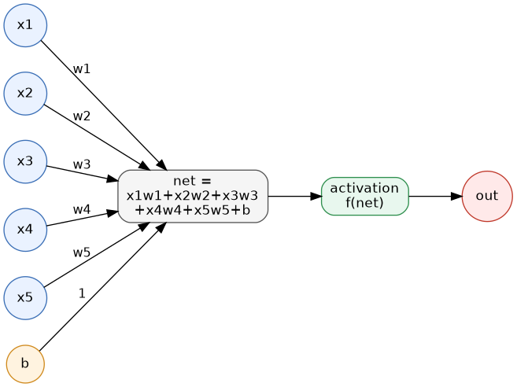

   Tek bir nöronun matematiksel modeli: girdiler ağırlıklarla çarpılıp bias ile toplanır, elde edilen ``net``
   değeri bir aktivasyon fonksiyonundan geçirilerek çıktı üretilir.

Burada bir noktaya dikkat ediniz: w değerleri ve b değeri nöronun içindedir. x değerleri ise nörona giriş olarak
uygulanmaktadır. İzleyen paragraflarda da belirteceğimiz gibi yapay sinir ağının eğitilmesi aslında nöronların
içerisindeki w değerlerinin ve b değerlerinin uygun biçimde konumlandırılması anlamına gelmektedir.

Nöronun içerisindeki işlemleri XW + b biçiminde matrisel formda da ifade edebiliriz. Burada X bir satır vektörü W
da bir sütun vektörüdür:

.. code-block:: text

                           ┌    ┐
                           │ w1 │
   ┌                     ┐ │ w2 │
   │ x1  x2  x3  ...  xn │ │ w3 │ +  b =   x1w1 + x2w2 + x3w3 + ... + xnwn + b
   └                     ┘ │....│
                           │ wn │
                           └    ┘

           (1 × n)        (n × 1)         (1 × 1)

O halde nörondaki girdinin çıktıya dönüştürülmesi işlemini matrisel biçimde şöyle de gösterebiliriz:

.. code-block:: text

   out = activation(XW + b)

Çoklu Nöron Katmanı ve Matris Gösterimi
=======================================

Şimdi ağımızda tek bir nöron değil K tane farklı nöronun bulunduğunu düşünelim. N tane girdinin de (yani Xi'lerin)
bu nöronların hepsine bağlandığını varsayalım. Her nöronun ağırlık değerleri ve bias değeri diğerlerinden
farklıdır. Dolayısıyla K tane nöronun çıktısı aşağıdaki gibi bir matrisle gösterilebilir:

.. code-block:: text

   outs = activation(XW + b)

Artık burada X 1XN boyutunda, W matrisi ise NxK boyutunda ve b matrisi de 1XK boyutundadır. Sonuç olarak buradan K
tane çıktı değeri elde edilecektir. Buradaki XW işleminin artık dot product belirtmediğine bir matris çarpımı
belirttiğine dikkat ediniz. Gösterimimizdeki X matrisi bir satır vektörü durumundadır:

.. code-block:: text

   X = [x1, x2, x3, ..., xn]

Bu matris Nx1 boyutundadır. W matrisi ise aşağıdaki görünümdedir:

.. code-block:: text

   w11  w21 w31 ... wk1
   w12  w22 w32 ... wk2
   w13  w23 w33 ... wk3
   ...  ... ... ... ...
   w1n  w2n w3n ... wkn

Bu matris de NxK boyutundadır. Buradaki X matrisi ile W matrisi matris çarpımına sokulduğunda 1XK boyutunda bir
matris elde edilecektir. Gösterimimizdeki b matrisi şöyle temsil edilebilir:

.. code-block:: text

   b = [b1, b2, b3, ...., bk]

Bu matrisin de 1XK boyutunda olduğuna dikkat ediniz. Böylece XW + b işleminden 1XK boyutunda bir matris elde
edilecektir. Tabii biz bu matris çarpımını WX + b biçiminde ters de oluşturabilirdik. Bu durumda W matrisi şöyle
olacaktır:

.. code-block:: text

   w11  w12 w13 ... w1n
   w21  w22 w23 ... w2n
   w31  w32 w33 ... w3n
   ...  ... ... ... ...
   wk1  wk2 wk3 ... wkn

Söz konusu X matrisi de şöyle olacaktır:

.. code-block:: text

   x1
   x2
   x3
   ...
   xk

Tabii bu durumda b matrisi de şöyle olacaktır:

.. code-block:: text

   b1 b2 b3 ... bk

Artık burada W matrisinin KxN boyutunda olduğuna, X ve b matrislerinin de Kx1 boyutunda olduğuna dikkat ediniz.
Genellikle XW + b gösterimi yerine WX + b gösterimi tercih edilmektedir.

Sinir Ağının Eğitilmesi
=======================

Bir sinir ağının amacı *kestirimde* bulunmaktır. Yani biz ağa girdi olarak xi değerlerini veririz. Ağdan
hedeflediğimiz çıktıyı elde etmeye çalışırız. Ancak bunu yapabilmemiz için nöronlardaki w değerlerinin ve b
değerlerinin biliniyor olması gerekir. Peki bu değerleri nasıl elde edilmektedir?

Sinir ağları *denetimli (supervised)* bir öğrenme modeli sunmaktadır. Daha önceden de belirttiğimiz gibi denetimli
öğrenmede önce sistemin mevcut verilerle eğitilmesi gerekmektedir. İşte bir sinir ağının eğitilmesi aslında
nöronlardaki w değerlerinin ve b değerlerinin uygun biçimde belirlenmesi anlamına gelmektedir. Başka bir deyişle
önce biz ağımızı mevcut verilerle eğitip bu w ve b değerlerinin uygun biçimde oluşturulmasını sağlarız. Ondan sonra
kestirim yaparız. Tabii ağ ne kadar iyi eğitilirse ağın yapacağı kestirim de o kadar isabetli olacaktır.

Örneğin biz bir dairenin fiyatını tahmin etmeye çalışalım. Bunun için öncelikle veri toplamamız gerekir. Çeşitli
daireler için şu verilerin toplandığını varsayalım:

- Dairenin büyüklüğü
- Dairenin kaçıncı katta olduğu
- Dairenin içinde bulunduğu binanın yaşı
- Dairenin yaşam alanına uzaklığı
- Dairenin ne kadar yakında metro durağı olduğu
- Dairenin içinde bulunduğu binanın otopark miktarı
- Apartman aidatı

İşte elimizdeki veri kümesinin sütunlarını (özelliklerini) bu bilgiler oluşturmaktadır. Bizim çeşitli dairelerin bu
bilgilerini elde etmiş olmamız ve onların satış fiyatlarını da biliyor olmamız gerekir. Yani bizim işin başında
sinir ağına girdi yapacağımız bilgilerle ağın vermesi gereken gerçek çıktılardan oluşan bir veri kümesine
gereksinimimiz vardır. İşte ağın eğitimi için bu veri kümesini kullanırız. Ağımızı bu gerçek verilerle eğittikten
sonra artık nöronlardaki w ve b değerleri konumlandırılmış olacaktır. Biz de kestirim yapmak istediğimizde ağımıza
dairenin yukarıdaki bilgilerini veririz. Ağımız da bize çıktı olarak o dairenin olması gereken fiyatını verir.

Eğitim sırasında tüm nöronların içerisindeki ağırlık değerlerinin ve bias değerlerinin nasıl konumlandırıldığını
merak edebilirsiniz. İşte eğitim sırasında olması gereken değerle ağın verdiği değer arasındaki fark minimize
edilmeye çalışılmaktadır. Buna sinir ağlarındaki optimizasyon işlemi denilmektedir. Optimizasyon algoritmaları
türevde zincir kuralı kullanılarak çıktıdan geriye doğru nöronların ağırlık değerlerini ve bias değerlerini
güncellemektedir. Böylece ağ eğitildikçe bu w ve bias değerleri daha iyi konumlandırılmaktadır. Bu kestirimin
iyileştirilmesi anlamına gelmektedir.

Sinir Ağı Bileşenleri Hakkında Sorular
======================================

Biz yukarıda bir sinir ağının temel çalışma mekanizmasını açıkladık. Ancak bir sinir ağını oluşturabilmek için bu
ağın bileşenleri hakkında daha fazla bilgi sahibi olmamız gerekir. Ağın bileşenleri hakkında aklımıza gelebilecek
tipik sorular şunlardır:

- Ağın nöron katmanlarının sayısı ne olmalıdır?
- Katmanlardaki nöronların sayıları ve katman bağlantıları nasıl olmalıdır?
- Nöronlarda kullanılan aktivasyon fonksiyonları nasıl olmalıdır?
- Ağdaki w ve b değerlerini oluşturmak için kullanılan optimizasyon algoritmaları nelerdir ve nasıl çalışmaktadır?

Biz de bir süreç içerisinde bu sorulara yanıtlar vereceğiz. Ancak bir noktaya dikkatinizi çekmek istiyoruz: Sinir
ağlarında önemli bir işlem yükü vardır. Buradaki işlemlerin programcılar tarafından manuel bir biçimde her
defasında yeniden (ad-hoc biçimde) yapılması çok zahmetlidir. İşte zamanla bu sinir ağı işlemlerini kendi içlerinde
yapan kütüphaneler geliştirilmiştir. Bugün artık uygulamacılar bu işlemleri programlar yazarak değil zaten bu
konuda çözüm üreten hazır kütüphaneleri kullanarak yapmaktadır.

Regresyon Kavramı ve Sınıflandırma
==================================

İstatistikte girdi değerlerinden hareketle çıktı değerinin belirlenmesine (tahmin edilmesine) yönelik süreçlere
*regresyon (regression)* denilmektedir. İstatistikte regresyon modelleri çeşitli biçimlerde
sınıflandırılabilmektedir. İstatistikte çıktıya göre regresyon modelleri tipik olarak ikiye ayrılmaktadır:

1) Sınıflandırma Amacıyla Oluşturulan Regresyon Modelleri
2) Gerçek Bir Değer Elde Etmek Amacıyla Oluşturulan Regresyon Modelleri

Her ne kadar sınıflandırma işlemi de geniş anlamda bir regresyon işlemi gibi olsa da sınıflandırma istatistiksel
yöntemlerin dışında çeşitli başka yöntemlerle de yapılabilmektedir. İstatistiksel olarak sınıflandırma işlemi
*hedefi bir olasılık fonksiyonu olan, üzerine bir karar kuralı eklenmiş* bir regresyon problemidir.

Gerçek bir değer elde etmek amacıyla oluşturulan regresyon modellerinde bir olasılık değeri değil gerçek ve sürekli
bir değer elde edilmektedir. Örneğin bir dairenin yukarıda belirttiğimiz özellikleri girdiler olabilir, dairenin
fiyatı da çıktı olabilir. Burada çıktı sürekli sayısal bir değerdir. Çıktının bir sınıf biçiminde elde edildiği
regresyon modellerinde çıktı gerçek bir değer değil sınıf ya da kategori belirten ayrık bir değerdir. Örneğin
girdiler bir resmin pixel'leri olabilir. Çıktı da bu resmin elma mı, armut mu, kayısı mı olduğuna yönelik kategorik
bir bilgi olabilir. İstatistikte bu tür sınıflandırma yapan tipik regresyon modeline *lojistik regresyon* ya da
*logit regresyonu* denilmektedir. (Lojistik regresyondaki *lojistik* sözcüğünün günlük hayatta çokça
karşılaştığımız *lojistik hizmetlerdeki* *lojistik* sözcüğü ile bir ilgisi yoktur. Buradaki *lojistik* sözcüğü
matematikteki *logaritma* sözcüğünün kısaltmasından gelmektedir.)

Makine öğrenmesinde kestirim işlemleri kabaca iki gruba ayrılmaktadır:

1) Sınıflandırma işlemleri
2) Regresyon işlemleri

Makine öğrenmesinde regresyon terimi gerçek bir değer elde etmek amacıyla oluşturulan modeller için
kullanılmaktadır.

İkili ve Çok Sınıflı Sınıflandırma
==================================

Sınıflandırma işlemlerinde çıktının olabileceği değerlere *sınıf (class)* denilmektedir. Sınıflandırma
problemlerinde eğer çıktı ancak iki değerden biri olabiliyorsa bu tür sınıflandırma problemlerine *iki sınıflı
sınıflandırma (binary classification)* problemleri denilmektedir. Örneğin bir film hakkında yazılan yorum
yazısının *olumlu* ya da *olumsuz* biçiminde iki değerden oluştuğunu düşünelim. Buradaki sınıflandırma işlemi
ikili sınıflandırma işlemidir. Benzer biçimde bir biyomedikal görüntüdeki kitlenin *iyi huylu (benign)* mu *kötü
huylu (malign)* mu olduğuna yönelik sınıflandırma da ikili sınıflandırmaya bir örnektir. Eğer sınıflandırmada
çıktı sınıflarının sayısı ikiden fazla ise böyle sınıflandırma problemlerine *çok sınıflı (multiclass)*
sınıflandırma problemleri denilmektedir. Örneğin bir resmin hangi meyveye ilişkin olduğunun tespit edilmesi için
kullanılan sınıflandırma modeli *çok sınıflı* bir modeldir.

Yukarıda da belirttiğimiz gibi istatistikte *lojistik regresyon* denildiğinde aslında default olarak *iki sınıflı
(binary)* lojistik regresyon anlaşılmaktadır. Çok sınıflı lojistik regresyonlara istatistikte genellikle İngilizce
*multiclass logistic regression* ya da *multinomial logistic regression* denilmektedir.

.. _perceptron-ve-sinir-agi-katmanlari:

=================================================================
Perceptron, Sinir Ağı Katmanları ve Yapay Sinir Ağı Kütüphaneleri
=================================================================

Perceptron ve Basit Nöron Modeli
================================

En basit yapay sinir ağı tek bir nörondan oluşan mimaridir. Buna *perceptron* denilmektedir. Perceptron'u tek
hücrelilere benzetebiliriz. Perceptron kavramı 1957-1958 yıllarında Frank Rosenblatt tarafından ortaya atılmıştır.
Perceptron'da bir tane nöron vardır. N tane girdi bu nörondaki w değerleriyle dot product yapılıp bias değeri ile
toplanarak aktivasyon fonksiyonuna sokulur. Bu durumu şekilsel olarak şöyle gösterebiliriz:

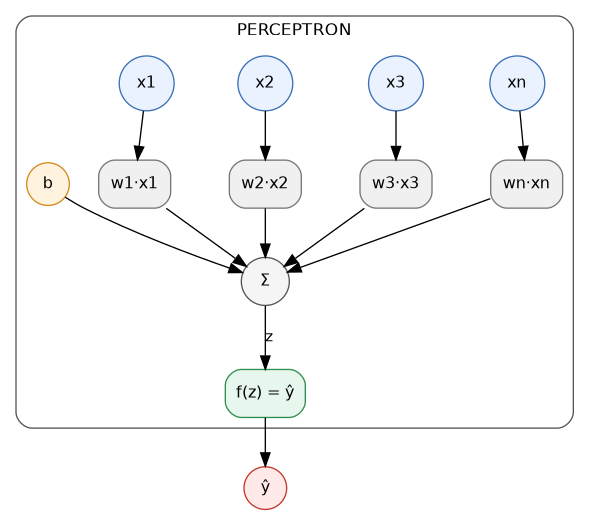

   Tek nöronlu perceptron modeli: her girdi kendi ağırlığıyla çarpılır, toplam bias ile birleştirilip aktivasyon
   fonksiyonundan (f(z)) geçirilerek çıktı (ŷ) elde edilir.

Yalnızca tek nörondan oluşan perceptron *doğrusal olarak ayrıştırılabilen (linearly separable)* ikili
sınıflandırma problemlerine ya da yalın çoklu regresyon problemlerine uygulanabilmektedir. Her ne kadar tek bir
nöron bile bazı problemleri çözebiliyorsa da problemler karmaşıklaştıkça ağdaki nöron sayılarının ve katmanların
artırılması gerekmektedir.

Aslında aktivasyon fonksiyonunun *sigmoid* olduğu, optimizasyon için kullanılan kayıp (loss) fonksiyonunun
*binary-cross-entropy* olduğu perceptron tamamen istatistikteki lojistik regresyonla aynı anlama gelmektedir.
Benzer biçimde aktivasyon fonksiyonun doğrusal (linear) olduğu, kayıp fonksiyonun da *mean-squared-error* olduğu
perceptron da çoklu doğrusal regresyonla aynı anlama gelmektedir. Görüldüğü gibi perceptron lojistik regresyon ve
çoklu doğrusal regresyon işlemlerini yapabilmektedir.

Aşağıda bir nöronun bir sınıfla temsil edilmesine ilişkin bir örnek veriyoruz.

.. code-block:: python

   import numpy as np

   class Neuron:
       def __init__(self, ninputs):
           self.ninputs = ninputs
           self.activation = Neuron.sigmoid

       def set_weights(self, weights, b, activation=None):
           if self.ninputs != len(weights):
               raise ValueError('invalid weights!..')
           self.weights = weights
           self.b = b
           if activation:
               self.activation = activation

       def output(self, x):
           if self.ninputs != len(x):
               raise ValueError('invalid inputs')
           return self.activation(np.dot(self.weights, x) + self.b)

       @staticmethod
       def sigmoid(x):
           return 1 / (1 + np.e ** x)

   # test

   n = Neuron(5)
   n.set_weights(np.array([1, 2, 3, 4, 5]), 1)
   result = n.output(np.array([1, 2, 3, 4, 5]))
   print(result)

Çok Nöronlu Ağlarda Bağlantılar: Yoğun ve Seyrek Bağlantı
=========================================================

Peki bir sinir ağında birden fazla nöron olduğunda bunların arasındaki bağlantı nasıl olacaktır? Örneğin ağımızda
bir değil üç nöron olsun ve 4 tane de girdi olsun. Bu durumda girdiler bu dört girdi üç nörona da bağlanacaktır. Bu
üç nörondan üç ayrı çıkış elde edilecektir:

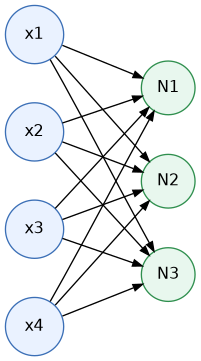

   Dört girdinin üç nörona (N1, N2, N3) yoğun (dense) biçimde bağlanması: her girdi, her nörona bağlıdır.

Bir nöronun çıktısının sonraki katmandaki tüm nöronlara girdi yapılması ile oluşturulan bağlantıya *yoğun bağlantı
(dense connection)* denilmektedir. Sinir ağlarında genellikle yoğun bağlantı kullanılmaktadır. Yukarıdaki sinir
ağında üç ayrı çıkış vardır. Biz tek bir çıkış istiyorsak bu çıkışları da başka bir nörona girdi yaparız:

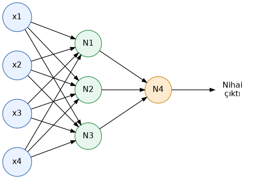

   N1, N2 ve N3 nöronlarının çıktıları, tek bir nihai çıktı üretmek üzere N4 nöronuna bağlanmıştır.

Yoğun bağlantı yerine önceki nöronun çıktısı sonraki her nörona değil bazı nöronlara bağlanması da söz konusu
olabilmektedir. Bu tür bağlantılara *seyrek bağlantı (sparse connection)* da denilmektedir. Seyrek bağlantı çeşitli
amaçlarla kullanılabilmektedir. Sonraki nöronun çıktısının önceki nöronlara bağlanması da ilginç bir durumdur. Buna
sinir ağlarında *özyinelemeli sinir ağları (recurrent neural networks (RNN))* da denilmektedir. Özyinelemeli terim
yerine *geri beslemeli (feed backward)* terimi de kullanılabilmektedir.

Model Parametre Sayısı ve Güncel LLM Modellerinin Büyüklükleri
==============================================================

Yukarıdaki 4 girişe ve 4 nörona sahip ağda eğitim sırasında konumlandırılması gereken toplam kaç ağırlık değeri ve
bias değeri vardır? N1, N2 ve N3 nöronlarının 4'er girdisi vardır. N4 nöronunun ise 3 girdisi vardır. Bu nöronların
hepsinin ayrıca bir bias değeri de bulunmaktadır. O halde konumlandırılması gereken toplam ağırlıkların sayısı
(burada ağırlık demekle bias değerlerini de dahil ediyoruz) 4 * 3 + 3 + 3 + 1 = 19 biçimindedir. Bir sinir ağında
eğitim sonucunda konumlandırılması gereken ağırlık değerlerinin sayısına (bias değerleri de bu bağlamda ağırlık
değeri olarak ele alıyoruz) modelin *parametre sayısı* denilmektedir. Bugün kullandığımız LLM modellerindeki
parametre sayısı modelden modele değişebilmektedir. Aşağıda bazı LLM modellerinin parametre sayılarını veriyoruz:

.. list-table::
   :header-rows: 1

   * - Model (kapalı)
     - Toplam (tahmin)
   * - GPT-5.x (flagship)
     - ~1-3 trilyon
   * - GPT-5.x mini/nano
     - ~10-100 milyar
   * - Claude Opus 5
     - ~2-5 trilyon
   * - Claude Sonnet sınıfı
     - ~300 milyar-1 trilyon
   * - Claude Haiku sınıfı
     - ~20-70 milyar
   * - Gemini 3 Pro/Ultra
     - ~1-3 trilyon
   * - Gemini 3 Flash/Lite
     - ~20-100 milyar
   * - Grok 4 / 5
     - ~2-3 trilyon

Sinir Ağı Katmanları: Girdi, Saklı ve Çıktı Katmanları
======================================================

Gelişmiş sinir ağları çok sayıda nöronun bulunduğu katmanlardan (layers) oluşmaktadır. Katman aynı düzeydeki nöron
grubu için kullanılan bir kavramdır. Yapay sinir ağlarında katmanlar tipik olarak üçe ayrılmaktadır:

1) Girdi Katmanı (Input Layer)
2) Saklı Katmanlar (Hidden Layers)
3) Çıktı Katmanı (Output Layer)

Girdi katmanı ağa uygulanacak verileri temsil eden katmandır. Aslında girdi katmanı gerçek anlamda nöronlardan
oluşmaz. Ancak anlatımları kolaylaştırmak için bu katmanın da nöronlardan oluştuğu varsayılmaktadır. Başka bir
deyişle girdi katmanındaki nöronların tek bir girdisi ve tek bir çıktısı vardır. Bunların w değerleri 1, bias
değerleri 0'dır. Aktivasyon fonksiyonları ise f(x) = x biçimindedir. Yani girdi katmanı bir şey yapmaz, girdiyi
değiştirmeden çıktıya verir. Yukarıda da belirttiğimiz gibi girdi katmanı gerçek bir katman değildir. Girdileri
temsil etmektedir. Girdi katmanındaki nöron sayısı tablo biçimindeki (tabular) veri kümesindeki sütunların (yani
özelliklerin) sayısı kadar olmalıdır. Örneğin 5 tane özelliğe (feature) sahip olan bir veri kümesine ilişkin sinir
ağının girdi katmanı şöyle ifade edilebilir:

.. code-block:: text

   x1 ---> O --->
   x2 ---> O --->
   x3 ---> O --->
   x4 ---> O --->
   x5 ---> O --->

Buradaki O sembolleri girdi katmanındaki nöronları temsil etmektedir. Girdi katmanındaki nöronların 1 tane
girdisinin, 1 tane de çıktısının olduğuna dikkat ediniz. Buradaki nöronlar girdiyi değiştirmediğine göre bunların w
değerleri 1, b değerleri 0, aktivasyon fonksiyonu da f(x) = x gibi düşünülebilir.

Örneğin zambakların çeşitli özelliklerini ve bunların türlerini barındıran *iris* veri kümesindeki sütunlar
şöyledir:

.. list-table::
   :header-rows: 1

   * - sepal_length
     - sepal_width
     - petal_length
     - petal_width
     - species
   * - 5.1
     - 3.5
     - 1.4
     - 0.2
     - setosa
   * - 4.9
     - 3.0
     - 1.4
     - 0.2
     - setosa
   * - 4.7
     - 3.2
     - 1.3
     - 0.2
     - setosa
   * - 4.6
     - 3.1
     - 1.5
     - 0.2
     - setosa
   * - 5.0
     - 3.6
     - 1.4
     - 0.2
     - setosa
   * - ...
     - ...
     - ...
     - ...
     - ...

Burada species sütunu zambağın türünü belirtmektedir. Bu veri kümesinden amaç dört özelliği girilen bir zambağın
türünün tespit edilmesidir. İşte bu veri kümesi için oluşturulacak sinir ağının girdi katmanında 4 nöron
bulunmaktadır:

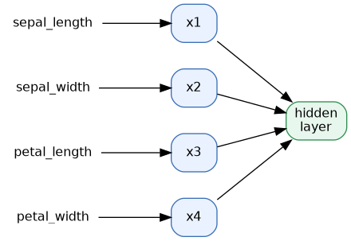

   Iris veri kümesinin dört özelliği (sepal_length, sepal_width, petal_length, petal_width) girdi katmanındaki
   dört nörona (x1-x4) bağlanır ve buradan saklı katmana iletilir.

Eğitim sırasında her satır girdi olarak uygulanmaktadır.

Girdiler (yani girdi katmanının çıktıları) saklı katman (hidden layer) denilen katmanlardaki nöronlara bağlanırlar.
Modelde sıfır tane, bir tane, iki tane ya da ikiden fazla saklı katman bulunabilir. Saklı katmanların sayısı ve
saklı katmanlardaki nöronların sayısı ve bağlantı biçimleri problemin niteliğine göre değişebilmektedir. Yani saklı
katmanlardaki nöronların girdi katmanıyla aynı sayıda olması gerekmez. Her saklı katmandaki nöron sayıları aynı
olmak zorunda da değildir. Genel olarak sinir ağı modelinde saklı katmanların sayısı 2'den fazla ise bu tür
modellere *derin sinir ağı (deep neural network)*, bu tür ağların bulunduğu modellere ilişkin konuya da genel
olarak *derin öğrenme (deep learning)* denilmektedir.

Çıktı katmanı bizim sonucu alacağımız katmandır. Çıktı katmanındaki nöron sayısı bizim kestirmeye çalıştığımız
olgularla ilgilidir. Örneğin biz bir evin fiyatını kestirmeye çalışıyorsak çıktı katmanında tek bir nöron bulunur.
Yine örneğin biz ikili sınıflandırma problemi üzerinde çalışıyorsak çıktı katmanı yine tek bir nörondan oluşabilir.
Ancak biz evin fiyatının yanı sıra evin sağlamlığını da kestirmek istiyorsak bu durumda çıktı katmanında iki nöron
olacaktır. Benzer biçimde çok sınıflı sınıflandırma problemlerinde genel olarak çıktı katmanlarında sınıf sayısı
kadar nöron bulunur.

Bir yapay sinir ağındaki katmanların sayısı belirtilirken bazıları girdi katmanını bu sayıya dahil ederken,
bazıları etmemektedir. Bu nedenle katman sayılarını konuşurken yalnızca saklı katmanları belirtmek bu bakımdan iki
anlamlılığı giderebilmektedir. Örneğin biz *modelimizde 5 katman var* dediğimizde birisi bu 5 katmanın içerisinde
girdi katmanı dahil mi diye tereddütte kalabilir. O halde iki anlamlılığı ortadan kaldırmak için *modelimizde 3
saklı katman var* gibi bir ifade daha uygun olacaktır.

Katman ve Nöron Sayısının Model Başarısına Etkisi
=================================================

Bir yapay sinir ağı modelinde katman sayısının artırılması daha iyi bir sonucun elde edileceği anlamına gelmez.
Benzer biçimde katmanlardaki nöron sayılarının artırılması da daha iyi bir sonucun elde edileceği anlamına
gelmemektedir. Katmanların sayısından ziyade onların işlevleri daha önemli olmaktadır. Ağa gereksiz katman eklemek,
katmanlardaki nöronları artırmak tam ters bir biçimde ağın kestirim başarısının düşmesine de yol açabilir. Yani
gerekmediği halde ağa saklı katman eklemek, katmanlardaki nöron sayılarını artırmak bir fayda sağlamamakta tersine
kestirim başarısını düşürebilmektedir. Ancak görüntü tanıma gibi, yazı anlamlandırma gibi, üretici yapay zeka
uygulamaları gibi özel ve zor problemlerde saklı katman sayılarının artırılması gerekmektedir.

Saklı Katman Sayısı İçin Pratik Öneriler
========================================

Peki bir sinir ağı modelinde kaç tane saklı katman olmalıdır? Bu sorunun matematiksel derinliği vardır. Ancak
pratik olarak şunları söyleyebiliriz:

- Sıfır tane saklı katmana sahip tek bir nörondan oluşan en basit modele *perceptron* dendiğini belirtmiştik. Bu
  perceptron *doğrusal olarak ayrıştırılabilen (linearly separable)* sınıflandırma problemlerini ve karmaşık
  olmayan çoklu doğrusal regresyon problemlerini çözebilmektedir. Doğrusal olarak ayrıştırılabilirlik kursumuzda
  başka bir bölümde ele alınmaktadır.

- Tek saklı katmanlı modeller aslında pek çok sınıflandırma problemini ve regresyon problemini belli bir
  yeterlilikte çözebilmektedir. Ancak tek saklı katman yine de bu tarz bazı problemler için yetersiz kalabilmektedir.

- İki saklı katman pek çok sınıflandırma problemi için ve regresyon problemi için yeterli bir modeldir. Bu nedenle
  karmaşık olmayan problemler için ilk akla gelecek model iki saklı katmanlı modeldir.

- İkiden fazla saklı katmana sahip olan modeller karmaşık ve özel problemleri çözmek için kullanılmaktadır. İki
  saklı katmandan fazla katmana sahip olan sinir ağlarına genel olarak *derin öğrenme ağları (deep learning
  networks)* denildiğini anımsayınız.

Yukarıda da belirttiğimiz gibi *derin öğrenme (deep learning)* farklı bir yöntemi belirtmemektedir. Derin öğrenme
özel ve karmaşık problemleri çözebilmek için ikiden fazla saklı katman içeren sinir ağı modellerini belirtmek için
kullanılan bir terimdir.

Henüz anlamlandıramasak da tek saklı katmanlı ve iki saklı katmanlı sinir ağlarının hangi tür problemleri hangi
düzeyde çözebildiğine ilişkin aşağıda bir tablo veriyoruz:

.. list-table::
   :header-rows: 1

   * - Problem türü
     - Tek saklı katman
     - İki saklı katman
   * - Sürekli, düzgün regresyon
     - Yeterli
     - Yeterli (gereksiz)
   * - Köşeli ama sürekli fonksiyon (\|x\|)
     - Yeterli
     - Yeterli
   * - Süreksiz (sıçramalı) fonksiyon
     - Kaba taklit, verimsiz
     - Verimli yaklaşım
   * - Bağlantılı, dışbükey karar bölgesi
     - Yeterli
     - Yeterli
   * - Dışbükey olmayan tek bölge
     - Kabaca yapar
     - Verimli
   * - Kopuk karar bölgeleri
     - Verimsiz
     - Verimli
   * - XOR ve küçük mantık
     - Yeterli
     - Yeterli
   * - Az boyutlu tablo verisi
     - Genellikle yeterli
     - Bazen daha iyi
   * - Orta/büyük tablo verisi
     - Yetersiz kalabilir
     - Genellikle yeterli
   * - Ham görüntü / ses / metin
     - Yetersiz
     - Yetersiz, derin ağ
   * - Uzun sıralı bağımlılık
     - Yetersiz
     - Yetersiz, derin ağ

Saklı Katmanlardaki Nöron Sayısı İçin Pratik Kurallar
=====================================================

Peki katmanlardaki nöron sayıları nasıl olmalıdır? Girdi katmanındaki nöron sayısı zaten problemin içerisinde
belirlenmiş durumdadır. Örneğin zambakların 4 özelliğinden onların türlerinin tespit edilmesi probleminde bir
modelde girdi katmanında dört nöron bulunacaktır. Ya da örneğin bir dairenin 10 farklı özelliğinden hareketle onun
fiyatının tahmin edilmesi probleminde girdi katmanında 10 nöron bulunacaktır. Çıktı katmanındaki nöron sayıları ise
yine problemin içerisinde kendini belli etmektedir. İkili sınıflandırma (binary classification) problemlerinde
çıktı katmanı tek nörondan, çoklu sınıflandırma problemlerinde (multiclass classification) çıktı katmanı sınıf
sayısı kadar nörondan oluşur. Çok değişkenli olmayan regresyon problemlerinde çıktı katmanındaki nöron sayıları bir
tane, çok değişkenli regresyon problemlerinde değişken sayısı kadar olmaktadır.

Saklı katmanlardaki nöron sayıları için çok pratik şeyler söylemek zordur. Çünkü saklı katmanlardaki nöron sayıları
bazı faktörlere de bağlı olarak ayarlanabilmektedir. Örneğin eğitimde kullanılacak veri miktarı, problemin
karmaşıklığı, hyper parametrelerin durumları saklı katmanlardaki nöron sayıları üzerinde etkili olabilmektedir.
Saklı katmanlardaki nöron sayıları için pratik bir biçimde şunlar söylenebilir:

- Problem karmaşıklaştıkça saklı katmanlardaki nöron sayılarını artırmak uygun olabilmektedir.
- Saklı katmanlarda çok az nöron bulundurmak *underfitting* yani yetersiz öğrenmeye yol açabilmektedir.
- Saklı katmanlarda gereksiz biçimde fazla sayıda nöron bulundurmak eğitim süresini uzatabileceği gibi
  *overfitting* durumuna da yol açabilir. Aynı zamanda modelin diskte saklanması için gereken disk alanını da
  artırabilmektedir.
- Eğitim veri kümesi azsa saklı katmanlardaki nöron sayıları düşürülebilir, fazlaysa yükseltilebilir.
- Pek çok problemde saklı katmanlardaki nöron sayıları çok fazla ya da çok az olmadıktan sonra önemli olmayabilir.
- Saklı katmanlardaki nöron sayısı girdi katmanındaki nöron sayısından az olmamalıdır.

Çeşitli kaynaklar saklı katmanlardaki nöronların sayıları için üstünkörü şu pratik tavsiyelerde bulunmaktadır:

- Saklı katmanlardaki nöronların sayıları girdi katmanındaki nöronların sayılarının 2/3'ü ile çıktı katmanındaki
  nöronların sayısının toplamı kadar olabilir. Örneğin girdi katmanındaki nöron sayısı 5, çıktı katmanındaki 1
  olsun. Bu durumda saklı katmandaki nöron sayısı 4 ya da 5 olabilir.

- Saklı katmandaki nöronların sayısı girdi katmanındaki nöron sayısının iki katından fazla olmamalıdır.

Bu konudaki literatürün özetini aşağıda bir tablo halinde veriyoruz:

.. list-table::
   :header-rows: 1

   * - Kural
     - Mantığı
   * - N_h, N_i ile N_o arasında olmalı
     - Saklı katman girişi çıkışa doğru *süzer*
   * - N_h ~ (2/3)*N_i + N_o
     - Girişten biraz küçük bir ara temsil
   * - N_h < 2*N_i
     - Aşırı uyuma karşı kaba bir üst sınır
   * - N_h ~ sqrt(N_i*N_o)
     - Geometrik piramit kuralı (Masters, 1993)
   * - N_h ~ N_s / (α*(N_i + N_o)), α = 2..10
     - Parametre sayısını örnek sayısına bağlar

Burada N_h: saklı katmandaki nöronların sayısını, N_i: girdi katmanındaki nöronların sayısını, N_o: çıktı
katmanındaki nöronların sayısını, N_s ise eğitimde kullanılacak örneklerin sayısını belirtmektedir. α
uygulamacının belirleyeceği bir değeri temsil etmektedir.

Burada son satırdaki pratik kurala dikkat ediniz. Diğer satırlardan farklı olarak bu son satırda eğitimde
kullanılacak örnek sayısı da hesaba katılmıştır. Örneğin bu formüle göre girdi katmanında 10 nöron olan, çıktı
katmanında 1 nöron olan, örnek sayısının da 1000 olduğu çeşitli α değerleri için ara katmanlardaki nöron sayısı
şöyle olacaktır:

.. list-table::
   :header-rows: 1

   * - alpha
     - N_h
   * - 2
     - 45
   * - 3
     - 30
   * - 4
     - 23
   * - 5
     - 18
   * - 6
     - 15
   * - 7
     - 13
   * - 8
     - 11
   * - 9
     - 10
   * - 10
     - 9

Burada α değeri küçültüldükçe nöron sayılarının arttığı görülmektedir. Bu değerler için tablonun ilk dört
satırındaki nöron değerleri de şöyledir:

.. list-table::
   :header-rows: 1

   * - Kural
     - N_h
   * - N_h, N_i ile N_o arasında olmalı
     - 1..10
   * - N_h ~ (2/3)*N_i + N_o
     - 8 (7.67)
   * - N_h < 2*N_i
     - <= 19
   * - N_h ~ sqrt(N_i*N_o)
     - 3 (3.16)

Ancak yukarıda da belirttiğimiz gibi çok abartılı olmadığı sürece ve yeterli eğitim verisinin bulunduğu durumda
saklı katmanlardaki nöron sayılarının kestirim üzerindeki etkisi önemli bir boyutta olmamaktadır.

Özetle eğer saklı katmanlardaki nöron sayısını bir formüle dayandırmak istiyorsanız tablodaki son formülü
kullanabilirsiniz:

.. code-block:: text

   N_h ~ N_s / (α*(N_i + N_o)), α = 2..10

Ancak bu formülde örnek sayısı arttıkça nöron sayısı artmaktadır. Siz belli bir üst sınır da uygulayabilirsiniz.

Katmanlardaki Nöron Dağılım Biçimleri
=====================================

Birden fazla saklı katman kullanıldığında, katmanlardaki nöron sayıları aynı olmak zorunda değildir.
Katmanlardaki nöron sayılarının nasıl değişeceği de bir tasarım kararıdır. Yaygın dört biçim şunlardır:

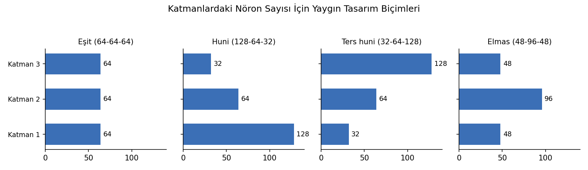

   Katmanlardaki nöron sayısı için dört yaygın tasarım biçimi: eşit genişlik, huni (piramit), ters huni ve elmas.

Eşit genişlik: En basit tasarımdır. Bengio (2012), kendi deneylerinde tüm katmanları aynı genişlikte tutmanın
genellikle azalan ya da artan genişlikler kadar ya da onlardan daha iyi sonuç verdiğini bildirmiştir.

Huni (piramit): Her katman bir öncekinin yarısıdır. En yaygın alışkanlıktır. Arkasındaki sezgi, ağın ham girdiden
başlayarak giderek daha soyut ve daha kompakt temsiller kurmasıdır.

Ters huni: Huninin tersine nöron sayıları sonraki katmanlarda artırılır. MLP'de seyrek kullanılır.

Elmas: Önce nöron sayıları artar, sonra azalır. Girdiyi önce daha yüksek boyutlu bir uzaya taşıyıp orada doğrusal
olmayan işlem yapmak, sonra sıkıştırmak fikrine dayanır. Transformer'lardaki ileri beslemeli bloğun (d → 4d → d)
yapısı buna benzemektedir.

Biz genellikle tipik problemlerde iki saklı katman ve katmanlarda da 16, 32, 64, 100, 128 gibi sayılarda nöron
kullanacağız. Ancak ileride özel mimarilerde bu durumu farklılaştıracağız.

Yapay Sinir Ağı Kütüphaneleri: TensorFlow, Keras ve PyTorch
===========================================================

Yapay sinir ağlarında çalışmak için *alçak seviyeli* ve *yüksek seviyeli* kütüphaneler ve framework'ler
bulunmaktadır. Aşağı seviyeli iki önemli framework şunlardır: TensorFlow ve PyTorch. Yüksek seviyeli kütüphane
olarak en fazla Keras tercih edilmektedir. Keras eskiden bağımsız bir kütüphaneydi ve kendi içinde TensorFlow,
Theano, Microsoft Cognitive Toolkit, PlaidML gibi kütüphaneleri *arkayüz (backend)* olarak kullanabiliyordu. Ancak
daha sonraları Keras, TensorFlow 2.0 ile birlikte TensorFlow bünyesine katılmıştır. TensorFlow 2.0 ile birlikte
``tf.keras`` TensorFlow'un resmi yüksek seviyeli kütüphanesi haline gelmiştir. (2023'te yayımlanan Keras 3 ile
Keras yeniden bağımsız ve çoklu arkayüze (backend) sahip bir kütüphane haline geldi. TensorFlow, JAX ve PyTorch
üzerinde çalışabilmektedir. TensorFlow 2.16'dan itibaren ``tf.keras`` da Keras 3'ü kullanmaktadır.)

TensorFlow şöyle yüklenebilir:

.. code-block:: bash

   pip install tensorflow

TensorFlow çok thread'li ve paralel işlem yapan bir kütüphanedir. Paralel işlemler sırasında grafik kartının
olanaklarını da kullanmaktadır. GPU desteği resmi olarak NVIDIA kartlar için sağlanmaktadır. TensorFlow'un NVIDIA
GPU'yu kullanabilmesi için NVIDIA sürücüsü, CUDA Toolkit ve cuDNN kütüphanesinin bulunması gerekir. Bunlar yoksa
TensorFlow yalnızca CPU ile çalışır; GPU'suz eğitim süreleri büyük ağlarda on kata kadar uzayabilmektedir.

TensorFlow 2.10'dan sonraki sürümler Windows üzerinde doğrudan GPU desteği vermemektedir. Linux'ta yalnızca NVIDIA
sürücüsünün kurulması yeterlidir. Windows'ta GPU desteği için Linux ortamının kurulması (örneğin WSL2)
gerekebilmektedir. ARM tabanlı Apple işlemcilerinin kullanıldığı bilgisayarlarda GPU hızlandırması
tensorflow-metal eklentisiyle sağlanmaktadır.

PyTorch aşağıdaki gibi yüklenebilir:

.. code-block:: bash

   pip install torch

Ancak PyTorch'ta bazı paketlerin ayrıca kurulması gerekmektedir. Örneğin torchvision ve torchaudio paketleriyle
birlikte yüklemeyi şöyle yapabilirsiniz:

.. code-block:: bash

   pip install torch torchvision torchaudio

PyTorch'un GPU kullanması daha sorunsuzdur. Aşağıdaki tabloda PyTorch'un desteklediği GPU donanımları
listelenmiştir:

.. list-table::
   :header-rows: 1

   * - Backend
     - Platform
     - Device
   * - CUDA (NVIDIA)
     - Linux, Windows
     - ``'cuda'``
   * - ROCm (AMD)
     - Linux, Windows (\*)
     - ``'cuda'`` (HIP)
   * - MPS (Apple)
     - macOS
     - ``'mps'``
   * - XPU (Intel)
     - Linux, Windows
     - ``'xpu'``
   * - CPU
     - Hepsi
     - ``'cpu'``

Veri Kümesinin Eğitim ve Test Olarak Ayrılması: Diyabet Veri Kümesi Örneği
==========================================================================

Bir veri kümesini CSV dosyasından okuduktan sonra onu Keras'ın kullanımına hazırlamak için bazı işlemlerin
yapılması gerekir. Yapılması gereken ilk işlem veri kümesinin *dataset_x* ve *dataset_y* biçiminde iki parçaya
ayrılmasıdır. Çünkü ağın eğitilmesi sırasında girdilerle çıktıların ayrıştırılması gerekmektedir. Burada
*dataset_x* girdileri *dataset_y* ise kestirilecek çıktıları belirtmektedir.

Eğitim bittikten sonra genellikle ağın kestirimine hangi ölçüde güvenileceğini belirleyebilmek için bir test
işlemi yapılır. Test işleminin eğitimde kullanılmamış olan bir test veri kümesi ile yapılması gerekir. (Örneğin bir
sınavda yalnızca sınıfta çözülen sorular sorulursa test işleminin gücü düşecektir.) O halde bizim ana veri kümesini
*eğitim veri kümesi* ve *test veri kümesi* biçiminde iki kısma ayırmamız gerekir. Oranlar çeşitli koşullara göre
değişebilirse de tipik olarak %80'lik verinin eğitim için %20'lik verinin test için kullanılması tercih
edilmektedir.

Eğitim ve test veri kümesini manuel olarak ayırabiliriz. Ancak ayırma işleminden önce veri kümesini satırsal
bakımdan karıştırmak uygun olur. Çünkü bazı veri kümeleri CSV dosyasına karışık bir biçimde değil yanlı bir
biçimde kodlanmış olabilmektedir. Örneğin bazı veri kümeleri bazı alanlara göre sıraya dizilmiş bir biçimde
bulunabilmektedir. Biz onun baştaki belli kısmını eğitim, sondaki belli kısmını test veri kümesi olarak
kullanırsak eğitim ve test veri kümeleri yanlı hale gelebilmektedir.

Biz programlarımızda genellikle bir veri kümesinin tamamı için *dataset* ismini, onun girdi kısmı için
*dataset_x* ismini, çıktı kısmı için *dataset_y* ismini kullanacağız. Veri kümesini eğitim ve test olarak
ayırdığımızda da isimleri şu biçimde vereceğiz: *training_dataset_x*, *training_dataset_y*, *test_dataset_x*,
*test_dataset_y*.

Aşağıda bir kişinin çeşitli biyomedikal bilgilerinden hareketle onun şeker hastası olup olmadığını anlamaya
yönelik bir veri kümesinin manuel ayrıştırılması örneği verilmiştir. Veri kümesini
`Kaggle üzerindeki bu bağlantıdan <https://www.kaggle.com/datasets/uciml/pima-indians-diabetes-database>`_
indirebilirsiniz.

Veri kümesinin görünümü şöyledir:

.. code-block:: text

   Pregnancies,Glucose,BloodPressure,SkinThickness,Insulin,BMI,DiabetesPedigreeFunction,Age,Outcome
   6,148,72,35,0,33.6,0.627,50,1
   1,85,66,29,0,26.6,0.351,31,0
   8,183,64,0,0,23.3,0.672,32,1
   1,89,66,23,94,28.1,0.167,21,0
   0,137,40,35,168,43.1,2.288,33,1
   5,116,74,0,0,25.6,0.201,30,0

Bu veri kümesinde bazı sütunlar eksik veri içermektedir. Bu eksik veriler NaN biçiminde değil 0 biçiminde
kodlanmıştır. Biz bu eksik verileri ortalama değerle doldurabiliriz. Eksik veri içeren sütunlar şunlardır:

- Glucose
- BloodPressure
- SkinThickness
- Insulin
- BMI

.. code-block:: python

   TRAINING_RATIO = 0.80

   import pandas as pd

   df = pd.read_csv('diabetes.csv')

   from sklearn.impute import SimpleImputer

   si = SimpleImputer(strategy='mean', missing_values=0)

   impute_features = ['Glucose', 'BloodPressure', 'SkinThickness', 'Insulin', 'BMI']
   df[impute_features] = si.fit_transform(df[impute_features])

   dataset = df.to_numpy()

   import numpy as np

   np.random.shuffle(dataset)

   dataset_x = dataset[:, :-1]
   dataset_y = dataset[:, -1]

   training_len = int(np.round(len(dataset_x) * TRAINING_RATIO))

   training_dataset_x = dataset_x[:training_len]
   test_dataset_x = dataset_x[training_len:]

   training_dataset_y = dataset_y[:training_len]
   test_dataset_y = dataset_y[training_len:]

.. _keras-ile-model-olusturma:

===================================================================
train_test_split Fonksiyonu ve Keras ile Sinir Ağı Modeli Oluşturma
===================================================================

train_test_split Fonksiyonu ile Veri Kümesinin Ayrılması
========================================================

Veri kümesini eğitim ve test olarak ayırma işlemi için ``sklearn.model_selection`` modülündeki
``train_test_split`` isimli fonksiyon sıkça kullanılmaktadır. Biz de programlarımızda çoğu zaman bu fonksiyonu
kullanacağız. Fonksiyon NumPy dizilerini ya da Pandas DataFrame ve Series nesnelerini ayırabilmektedir. Fonksiyon
bizden ``dataset_x`` ve ``dataset_y`` değerlerini ayrı ayrı ister. ``test_size`` ya da ``train_size`` parametreleri
0 ile 1 arasında test ya da eğitim verilerinin oranını belirlemek için kullanılmaktadır. ``train_test_split``
fonksiyonu bize 4'lü bir liste vermektedir. Listenin elemanları sırasıyla şunlardır: *training_dataset_x*,
*test_dataset_x*, *training_dataset_y*, *test_dataset_y*. Örneğin:

.. code-block:: python

   training_dataset_x, test_dataset_x, training_dataset_y, test_dataset_y = train_test_split(dataset_x, dataset_y,
                                                                                               test_size=0.2)

Aslında fonksiyonun ``train_size`` ve ``test_size`` parametreleri float yerine int olarak da girilebilir. Bu
parametreler için int türden değer verilirse bu int değer eğitim ve test veri kümesinin sayısını belirtmektedir.
Ancak genellikle uygulamacılar bu parametreler için oransal değerler vermeyi tercih etmektedir.

``train_test_split`` fonksiyonu veri kümesini bölmeden önce karıştırma işlemini de yapmaktadır. Fonksiyonun
``shuffle`` parametresi ``False`` yapılırsa fonksiyon karıştırma yapmadan bölme işlemini yapar.

.. code-block:: python

   training_dataset_x, test_dataset_x, training_dataset_y, test_dataset_y = train_test_split(dataset_x, dataset_y,
                                                                                               test_size=0.2)

Burada fonksiyona ``dataset_x`` ve ``dataset_y`` girdi olarak verilmiştir. Fonksiyon bunları bölerek dörtlü bir
listeye geri dönmüştür.

.. code-block:: python

   import pandas as pd

   df = pd.read_csv('diabetes.csv')

   from sklearn.impute import SimpleImputer

   si = SimpleImputer(strategy='mean', missing_values=0)

   impute_features = ['Glucose', 'BloodPressure', 'SkinThickness', 'Insulin', 'BMI']
   df[impute_features] = si.fit_transform(df[impute_features])

   dataset = df.to_numpy()

   dataset_x = dataset[:, :-1]
   dataset_y = dataset[:, -1]

   from sklearn.model_selection import train_test_split

   training_dataset_x, test_dataset_x, training_dataset_y, test_dataset_y = train_test_split(dataset_x, dataset_y,
                                                                                               test_size=0.2)

train_test_split Fonksiyonunun DataFrame ve Series Nesneleriyle Kullanımı
=========================================================================

``train_test_split`` fonksiyonu ile biz doğrudan Pandas DataFrame ve Series nesneleri üzerinde de bölme işlemini
yapabiliriz. Bu durumda fonksiyon bize dörtlü listeyi DataFrame ve Series nesneleri biçiminde verecektir. Aşağıda
bu biçimde bölmeye bir örnek verilmiştir.

.. code-block:: python

   import pandas as pd

   df = pd.read_csv('diabetes.csv')

   dataset_x = df.iloc[:, :-1]
   dataset_y = df.iloc[:, -1]

   from sklearn.model_selection import train_test_split

   training_dataset_x, test_dataset_x, training_dataset_y, test_dataset_y = train_test_split(dataset_x, dataset_y,
                                                                                               test_size=0.2)

train_test_split Fonksiyonuna Birden Fazla Veri Kümesi Verilmesi
================================================================

Aslında ``train_test_split`` fonksiyonuna parametre olarak bir ya da birden fazla veri kümesi girilebilmektedir.
Fonksiyon bunların hepsini karşılıklı olarak aynı satırlardan eğitim ve test veri kümesi biçiminde ikiye
ayırmaktadır. Biz fonksiyona k tane parametre girdiğimizde fonksiyon bize k * 2 elemanlık bir liste vermektedir.
Örneğin:

.. code-block:: python

   splitted_datasets = train_test_split(dataset_x, dataset_y, dataset_z, test_size=0.2)

Burada ``splitted_datasets`` listesi toplam 6 elemana sahip olacaktır. Bu 6 elemanın ilk ikisi ``dataset_x``'in
bölünmüş halini, sonraki ikisi ``dataset_y``'nin bölünmüş halini, sonraki ikisi ise ``dataset_z``'nin bölünmüş
halini içerecektir. Biz ``train_test_split`` fonksiyonuna tek bir veri kümesini de verebiliriz. Bu durumda
fonksiyon bunu da eğitim ve test olmak üzere iki parçaya ayıracaktır. Örneğin:

.. code-block:: python

   training_df, test_df = train_test_split(df, test_size=0.2)

Burada fonksiyon iki elemanlı bir listeye geri dönmüştür. Biz de onu açarak iki değişkene atamış olduk.

Keras'ta Sinir Ağı Oluşturma Adımları
=====================================

Keras'ta bir sinir ağı oluşturmanın çeşitli adımları vardır. Burada sırasıyla bu adımlardan ve adımlarla ilgili
bazı olgulardan bahsedeceğiz.

1) Model Nesnesinin Oluşturulması
---------------------------------

İşlemlere başlarken öncelikle bir model nesnesi oluşturulmalıdır. ``tensorflow.keras`` modülü içerisinde çeşitli
model sınıfları bulunmaktadır. En çok kullanılan model sınıfı ``Sequential`` isimli sınıftır. Keras'ta tüm model
sınıfları ``Model`` isimli sınıftan türetilmiştir. ``Sequential`` modelde ağa her eklenen katman sona eklenir.
Böylece ağ katmanların sırasıyla eklenmesi yoluyla oluşturulur. ``Sequential`` nesnesi yaratılırken ``name``
parametresiyle modele bir isim de verilebilir. Örneğin:

.. code-block:: python

   from tensorflow.keras import Sequential

   model = Sequential(name='Test Model')

Aslında ``Sequential`` nesnesi yaratılırken katmanlar belirlendiyse ``layers`` parametresiyle bu katmanlar da
verilebilmektedir. Ancak sınıfın tipik kullanımında katmanlar daha sonra izleyen maddelerde ele alınacağı gibi
sırasıyla eklenmektedir.

2) Katman Nesnelerinin Oluşturulup Modele Eklenmesi
---------------------------------------------------

Model nesnesinin yaratılmasından sonra katman nesnelerinin oluşturulup model nesnesine eklenmesi gerekir. Keras'ta
farklı gereksinimler için farklı katman sınıfları bulundurulmuştur. En çok kullanılan katman sınıfı
``tensorflow.keras.layers`` modülündeki ``Dense`` sınıfıdır. Dense bir katman modele eklendiğinde *önceki
katmandaki tüm nöronların çıktıları eklenen katmandaki nöronların hepsine girdi* yapılmaktadır. Bu durumda örneğin
önceki katmanda k tane nöron varsa biz de modele n tane nörondan oluşan bir Dense katman ekliyorsak bu durumda
modele k * n + n tane yeni parametre (yani tahmin edilmesi gereken parametre) eklemiş oluruz. Burada k * n tane
ayarlanması gereken w (ağırlık) değerleri ve n tane de ayarlanması gereken bias değerleri söz konusudur. Bir
nörondaki w (ağırlık) değerlerinin o nörona giren nöron sayısı kadar olduğunu ve bias değerlerinin her nöron için
bir tane olduğunu anımsayınız. ``Dense`` sınıfının ``__init__`` metodunun parametrik yapısı şöyledir:

.. code-block:: python

   tf.keras.layers.Dense(
       units,
       activation=None,
       use_bias=True,
       kernel_initializer='glorot_uniform',
       bias_initializer='zeros',
       kernel_regularizer=None,
       bias_regularizer=None,
       activity_regularizer=None,
       kernel_constraint=None,
       bias_constraint=None,
       lora_rank=None,
       **kwargs
   )

Metodun ilk parametresi eklenecek katmandaki nöron sayısını belirtir. İkinci parametre olan ``activation``
parametresi o katmandaki tüm nöronların aktivasyon fonksiyonlarının ne olacağını belirtmektedir. Bu parametreye
aktivasyon fonksiyonları birer yazı biçiminde isimsel olarak girilebilir. Ya da ``tensorflow.keras.activations``
modülündeki fonksiyonlar olarak girilebilir. Örneğin:

.. code-block:: python

   from tensorflow.keras.layers import Dense

   layer = Dense(64, activation='relu')

Aktivasyon fonksiyonu isimsel olarak değil fonksiyon olarak da girilebilirdi:

.. code-block:: python

   from tensorflow.keras.activations import relu

   layer = Dense(64, activation=relu)

Dense fonksiyonun ``use_bias`` parametresi default durumda ``True`` biçimdedir. Bu parametre, katmandaki
nöronlarda *bias* değerinin kullanılıp kullanılmayacağını belirtmektedir. Metodun ``kernel_initializer``
parametresi katmandaki nöronlarda kullanılan w parametrelerinin ilk değerlerinin nasıl alınacağını belirtmektedir.
Bu parametrenin default değeri *glorot_uniform* biçimindedir. Metodun ``bias_initializer`` parametresi ise
katmandaki nöronların *bias* değerlerinin başlangıçta nasıl alınacağını belirtmektedir. Bu parametrenin default
değeri de *zero* biçimdedir. Yani bias değerleri başlangıçta 0 durumundadır. ``Dense`` sınıfının ``__init__``
metodunun diğer parametreleri hakkında bu aşamada bilgi vermeyeceğiz.

3) Girdi Katmanının Belirtilmesi
--------------------------------

Keras'ta ``Sequential`` modelde girdi katmanı programcı tarafından yaratılacağı gibi ilk saklı katman yaratılırken
girdi katmanındaki nöron sayısı ``input_dim`` parametresiyle ya da ``input_shape`` parametresiyle de
belirtilmektedir. ``input_dim`` tek boyutlu girdiler için ``input_shape`` ise çok boyutlu girdiler için
kullanılmaktadır. Örneğin:

.. code-block:: python

   dense_layer = Dense(100, activation='relu', input_dim=8)

Tabii ``input_dim`` ya da ``input_shape`` parametrelerini yalnızca ilk saklı katmanda kullanabiliriz. Genel olarak
ağın girdi katmanında ``dataset_x``'teki sütun sayısı kadar nöron olacağına göre ilk katmandaki ``input_dim``
parametresini aşağıdaki gibi de girebiliriz:

.. code-block:: python

   layer = Dense(100, activation='relu', input_dim=training_dataset_x.shape[1])

Belli bir süreden sonra artık girdi katmanının ilk katmanda belirtilmesi *deprecated* yapılmıştır. Artık Keras
açıkça girdi katmanının ``Input`` sınıfı türünden bir nesne biçiminde modele eklenmesini istemektedir.

Girdi katmanını ``Input`` isimli katman sınıfıyla oluştururken bu ``Input`` sınıfının ``__init__`` metodunun
birinci parametresi bir demet biçiminde (yani shape olarak) girilmelidir. Örneğin:

.. code-block:: python

   input_layer = Input((8, ))

Burada 8 nöronluk bir girdi katmanı oluşturulmuştur. Yukarıda da belirttiğimiz gibi eskiden ilk saklı katmanda
girdi katmanı belirtiliyordu. Ancak TensorFlow kütüphanesinin yeni versiyonlarında ilk saklı katmanda girdi
katmanının belirtilmesi artık *deprecated* yapılmıştır ve uyarıya (warning) yol açmaktadır. Biz de kursumuzda
girdi katmanını artık ``Input`` nesnesi ile oluşturacağız. ``Input`` sınıfının ``__init__`` metodunun parametrik
yapısı şöyledir:

.. code-block:: python

   tf.keras.Input(
       shape=None,
       batch_size=None,
       dtype=None,
       sparse=None,
       batch_shape=None,
       name=None,
       tensor=None
   )

Her katmana istersek ``name`` parametresi ile bir isim de verebiliriz. Bu isimler model özeti alınırken ya da
katmanlara erişilirken kullanılabilmektedir. Örneğin:

.. code-block:: python

   input_layer = Input((10, ), name='Input')
   dense_layer = Dense(64, activation='relu', name='Dense-1')

4) Katmanların Modele Eklenmesi
-------------------------------

Oluşturulan katman nesnesinin model nesnesine eklenmesi için ``Sequential`` sınıfının ``add`` metodu
kullanılmaktadır. Örneğin:

.. code-block:: python

   input_layer = Input((10, ), name='Input')
   dense_layer = Dense(64, activation='relu', name='Dense-1')

   model.add(input_layer)
   model.add(dense_layer)

Programcılar genellikle katman nesnesinin yaratılması ve eklenmesini tek satırda aşağıdaki gibi yaparlar:

.. code-block:: python

   model.add(Input((10, ), name='Input'))
   model.add(Dense(64, activation='relu', name='Dense-1'))

Şimdi modelden tek çıkış elde etmek için modele 1 nöronluk bir çıktı katmanı da ekleyelim:

.. code-block:: python

   model = Sequential(name='Test Model')
   model.add(Input((10, ), name='Input'))
   model.add(Dense(64, activation='relu', name='Dense-1'))
   model.add(Dense(1, activation='linear', name='Output'))

Burada artık 10 girdi nöronundan oluşan, tek saklı katmana sahip, çıktı katmanında tek nöron olan bir model
oluşturmuş olduk. Bu modeli şekilsel olarak şöyle gösterebiliriz:

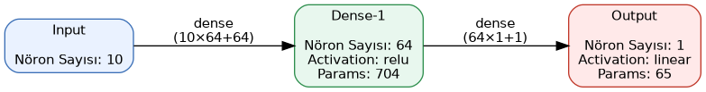

   Üç katmanlı örnek modelin mimarisi: Input katmanı 10 nöron, Dense-1 katmanı 64 nöron (relu, 704 parametre),
   Output katmanı 1 nöron (linear, 65 parametre) içermektedir.

Buradaki parametre sayılarına dikkat ediniz. Girdi katmanında 10 nöron vardır. Ancak girdi katmanı parametre
içermez. Saklı katmanda 64 nöron vardır. Bu 64 nöron girdi katmanındaki 10 nöron ile *dense* bağlanmıştır. Her
nöronda ayrıca bir de *bias* değeri bulunmaktadır. Bu durumda saklı katmandaki toplam parametrelerin sayısı
10 * 64 + 64 = 704'tür. Çıktı katmanında 1 nöron vardır. Saklı katmanın 64 nöronu bu nöronun girdisini
oluşturacaktır. Bu nöronun bias değeri de olduğuna göre çıktı katmanındaki parametre sayısı 64 * 1 + 1 = 65
olacaktır. İşte eğitim sonucunda 704 + 65 = 769 tane parametre konumlandırılmış olacaktır.

5) Model Özeti: summary() Metodu
--------------------------------

Modele katmanlar eklendikten sonra bir özet bilgi yazdırılabilir. Bu işlem ``Sequential`` sınıfının ``summary``
isimli metoduyla yapılmaktadır. Örneğin:

.. code-block:: python

   model.summary()

Yukarıdaki model için oluşan çıktı şöyledir:

.. code-block:: text

   Model: "Test-Model"
   ┌─────────────────────────────────┬────────────────────────┬───────────────┐
   │ Layer (type)                    │ Output Shape           │       Param # │
   ├─────────────────────────────────┼────────────────────────┼───────────────┤
   │ Dense-1 (Dense)                 │ (None, 64)             │           704 │
   ├─────────────────────────────────┼────────────────────────┼───────────────┤
   │ Output (Dense)                  │ (None, 1)              │            65 │
   └─────────────────────────────────┴────────────────────────┴───────────────┘
   Total params: 769 (3.00 KB)
   Trainable params: 769 (3.00 KB)
   Non-trainable params: 0 (0.00 B)

Şimdi aşağıdaki modeli inceleyiniz:

.. code-block:: python

   model = Sequential(name='Test Model')

   model.add(Input((8, )))
   model.add(Dense(16, activation='relu', name='Hidden-1'))
   model.add(Dense(16, activation='relu', name='Hidden-2'))
   model.add(Dense(1, activation='sigmoid', name='Output'))
   model.summary()

Bu modelde bir girdi katmanı, iki saklı katman (biz bunlara ara katman da diyeceğiz) bir de çıktı katmanı vardır.
``summary`` metodundan elde edilen çıktı şöyledir.

.. code-block:: text

   Model: "Test Model"
   ┌─────────────────────────────────┬────────────────────────┬───────────────┐
   │ Layer (type)                    │ Output Shape           │       Param # │
   ├─────────────────────────────────┼────────────────────────┼───────────────┤
   │ Hidden-1 (Dense)                │ (None, 16)             │           144 │
   ├─────────────────────────────────┼────────────────────────┼───────────────┤
   │ Hidden-2 (Dense)                │ (None, 16)             │           272 │
   ├─────────────────────────────────┼────────────────────────┼───────────────┤
   │ Output (Dense)                  │ (None, 1)              │            17 │
   └─────────────────────────────────┴────────────────────────┴───────────────┘
   Total params: 433 (1.69 KB)
   Trainable params: 433 (1.69 KB)
   Non-trainable params: 0 (0.00 B)

Burada ağımızdaki girdi katmanında 8 nöron olduğuna göre ve ilk saklı katmanda da 16 nöron olduğuna göre ilk saklı
katmanda 8 * 16 tane *w* değeri vardır. Öte yandan her nöronun bir tane bias değeri de olduğuna göre ilk
katmandaki ayarlanması gereken parametrelerin (trainable parameters) sayısı 8 * 16 + 16 = 144 tanedir. İkinci
saklı katmana 16 nöron *dense* biçimde bağlanmıştır. O halde ikinci saklı katmandaki ayarlanması gereken
parametreler toplamda 16 * 16 + 16 = 272 tanedir. Modelimizin çıktı katmanında 1 nöron vardır. Önceki katmanın 16
çıkışı olduğuna göre bu 16 çıkış çıktı katmanındaki nöronla *dense* bağlanacaktır. Böylece çıktı katmanında
16 * 1 + 1 = 17 ayarlanması gereken parametre olacaktır.

ReLU Aktivasyon Fonksiyonu
==========================

Saklı katmanlarda en çok kullanılan aktivasyon fonksiyonu *ReLU (Rectifier Linear Unit)* isimli fonksiyondur. Bu
fonksiyon negatif değerleri 0'a dönüştürür, 0 ve pozitif değerleri olduğu gibi bırakır. ReLU fonksiyonunu
matematiksel olarak şöyle ifade edebiliriz:

.. code-block:: text

   ReLU(x) = max(0, x)

             ⎧ x , x > 0
   ReLU(x) = ⎨
             ⎩ 0 , x ≤ 0

Eskiden ara katmanlarda tanh (hiperbolik tanjant fonksiyonu) ve sigmoid fonksiyonları çokça kullanılırdı. Ancak
ReLU fonksiyonu hem performansından dolayı hem de basitliğinden dolayı artık ara katmanların temel aktivasyon
fonksiyonu haline gelmiştir. Özel bir durum yoksa (bazen söz konusu olabilmektedir) ara katmanlarda olarak ReLU
fonksiyonunu tercih edebilirsiniz. Burada bir noktaya dikkatinizi çekmek istiyoruz: ``Dense`` sınıfında eğer
``activation`` parametresi için argüman girilmezse varsayılan aktivasyon fonksiyonu ReLU değil, özdeş fonksiyon
(birim fonksiyon) olmaktadır. ReLU fonksiyonunun grafiği aşağıdaki gibidir:

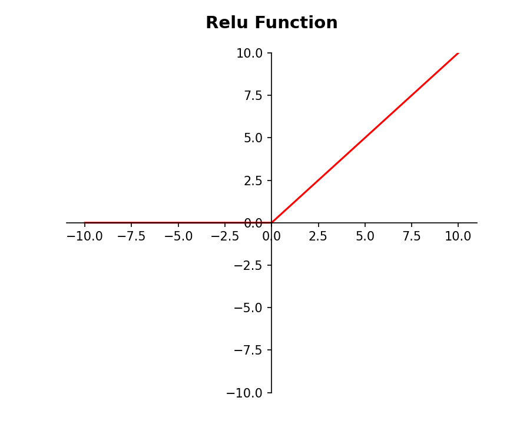

   ReLU fonksiyonunun grafiği: x negatif olduğunda çıktı 0'dır, x pozitif olduğunda çıktı x'in kendisidir.

ReLU fonksiyonunun kullanılma gerekçeleri 2010 yılından itibaren çeşitli makalelerde ele alınmıştır:

.. list-table::
   :header-rows: 1

   * - Yıl
     - Yazarlar
     - Yayın
     - Katkı
   * - 2010
     - Nair, Hinton
     - ICML
     - ReLU terimini ortaya koydu
   * - 2011
     - Glorot, Bordes, Bengio
     - AISTATS
     - Ön eğitimsiz derin ağ eğitimi
   * - 2012
     - Krizhevsky ve ark.
     - NeurIPS
     - AlexNet ile pratikte yaygınlaştı
   * - 2013
     - Maas, Hannun, Ng
     - ICML WS
     - Leaky ReLU önerisi
   * - 2015
     - He ve ark.
     - ICCV
     - PReLU ve He başlatma

Çıktı Katmanında Kullanılan Aktivasyon Fonksiyonları
====================================================

Çıktı katmanındaki aktivasyon fonksiyonu problemin türüne göre tipik olarak üç biçimden biri olmaktadır:

1) Sigmoid fonksiyonu
2) Özdeş (Linear) fonksiyon
3) Softmax fonksiyonu

- Sigmoid fonksiyonunu biz *lojistik regresyonu* ele alırken görmüştük. Bu fonksiyon x değerlerini [0, 1]
  aralığına hapsediyordu. İkili sınıflandırma problemlerinde tipik olarak çıktı katmanında tek nöron bulundurulur.
  Bu tek nöronun aktivasyon fonksiyonu sigmoid olur. Böylece ağdan [0, 1] arasında bir olasılık değeri elde edilir.
  Bu değer 0.5'ten küçükse bir sınıf, 0.5'ten büyükse diğer sınıf kestirilir.

- Regresyon problemleri söz konusu olduğunda tipik olarak yine çıktı katmanında tek bir nöron bulunur. Bu nöronun
  aktivasyon fonksiyonu *özdeş fonksiyon (linear function)* olur. Böylece ağın çıktısından pozitif de negatif de
  olabilen gerçek sayı değeri elde edilir.

- Çok sınıflı sınıflandırma problemlerinde tipik olarak çıktı katmanında sınıf sayısı kadar nöron bulundurulur. Bu
  nöronların çıktılarının toplamı 1 olacak biçimde ayarlama yapılır. İşte bu çok sınıf belirten problemlerdeki
  çıktı katmanında kullanılan bu aktivasyon fonksiyonuna *softmax* denilmektedir.

Aşağıdaki örnekte *diabetes* veri kümesi üzerinde ikili sınıflandırma problemi için bir sinir ağı oluşturulmuştur.

.. code-block:: python

   import pandas as pd

   df = pd.read_csv('diabetes.csv')

   from sklearn.impute import SimpleImputer

   si = SimpleImputer(strategy='mean', missing_values=0)

   impute_features = ['Glucose', 'BloodPressure', 'SkinThickness', 'Insulin', 'BMI']
   df[impute_features] = si.fit_transform(df[impute_features])

   dataset = df.to_numpy()

   dataset_x = dataset[:, :-1]
   dataset_y = dataset[:, -1]

   from sklearn.model_selection import train_test_split

   training_dataset_x, test_dataset_x, training_dataset_y, test_dataset_y = \
           train_test_split(dataset_x, dataset_y, test_size=0.2)

   from tensorflow.keras import Sequential
   from tensorflow.keras.layers import Input, Dense

   model = Sequential(name='Diabetes')

   model.add(Input((training_dataset_x.shape[1],)))
   model.add(Dense(16, activation='relu', name='Hidden-1'))
   model.add(Dense(16, activation='relu', name='Hidden-2'))
   model.add(Dense(1, activation='sigmoid', name='Output'))
   model.summary()

.. _model-derleme-ve-egitim:

=========================================================
Keras'ta Modelin Derlenmesi (compile) ve Eğitilmesi (fit)
=========================================================

4) Modelin Derlenmesi: compile Metodu
=====================================

Keras'ta modeli oluşturulduktan sonra modelin derlenmesi (compile edilmesi) gerekir. Buradaki *derleme* makine
diline dönüştürme anlamında bir terim değildir. Burada *derleme* eğitim için bazı belirlemelerin yapılması
anlamına gelmektedir. Bu işlem ``Sequential`` sınıfının ``compile`` isimli metoduyla yapılmaktadır. ``compile``
metodunun parametrik yapısı şöyledir:

.. code-block:: python

   compile(
       optimizer='rmsprop',
       loss=None,
       loss_weights=None,
       metrics=None,
       weighted_metrics=None,
       run_eagerly=False,
       steps_per_execution=1,
       jit_compile='auto',
       auto_scale_loss=True
   )

``compile`` metodunun en önemli iki parametresi ``loss`` ve ``optimizer`` parametreleridir. Eğitim sırasında ağın
ürettiği değerlerin gerçek değerlere yaklaştırılması için w ve bias değerlerinin nasıl güncelleneceğine ilişkin
algoritmalara *optimizasyon algoritmaları* denilmektedir. Matematiksel optimizasyon işlemlerinde belli bir
fonksiyonun minimize edilmesi istenir. İşte minimize edilecek bu fonksiyona da *kayıp fonksiyonu (loss function)*
denilmektedir. Başka bir deyişle optimizasyon algoritması kayıp fonksiyonun değerini minimize edecek biçimde işlem
yapan algoritmadır. Yani optimizasyon algoritması kayıp fonksiyonunu minimize etmek için yapılan işlemleri temsil
etmektedir. Kayıp fonksiyonu çok değişkenli bir fonksiyondur. Bu biçimdeki fonksiyonların kapalı çözümlerle minimum
noktalarının bulunması mümkün değildir. Bu optimizasyon işlemi bir döngü içerisinde nümerik yöntemlerle
yapılmaktadır. Döngüde sürekli olarak ağdaki nöronların *w* ve *bias* değerleri güncellenir. Böylece gerçek
değerlere yakın çıktı üretmeye başlar.

Kayıp Fonksiyonları
-------------------

Kayıp fonksiyonları ağın ürettiği değerlerle gerçek değerler arasındaki farklılığı temsil eden fonksiyonlardır.
Kayıp fonksiyonları genel olarak iki girdi alıp bir çıktı vermektedir. Kayıp fonksiyonunun girdileri gerçek
değerler ile ağın ürettiği değerlerdir. Çıktısı ise aradaki farklılığı belirten bir değerdir. Eğitim sırasında
gitgide kayıp fonksiyonunun değerinin düşmesini bekleriz. Tabii kayıp fonksiyonunun değerinin düşmesi aslında ağın
gerçek değerlere daha yakın değerler üretmesi anlamına gelmektedir. Kayıp fonksiyonları çıktının biçimine yani
problemin türüne bağlı olarak seçilmektedir. Örneğin ikili sınıflandırma problemleri için *binary-cross-entropy*,
çoklu sınıflandırma problemleri için *categorical-cross-entropy*, regresyon problemleri için *mean-squared-error*
isimli kayıp fonksiyonları tercih edilmektedir. Aşağıda Keras'ta hazır bulunan kayıp fonksiyonlarının bir listesini
veriyoruz:

.. list-table::
   :header-rows: 1

   * - Sınıf (keras.losses)
     - String adı
     - Alternatif adlar
     - Problem türü
   * - MeanSquaredError
     - ``'mean_squared_error'``
     - ``'mse'``, ``'MSE'``
     - Regresyon
   * - MeanAbsoluteError
     - ``'mean_absolute_error'``
     - ``'mae'``, ``'MAE'``
     - Regresyon (outlier dayanıklı)
   * - MeanAbsolutePercentageError
     - ``'mean_absolute_percentage_error'``
     - ``'mape'``, ``'MAPE'``
     - Regresyon (yüzde hata)
   * - MeanSquaredLogarithmicError
     - ``'mean_squared_logarithmic_error'``
     - ``'msle'``, ``'MSLE'``
     - Regresyon (geniş aralık)
   * - Huber
     - ``'huber'``
     - -
     - Regresyon (MSE+MAE karma)
   * - LogCosh
     - ``'log_cosh'``
     - -
     - Regresyon (yumuşak Huber)
   * - Poisson
     - ``'poisson'``
     - -
     - Sayım (count) regresyonu
   * - BinaryCrossentropy
     - ``'binary_crossentropy'``
     - ``'bce'``, ``'BCE'``
     - İkili ve çok etiketli sınıf.
   * - BinaryFocalCrossentropy
     - ``'binary_focal_crossentropy'``
     - -
     - Dengesiz ikili sınıflandırma
   * - CategoricalCrossentropy
     - ``'categorical_crossentropy'``
     - -
     - Çok sınıflı sınıflandırma
   * - SparseCategoricalCrossentropy
     - ``'sparse_categorical_crossentropy'``
     - -
     - Çok sınıflı sınıflandırma
   * - CategoricalFocalCrossentropy
     - ``'categorical_focal_crossentropy'``
     - -
     - Dengesiz çok sınıflı sınıf.
   * - KLDivergence
     - ``'kl_divergence'``
     - ``'kld'``, ``'KLD'``
     - Dağılım eşleme (distillation)
   * - Hinge
     - ``'hinge'``
     - -
     - İkili sınıf. (SVM tarzı)
   * - SquaredHinge
     - ``'squared_hinge'``
     - -
     - İkili sınıf. (SVM tarzı)
   * - CategoricalHinge
     - ``'categorical_hinge'``
     - -
     - Çok sınıflı sınıf. (SVM tarzı)
   * - CosineSimilarity
     - ``'cosine_similarity'``
     - -
     - Embedding / benzerlik öğrenme
   * - Dice
     - ``'dice'``
     - -
     - Görüntü segmentasyonu
   * - CTC
     - ``'ctc'``
     - -
     - Dizi hizalama (OCR, konuşma)

Kayıp fonksiyonu ``compile`` metoduna yine isimsel olarak ya da ``tensorflow.keras.losses`` modülündeki sınıflar
türünden sınıf nesneleri biçiminde ya da doğrudan fonksiyon olarak girilebilmektedir. Kayıp fonksiyonları kısa ya
da uzun isim olarak yazısal biçimde kullanılabilmektedir. Yazısal girişte isimleri tam olarak yukarıdaki tabloda
belirtildiği biçimde girmelisiniz. Aslında kayıp fonksiyonları için sınıfların yanı sıra fonksiyonlar da
bulunmaktadır. Bu fonksiyonların isimleri de doğrudan girilebilir. Fonksiyon isimleri yukarıdaki tablodaki uzun ve
kısa fonksiyon isimleriyle aynıdır. Bu sınıflar ve fonksiyonlar ``tensorflow.keras.losses`` modülünde
bulunmaktadır. Örneğin:

.. code-block:: python

   model.compile(loss='binary_crossentropy', ....)

Optimizasyon Algoritmaları
--------------------------

Optimizasyon algoritmaları aslında genel yapı olarak birbirlerine benzemektedir. Pek çok problemde bu
algoritmaların çoğu benzer performansı göstermektedir. En çok kullanılan optimizasyon algoritmaları *rmsprop*,
*adam* ve *sgd* algoritmalarıdır. Bu algoritmalar *gradient descent* denilen genel optimizasyon yöntemini farklı
biçimlerde uygulamaktadır. Optimizasyon algoritmaları kursumuzun ilerleyen bölümlerinde ele alınacaktır.

``compile`` metodunda optimizasyon algoritması bir yazı olarak ya da ``tensorflow.keras.optimizers`` modülündeki
sınıflar türünden bir sınıf nesnesi olarak girilebilmektedir. Örneğin:

.. code-block:: python

   model.compile(optimizer='rmsprop', ...)

Örneğin:

.. code-block:: python

   from tensorflow.keras.optimizers import RMSprop

   rmsprop = RMSprop()

   model.compile(optimizer=rmsprop, ...)

Tabii ``optimizer`` parametresinin bir sınıf nesnesi olarak girilmesi daha ayrıntılı belirlemelerin yapılmasına
olanak sağlamaktadır. Optimizasyon işlemlerinde bazı parametrik değerler vardır. Bunlara makine öğrenmesinde *üst
düzey parametreler (hyper parameters)* denilmektedir. İşte optimizasyon algoritması bir sınıf nesnesi biçiminde
verilirse bu sınıfın ``__init__`` metodunda bu üst düzey parametreler istenildiği gibi ayarlanabilmektedir. Eğer
optimizasyon algoritması yazısal biçimde verilirse bu üst düzey parametreler default değerlerle kullanılmaktadır.
``optimizer`` parametresinin default değeri *rmsprop* biçimindedir. Yani biz bu parametre için değer girmezsek
default optimizasyon algoritması *rmsprop* olarak alınacaktır. Aşağıda Keras'ta hazır bulunan optimizer
algoritmalarının bir listesini veriyoruz:

.. list-table::
   :header-rows: 1

   * - Sınıf (keras.optimizers)
     - String adı
     - Özellik
     - Tipik kullanım alanı
   * - SGD
     - ``'sgd'``
     - Sabit LR, momentum/nesterov
     - CNN (ResNet), iyi genelleme
   * - RMSprop
     - ``'rmsprop'``
     - Gradyan karesi hareketli ort.
     - RNN / LSTM, RL
   * - Adam
     - ``'adam'``
     - Momentum + RMSprop
     - Genel amaçlı varsayılan
   * - AdamW
     - ``'adamw'``
     - Adam + ayrık weight decay
     - Transformer, LLM fine-tune
   * - Adamax
     - ``'adamax'``
     - Adam, sonsuz norm (L∞)
     - Embedding, seyrek gradyan
   * - Nadam
     - ``'nadam'``
     - Adam + Nesterov momentum
     - Daha hızlı yakınsama
   * - Adagrad
     - ``'adagrad'``
     - Parametre başına birikimli LR
     - Seyrek özellik (NLP, öneri)
   * - Adadelta
     - ``'adadelta'``
     - Adagrad, LR azalması sınırlı
     - LR ayarı istenmeyen durum
   * - Ftrl
     - ``'ftrl'``
     - L1/L2 düzenlemeli, seyrek
     - Geniş lineer model, CTR
   * - Lion
     - ``'lion'``
     - Yalnızca işaret (sign) günc.
     - Büyük model, az bellek
   * - Adafactor
     - ``'adafactor'``
     - Faktörize 2. moment
     - Büyük Transformer (T5)
   * - Lamb
     - ``'lamb'``
     - Katman bazlı uyarlamalı Adam
     - Çok büyük batch (BERT)
   * - LossScaleOptimizer
     - -
     - Başka optimizer sarmalayıcı
     - Mixed precision (float16)

Peki biz hangi optimizasyon algoritmasını seçmeliyiz? Aslında bu algoritmaların hepsi kayıp fonksiyonunu minimize
etmek için döngü içerisinde adım adım ilerlemektedir. Dolayısıyla çoğu durumda bunlardan hangisinin seçileceği
önemli farklılık yaratmamaktadır. Örneğin *sgd*, *rmsprop* ve *adam* algoritmalarından herhangi birini
seçebilirsiniz. Bunlar arasındaki farklılıklar daha çok hedefe yakınsama hızı üzerinde etkili olmaktadır.

Metrik Fonksiyonlar
-------------------

``compile`` metodunun üçüncü önemli parametresi *metrics* isimli parametredir. Makine öğrenmesinde kestirimin
başarısını tespit etmek için kullanılan fonksiyonlara *metric* denilmektedir. ``metrics`` parametresi bir liste ya
da demet olarak girilir. Bu parametre daha sonra açıklanacak olan *sınama (validation)* işlemi için kullanılacak
metrik fonksiyonları belirtmektedir. Sınamada her zaman zaten bizim kayıp fonksiyonu olarak belirttiğimiz fonksiyon
kullanılmaktadır. ``metrics`` parametresinde ilave fonksiyonlar da girilebilmektedir. Örneğin ikili sınıflandırma
problemleri için tipik olarak *binary_accuracy* denilen metrik fonksiyon, çoklu sınıflandırma için
*categorical_accuracy* denilen metrik fonksiyon ve regresyon problemleri için de *mean_absolute_error* isimli
metrik fonksiyon sıklıkla kullanılmaktadır.

Aşağıda metrik fonksiyonların listesini bir tablo halinde veriyoruz:

.. list-table::
   :header-rows: 1

   * - Sınıf (keras.metrics)
     - String adı
     - Alternatif adlar
     - Problem türü
   * - Accuracy
     - ``'accuracy'``
     - ``'acc'`` (compile)
     - Genel (tam eşleşme oranı)
   * - BinaryAccuracy
     - ``'binary_accuracy'``
     - -
     - İkili sınıflandırma
   * - CategoricalAccuracy
     - ``'categorical_accuracy'``
     - -
     - Çok sınıflı (one-hot)
   * - SparseCategoricalAccuracy
     - ``'sparse_categorical_accuracy'``
     - -
     - Çok sınıflı (tamsayı etiket)
   * - TopKCategoricalAccuracy
     - ``'top_k_categorical_accuracy'``
     - -
     - Çok sınıflı (one-hot), top-k
   * - SparseTopKCategoricalAccuracy
     - ``'sparse_top_k_categorical_accuracy'``
     - -
     - Çok sınıflı (tamsayı), top-k
   * - Precision
     - ``'precision'``
     - -
     - İkili / çok etiketli sınıf.
   * - Recall
     - ``'recall'``
     - -
     - İkili / çok etiketli sınıf.
   * - F1Score
     - ``'f1_score'``
     - -
     - Sınıflandırma (dengesiz veri)
   * - FBetaScore
     - ``'f_beta_score'``
     - -
     - Sınıflandırma (P/R ağırlıklı)
   * - AUC
     - ``'auc'``
     - -
     - İkili sınıf. (ROC / PR eğrisi)
   * - TruePositives
     - ``'true_positives'``
     - -
     - İkili sınıf. (confusion matrix)
   * - TrueNegatives
     - ``'true_negatives'``
     - -
     - İkili sınıf. (confusion matrix)
   * - FalsePositives
     - ``'false_positives'``
     - -
     - İkili sınıf. (confusion matrix)
   * - FalseNegatives
     - ``'false_negatives'``
     - -
     - İkili sınıf. (confusion matrix)
   * - PrecisionAtRecall
     - (argüman şart)
     - -
     - İkili sınıf. (eşik analizi)
   * - RecallAtPrecision
     - (argüman şart)
     - -
     - İkili sınıf. (eşik analizi)
   * - SensitivityAtSpecificity
     - (argüman şart)
     - -
     - İkili sınıf. (tıbbi test vb.)
   * - SpecificityAtSensitivity
     - (argüman şart)
     - -
     - İkili sınıf. (tıbbi test vb.)
   * - BinaryCrossentropy
     - ``'binary_crossentropy'``
     - ``'bce'``, ``'BCE'``
     - İkili sınıflandırma
   * - CategoricalCrossentropy
     - ``'categorical_crossentropy'``
     - -
     - Çok sınıflı (one-hot)
   * - SparseCategoricalCrossentropy
     - ``'sparse_categorical_crossentropy'``
     - -
     - Çok sınıflı (tamsayı etiket)
   * - KLDivergence
     - ``'kl_divergence'``
     - -
     - Dağılım karşılaştırma
   * - Hinge
     - ``'hinge'``
     - -
     - İkili sınıf. (SVM tarzı)
   * - SquaredHinge
     - ``'squared_hinge'``
     - -
     - İkili sınıf. (SVM tarzı)
   * - CategoricalHinge
     - ``'categorical_hinge'``
     - -
     - Çok sınıflı (SVM tarzı)
   * - MeanSquaredError
     - ``'mean_squared_error'``
     - ``'mse'``, ``'MSE'``
     - Regresyon
   * - RootMeanSquaredError
     - ``'root_mean_squared_error'``
     - -
     - Regresyon (hedefle aynı birim)
   * - MeanAbsoluteError
     - ``'mean_absolute_error'``
     - ``'mae'``, ``'MAE'``
     - Regresyon
   * - MeanAbsolutePercentageError
     - ``'mean_absolute_percentage_error'``
     - ``'mape'``, ``'MAPE'``
     - Regresyon (yüzde hata)
   * - MeanSquaredLogarithmicError
     - ``'mean_squared_logarithmic_error'``
     - ``'msle'``, ``'MSLE'``
     - Regresyon (geniş aralık)
   * - LogCoshError
     - ``'log_cosh_error'``
     - -
     - Regresyon
   * - R2Score
     - ``'r2_score'``
     - -
     - Regresyon (açıklanan varyans)
   * - PearsonCorrelation
     - ``'pearson_correlation'``
     - -
     - Regresyon (doğrusal ilişki)
   * - ConcordanceCorrelation
     - ``'concordance_correlation'``
     - -
     - Regresyon (uyum)
   * - Poisson
     - ``'poisson'``
     - -
     - Sayım (count) regresyonu
   * - CosineSimilarity
     - ``'cosine_similarity'``
     - -
     - Embedding / benzerlik
   * - BinaryIoU
     - ``'binary_io_u'``
     - -
     - İkili segmentasyon
   * - IoU
     - (argüman şart)
     - -
     - Segmentasyon (seçili sınıflar)
   * - MeanIoU
     - (argüman şart)
     - -
     - Çok sınıflı segmentasyon
   * - OneHotIoU
     - (argüman şart)
     - -
     - Segmentasyon (one-hot)
   * - OneHotMeanIoU
     - (argüman şart)
     - -
     - Segmentasyon (one-hot)

Metrik fonksiyonlar hem sınıf nesnesi biçiminde, hem fonksiyon biçiminde hem de yazısal biçimde girilebilmektedir.
Genellikle Keras programcıları metrik fonksiyonları isimsel olarak girmektedir. Örneğin ikili sınıflandırma
problemi için biz eğitim sırasında *loss* değerinin yanı sıra *binary_accuracy* değerini de elde etmek isteyelim.
Bu durumda ``compile`` metodunu şöyle çağırabiliriz:

.. code-block:: python

   model.compile(optimizer='rmsprop', loss='binary_crossentropy', metrics=['binary_accuracy'])

5) Modelin Eğitilmesi: fit Metodu
=================================

Modelin derlenmesinden sonra artık gerçekten eğitim aşamasına geçilir. Eğitim süreci ``Sequential`` sınıfının
``fit`` metoduyla yapılmaktadır. ``fit`` metodunun parametrik yapısı şöyledir:

.. code-block:: python

   fit(
       x=None,
       y=None,
       batch_size=None,
       epochs=1,
       verbose='auto',
       callbacks=None,
       validation_split=0.0,
       validation_data=None,
       shuffle=True,
       class_weight=None,
       sample_weight=None,
       initial_epoch=0,
       steps_per_epoch=None,
       validation_steps=None,
       validation_batch_size=None,
       validation_freq=1
   )

``fit`` metodunun en önemli parametresi ilk iki parametre olan ``x`` ve ``y`` veri kümeleridir. Biz burada
``training_dataset_x`` ve ``training_dataset_y`` verilerini ``fit`` metodunun ilk iki parametresine geçirmeliyiz.
``fit`` metodunun diğer önemli bir parametresi ``batch_size`` isimli parametredir. Eğitim işlemi aslında satır
satır değil batch batch yapılmaktadır. Batch bir grup satıra denilmektedir. Yani ağa bir grup satır girdi olarak
verilir. Ağdan bir grup çıktı elde edilir. Bu bir grup çıktı ile bu çıktıların gerçek değerleri kayıp fonksiyonuna
sokulur ve optimizasyon algoritması çalıştırılarak *w* ve *bias* değerleri güncellenir. Yani optimizasyon
algoritması her batch işlemden sonra devreye sokulmaktadır. Batch büyüklüğü ``fit`` metodunda ``batch_size``
parametresiyle belirtilmektedir. Bu değer girilmezse ``batch_size`` varsayılan durumda 32 olarak alınmaktadır. 32
değeri pek çok uygulama için uygun bir değerdir. Optimizasyon işleminin satır satır yapılması yerine batch batch
yapılmasının iki önemli nedeni vardır: Birincisi işlem miktarının azaltılması, dolayısıyla eğitim süresinin
kısaltılmasıdır. İkincisi ise *overfitting* denilen olumsuz durum için bir önlem oluşturmasıdır. Overfitting
hakkında ileride açıklama yapacağız.

``fit`` metodunun diğer önemli bir parametresi de *epochs* isimli parametredir. Eğitim veri kümesinin eğitim
sırasında yeniden eğitimde kullanılmasına *epoch* işlemi denilmektedir. Örneğin elimizde 1000 satırlık bir eğitim
veri kümesi olsun. ``batch_size`` parametresinin de 20 olduğunu varsayalım. Bu durumda bu eğitim veri kümesi
1000 / 20 = 50 batch işleminde bitecektir. Yani model parametreleri 50 kere ayarlanacaktır. Pek çok durumda eğitim
veri kümesinin bir kez işleme sokulması model parametrelerinin iyi bir biçimde konumlandırılması için yetersiz
kalmaktadır. İşte eğitim veri kümesinin birden fazla kez (yani ``fit`` metodundaki ``epochs`` sayısı kadar)
yeniden eğitimde kullanılması yoluna gidilmektedir. Peki ``epochs`` değeri ne olmalıdır? Epoch sayısı uygulamacı
tarafından belirlenmektedir. Az sayıda epoch uygulamak model parametrelerini yeterince iyi konumlandıramayabilir.
Çok fazla sayıda epoch uygulamak yanlış şeylerin öğrenilmesine yol açabilmektedir. Bu olguya *overfitting*
denilmektedir. Ayrıca çok fazla epoch eğitim zamanını da uzatmaktadır. Uygulamacı epoch'lar sırasında modelin
davranışına bakabilir ve uygun epoch sayısında işlemi kesebilir. Eğitim sırasında Keras bizim belirlediğimiz
fonksiyonları çağırabilmektedir. Buna Keras'ın *callback* mekanizması denilmektedir. Uygulamacı bu yolla model
belli bir duruma geldiğinde eğitim işlemini kesebilir. Ya da uygulamacı eğer eğitim çok uzamayacaksa yüksek bir
epoch ile eğitimini yapabilir. İşlemler bitince epoch'lardaki performansa bakabilir. Olması gereken epoch değerini
kestirebilir. Sonra modeli yeniden bu sayıda epoch ile eğitir.

``fit`` metodunun ``shuffle`` parametresi her epoch'tan sonra eğitim veri kümesinin karıştırılıp
karıştırılmayacağını belirtmektedir. Bu parametre default olarak ``True`` biçimdedir. Yani her epoch'tan önce (ilk
epoch dahil olmak üzere) eğitim veri kümesi karıştırılmaktadır. Epoch'lar arasında eğitim veri kümesinin
karıştırılmaması eğitim sürecini olumsuz etkileyebilmektedir. Aşağıdaki tabloda verinin durumuna göre
karıştırmamanın yarattığı dezavantajlar belirtilmektedir:

.. list-table::
   :header-rows: 1

   * - Durum
     - Etki
   * - Sıralı veri (etikete göre)
     - Ciddi sorun: salınım, kötü yakınsama
   * - Bir kez karıştırılmış, sabit sıra
     - Genelde çalışır, biraz daha kötü
   * - Her epoch yeniden karıştırma
     - Önerilen yöntem (random reshuffling)
   * - Zaman serisi / stateful RNN
     - Örnek içi sıra korunmalı

Bazı veri kümelerinde veriler arasında öncelik-sonralık ilişkisi bulunabilmektedir. Bu tür veri kümelerine *zaman
serisi (time series)* denilmektedir. Zaman serilerine ilişkin veri kümelerinin karıştırılmaması gerekir.

.. _sinama-ve-degerlendirme:

============================================================
Keras'ta Sınama (Validation) İşlemi ve Modelin Test Edilmesi
============================================================

Sınama (Validation) İşlemi
==========================

Modelin ``fit`` metodu ile eğitilmesi sırasında *sınama (validation)* denilen önemli bir süreç daha devreye
girmektedir. Sınama işlemi test işlemine benzemektedir. Ancak test işlemi tüm model eğitildikten sonra yapılırken
sınama işlemi her epoch'tan sonra modelin eğitim sürecinde yapılmaktadır. Başka bir deyişle sınama işlemi model
eğitilirken yapılan test işlemidir. Epoch'lar sırasında modelin performansı hakkında bilgi edinebilmek için sınama
işlemi yapılmaktadır. Sınamanın yapılması için ``fit`` metodunun ``validation_split`` parametresinin 0 ile 1
arasında oransal bir değer olarak girilmesi gerekir. Bu oransal değer eğitim veri kümesinin yüzde kaçının sınama
için kullanılacağını belirtmektedir. Örneğin ``validation_split=0.2`` ise bu durum eğitim veri kümesinin
%20'sinin sınama için kullanılacağını belirtmektedir. ``fit`` metodu işin başında eğitim veri kümesini eğitimde
kullanılacak kısım ile sınamada kullanılacak kısım biçiminde ikiye ayırmaktadır. Sonra her epoch'ta yalnızca
eğitimde kullanılacak kümeyi karıştırmaktadır. Sınama işlemi aynı kümeyle her epoch sonrasında karıştırılmadan
yapılmaktadır. ``fit`` metodunda ayrıca bir de ``validation_data`` isimli bir parametre vardır. Bu parametre
sınama verilerini girmek için kullanılmaktadır. Bazen programcı sınama verilerinin eğitim veri kümesinden elde
edilmesini istemez. Onu ayrıca ``fit`` metoduna vermek isteyebilir. Tabii ``validation_data`` parametresi
girildiyse artık ``validation_split`` parametresinin bir anlamı yoktur. Bu parametre girilse bile artık fonksiyon
tarafından dikkate alınmaz. Örneğin:

.. code-block:: python

   hist = model.fit(training_dataset_x, training_dataset_y, batch_size=32, epochs=100, validation_split=0.2)

``validation_split`` parametresinin default değerinin 0 olduğuna dikkat ediniz. ``validation_split`` değerinin 0
olması epoch'lar sonrasında sınama işleminin yapılmayacağı anlamına gelmektedir.

``fit`` metodu ``History`` denilen bir sınıf nesnesi geri döndürmektedir. Bu nesnenin içerisinde her epoch'taki
loss ve metrik değerler bulunmaktadır. Bu nesnenin nasıl kullanılacağını izleyen paragraflarda ele alacağız.

Eğitim Sırasında Yazdırılan Değerler
====================================

Peki modelin ``fit`` metodunda her epoch'tan sonra sınama işleminde hangi ölçümler ekrana yazdırılacaktır ve bize
verilecektir? İşte ``compile`` metodunda belirtilen ve ismine metrik fonksiyonlar denilen fonksiyonlar her epoch
işlemi sonucunda ekrana yazdırılmaktadır ve uygulamacıya *history nesnesi* biçiminde verilmektedir. Her epoch
sonucunda ``fit`` metodu şu değerleri yazdırmaktadır:

- Epoch sonrasında eğitim veri kümesinin kendisi için elde edilen loss değerlerinin ortalaması.
- Epoch sonrasında eğitim veri kümesinin kendisi için elde edilen metrik değerlerin ortalaması
- Epoch sonrasında sınama için kullanılan sınama verilerinden elde edilen loss değerlerinin ortalaması
- Epoch sonrasında sınama için kullanılan sınama verilerinden elde edilen metrik değerlerin ortalaması

Loss değerleri ve metrik değerler her batch için yeniden hesaplanıp onların ortalaması alınmaktadır. Örneğin bir
epoch 50 batch olsun. Her batch girdi yapılıp ondan elde edilen loss değerleri biriktirilip onların ortalaması
epoch bittiğinde kullanılmakta ve uygulamacıya verilmektedir. Buradaki ortalama aslında ağırlıklı ortalamadır.
Çünkü son batch'te daha az örnek kalabilmektedir. (Örneğin ``batch_size`` = 32 olsun. Veri kümesindeki veri
miktarı 32'ye tam bölünmüyorsa son epoch 32'den küçük veri içerecektir.) Metrik değerler için Keras sayaçlar tutup
her epoch'ta bu sayaçları artırıp en sonunda örnek sayısına bölerek ortalama hesaplamaktadır. Bu süreçte hem
eğitimde kullanılan veriler için hem de sınama veri kümesi için loss ve metrik değerler hesaplanmaktadır.

val\_ Önekli Değerler ve Örnek Çıktı
====================================

Eğitim veri kümesindeki değerler ile sınama veri kümesinden elde edilen değerler birbirine karışmasın diye ``fit``
metodu sınama verilerinden elde edilen değerlerin başına *val_* öneki getirmektedir. Örneğin biz ikili
sınıflandırma problemi üzerinde çalışıyor olalım ve metrik fonksiyon olarak *binary_accuracy* kullanmış olalım.
``fit`` metodu her epoch sonrasında şu değerleri ekrana yazdıracaktır:

.. code-block:: text

   loss (eğitim veri kümesinden elde edilen ortalama loss değeri)
   binary_accuracy (eğitim veri kümesinden elde edilen ortalama metrik değer)
   val_loss (sınama veri kümesinden elde edilen ortalama loss değeri)
   val_binary_accuracy (sınama veri kümesinden elde edilen ortalama metrik değer)

Tabii ``compile`` metodunda birden fazla metrik değer de belirtilmiş olabilir. Bu durumda ``fit`` tüm bu metrik
değerlerin ortalamasını ekrana yazdıracaktır. ``fit`` tarafından ekrana yazdırılan örnek bir çıktı şöyle olabilir:

.. code-block:: text

   ....
   Epoch 91/100
   16/16 [==============================] - 0s 3ms/step - loss: 0.5536 - binary_accuracy: 0.7230 - val_loss: 0.5520 -
   val_binary_accuracy: 0.7480
   Epoch 92/100
   16/16 [==============================] - 0s 3ms/step - loss: 0.5392 - binary_accuracy: 0.7251 - val_loss: 0.5588 -
   val_binary_accuracy: 0.7805
   Epoch 93/100
   16/16 [==============================] - 0s 3ms/step - loss: 0.5539 - binary_accuracy: 0.7088 - val_loss: 0.5666 -
   val_binary_accuracy: 0.8049
   ...

Burada ``loss`` değeri epoch sonrasında eğitim verilerinden elde edilen ortalama loss değerini, ``val_loss``
değeri epoch sonrasında sınama verilerinden elde edilen ortalama loss değerini, ``binary_accuracy`` epoch
sonrasında eğitim verilerinden elde edilen ortalama isabet yüzdesini ve ``val_binary_accuracy`` ise epoch
sonrasında sınama verilerinden elde edilen ortalama isabet yüzdesini belirtmektedir.

Eğitim sırasında eğitim veri kümesindeki başarının sınama veri kümesinde görülmemesi eğitimin kötü bir yöne
gittiğine işaret etmektedir. Örneğin ikili sınıflandırma probleminde epoch sonucunda eğitim veri kümesindeki
``binary_accuracy`` değerinin %99 olduğunu ancak ``val_binary_accuracy`` değerinin %65 olduğunu düşünelim. Bunun
anlamı ne olabilir? Bu durum aslında epoch'lar sırasında modelin bir şeyler öğrendiği ama bizim istediğimiz
şeyleri öğrenemediği anlamına gelmektedir. Çünkü eğitim veri kümesini epoch'larla sürekli bir biçimde gözden
geçiren model artık onu ezberlemiştir. Ancak o başarıyı eğitimden bağımsız bir veri kümesinde gösterememektedir.
İşte bu olguya *overfitting* denilmektedir. Yanlış bir şeyin öğrenilmesi bir şeyin öğrenilememesi kadar kötü bir
durumdur. Overfitting oluşumunun çeşitli nedenleri vardır. Ancak overfitting epoch'lar dolayısıyla oluşuyorsa
epoch'ları uygun bir noktada kesmek gerekir.

6) Modelin Test Edilmesi: evaluate Metodu
=========================================

fit işleminden sonra artık model eğitilmiştir. Onun test veri kümesiyle test edilmesi gerekir. Bu işlem
``Sequential`` sınıfının ``evaluate`` isimli metodu ile yapılmaktadır. ``evaluate`` metodunun parametrik yapısı
şöyledir:

.. code-block:: python

   evaluate(
       x=None,
       y=None,
       batch_size=None,
       verbose='auto',
       sample_weight=None,
       steps=None,
       callbacks=None,
       return_dict=False,
       **kwargs
   )

``evaluate`` metodunun ilk iki parametresi ``test_dataset_x`` ve ``test_dataset_y`` değerlerini almaktadır. Bu
metodun da ``batch_size`` parametresi vardır. Buradaki ``batch_size`` parametresi eğitim işlemi yapılırken
``fit`` metodunda kullanılan ``batch_size`` parametresinden işlevsel olarak farklıdır. Model test edilirken test
işlemi de birer birer değil batch batch yapılabilmektedir. Ancak bu batch'ler arasında herhangi bir şey
yapılmamaktadır. (Eğitim sırasındaki batch işlemleri sonrasında ağ parametrelerinin ayarlandığını anımsayınız.
Test işlemi sırasında böyle bir ayarlama yapılmamaktadır.) Buradaki batch değeri yalnızca işlemlerin hızlı
yapılması üzerinde etkili olmaktadır. Yine ``batch_size`` parametresi girilmezse bu değer default 32
alınmaktadır. ``evaluate`` metodu bir liste geri döndürmektedir. Listenin ilk elemanı test veri kümesinden elde
edilen loss fonksiyonunun değeridir. Diğer elemanları da sırasıyla metrik olarak verilen fonksiyonların
değerleridir. Örneğin:

.. code-block:: python

   eval_result = model.evaluate(test_dataset_x, test_dataset_y)

Burada ``eval_result`` değişkeni yukarıdaki örneğimizde aşağıdaki görünümde iki elemanlı bir liste olacaktır:

.. code-block:: text

   [0.9650349617004395, 0.4678175151348114]

Keras'ın 3'lü versiyonlarıyla birlikte ``evaluate`` metoduna ``return_dict`` parametresi eklenmiştir. Bu
parametrenin default değeri ``False`` biçimdedir. Eğer bu parametre ``True`` girilirse bu durumda ``evaluate``
metodu bir liste yerine bir sözlük geri döndürmektedir. Sözlüğün anahtarları ilgili değerin isminden, değerleri
ise onun değerlerinden oluşmaktadır. Örneğin:

.. code-block:: python

   eval_result = model.evaluate(test_dataset_x, test_dataset_y, return_dict=True)

Artık ``eval_result`` bir sözlüktür. Bu sözlüğün ``'loss'`` anahtarında loss değeri metrik isimlere ilişkin
anahtarlarında ilgili metrik değerler bulunmaktadır. Örneğin:

.. code-block:: text

   {'binary_accuracy': 0.9650349617004395, 'loss': 0.4678175151348114}

Biz de metrik değerleri isimleriyle şöyle yazdırabiliriz:

.. code-block:: python

   for name, value in eval_result.items():
       print(f'{name}: {value}')

Buradan aşağıdakine benzer bir çıktı elde edilecektir:

.. code-block:: text

   binary_accuracy: 0.9650349617004395
   loss: 0.4678175151348114

.. _predict-ve-tekrarlanabilirlik:

================================================================
Kestirim (predict) İşlemi ve Sonuçların Yeniden Üretilebilirliği
================================================================

7) Kestirim: predict Metodu
===========================

Artık model test de edilmiştir. Şimdi sıra *kestirim (prediction)* yapmaya gelmiştir. Kestirim işlemi için
``Sequential`` sınıfının ``predict`` metodu kullanılmaktadır. Biz bu metoda girdi katmanına uygulanacak
özelliklerin (yani satırların) değerlerini veririz, ``predict`` metodu da bize çıktı katmanındaki nöronların
değerlerini verir. ``predict`` metoduna biz her zaman iki boyutlu bir NumPy dizisi vermeliyiz. Çünkü ``predict``
metodu tek hamlede birden çok satır için kestirim yapabilmektedir. Biz ``predict`` metoduna bir satır verecek
olsak bile onu iki boyutlu bir matris biçiminde vermeliyiz. Örneğin:

.. code-block:: python

   import numpy as np

   predict_dataset = np.array([[2 ,90, 68, 12, 120, 38.2, 0.503, 28],
                           [4, 111, 79, 47, 207, 37.1, 1.39, 56],
                           [3, 190, 65, 25, 130, 34, 0.271, 26],
                           [8, 176, 90, 34, 300, 50.7, 0.467, 58],
                           [7, 106, 92, 18, 200, 35, 0.300, 48]])

   predict_result = model.predict(predict_data)
   print(predict_result)

``predict`` metodu bize tahmin edilen değerleri iki boyutlu bir NumPy dizisi biçiminde vermektedir. Bunun nedeni
aslında ağın birden fazla çıktısının (yani çıktı katmanında birden fazla nöronun) olabilmesidir. Örneğin ağın bir
çıktısı varsa bu durumda ``predict`` metodu bize *n tane satırdan 1 tane sütundan* oluşan bir matris, ağın iki
çıktısı varsa *n tane satırdan 2 tane sütundan* oluşan bir matris verecektir. O halde örneğin çıktı olarak tek
nöronun bulunduğu bir ağda biz kestirim değerlerini şöyle yazdırabiliriz:

.. code-block:: python

   for i in range(len(predict_result)):
       print(predict_result[i, 0])

Ya da şöyle yazdırabiliriz:

.. code-block:: python

   for result in predict_result[:, 0]:
       print(result)

Tabii iki boyutlu diziyi NumPy'ın ``flatten`` metoduyla ya da ``ravel`` metoduyla tek boyutlu hale getirerek de
yazdırma işlemini yapabilirdik:

.. code-block:: python

   for val in predict_result.flatten():
       print(val)

``predict`` metodu bize ağın çıktı değerini vermektedir. Yukarıdaki ``diabetes.csv`` örneğimizde ağın çıktı
katmanındaki aktivasyon fonksiyonunun *sigmoid* olduğunu anımsayınız. Sigmoid fonksiyonu 0 ile 1 arasında bir
değer vermektedir. O halde biz ağın çıktısındaki değer 0.5'ten büyükse ilgili kişinin şeker hastası olduğu (çünkü
1'e daha yakındır), 0.5'ten küçükse o kişinin şeker hastası olmadığı (çünkü 0'a daha yakındır) sonucunu
çıkartabiliriz. Tabii değer ne kadar 1'e yakınsa kişinin şeker hastası olma olasılığı, değer ne kadar 0'a yakınsa
kişinin şeker hastası olmama olasılığı o kadar yüksek olacaktır. O halde sigmoid fonksiyonun çıktısının bir
olasılık belirttiğini söyleyebiliriz. Bu durumda kişinin şeker hastası olup olmadığı ağın çıktı değerinin 0.5'ten
büyük olup olmamasıyla kestirilebilir:

.. code-block:: python

   for result in predict_result[:, 0]:
       print('Şeker hastası' if result > 0.5 else 'Şeker Hastası Değil')

Aşağıdaki örnekte ``diabetes.csv`` dosyası üzerinde yukarıda belirtilen tüm adımlar uygulanmıştır.

.. code-block:: python

   import pandas as pd

   df = pd.read_csv('diabetes.csv')

   from sklearn.impute import SimpleImputer

   si = SimpleImputer(strategy='mean', missing_values=0)

   impute_features = ['Glucose', 'BloodPressure', 'SkinThickness', 'Insulin', 'BMI']
   df[impute_features] = si.fit_transform(df[impute_features])

   dataset = df.to_numpy()

   dataset_x = dataset[:, :-1]
   dataset_y = dataset[:, -1]

   from sklearn.model_selection import train_test_split

   training_dataset_x, test_dataset_x, training_dataset_y, test_dataset_y = train_test_split(dataset_x, dataset_y,
                                                                                               test_size=0.2)

   from tensorflow.keras import Sequential
   from tensorflow.keras.layers import Input, Dense

   model = Sequential(name='Diabetes')

   model.add(Input((training_dataset_x.shape[1],)))
   model.add(Dense(16, activation='relu', name='Hidden-1'))
   model.add(Dense(16, activation='relu', name='Hidden-2'))
   model.add(Dense(1, activation='sigmoid', name='Output'))
   model.summary()

   model.compile(optimizer='rmsprop', loss='binary_crossentropy', metrics=['binary_accuracy'])
   model.fit(training_dataset_x, training_dataset_y, batch_size=32, epochs=100, validation_split=0.2)
   eval_result = model.evaluate(test_dataset_x, test_dataset_y, batch_size=32)

   for i in range(len(eval_result)):
       print(f'{model.metrics_names[i]}: {eval_result[i]}')

   import numpy as np

   predict_dataset = np.array([[2 ,90, 68, 12, 120, 38.2, 0.503, 28],
                               [4, 111, 79, 47, 207, 37.1, 1.39, 56],
                               [3, 190, 65, 25, 130, 34, 0.271, 26],
                               [8, 176, 90, 34, 300, 50.7, 0.467, 58],
                               [7, 106, 92, 18, 200, 35, 0.300, 48]])

   predict_result = model.predict(predict_dataset)
   print(predict_result)

   for result in predict_result[:, 0]:
       print('Şeker hastası' if result > 0.5 else 'Şeker Hastası Değil')

Saklı Katman Sayısı Üzerine Bir Hatırlatma
==========================================

Şimdi yukarıdaki adımların bazı ayrıntıları üzerinde duralım. Daha önceden de belirttiğimiz gibi pek çok problem
iki saklı katmanla ve Dense bir bağlantı ile tatminkar biçimde çözülebilmektedir. Dolayısıyla bizim ilk aklımıza
gelen model iki saklı katmanlı klasik modeldir. Ancak özel problemler (şekil tanıma, yazıdan anlam çıkartma,
görüntü hakkında çıkarım yapma gibi) iki saklı katmanla tatminkar biçimde çözülememektedir. Bu durumda ikiden
fazla saklı katman kullanılır. Bu modellere *derin öğrenme (deep learning)* modelleri de denilmektedir.

Sonuçların Yeniden Üretilebilirliği (Reproducibility)
=====================================================

Yapay sinir ağı her farklı eğitimde farklı *w* ve *bias* değerlerini oluşturabilir. Bu nedenle ağın performans
değerleri de eğitimden eğitime değişebilir. Her eğitimde ağın farklı değerlere konumlandırılmasının nedenleri
şunlardır:

1) ``train_test_split`` fonksiyonu her çalıştırıldığında aslında fonksiyon ``training_dataset`` ve
   ``test_dataset`` veri kümelerini karıştırarak elde etmektedir.
2) Katmanlardaki *w* değerleri (ve istersek *bias* değerleri) programın her çalıştırılmasında rastgele başlangıç
   değerleriyle set edilmektedir.
3) ``fit`` işleminde her epoch sonrasında veri kümesi yeniden karıştırılmaktadır.

Bir rastgele sayı üretiminde üretim aynı *tohum değerden (seed)* başlatılırsa hep aynı değerler elde edilir. Bu
duruma rassal sayı üretiminin *reproducible olması* denmektedir. Eğer tohum değer belirtilmezse NumPy ve
TensorFlow gibi kütüphanelerde bu tohum değeri programın her çalıştırılmasında rastgele biçimde bilgisayarın
saatinden hareketle oluşturmaktadır.

O halde eğitimden hep aynı sonucun elde edilmesi için (yani eğitimin *reproducible* hale getirilmesi için)
yukarıdaki unsurların dikkate alınması gerekir. Tipik yapılması gereken birkaç şeyi şöyle belirtebiliriz:

1) scikit-learn ve diğer bazı makine öğrenmesi kütüphanelerinde aşağı seviyeli kütüphane olarak NumPy kullanıldığı
   için NumPy'ın rassal sayı üreticisinin tohum değeri belli bir değerle set edilebilir. Örneğin:

.. code-block:: python

   import numpy as np

   np.random.seed(12345)

2) TensorFlow kütüphanesi bazı işlemlerde kendi rassal sayı üreticisini kullanmaktadır. Onun tohum değeri de
   belli bir değerle set edilebilir. Örneğin:

.. code-block:: python

   from tensorflow.keras.utils import set_random_seed

   set_random_seed(78901)

Tabii yukarıdaki işlemler yapılsa bile rassal sayı üretimi *reproducible* hale getirilemeyebilir. Çünkü bu durum
bu kütüphanelerin rassal sayı üretiminin hangi kütüphaneler kullanılarak yapıldığı ile ilgilidir. Yukarıdaki iki
madde sezgisel bir çıkarımı ifade etmektedir.

Peki neden ağın her eğitilmesinde aynı sonuçların elde edilmesini (yani ağın *reproducible* sonuçlar vermesini)
isteyebiliriz? İşte bazen modellerimizde ve algoritmalarımızda yaptığımız değişiklikleri birbirleriyle
kıyaslamak isteyebiliriz. Bu durumda kıyaslamanın hep aynı biçimde yapılmasını sağlayabilmek için rassal bir
biçimde alınan değerlerin her çalıştırmada aynı değerler olmasını sağlamamız gerekir. Tabii aslında algoritmaları
karşılaştırmak için bu biçimde *reproducible* rassal sayı üretimi yapmak yerine algoritmaları çokça çalıştırıp
bir ortalama değere de bakılabilir. Bu yöntem genellikle daha iyi bir karşılaştırma olanağı sunmaktadır.

O halde biz yukarıda belirttiğimiz iki ayarlamayı yaparak *diabetes* modelimizi çalıştırırsak bu durumda her
eğitimde ve test işleminde aynı sonucu elde edebiliriz. Aşağıda buna bir örnek verilmiştir.

.. code-block:: python

   import pandas as pd
   import numpy as np
   from tensorflow.keras.utils import set_random_seed

   np.random.seed(1234567)
   set_random_seed(678901)

   df = pd.read_csv('diabetes.csv')

   from sklearn.impute import SimpleImputer

   si = SimpleImputer(strategy='mean', missing_values=0)

   impute_features = ['Glucose', 'BloodPressure', 'SkinThickness', 'Insulin', 'BMI']
   df[impute_features] = si.fit_transform(df[impute_features])

   dataset = df.to_numpy()

   dataset_x = dataset[:, :-1]
   dataset_y = dataset[:, -1]

   from sklearn.model_selection import train_test_split

   training_dataset_x, test_dataset_x, training_dataset_y, test_dataset_y = train_test_split(dataset_x, dataset_y,
                                                                                               test_size=0.2)

   from tensorflow.keras import Sequential
   from tensorflow.keras.layers import Input, Dense

   model = Sequential(name='Diabetes')

   model.add(Input((training_dataset_x.shape[1],)))
   model.add(Dense(16, activation='relu', name='Hidden-1'))
   model.add(Dense(16, activation='relu', name='Hidden-2'))
   model.add(Dense(1, activation='sigmoid', name='Output'))
   model.summary()

   model.compile(optimizer='rmsprop', loss='binary_crossentropy', metrics=['binary_accuracy'])
   model.fit(training_dataset_x, training_dataset_y, batch_size=32, epochs=100, validation_split=0.2)
   eval_result = model.evaluate(test_dataset_x, test_dataset_y, batch_size=32)

   for i in range(len(eval_result)):
       print(f'{model.metrics_names[i]}: {eval_result[i]}')

   predict_dataset = np.array([[2 ,90, 68, 12, 120, 38.2, 0.503, 28],
                               [4, 111, 79, 47, 207, 37.1, 1.39, 56],
                               [3, 190, 65, 25, 130, 34, 0.271, 26],
                               [8, 176, 90, 34, 300, 50.7, 0.467, 58],
                               [7, 106, 92, 18, 200, 35, 0.300, 48]])

   predict_result = model.predict(predict_dataset)
   print(predict_result)

   for result in predict_result[:, 0]:
       print('Şeker hastası' if result > 0.5 else 'Şeker Hastası Değil')

.. _aktivasyon-ve-kayip-fonksiyonlari:

======================================================
Aktivasyon Fonksiyonları ve Kayıp (Loss) Fonksiyonları
======================================================

Giriş
=====

Şimdi de dikkatimizi katmanlardaki aktivasyon fonksiyonlarına yöneltelim. Katmanlardaki aktivasyon fonksiyonları
ne olmalıdır? Girdi katmanı gerçek bir katman olmadığına göre orada bir aktivasyon fonksiyonu yoktur. Saklı
katmanlardaki aktivasyon fonksiyonları için çeşitli seçenekler bulunmaktadır. Biz de bu bölümde belli başlı
aktivasyon fonksiyonlarını daha ayrıntılı olarak ele alacağız.

ReLU (Rectified Linear Unit) Fonksiyonu
=======================================

Özellikle son yıllarda saklı katmanlarda en fazla tercih edilen aktivasyon fonksiyonu *relu (rectified linear
unit)* denilen aktivasyon fonksiyonudur. Bu fonksiyona İngilizce *rectifier* da denilmektedir. Relu fonksiyonu
şöyledir:

.. code-block:: text

   x >= 0  ise y = x
   x < 0   ise y = 0

Yani relu fonksiyonu x değeri 0'dan büyük ise (ya da eşit ise) aynı değeri veren, x değeri 0'dan küçük ise 0
değerini veren fonksiyondur. relu fonksiyonunu basit bir biçimde aşağıdaki gibi yazabiliriz:

.. code-block:: python

   def relu(x):
     return np.maximum(x, 0)

NumPy kütüphanesinin ``maximum`` fonksiyonunun birinci parametresi bir NumPy dizisi ya da Python listesi
biçiminde girilirse fonksiyon bu dizinin ya da listenin her elemanı ile maximum işlemi yapmaktadır. Örneğin:

.. code-block:: text

   >>> import numpy as np
   >>> x = [10, -4, 5, 8, -2]
   >>> y = np.maximum(x, 3)
   >>> y
   array([10,  3,  5,  8,  3])

Relu fonksiyonun grafiği aşağıdaki gibi çizilebilir.

.. code-block:: python

   import numpy as np
   import matplotlib.pyplot as plt

   def relu(x):
         return np.maximum(x, 0)

   x = np.linspace(-10, 10, 1000)
   y = relu(x)

   plt.title('Relu Function', fontsize=14, fontweight='bold', pad=20)
   axis = plt.gca()
   axis.spines['left'].set_position('center')
   axis.spines['bottom'].set_position('center')
   axis.spines['top'].set_color(None)
   axis.spines['right'].set_color(None)
   axis.set_ylim(-10, 10)
   plt.plot(x, y, color='red')
   plt.show()

Programın çıktısı aşağıdaki gibidir:

   ReLU fonksiyonunun grafiği.

Aktivasyon fonksiyonları katman nesnelerine isimsel olarak girilebileceği gibi ``tensorflow.keras.activations``
modülündeki fonksiyonlar biçiminde de girilebilmektedir. Örneğin:

.. code-block:: python

   from tensorflow.keras.activations import relu
   ...
   model.add(Dense(16, activation=relu, name='Hidden'))

Bu modüldeki fonksiyonlar Keras kütüphanesi TensorFlow kütüphanesi kullanılarak yazıldığı için çıktı olarak Tensor
nesneleri vermektedir. Biz relu grafiğini çizdirirken fonksiyonu kendimiz yazmak yerine TensorFlow içerisindeki
fonksiyonu doğrudan da kullanabiliriz. Tensor nesnelerinin NumPy dizilerine dönüştürülmesi için Tensor sınıfının
``numpy`` metodu kullanılabilir. Örneğin:

.. code-block:: python

   from tensorflow.keras.activations import relu

   x = np.linspace(-10, 10, 1000)
   y = relu(x).numpy()

Aşağıdaki örnekte relu fonksiyonun grafiği TensorFlow'daki relu fonksiyonu yardımıyla çizdirilmiştir.

.. code-block:: python

   import numpy as np
   import matplotlib.pyplot as plt

   def relu(x):
         return np.maximum(x, 0)

   x = np.linspace(-10, 10, 1000)

   # y = relu(x)

   from tensorflow.keras.activations import relu
   y = relu(x).numpy()

   plt.title('Relu Function', fontsize=14, fontweight='bold', pad=20)
   axis = plt.gca()
   axis.spines['left'].set_position('center')
   axis.spines['bottom'].set_position('center')
   axis.spines['top'].set_color(None)
   axis.spines['right'].set_color(None)
   axis.set_ylim(-10, 10)
   plt.plot(x, y, color='red')
   plt.show()

Programın çıktısı yukarıdaki grafik ile aynıdır, çünkü TensorFlow'un ``relu`` fonksiyonu matematiksel olarak
NumPy ile yazılan ``relu`` fonksiyonuyla eşdeğerdir.

Sigmoid (Lojistik) Fonksiyonu
=============================

İkili sınıflandırma problemlerinde çıktı katmanında en fazla kullanılan aktivasyon fonksiyonu *sigmoid* denilen
fonksiyondur. Yukarıdaki *diabetes* örneğinde biz çıktı katmanında sigmoid fonksiyonunu kullanmıştık. Gerçekten de
ikili sınıflandırma problemlerinde ağın çıktı katmanında tek bir nöron bulunur ve bu nöronun da aktivasyon
fonksiyonu *sigmoid* olur.

Peki sigmoid nasıl bir fonksiyondur? Bu fonksiyona *lojistik (logistic)* fonksiyonu da denilmektedir.
Fonksiyonun matematiksel ifadesi şöyledir:

.. code-block:: text

   y = 1 / (1 + e⁻ˣ)

Burada e değeri 2.71828... biçiminde irrasyonel bir değerdir. Yukarıdaki kesrin pay ve paydası e ** x ile
çarpılırsa fonksiyon aşağıdaki gibi de ifade edilebilir:

.. code-block:: text

   y = eˣ / (1 + eˣ)

Fonksiyona *sigmoid* isminin verilmesinin nedeni S şekline benzemesinden dolayıdır. Sigmoid eğrisi x = 0 için 0.5
değerini veren x pozitif yönde arttıkça 1 değerine hızla yaklaşan, x negatif yönde arttıkça 0 değerine hızla
yaklaşan S şeklinde bir eğridir. Sigmoid fonksiyonunun (0, 1) arasında bir değer verdiğine dikkat ediniz. x değeri
arttıkça eğri 1'e yaklaşır ancak hiçbir zaman 1 olmaz. Benzer biçimde x değeri azaldıkça eğri 0'a yaklaşır ancak
hiçbir zaman 0 olmaz.

Sigmoid fonksiyonu makine öğrenmesinde ve istatistikte belli bir gerçek değeri 0 ile 1 arasına hapsetmek için
sıkça kullanılmaktadır. Sigmoid çıktısı aslında bir bakımdan kestirimin 1 olma olasılığını vermektedir. Tabii biz
kestirimde bulunurken kesin bir yargı belirteceğimiz zaman eğrinin orta noktası olan 0.5 değerini referans alırız.
Ağın ürettiği değer 0.5'ten büyükse bunu 1 gibi, 0.5'ten küçükse 0 gibi değerlendiririz.

Sigmoid eğrisi aşağıdaki gibi çizilebilir.

.. code-block:: python

   import numpy as np
   import matplotlib.pyplot as plt

   x = np.linspace(-10, 10, 1000)
   y = np.e ** x / (1 + np.e ** x)

   plt.title('Sigmoid (Logistic) Function', fontsize=14, pad=20, fontweight='bold')
   axis = plt.gca()
   axis.spines['left'].set_position('center')
   axis.spines['bottom'].set_position('center')
   axis.spines['top'].set_color(None)
   axis.spines['right'].set_color(None)

   axis.set_ylim(-1, 1)

   plt.plot(x, y)
   plt.show()

Programın çıktısı aşağıdaki gibidir:

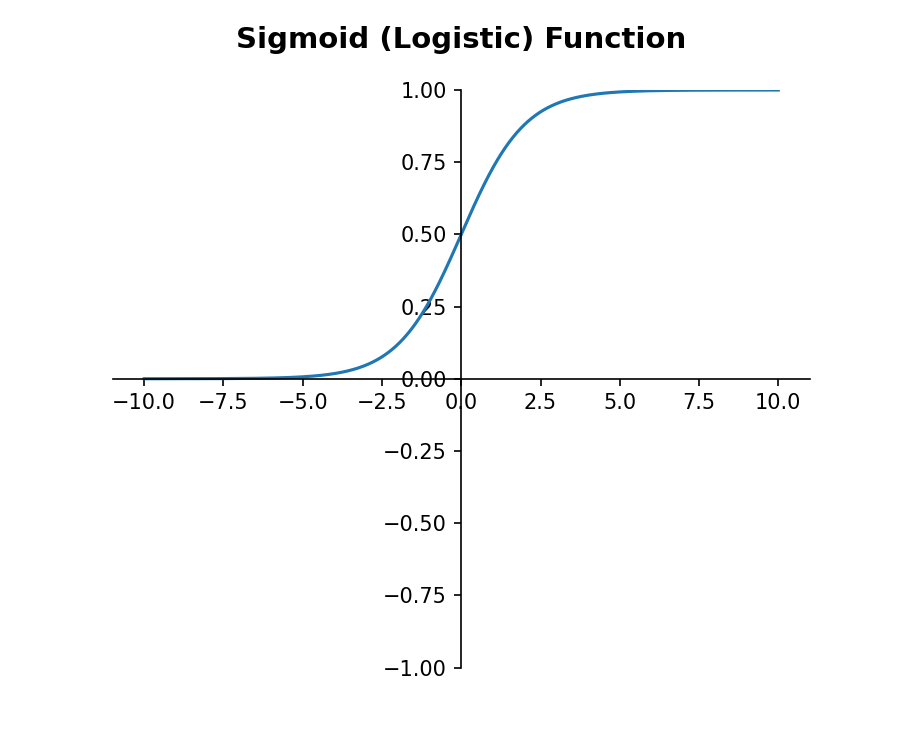

   Sigmoid (lojistik) fonksiyonunun grafiği.

Yine benzer biçimde ``tensorflow.keras.activations`` modülü içerisinde sigmoid fonksiyonu zaten hazır biçimde
bulunmaktadır. Tabii bu fonksiyon da bize TensorFlow'daki bir Tensor nesnesini vermektedir. Aşağıda sigmoid
eğrisini bu hazır fonksiyonu kullanarak çizdiriyoruz.

.. code-block:: python

   import numpy as np
   import matplotlib.pyplot as plt

   from tensorflow.keras.activations import sigmoid

   x = np.linspace(-10, 10, 1000)
   y = sigmoid(x).numpy()

   plt.title('Sigmoid (Logistic) Function', fontsize=14, fontweight='bold', pad=20)
   axis = plt.gca()
   axis.spines['left'].set_position('center')
   axis.spines['bottom'].set_position('center')
   axis.spines['top'].set_color(None)
   axis.spines['right'].set_color(None)
   axis.set_ylim(-1, 1)
   plt.plot(x, y, color='red')
   plt.show()

Programın çıktısı yukarıdaki sigmoid grafiği ile aynıdır.

Sigmoid Fonksiyonunun Birinci Türevi
====================================

Sigmoid fonksiyonunun birinci türevi Gauss eğrisine benzemektedir. Aşağıdaki örnekte Sigmoid fonksiyonunun
birinci türevi alınıp eğrisi çizdirilmiştir. Ancak bu örnekte henüz görmediğimiz SymPy kütüphanesini kullandık.
Sigmoid fonksiyonun birinci türevi şöyledir:

.. code-block:: text

   sigmoid'(x) = eˣ/(eˣ + 1) - e²ˣ/(eˣ + 1)²

.. code-block:: python

   import sympy
   from sympy import init_printing

   init_printing()

   x = sympy.Symbol('x')
   fx = sympy.E ** x / (1 + sympy.E ** x)
   dx = sympy.diff(fx, x)

   print(dx)

   import numpy as np

   np.linspace(-10, 10, 1000)
   pdx = sympy.lambdify(x, dx)

   x = np.linspace(-10, 10, 1000)
   y = pdx(x)

   import matplotlib.pyplot as plt

   plt.title('First Derivative of Sigmoid Function', fontsize=14, pad=20, fontweight='bold')
   axis = plt.gca()
   axis.spines['left'].set_position('center')
   axis.spines['bottom'].set_position('center')
   axis.spines['top'].set_color(None)
   axis.spines['right'].set_color(None)

   axis.set_ylim(-0.4, 0.4)

   plt.plot(x, y)
   plt.show()

Programın çıktısı aşağıdaki gibidir:

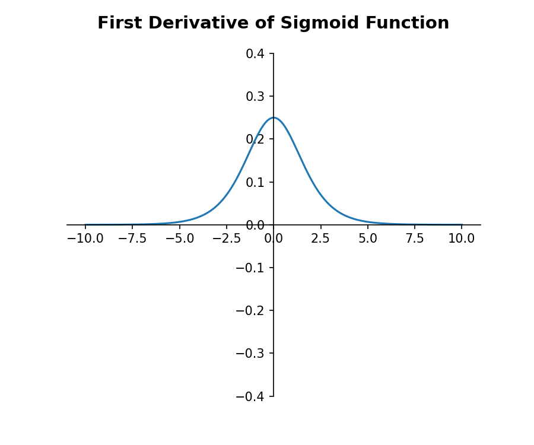

   Sigmoid fonksiyonunun birinci türevinin grafiği (Gauss eğrisine benzer).

Hiperbolik Tanjant (tanh) Fonksiyonu
====================================

Diğer çok kullanılan bir aktivasyon fonksiyonu da *hiperbolik tanjant* fonksiyonudur. Bu fonksiyona kısaca *tanh*
fonksiyonu da denilmektedir. Fonksiyonun matematiksel ifadesi şöyledir:

.. code-block:: text

   f(x) = (e²ˣ - 1) / (e²ˣ + 1)

Fonksiyonun sigmoid fonksiyonuna benzediğine ancak üstel ifadenin x yerine 2 * x olduğuna dikkat ediniz. Tanh
fonksiyonu adeta sigmoid fonksiyonunun (-1, +1) arası değer veren biçimi gibidir. Fonksiyon yine S şekli
biçimindedir. Ancak dönüş noktası x = 0'dadır.

Tanh fonksiyonu saklı katmanlarda da bazen çıktı katmanlarında da kullanılabilmektedir. Eskiden bu fonksiyon
saklı katmanlarda çok yoğun kullanılıyordu. Ancak artık saklı katmanlarda daha çok relu fonksiyonu tercih
edilmektedir. Fakat tanh fonksiyonunun daha iyi sonuç verdiği modeller de söz konusu olmaktadır.

tanh fonksiyonu Keras'ta ``tensorflow.keras.activations`` modülünde ``tanh`` ismiyle de bulunmaktadır.

Fonksiyonun grafiğini aşağıdaki gibi çizdirebiliriz.

.. code-block:: python

   import numpy as np
   import matplotlib.pyplot as plt

   x = np.linspace(-10, 10, 1000)
   y = (np.e ** (2 * x) - 1) / (np.e ** (2 * x) + 1)

   plt.title('Hiperbolik Tanjant (tanh) Fonksiyonunun Grafiği', fontsize=14, pad=20, fontweight='bold')
   axis = plt.gca()
   axis.spines['left'].set_position('center')
   axis.spines['bottom'].set_position('center')
   axis.spines['top'].set_color(None)
   axis.spines['right'].set_color(None)

   axis.set_ylim(-1, 1)

   plt.plot(x, y)
   plt.show()

Programın çıktısı aşağıdaki gibidir:

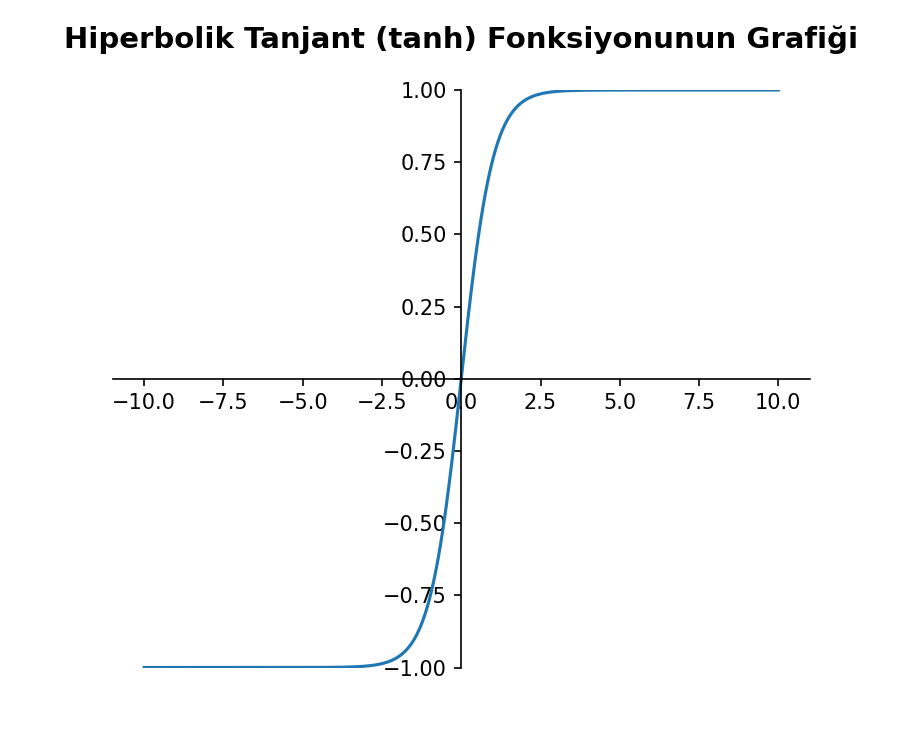

   Hiperbolik tanjant (tanh) fonksiyonunun grafiği.

Softmax Fonksiyonu
==================

Diğer çok karşılaşılan bir aktivasyon fonksiyonu da *softmax* isimli fonksiyondur. Softmax fonksiyonu çok sınıflı
sınıflandırma problemlerinde çıktı katmanlarında kullanılmaktadır. Bu aktivasyon fonksiyonu Keras'ta *softmax*
ismiyle bulunmaktadır. Örneğin bir resmin *elma*, *armut*, *kayısı*, *şeftali*, *karpuz* resimlerinden hangisi
olduğunu anlamak için kullanılan sınıflandırma modeli çok sınıflı bir sınıflandırma modelidir. Buna istatistikte
*çok sınıflı lojistik regresyon (multinomial logistic regression)* da denilmektedir. Bu tür problemlerde sinir
ağında sınıf sayısı kadar nöron bulundurulur. Örneğin yukarıdaki *elma*, *armut*, *kayısı*, *şeftali*, *karpuz*
resim sınıflandırma probleminde ağın çıktısında 5 nöron bulunacaktır.

Ağın çıktı katmanındaki tüm nöronların aktivasyon fonksiyonları *softmax* yapılırsa tüm çıktı katmanındaki
nöronların çıktı değerlerinin toplamı her zaman 1 olur. Böylece çıktı katmanındaki nöronların çıktı değerleri
ilgili sınıfın olasılığını belirtir hale gelir. Biz de toplamı 1 olan çıktıların en yüksek değerine bakarız ve
sınıflandırmanın o sınıfı kestirdiğini kabul ederiz. Örneğin yukarıdaki *elma*, *armut*, *kayısı*, *şeftali*,
*karpuz* sınıflandırma probleminde ağın çıktı katmanındaki nöronların çıktı değerlerinin şöyle olduğunu
varsayalım:

.. code-block:: text

   Elma Nöronunun Çıktısı ---> 0.2
   Armut Nöronunun Çıktısı ---> 0.2
   Kayısı Nöronunun Çıktısı ---> 0.3
   Şeftali Nöronunun Çıktısı ---> 0.2
   Karpuz Nöronunun Çıktısı ---> 0.1

Burada en büyük çıktı 0.3 olan kayısı nöronuna ilişkindir. O halde biz bu kestirimin *kayısı* olduğuna karar
veririz. Softmax fonksiyonu bir grup değer için o grup değerlere bağlı olarak şöyle hesaplanmaktadır:

.. code-block:: text

   softmax(x) = eˣ / Σ(eˣ)

Burada gruptaki değerler x vektörüyle temsil edilmektedir. Fonksiyonda değerlerin e tabanına göre kuvvetleri x
değerlerinin e tabanına göre kuvvetlerinin toplamına bölünmüştür. Bu işlemden yine gruptaki eleman sayısı kadar
değer elde edilecektir. Tabii bu değerlerin toplamı da 1 olacaktır. Örneğin elimizde aşağıdaki gibi x değerleri
olsun:

.. code-block:: python

   x = np.array([3, 6, 4, 1, 7])

Şimdi bu x değerlerinin softmax değerlerini elde edelim:

.. code-block:: text

   >>> import numpy as np
   >>> x = np.array([3, 6, 4, 1, 7])
   >>> x
   array([3, 6, 4, 1, 7])
   >>> sm = np.e ** x / np.sum(np.e ** x)
   >>> sm
   array([0.0127328 , 0.25574518, 0.03461135, 0.0017232 , 0.69518747])
   >>> np.sum(sm)
   1.0

softmax fonksiyonu Keras'ta ``tensorflow.keras.activations`` modülünde ``softmax`` ismiyle de bulunmaktadır.
Ancak bu fonksiyonu kullanırken girdinin TensorFlow'daki bir Tensor nesnesi biçiminde ve iki boyutlu olarak
verilmiş olması gerekmektedir. TensorFlow kütüphanesindeki aktivasyon fonksiyonları dışarıdan değil TensorFlow
içerisinden kullanılsın diye tasarlanmıştır. Bu nedenle softmax gibi bazı fonksiyonlarda biz NumPy dizisi
verememekteyiz. Ayrıca TensorFlow'daki bu aktivasyon fonksiyonları birden fazla değer üzerinde de bir Tensor
olarak işlem yapabilmektedir. (softmax fonksiyonunda aslında bir değer bir grup değerden oluştuğu için girdi
olarak da bizden iki boyutlu bir Tensor istenmektedir.) Örneğin:

.. code-block:: text

   >>> import numpy as np
   >>> import tensorflow as tf
   >>> from tensorflow.keras.activations import softmax
   >>> x = np.array([[1, 2, 3, 4, 5]], dtype=np.float64)
   >>> t = tf.convert_to_tensor(x)
   >>> result = softmax(t)
   >>> result
   <tf.Tensor: shape=(1, 5), dtype=float64, numpy=array([[0.01165623, 0.03168492, 0.08612854, 0.23412166, 0.63640865]])>

Keras aslında çıktı katmanlarındaki tüm softmax aktivasyon fonksiyonlarının bir grup oluşturduğunu varsayar.
Sonra girdilerle ağırlık değerlerini çarpıp bias değeriyle toplayarak yukarıdaki gibi bir x vektörü elde eder.
Sonra da yukarıdaki işlemi uygular. Başka bir deyişle çıktı katmanındaki softmax aktivasyon fonksiyonuna sahip
olan nöronlar bir grup olarak değerlendirilmektedir.

Linear (Özdeş) Fonksiyonu
=========================

Diğer çok kullanılan aktivasyon fonksiyonlarından biri de *linear* aktivasyon fonksiyonudur. Aslında bu fonksiyon
y = x ya da f(x) = x fonksiyonudur. Yani *linear* fonksiyonu girdi ile aynı değeri üretmektedir. Başka bir
deyişle bir şey yapmayan bir fonksiyondur. Peki böyle bir aktivasyon fonksiyonunun ne anlamı olabilir? Bu
aktivasyon fonksiyonu regresyon problemlerinin çıktı katmanında kullanılmaktadır. Regresyon problemleri çıktı
olarak bir sınıf bilgisi değil gerçek bir değer bulmaya çalışan problemlerdir. Örneğin bir evin fiyatının
kestirilmesi, bir otomobilin mil başına yaktığı yakıt miktarının kestirilmesi gibi problemler regresyon
problemleridir.

linear aktivasyon fonksiyonu Keras'ta *linear* ismiyle kullanılmaktadır. Her ne kadar bir şey yapmıyorsa da bu
aktivasyon fonksiyonu aynı zamanda ``tensorflow.keras.activations`` modülünde ``linear`` isimli bir fonksiyon
biçiminde de bulunmaktadır. Örneğin:

.. code-block:: text

   >>> from tensorflow.keras.activations import linear
   >>> x = [1, 2, 3, 4, 5]
   >>> x = np.array([1, 2, 3, 4, 5], dtype=np.float64)
   >>> result = linear(x)
   >>> result
   array([1., 2., 3., 4., 5.])

linear fonksiyonunun grafiğini -bariz olmasına karşın- aşağıda veriyoruz.

.. code-block:: python

   import numpy as np
   import matplotlib.pyplot as plt

   def linear(x):
         return x

   x = np.linspace(-10, 10, 1000)
   y = linear(x)

   """
   from tensorflow.keras.activations import linear

   y = linear(x).numpy()
   """

   plt.title('Linear Function', fontsize=14, fontweight='bold', pad=20)
   axis = plt.gca()
   axis.spines['left'].set_position('center')
   axis.spines['bottom'].set_position('center')
   axis.spines['top'].set_color(None)
   axis.spines['right'].set_color(None)
   axis.set_ylim(-10, 10)
   plt.plot(x, y, color='red')
   plt.show()

Programın çıktısı aşağıdaki gibidir:

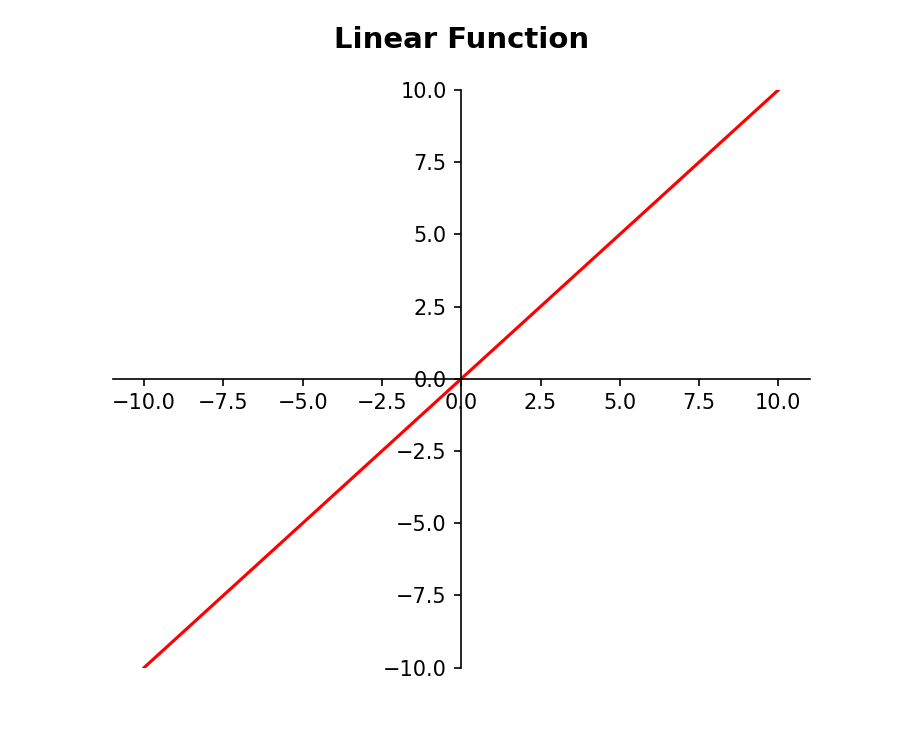

   Linear (özdeş) fonksiyonunun grafiği.

Kayıp (Loss) Fonksiyonlarına Giriş
==================================

Biz yukarıda çok karşılaşılan temel aktivasyon fonksiyonlarını ele aldık. Aslında yukarıda ele aldığımızdan daha
fazla aktivasyon fonksiyonu vardır. Şimdi de optimizasyon algoritmasının minimize etmeye çalıştığı *loss*
fonksiyonları üzerinde duracağız.

loss fonksiyonları gerçek değerlerle ağın tahmin ettiği değerleri girdi olarak alıp bu farklılığı bir sayısal
değerle ifade eden fonksiyonlardır. Optimizasyon algoritmaları bu loss fonksiyonlarının değerini düşürmeye
çalışmaktadır. Gerçek değerlerle ağın ürettiği değerlerin arasındaki farkın minimize edilmesi aslında ağın gerçek
değerlere yakın değerler üretmesi anlamına gelmektedir.

Anımsanacağı gibi *w* ve *bias* değerleri *optimizer* denilen algoritma tarafından her batch işleminde
güncellenmekteydi. Yukarıda da belirttiğimiz gibi optimizer algoritması aslında *loss* denilen bir fonksiyonu
minimize etmeye çalışmaktadır. Başka bir deyişle *loss* fonksiyonu aslında *w* ve *bias* değerlerinin
güncellenmesi için bir amaç fonksiyonu görevini görmektedir. Değişik problemler için değişik loss fonksiyonları
bulunmaktadır. Programcı model sınıfının ``compile`` metodunda ``loss`` parametresiyle loss fonksiyonu isimsel
biçimde girebilir. Ya da isterse ``tensorflow.keras.losses`` modülündeki sınıflar ve fonksiyonlar yoluyla
girebilir. (Loss fonksiyonları için TensorFlow hem callable sınıflar hem de fonksiyonlar bulundurmuştur.)

Eğitim batch batch yapıldığı için loss fonksiyonları tek bir satırın çıktısından değil n tane satırın çıktısından
hesaplanmaktadır. Yani bir batch işleminin gerçek sonucu ile ağdan o batch için elde edilecek kestirim
sonuçlarına dayanılarak loss değerleri hesaplanmaktadır. Örneğin ``batch_size`` = 32 olduğu durumda aslında Keras
ağa 32'lik bir giriş uygulayıp 32'lik bir çıktı elde eder. Bu 32 çıktı değeri gerçek 32 değerle loss fonksiyonuna
sokulur.

Mean Squared Error (MSE)
========================

Regresyon problemleri için en yaygın kullanılan loss fonksiyonu *Mean Squared Error (MSE)* denilen fonksiyondur.
Bu fonksiyona Türkçe *Ortalama Karesel Hata* diyebiliriz. MSE fonksiyonu çıktı olarak gerçek değerlerden
kestirilen değerlerin farkının karelerinin ortalamasını vermektedir. Fonksiyonun sembolik gösterimi şöyledir:

.. code-block:: text

   MSE = mean((y - ŷ)²)

Burada y gerçek değerleri, y_hat ise kestirilen değerleri belirtmektedir. Örneğin:

.. code-block:: text

   >>> y = np.array([1, 2, 3, 4, 5])
   >>> y_hat = np.array([1.1, 1.9, 3.2, 3.8, 5.02])
   >>> np.mean((y - y_hat) ** 2)
   0.020080000000000032

Aynı işlemi ``tensorflow.keras.losses`` modülündeki ``mse`` (ya da ``mean_squared_error``) fonksiyonuyla da
aşağıdaki gibi yapabilirdik:

.. code-block:: text

   >>> from tensorflow.keras.losses import mse
   >>> mse(y, y_hat)
   <tf.Tensor: shape=(), dtype=float64, numpy=0.020080000000000032>

Mean Absolute Error (MAE)
=========================

Regresyon problemleri için kullanılabilen diğer bir loss fonksiyonu da *Mean Absolute Error (MAE)* isimli
fonksiyondur. Bu fonksiyona da Türkçe *Ortalama Mutlak Hata* diyebiliriz. Ortalama mutlak hata gerçek
değerlerden kestirilen değerlerin farklarının mutlak değerlerinin ortalaması biçiminde hesaplanmaktadır.
Sembolik gösterimi şöyledir:

.. code-block:: text

   mae = np.mean(np.abs(y - y_hat))

Burada y gerçek değerleri y_hat ise ağın kestirdiği değerleri belirtmektedir. Regresyon problemleri için loss
fonksiyonu olarak çoğu kez MSE tercih edilmektedir. Çünkü kare alma işlemi algoritmalar için daha uygun bir
işlemdir. Aynı zamanda değerleri daha fazla farklılaştırmaktadır. MAE loss fonksiyonundan ziyade metrik değer
olarak *insan algısına* daha yakın bir çağrışım sağlar:

.. code-block:: text

   >>> y = np.array([1, 2, 3, 4, 5], dtype=np.float64)
   >>> y_hat = np.array([1.1, 1.9, 3.2, 3.8, 5.02])
   >>> mae = np.mean(np.abs(y - y_hat))
   >>> mae
   0.12400000000000003

Ortalama karesel hata bir metrik değer olarak bizim için iyi bir çağrışım yapmamaktadır. Halbuki ortalama mutlak
hata bizim için anlamlı bir çağrışım yapmaktadır. Örneğin ağımızın ortalama mutlak hatası 0.124 ise gerçek değer
ağımızın bulduğu değerden 0.124 solda ya da sağda olabilir. Yine ortalama mutlak hata ``tensorflow.keras.losses``
modülü içerisindeki *mae* ya da *mean_absolute_error* isimli fonksiyonla da hesaplanabilmektedir. Örneğin:

.. code-block:: text

   >>> from tensorflow.keras.losses import mae
   >>> y = np.array([1, 2, 3, 4, 5], dtype=np.float64)
   >>> y_hat = np.array([1.1, 1.9, 3.2, 3.8, 5.02])
   >>> result = mae(y, y_hat)
   >>> result
   <tf.Tensor: shape=(), dtype=float64, numpy=0.12400000000000003>

Mean Absolute Percentage Error (MAPE)
=====================================

Regresyon problemleri için diğer bir loss fonksiyonu da *Mean Absolute Percentage Error (MAPE)* isimli
fonksiyondur. Fonksiyonun sembolik ifadesi şöyledir:

.. code-block:: text

   MAPE = 100 * mean(|y - ŷ| / y)

Burada y gerçek değerleri y_hat ise ağın kestirdiği değerleri belirtmektedir. Örneğin:

.. code-block:: text

   >>> y = np.array([1, 2, 3, 4, 5], dtype=np.float64)
   >>> y_hat = np.array([1.1, 1.9, 3.2, 3.8, 5.02])
   >>> mape = 100 * np.mean(np.abs(y - y_hat) / y)
   >>> mape
   5.413333333333335

Tabii aynı işlemi yine ``tensorflow.keras.losses`` modülündeki *mape* fonksiyonuyla da yapabiliriz:

.. code-block:: text

   >>> from tensorflow.keras.losses import mape
   >>> y = np.array([1, 2, 3, 4, 5], dtype=np.float64)
   >>> y_hat = np.array([1.1, 1.9, 3.2, 3.8, 5.02])
   >>> result = mape(y, y_hat)
   >>> result
   <tf.Tensor: shape=(), dtype=float64, numpy=5.413333333333335>

Mean Squared Logarithmic Error (MSLE)
=====================================

Regresyon problemleri için diğer bir loss fonksiyonu da *Mean Squared Logarithmic Error (MSLE)* isimli
fonksiyondur. Bu fonksiyon gerçek değerlerle kestirilen değerlerin logaritmalarının farklarının karelerinin
ortalaması biçiminde hesaplanır. Sembolik ifadesi şöyledir:

.. code-block:: text

   MSLE = mean((log(y) - log(ŷ))²)

Bazen bu fonksiyon gerçek ve kestirilen değerlere 1 toplanarak da oluşturulabilmektedir (TensorFlow *msle*
fonksiyonunu bu biçimde kullanmaktadır):

.. code-block:: text

   MSLE = mean((log(y + 1) - log(ŷ + 1))²)

Örneğin:

.. code-block:: text

   >>> y = np.array([1, 2, 3, 4, 5], dtype=np.float64)
   >>> y_hat = np.array([1.1, 1.9, 3.2, 3.8, 5.02])
   >>> msle = np.mean((np.log(y + 1) - np.log(y_hat + 1)) ** 2)
   >>> msle
   0.0015175569737783628

Aynı işlemi ``tensorflow.keras.losses`` modülündeki *msle* fonksiyonuyla da yapabiliriz:

.. code-block:: text

   >>> from tensorflow.keras.losses import msle
   >>> y = np.array([1, 2, 3, 4, 5], dtype=np.float64)
   >>> y_hat = np.array([1.1, 1.9, 3.2, 3.8, 5.02])
   >>> result = msle(y, y_hat)
   >>> result
   <tf.Tensor: shape=(), dtype=float64, numpy=0.0015175569737783555>

Binary Cross-Entropy (BCE)
==========================

İkili sınıflandırma problemleri için en yaygın kullanılan loss fonksiyonu *Binary Cross-Entropy (BCE)* denilen
fonksiyondur. Bu fonksiyonun sembolik gösterimi şöyledir:

.. code-block:: text

   BCE = -mean(y * log(ŷ) + (1 - y) * log(1 - ŷ))

Burada bir toplam teriminin olduğunu görüyorsunuz. Gerçek değerler 0 ya da 1 olduğuna göre bu toplam teriminin ya
sol tarafı ya da sağ tarafı 0 olacaktır. Burada yapılmak istenen şey aslında isabet olasılığının logaritmalarının
ortalamasının alınmasıdır. Örneğin gerçek y değeri 0 olsun ve ağ da sigmoid çıktısından 0.1 elde etmiş olsun. Bu
durumda toplam ifadesinin sol tarafı 0, sağ tarafı ise log(0.9) olacaktır. Şimdi gerçek değerin 1 ancak ağın
sigmoid çıktısından elde edilen değerin 0.9 olduğunu düşünelim. Bu kez toplamın sağ tarafı 0, sol tarafı ise
log(0.9) olacaktır. İşte fonksiyonda bu biçimde isabet olasılıklarının logaritmalarının ortalaması bulunmaktadır.
Örneğin:

.. code-block:: text

   >>> y = np.array([1, 0, 1, 1, 0])
   >>> y_hat = np.array([0.9, 0.05, 0.095, 0.89, 0.111])
   >>> -np.mean(y * np.log(y_hat) + (1 - y) * np.log(1 - y_hat))
   0.5489448114302314

Aynı işlemi ``tensorflow.keras.losses`` modülündeki ``binary_crossentropy`` isimli fonksiyonla da yapabiliriz:

.. code-block:: text

   >>> y_hat = np.array([0.9, 0.05, 0.095, 0.89, 0.111])
   >>> result = binary_crossentropy(y, y_hat)
   >>> result
   <tf.Tensor: shape=(), dtype=float64, numpy=0.5489445126600796>

Categorical Cross-Entropy (CCE)
===============================

Çok sınıflı sınıflandırma problemleri için en yaygın kullanılan loss fonksiyonu ise *Categorical Cross-Entropy
(CCE)* isimli fonksiyondur. CCE fonksiyonu aslında BCE fonksiyonun çoklu biçimidir. Tabii CCE değerini
hesaplayabilmek için ağın kategori sayısı kadar çıktıya sahip olması ve bu çıktıların toplamının da 1 olması
gerekmektedir. Başka bir deyişle ağın çıktı katmanındaki nöronların aktivasyon fonksiyonları *softmax* olmalıdır.
Ayrıca CCE çok sınıflı bir entropy hesabı yaptığına göre gerçek değerlerin one-hot-encoding biçiminde kodlanmış
olması gerekir. (Yani örneğin ileride göreceğimiz gibi K sınıflı bir sınıflandırma problemi için biz ağa çıktı
olarak *one-hot-encoding* kodlanmış K tane y değerini vermeliyiz.) K tane sınıf belirten bir satırın CCE değeri
şöyle hesaplanır (tabii burada K tane *one-hot-encoding* edilmiş gerçek değer ile M tane softmax çıktı değeri söz
konusu olmalıdır):

.. code-block:: text

   CCE = -∑ yₖ * log(ŷₖ)

Burada yk one-hot-encoding yapılmış gerçek değerleri yk_hat ise softmax biçiminde elde edilmiş ağın çıktı
katmanındaki değerleri temsil etmektedir.

